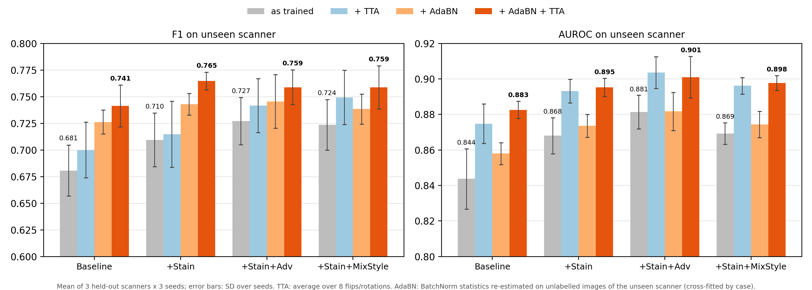

# Aaron's model: stain augmentation + test-time adaptation

Candidate classification (mitotic figure vs imposter) on the MIDOG++ breast subset,
leave-one-scanner-out (held-out scanner = Aperio CS2, Hamamatsu S360 or Hamamatsu XR),
ResNet-18 on 128 px patches (32 µm field), 3 seeds per setting.

## Results (unseen scanner, mean of 3 folds × 3 seeds)

| Setting | F1 | Precision | Recall | AUROC |
|---|---|---|---|---|
| Baseline | 0.681 | 0.649 | 0.764 | 0.844 |
| + Stain (HED jitter, σ = 0.05) | 0.710 | 0.668 | 0.799 | 0.868 |
| + Stain + Adv (DANN / gradient reversal) | 0.727 | 0.689 | 0.807 | 0.881 |
| + Stain, AdaBN + TTA | 0.765 | 0.751 | 0.787 | 0.895 |
| **+ Stain, AdaBN + TTA, 3-seed ensemble** | **0.781** | **0.766** | **0.798** | **0.902** |

- AdaBN + TTA vs. as trained (+Stain): F1 +0.055 [0.036, 0.073], AUROC +0.027 [0.020, 0.035]
  (two-level bootstrap: slides within fold, seeds). Significant for all four trained variants.
- TTA alone (8 flips/rotations, no target data): AUROC +0.02–0.03 for every variant.
- Seed ensemble on top: F1 +0.015 [0.009, 0.023].
- Not helpful: MixStyle (F1 +0.014, CI crosses 0); frozen Phikon features + logistic probe (AUROC 0.68–0.77).

**Caveat.** AdaBN re-estimates BatchNorm statistics on *unlabelled* images of the target
scanner, so it is test-time adaptation, not pure domain generalisation. It is cross-fitted
(adapt on half the target cases, predict the other half) and gives the same numbers as
adapting on all of them. TTA uses no target data.



## Layout

```
scripts/   code (paths are relative to this folder)
results/   summary tables (CSV)
figures/   result plots
```

Not in the repo (too large / dataset licence): `data/` (patches, MIDOG++ images),
`checkpoints/`, per-run predictions, logs. Recreate them with the steps below.

## How to run

```bash
python -m venv .venv && .venv/bin/pip install -r requirements.txt

# 1. crop the 4,435 candidates from the MIDOG++ breast TIFFs -> data/patches_128.npz, data/patches_meta.csv
.venv/bin/python scripts/prepare_patches.py --data-dir /path/to/midogpp_breast

# 2. train: one held-out scanner, one variant, one seed
.venv/bin/python scripts/train_patch.py --fold CS2 --variant stain --seed 0
#    variants: baseline, stain, adv, stain_adv, mix, stain_mix
#    all four main variants for a fold: scripts/run_fold.sh CS2 0

# 3. test-time augmentation + AdaBN on the trained checkpoints
.venv/bin/python scripts/eval_tta_adabn.py
.venv/bin/python scripts/eval_adabn_crossfit.py

# 4. statistics and figures
.venv/bin/python scripts/summarize_seeds.py --seeds 0 1 2
.venv/bin/python scripts/summarize_tta.py
.venv/bin/python scripts/summarize_ensemble.py --modes plain tta adabncf adabncf_tta
.venv/bin/python scripts/plot_tta.py
```

| Script | What it does |
|---|---|
| `prepare_patches.py` | crops each annotation at a fixed physical size (32 µm) on every scanner |
| `train_patch.py` | ResNet-18 training; `--variant` toggles stain augmentation, scanner-adversarial head, MixStyle; threshold picked on source validation by F1 |
| `eval_tta_adabn.py` | predictions as trained / + TTA / + AdaBN / + AdaBN + TTA |
| `eval_adabn_crossfit.py` | cross-fitted AdaBN (adapt on half the target cases, predict the other half) |
| `summarize_*.py` | two-level bootstrap CIs and paired comparisons |
| `phikon_probe.py`, `prepare_patches_224.py` | frozen Phikon foundation-model baseline (negative result) |
