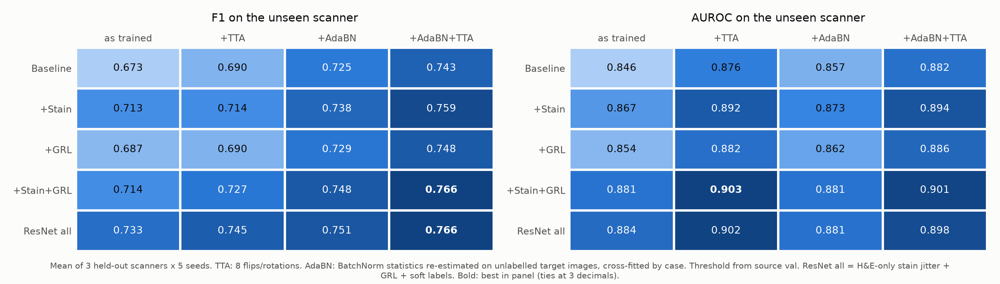
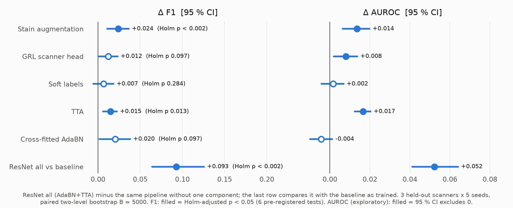

# ResNet-18 Add-ons: Results

*CSE 4109 · AI for Health · Aaron's part (8 November 2026)*

> **In one sentence:** On the unseen scanner, ResNet all raises F1 from 0.673 for the baseline to **0.766** (+0.093, statistically significant). About half of the gain comes from the test-time steps (TTA + AdaBN). Once test-time adaptation is applied, the training-time add-ons add much less than they seem to under plain inference.

# 1. The question

- **Task:** classify each candidate cell in the MIDOG++ breast subset as a mitotic figure or an imposter.
- **Evaluation:** leave-one-scanner-out.
  - Train on two scanners and test on all 50 cases of the third, unseen scanner.
  - Each of CS2, S360 and XR takes a turn as the test scanner.
- **Repeats:** 5 seeds per configuration. Results are the mean over 3 folds × 5 seeds.
- **Threshold:** chosen on validation data from the training scanners only. The test scanner's labels are never used.
- **Statistics:** two-level paired bootstrap, B = 5000.
  - Cases are resampled within each fold.
  - Both arms of a comparison use the same seeds.

# 2. Main table: five models × three inference modes

| Model | F1 as trained | F1 + TTA | F1 + AdaBN + TTA | AUROC as trained | AUROC + AdaBN + TTA |
|---|---|---|---|---|---|
| Baseline | 0.673 | 0.690 | 0.743 | 0.846 | 0.882 |
| + Stain | 0.713 | 0.714 | 0.759 | 0.867 | 0.894 |
| + GRL | 0.687 | 0.690 | 0.748 | 0.854 | 0.886 |
| + Stain + GRL | 0.714 | 0.727 | **0.766** | 0.881 | **0.901** |
| **ResNet all** | **0.733** | **0.745** | **0.766** | **0.884** | 0.898 |

**Across a row: test-time steps**

- **TTA (test-time augmentation):** each image is flipped and rotated into 8 versions, and the predictions are averaged. It needs no extra data and is almost a free gain.
- **AdaBN:** BatchNorm means and variances are re-estimated on **unlabelled** images from the test scanner.
  - In effect, the model takes a look at the new scanner's colour distribution before it predicts.
  - We cross-fit it: statistics estimated on half of the cases are used to predict the other half. That way no image is used both to adapt and to evaluate.
  - This step gives the largest gain of the three inference modes.

**Down a column: training-time add-ons**

- **Stain:** random stain jitter on the H and E channels only (HED jitter, σ = 0.05) during training. It keeps the model from relying on one scanner's colours.
- **GRL:** a scanner-classification head behind a gradient reversal layer. It pushes the features to carry no information about which scanner an image came from.
- **Soft labels:** the target is the fraction of raters who voted "mitotic", not a hard 0/1.
  - Candidates with only 2 raters were all unanimous.
  - So soft labels change the target only for the 925 candidates with 3 raters (about 21 %).

**ResNet all** combines all three training add-ons with TTA and cross-fitted AdaBN. It is the "+all" cell of the team grid.

- With AdaBN + TTA it reaches F1 0.766 (95 % CI [0.740, 0.786]).
- Precision is 0.729, recall 0.820 and AUROC 0.898.

# 3. Key finding: test-time adaptation absorbs most of the training add-on gain

| Inference mode | Baseline | ResNet all | Gap from training add-ons |
|---|---|---|---|
| As trained | 0.673 | 0.733 | **+0.060** |
| AdaBN + TTA | 0.743 | 0.766 | **+0.023** |

- **Most of the gap closes at test time.** With no add-ons, the baseline goes from 0.673 to 0.743 through AdaBN + TTA alone.
- **A plausible explanation is overlap.** Stain augmentation and GRL target colour and scanner differences, and AdaBN partly corrects those at test time.
  - We did **not** test this mechanism directly, so it is a hypothesis.
- **Corollary 1:** with AdaBN + TTA, ResNet all and the simpler + Stain + GRL are tied. The difference is −0.000, 95 % CI [−0.015, 0.014].
- **Corollary 2:** as trained, all beats + Stain + GRL by +0.020 [0.001, 0.038], mostly on the S360 fold.
  - So soft labels make a clear difference only without test-time adaptation.

# 4. What each component contributes (6 pre-registered tests)

Each test removes one component from ResNet all and measures the drop in F1. The 6 tests are Holm-adjusted together. They were written into `ADDONS_PROTOCOL.md` before phase-2 training, so they are confirmatory.

| Component (removed at AdaBN + TTA) | ΔF1 [95 % CI] | Holm p | Verdict |
|---|---|---|---|
| Stain augmentation | +0.024 [0.011, 0.038] | < 0.003 | significant |
| TTA | +0.015 [0.006, 0.024] | 0.013 | significant |
| AdaBN (TTA kept) | +0.020 [0.001, 0.040] | 0.097 | unadjusted CI excludes 0; not significant after Holm |
| GRL | +0.012 [0.001, 0.025] | 0.097 | unadjusted CI excludes 0; not significant after Holm |
| Soft labels | +0.007 [−0.006, 0.020] | 0.284 | not significant |
| **all (AdaBN + TTA) vs baseline as trained** | **+0.093 [0.064, 0.127]** | **< 0.003** | **significant** |

"Not significant" does not mean "no effect". It means no effect larger than the upper CI bound. For example, soft labels contribute at most about 0.02.

# 5. What we tried that was not better (exploratory)

- **TENT / TENT+IM** (test-time entropy minimisation that keeps updating the BN parameters): with TTA, within noise of AdaBN. More complex, not better.
- **AdaBN estimated on random tissue crops** instead of candidate patches: F1 drops by 0.178.
  - The model calls almost every candidate positive: recall 0.998, precision only 0.42.
  - The threshold calibration breaks. AdaBN statistics must come from images of the same kind as the test samples.
- **UDA-DANN** (adversarial alignment to the unlabelled target scanner during training): no better than AdaBN, and a more complicated pipeline.
- **EMA weights and Macenko stain normalisation** (phase 1): they help as trained but give no gain after AdaBN + TTA. Macenko even loses 0.015. This matches the pattern in section 3.
- **5-seed ensembles:** add about 0.02 F1.
  - The ResNet all ensemble reaches F1 0.785 and AUROC 0.908 at AdaBN + TTA, and F1 0.754 as trained.
  - Ensembles were not in the pre-registered protocol, so they are described but not tested.

# 6. Comparing with Axel's and Jun's results

- **AdaBN needs BatchNorm.** Optimus and most foundation models are ViTs with LayerNorm, so AdaBN largely does not apply to them.
- **Compare in the same inference mode.** Their models should be compared with the ResNet "as trained" column (ResNet all 0.733) or the "+ TTA" column (0.745), not with 0.766.
- **Report AdaBN separately.** It uses unlabelled test-scanner images, so it is test-time adaptation, not pure domain generalisation.

# 7. Talking points for the presentation

1. **Headline:** ResNet all reaches F1 0.766 on the unseen scanner, 0.093 above the baseline, and the gain is statistically significant.
2. **What works best:** stain augmentation, and AdaBN + TTA at test time.
3. **Interesting finding:** training add-ons look strong as trained, but most of their gain disappears once test-time adaptation is added. In the end, all and + Stain + GRL cannot be told apart.
4. **Rigour:**
   - The protocol was written before training.
   - The 6 tests are Holm-adjusted.
   - Every configuration has 5 seeds.
   - Thresholds use source data only.

# 8. Limitations

- **Small sample:** only 3 scanners with 50 cases each, so the confidence intervals are fairly wide.
- **Single source:** all slides come from one hospital, and scanner is the only variable that changes. Whether the results transfer to other hospitals is unknown.
- **Different task:** this is candidate classification, not a full detection pipeline. Its F1 is not directly comparable with the official MIDOG detection F1 (0.718).
- **Exploratory results:** every comparison outside the 6 pre-registered tests is exploratory and reported with unadjusted CIs.

Code, results tables and figures are in this folder; see [`README.md`](README.md) for how to reproduce them.
