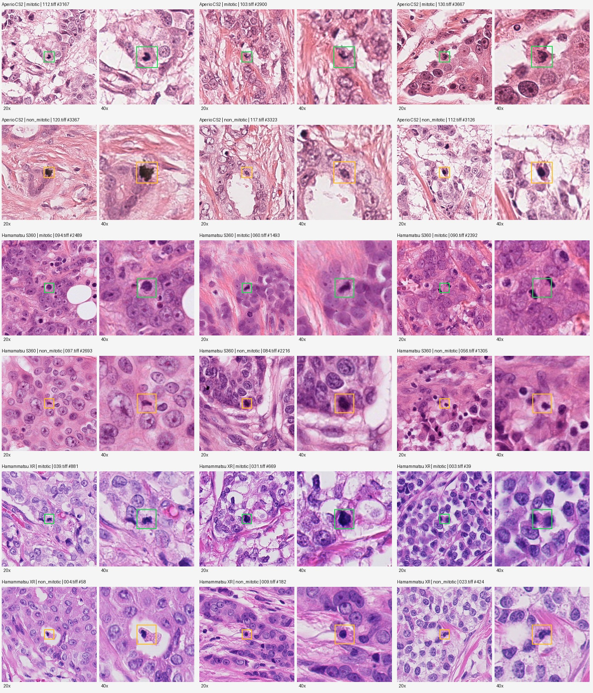
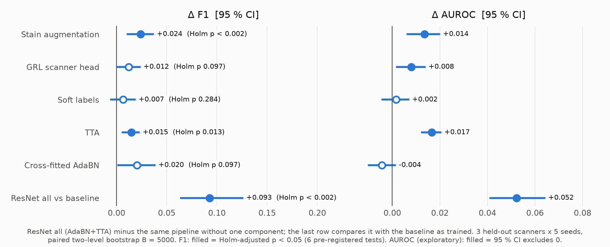
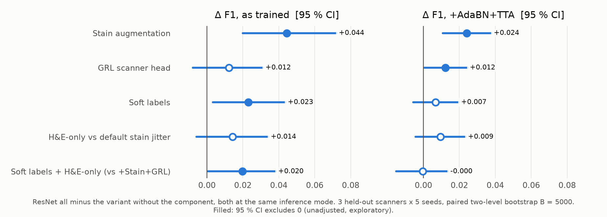
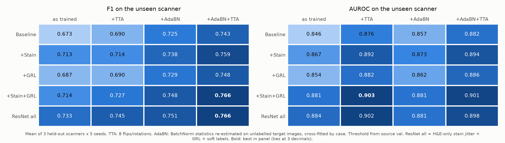
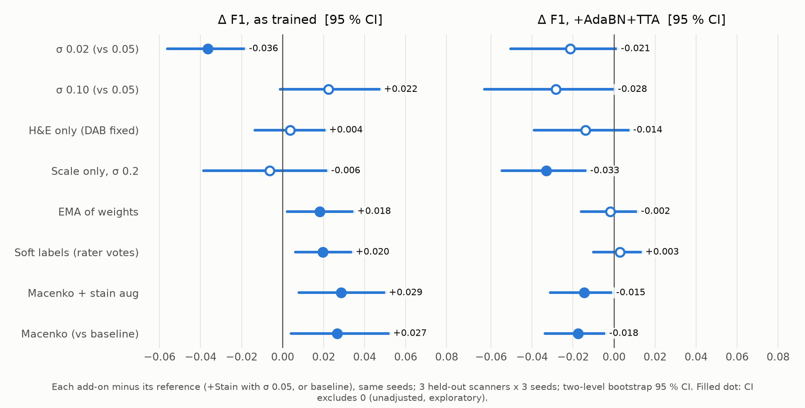
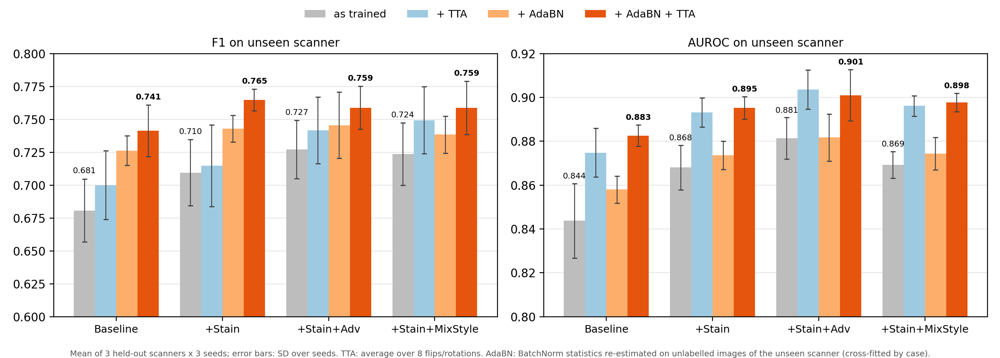
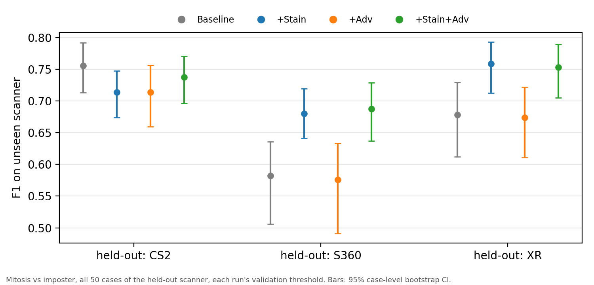
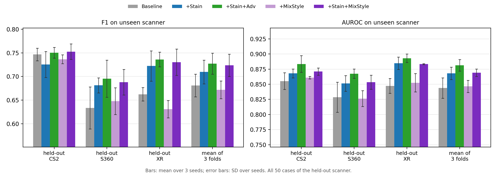

# Scanner and Stain Robustness for Mitotic-Figure Analysis on MIDOG++: Technical Report

| Item | Value |
|---|---|
| Repository | `General_Mitosis_Detection` |
| Commit | `9ab52a7` (branch `main`) |
| Report date | 2026-11-10 |
| Writing standard | ASD-STE100 Simplified Technical English, applied to at least 80% of prose sentences |
| Sources | The repository files, and published papers, challenge reports and model cards (section 12) |

## Contents

1. [Summary](#1-summary)
2. [About this report](#2-about-this-report)
3. [Objective and research question](#3-objective-and-research-question)
4. [Data](#4-data)
5. [Models, inputs and outputs](#5-models-inputs-and-outputs)
6. [Training and adaptation methods](#6-training-and-adaptation-methods)
7. [Evaluation method](#7-evaluation-method)
8. [Results](#8-results)
9. [Related work and external comparison points](#9-related-work-and-external-comparison-points)
10. [How to run each pipeline](#10-how-to-run-each-pipeline)
11. [Limitations and open work](#11-limitations-and-open-work)
12. [References](#12-references)

## 1. Summary

### 1.1 Objective

Stain, laboratory and scanner differences change the appearance of pathology images. A model can learn these differences in appearance and then fail on a new scanner. The repository examines this problem with mitotic-figure analysis on the breast-cancer subset of MIDOG++ (section 3).

The root `README.md` asks two questions (section 3). First, which methods make the models more robust to stain and scanner shift? Second, do the gains on patches also occur in detection?

The repository has two tasks:

- **Candidate classification.** The candidate location is known. The model gives the class of the candidate: MF or non-MF. Most results in the repository are for this task.
- **Detection.** The model must find the MF locations in a tile. Only demo1 and the upstream MIDOG++ code do this task.

The ResNet-18 study, demo1 and demo2 use leave-one-scanner-out (LOSO) evaluation. In each fold, the training uses 2 scanners, and the test uses all 50 images of the third scanner. The upstream MIDOG++ code does not use LOSO. It uses 5-fold cross-validation over all 7 tumour types.

### 1.2 Data and scale

| Item | Value | Section |
|---|---|---|
| Full MIDOG++ dataset | 503 labelled images, 7 tumour types, 11,937 MF | 4.1 |
| Breast subset (used here) | 150 images: 50 each from Aperio CS2, Hamamatsu S360 and Hamamatsu XR | 4.2 |
| Candidates in the breast subset | 4,435: 1,721 MF and 2,714 non-MF | 4.2 |
| Test candidates per LOSO fold | CS2 fold 1,612 (688 MF); S360 fold 1,648 (582 MF); XR fold 1,175 (451 MF) | 4.6 |
| Pixel size | CS2 0.2533 µm/px; S360 0.2298 µm/px; XR approximately 0.2268 µm/px | 4.2 |
| Image download | approximately 65 GB, not in the repository | 10.1 |

Each image is a region of a slide, not a whole-slide image. The repository has no patient IDs. Section 4.3 gives example records. Figure 1 shows example patches.

### 1.3 Models, inputs and outputs

| Sub-project | Model | Input | Output |
|---|---|---|---|
| ResNet-18 study (`aaron_model/`) | ImageNet ResNet-18 with add-ons: stain augmentation, GRL, soft labels. Test-time methods: TTA and cross-fitted AdaBN. | 128 x 128 px patch at 0.25 µm/px | MF probability |
| demo1 (`jun_model/demo1/`) | Pixel and feature logistic regression; Faster R-CNN with a ResNet-50 FPN backbone (random initialization) | 128 x 128 px patch (the pixel model resizes it to 32 x 32); 512 x 512 px tile | MF probability; MF boxes with scores |
| demo2 (`jun_model/demo2/`) | Phikon-v2, Hibou-B and Virchow2 with frozen linear probes; LoRA (r = 8) on each encoder; LoRA + stain + GRL | 224 px crop at approximately 0.25 µm/px (40x) | MF probability |
| Upstream MIDOG++ code (`midogpp/`) | RetinaNet with a ResNet-18 body | 512 x 512 px tile | MF points with scores. No results recorded |

Section 5 gives the full architectures. Section 6 gives the training settings.

### 1.4 Main results against the baselines

All F1 values in this table are fold-macro means of candidate-classification F1 on the same held-out test candidates. The last row gives detection F1. Detection is a different task.

| Result | F1 | Comparison | Status |
|---|---|---|---|
| All-positive floor | 0.558 | Lower limit for any useful classifier | Reference (derived) |
| ResNet-18 `baseline@plain` | 0.6729 [0.6324, 0.7052] | Internal baseline | Confirmatory (locked) arm |
| ResNet-18 `all@plain` (training add-ons only) | 0.7334 | +0.0606 over the baseline | Exploratory |
| ResNet-18 `all@adabncf_tta` (headline) | 0.7656 [0.7400, 0.7860] | +0.0928 [0.0641, 0.1270] over `baseline@plain`, Holm p = 0.0024 | Confirmatory (locked) |
| Frozen probes: Hibou-B / Phikon-v2 / Virchow2 | 0.479 / 0.595 / 0.707 | Hibou-B is below the floor | Confirmatory (locked) |
| Virchow2 LoRA | 0.8062 (seed SD 0.0072) | Primary demo2 model. Its F1 is 0.0010 below LoRA + stain + GRL | Post-hoc |
| Virchow2 LoRA + stain + GRL | 0.8073 (seed SD 0.0032) | +0.0010 over LoRA, better in only 3 of 9 seed-fold pairs | Post-hoc |
| demo1 Faster R-CNN detection | 0.728; 0.698 with strong colour jitter | Different task. Not comparable with the rows above | Legacy (biased) |

The Confirmatory (locked) labels have caveats. For the ResNet-18 study, held-out baseline results were in the repository before the protocol date. For the demo2 frozen probes, git cannot show that the lock came before the test (section 7.7).

The main findings are:

1. **Some ResNet-18 add-ons are significant after Holm correction, but other add-ons are not.** The pre-registered family had 6 tests. Three tests are significant after Holm correction: stain augmentation (+0.0242), TTA (+0.0149) and the headline contrast (+0.0928). GRL, soft labels and cross-fitted AdaBN are not significant after the correction (section 8.1).
2. **The test-time step gives most of the headline gain.** AdaBN with TTA on the baseline gives +0.0698, approximately 75% of the headline gain (Exploratory). AdaBN uses unlabelled data from the held-out scanner. Therefore it is test-time adaptation, not pure domain generalization.
3. **"all" does not have the highest score.** `stain_adv@adabncf_tta` has an F1 of 0.7661. This value is in the CI of `all`. The protocol fixed `all` before the test. The source-validation rule selected its stain configuration and the soft labels. The team definition added GRL, TTA and cross-fitted AdaBN.
4. **The foundation models are different in quality.** Frozen Virchow2 is above the ResNet-18 baseline. Frozen Hibou-B is below the all-positive floor (section 8.3).
5. **The LoRA models have the highest F1, but the results are post-hoc.** Virchow2 LoRA (0.8062) and LoRA + stain + GRL (0.8073) are above all other models. The team saw the frozen-probe test results before the LoRA work. Therefore, 0.8062 against 0.707 is not a confirmatory gain.
6. **The features keep the scanner identity.** A linear probe identified the 2 source scanners from Virchow2 embeddings with a balanced accuracy of approximately 1.0. This is true for the frozen, the LoRA and the LoRA + stain + GRL encoders (Validation only). The weak GRL (λ = 0.01) did not remove this information.
7. **The detection numbers are not valid evidence yet.** The legacy protocol selected the checkpoint and the threshold on the held-out scanner and used annotation-centred test tiles. The team did not do the corrected, locked rerun yet (sections 6.4 and 8.2).

Section 8.4 gives the full table with all baselines and the valid pairs. Comparisons across sub-projects are only descriptive, because the splits, inputs, seeds and uncertainty methods are different.

### 1.5 External comparison points

No repository value is directly comparable with a published value (section 9.6). The main reference points are:

- **Detection.** The MIDOG 2021 winner had a detection F1 of 0.748 on a hidden test set of 4 scanners. Two of these scanners had no training images [Aubreville2023b]. The domain-adversarial RetinaNet reference got an F1 of 0.718 [Wilm2021]. The MIDOG++ paper gives a breast detection F1 of 0.71 ± 0.01 for RetinaNet with 5-fold cross-validation [Aubreville2023]. The repository has no valid detection result for comparison. Its detection results are Legacy (biased) only.
- **Methods.** In [Wilm2021], normalization and augmentation added 0.0703 F1, and the GRL added 0.0201 F1. In [Lafarge2017], colour augmentation was the best single method. The repository result agrees with these findings: stain augmentation is significant, and the GRL is not significant after Holm correction.
- **Foundation models.** In [Ammeling2026], LoRA on Virchow2 was better than a linear probe for MF against hard negative (balanced accuracy 0.76 → 0.80). [Banerjee2026] found a similar result for atypical against normal MF. [deJong2025] and [Komen2025] found that most FM features encode the medical centre. In [Thiringer2026], Virchow2 is one of the most scanner-sensitive FMs.

### 1.6 What is necessary to run the pipelines

- You must have the MIDOG++ images (approximately 65 GB). You get them from Figshare through `midogpp/Setup.ipynb`.
- You must have three Python environments (section 10.1):
  - `.venv` (Python 3.8, torch 1.7.0 + CUDA 10.1) is for the upstream code and the demo1 patch baselines.
  - `aaron_model/.venv` (torch 2.14.1) is for the ResNet-18 study.
  - `.venv-det` (Python 3.10, PyTorch 2.5.1 + CUDA 12.1) is for demo1 detection, demo2 and the workflow package.
- You must have an NVIDIA GPU for demo1 detection and demo2. The demo2 documents give an RTX 3090 GPU with 24 GB of memory. The ResNet-18 study ran on Apple MPS.
- You must have Hugging Face access for the gated Hibou-B and Virchow2 models. You must also have Weights & Biases for the upstream code.

Section 10 gives the procedures and the tests. It also tells you about the known gaps in the commands from the project documents.

### 1.7 Main limitations

- The breast subset has only 3 scanners and 150 images. Each method has only 3 held-out estimates.
- The LoRA results are Post-hoc, and the detection results are Legacy (biased).
- Candidate classification uses known candidate locations. A clinical pipeline must also detect these locations.
- The repository has no external validation on new laboratories or scanners.

Section 11 gives the full list.

## 2. About this report

### 2.1 Purpose and scope

This report describes the full repository at commit `9ab52a7`. It gives the objective, the data, the models, the inputs and outputs, the training methods, the evaluation method and the recorded results. It also compares the results with the internal baselines and with published work. Section 10 tells you what is necessary to run each pipeline.

The report includes these four parts of the repository:

- The upstream MIDOG++ code in `midogpp/`.
- The ResNet-18 study in `aaron_model/`.
- demo1 and demo2 in `jun_model/`.
- The workflow package in `jun_model/mitosis_scanner_workflow/`.

### 2.2 How the facts were collected

All facts about the repository are from the committed files: code, configuration files, data tables, result tables and the project documents. A second, independent check compared each number with its source file. When a document and the code gave different values, this report gives the value in the code and tells you about the difference.

The review did not train or run any model again. The MIDOG++ images (approximately 65 GB) are not in the repository. Therefore, the review did not reproduce any result. The review calculated some values again from the committed annotation files, for example the all-positive floor. The report uses the marker "derived" for these values.

The facts about related work are from the primary papers, the challenge reports and the model cards. A second, independent check compared the important numbers with these sources. If the check did not show that a number is correct, the report tells you this or does not use the number.

### 2.3 Writing standard

The prose follows ASD-STE100 Simplified Technical English (STE) for at least 80% of its sentences. The main rules are:

- A descriptive sentence has a maximum of 25 words. A procedure step has a maximum of 20 words.
- Each sentence has one topic. Each paragraph has a maximum of 6 sentences.
- The text uses the active voice and simple verb tenses.
- Each term has one definition (section 2.4). The report always uses the same term for the same thing.
- Procedures (section 10) use numbered steps with commands.

The 80% target applies to the prose sentences and the list items. It does not apply to headings, tables, table and figure captions, code, source notes, quotations from the repository or the reference list. Tables can use short noun phrases.

An independent automated audit examined a random sample of 300 sentences in this scope. It found that 264 sentences (88%; 95% CI 84% to 91%) follow strict STE. A second check examined all 3,280 sentences in this scope, but only for length, tense, -ing forms and some unapproved words. It found that 99% of the sentences follow these rules.

The other sentences contain method names, metric names, reference keys or long technical names. STE cannot make these sentences shorter without a change to what they mean.

### 2.4 Terms

| Term | Meaning in this report |
|---|---|
| MIDOG++ | The public multi-domain mitotic-figure dataset [Aubreville2023]. |
| Image | One MIDOG++ TIFF file. It is a region of a slide, not a whole-slide image. |
| Mitotic figure (MF) | An annotated cell in mitosis (MIDOG++ category 1). |
| Non-mitotic figure (non-MF) | An annotated look-alike cell that is not a mitotic figure (MIDOG++ category 2, also known as a "hard negative" or "imposter"). |
| Candidate | One annotated cell location, MF or non-MF. |
| Patch | A crop around one candidate. It is the input for candidate classification. |
| Tile | A crop of an image region. It is the input for detection. |
| Candidate classification | The task when the candidate location is known. The model says MF or non-MF. |
| Detection | The task when the model must find the MF locations in a tile or an image. |
| Scanner domain | One of the 3 breast-cancer scanners: Aperio CS2, Hamamatsu S360 and Hamamatsu XR. The dataset files spell the last one `Hamammatsu XR`. |
| Source scanners | In one fold, the 2 scanners that supply the training and validation data. |
| Held-out scanner | In one fold, the scanner that supplies only the test data. |
| LOSO | Leave-one-scanner-out evaluation. It has 3 folds. Each fold has the name of its held-out scanner (CS2 fold, S360 fold, XR fold). |
| Fold-macro F1 | The mean of the 3 per-fold F1 values. |
| Pooled F1 | The F1 from the TP, FP and FN counts summed over the 3 folds. |
| All-positive floor | The F1 of a classifier that calls every candidate an MF. A useful classifier must be better than this value. |
| ResNet-18 study | The work in `aaron_model/`. |
| demo1 | The work in `jun_model/demo1/`: patch baselines and Faster R-CNN detection. |
| demo2 | The work in `jun_model/demo2/`: pathology foundation models, linear probes and LoRA. |
| Upstream MIDOG++ code | The code in `midogpp/`. |
| Workflow package | The code in `jun_model/mitosis_scanner_workflow/`. |
| Foundation model (FM) | A large pretrained pathology encoder. demo2 uses Phikon-v2, Hibou-B and Virchow2. The ResNet-18 study also uses Phikon (v1) in one comparison probe (section 5.3.4). |
| Frozen probe | A linear classifier that is trained on frozen FM embeddings. |
| Stain augmentation | A random change to the colour of the stain channels in HED space (haematoxylin, eosin and DAB) during training. Some configurations change only the H and E channels (section 5.3.3). |
| GRL | A gradient reversal layer with a scanner-prediction head (domain-adversarial training). |
| Soft labels | Training targets from the rater votes instead of 0/1 labels. |
| TTA | Test-time augmentation. |
| AdaBN | Adaptive batch normalization. It calculates the batch-normalization statistics again on unlabelled data from the held-out scanner. |
| TENT | Test-time entropy minimization. |
| Headline | The primary configuration of the ResNet-18 study, `all@adabncf_tta`, and its pre-registered contrast with `baseline@plain` (test 6). |

The report writes configuration names exactly as the code writes them, in code font, for example `baseline@plain` or `all@adabncf_tta`. Section 5.3.5 explains these names.

### 2.5 Status labels

Each result in this report gets one of these status labels. The label tells you how strong the result is as evidence.

| Label | Meaning |
|---|---|
| Confirmatory (locked) | The protocol, the model and the threshold were fixed before the team used the held-out scanner. The test was done one time. |
| Exploratory | The result came from analysis that was not pre-registered or not locked. |
| Post-hoc | The held-out results were visible before or during model development. |
| Legacy (biased) | The result came from a protocol with a known flaw, for example selection on the held-out scanner. It is not valid evidence of generalization. |
| Validation only | The number comes from source-scanner validation data, not from the held-out scanner. |
| Reference (derived) | The value comes from the labels, not from a model. An example is the all-positive floor. It gives a lower limit for comparison. |

### 2.6 Source citations

The report gives the repository source of a fact in code font after that fact, for example (source: `aaron_model/results/ablation5_summary.csv`). The report gives a published work as a key in square brackets, for example [He2016]. Section 12 gives the full references.

## 3. Objective and research question

#### The domain-shift problem

The tissue is not the only factor that has an effect on a pathology image. These other factors also change the image (source: `README.md`, section "Problem"):

- the tissue fixation and the section preparation in the laboratory;
- the stain reagents and the stain time;
- the optics, the sensor and the software of the scanner;
- the image resolution and the image compression.

These factors change the colour, the contrast and the texture of an image. They can also change the visible shape of a cell. A model can learn these image features instead of the tissue structure. Then the accuracy of the model can decrease on a new scanner, or the balance between its precision and recall can change.

Mitotic-figure analysis is a difficult test of this problem. A mitotic figure (MF) is small, and its shape is not always the same. In an image, many non-mitotic cells look similar to an MF. Therefore, a model must keep the small details of each cell. The output of the model must not change because of the variation from the stain and the scanner.

In this repository, the scanner is the domain variable. All 150 breast-cancer images are from one laboratory, UMC Utrecht (source: `jun_model/demo2/reports/data_audit.md:17`). Therefore, the data measure scanner shift inside one institution, not shift between hospitals. Each scanner domain also contains images of different cases. Therefore, the case mix changes with the scanner (see section 4.4).

#### The research question

The root `README.md` gives the central question:

> Which preprocessing, training, and adaptation methods make digital-pathology models more
> robust to stain and scanner shifts while preserving clinically relevant morphology, and do
> improvements on cropped patches transfer to object detection?

The question has two parts. The first part asks which methods make a model more robust to stain and scanner shift. The ResNet-18 study and demo2 examine this part with candidate classification. The second part asks if a method that improves the results on candidate patches also improves detection. The demo1 work examines this part. Its locked detection experiment is not complete (source: `README.md`, section "Object detection"; see sections 8.2 and 11).

#### The two tasks

The repository has two tasks. The table compares them.

| Item | Candidate classification | Detection |
|---|---|---|
| Input | A patch around one known candidate | A tile or a full image |
| Output | One score for the candidate: MF or non-MF | A list of MF locations, each with a score |
| Negatives | Only the annotated non-MF candidates (hard look-alike cells) | All other tissue in the tile or image |
| Errors that the metric counts | A wrong class for a known candidate | A wrong class, false positives in background tissue, and missed MF |
| Sub-projects | ResNet-18 study, demo1 patch baselines, demo2 | demo1 Faster R-CNN, upstream MIDOG++ code |

The repository reports the two tasks separately (source: `README.md`, lines 9-15 and section "Evaluation principles"). Candidate classification starts from the expert-annotated locations. It has no localization step, no false positives in background tissue and no missed candidates. Its negatives are only the annotated look-alike cells. Also, 38.80% of all candidates are MF.

A detection F1 includes all three error types. Therefore, the two F1 values measure different things. This report does not say that one F1 value is better than the other.

#### Leave-one-scanner-out evaluation

The repository uses LOSO evaluation on the 3 scanner domains: Aperio CS2, Hamamatsu S360 and Hamamatsu XR. In each fold, one scanner is the held-out scanner. The model trains and validates on the 2 source scanners only. The test uses all 50 images of the held-out scanner. A fold has the name of its held-out scanner: CS2 fold, S360 fold and XR fold.

The README gives these rules (source: `README.md`, section "Evaluation principles"):

1. Model selection and threshold selection use only source-scanner data.
2. The final test uses the held-out scanner one time.
3. A comparison uses the same folds, seeds, adaptation configuration and evaluation protocol.

The "Approach" section of the README says that the locked protocols select thresholds and checkpoints on source-scanner validation data (source: `README.md:66-67`). Some results in the repository do not follow these rules. The table in the next subsection gives the status of the main results of each sub-project.

AdaBN and TENT use unlabelled images of the held-out scanner at test time. Therefore, they are test-time adaptation, not pure domain generalization (source: `README.md`, section "Approach"; `aaron_model/ADDONS_PROTOCOL.md:26-30`; see section 6.1). Section 4.6 gives the exact split of each sub-project.

#### Primary endpoint and primary contrast of each sub-project

| Sub-project | Task | Primary endpoint | Primary contrast | Status of the main results |
|---|---|---|---|---|
| ResNet-18 study (`aaron_model/`) | Candidate classification | F1 on `test_out_all`, that is, all candidates of the 50 held-out images. The threshold comes from source validation only. The value is the mean over 3 folds of the per-fold mean over 5 seeds. AUROC is secondary: reported, not tested. | `all@adabncf_tta` against `baseline@plain`. This is 1 of 6 pre-registered F1 tests with Holm correction. | Confirmatory (locked) for the pre-registered family. Sections 6.3 and 8.1 give the caveats. |
| demo2 (`jun_model/demo2/`) | Candidate classification | F1 of the MF class at a threshold from source validation, with PR-AUC beside it. Both are macro means over 3 folds. The repository does not name one primary endpoint. | (1) The locked frozen probes: Phikon-v2, Hibou-B and Virchow2, with the all-positive floor. (2) Virchow2 LoRA against Virchow2 LoRA + stain + GRL, paired per seed and fold. | Confirmatory (locked) for the frozen probes. Git cannot confirm that the lock came before the test. Post-hoc for the held-out LoRA results. Validation only for the source-validation LoRA results. Reference (derived) for the all-positive floor. |
| demo1 (`jun_model/demo1/`) | Candidate classification and detection | No document names a primary endpoint. The headline patch metric is F1 at a fixed threshold of 0.5, macro over folds. The headline detection metrics are precision, recall and F1 at IoU ≥ 0.3, pooled over tiles in each fold, then averaged over folds. | The baseline against colour or stain augmentation. Detection also compares Reinhard normalization on the S360 fold. | Exploratory for the patch baselines, but Post-hoc for the patch LOSO `scanner_stat_aug` arm. Legacy (biased) for all recorded detection results. |
| upstream MIDOG++ code (`midogpp/`) | Detection | Detection F1 from TP, FP and FN summed over the images of a fold, with a 7.5 µm match radius. Secondary: mAP at IoU 0.5, and the metrics per tumour type. | None in the repository. `aggregate.py` writes tables of F1 and mAP per tumour type for each training run. | No results recorded in the repository. |

(source: `aaron_model/ADDONS_PROTOCOL.md:7-11, 46-64`; `jun_model/demo2/run_linear_probe_validation.py:152`; `jun_model/demo2/reports/demo2_detailed_summary.md:228, 244`; `jun_model/demo1/demo1_evaluate_detection_frcnn.py:89`; `midogpp/evaluation.py:99, 126-153`)

The table has three caveats:

- The ResNet-18 primary contrast changes the training add-ons and the test-time method together. Also, commit `a1ec55b` of 2026-11-05 added the held-out results of `baseline` (means over seeds 0-2) to `aaron_model/results/tta_summary.csv`. This date is before the protocol date of 2026-11-07. Sections 6.3.7 and 8.1.5 give more information about these points.
- The demo2 LoRA work started after the held-out results of the frozen probes were visible. Therefore, a comparison of LoRA with the frozen probes is descriptive only (see section 8.3.6).
- The upstream MIDOG++ code selects the checkpoint and the threshold on the same fold that it reports. It does not use LOSO (see section 4.6).

#### Out of scope

The repository does not examine these items:

- Inference on whole-slide images. Each image is a region of approximately 2 mm², not a whole-slide image.
- Shift between laboratories or hospitals. All breast images are from one laboratory. The stain work uses stain augmentation and normalization, not a second stain laboratory.
- Other tumour types and species in LOSO. Only the upstream MIDOG++ code uses all 7 tumour types.
- The 50 unlabelled image records with ids 151-200 in the MIDOG++ JSON (see section 4.1).
- Analysis at patient level. The metadata have no patient identifiers.
- A detector stage that finds candidates before candidate classification. The classifiers use the expert-annotated candidates.
- Mitotic counts, tumour grades or other clinical end points.
- External validation data. Section 11 gives this as open work.

## 4. Data

This section describes the data that the repository uses. Section 4.1 gives the full MIDOG++ dataset. Sections 4.2 to 4.4 give the breast-cancer subset, its data format, data examples and data quality problems. Sections 4.5 and 4.6 give the model inputs and the data splits of each pipeline.

### 4.1 The MIDOG++ dataset

MIDOG++ is a public dataset of mitotic figures in H&E-stained tissue [Aubreville2023]. It has 7 tumour types from 2 species, 4 laboratories and 4 scanner models. Each image is one region of a slide, not a whole-slide image.

The repository keeps the label files and the split file in `midogpp/`. The TIFF images are not in the repository. The notebook `midogpp/Setup.ipynb` downloads them from Figshare. Their total size is approximately 65 GB (source: `midogpp/Setup.ipynb`; `README.md:158`).

#### Scale

| Quantity | Value |
|---|---|
| Image records in the COCO JSON and in the SQLite file | 553 (ids 1-553) |
| Labelled images (split CSV and download list) | 503 |
| Candidates (annotation records) | 26,286 |
| MF (category 1) | 11,937 (45.41%) |
| Non-MF (category 2) | 14,349 (54.59%) |
| MIDOG "train" / "test" images (CSV column `Dataset`) | 392 / 111 |
| MF / non-MF in the "train" images | 9,470 / 11,433 |
| MF / non-MF in the "test" images | 2,467 / 2,916 |
| Labelled images with 0 MF | 28 |
| Image width of the 503 labelled images (px) | 6,439-7,215 (median 6,577) |
| Image height of the 503 labelled images (px) | 4,776-5,412 (median 4,933) |

(source: `midogpp/databases/MIDOG++.json` joined to `midogpp/datasets_xvalidation.csv`, recomputed with python3)

#### Tumour types

| Tumour type (CSV name) | Slide ids | Species | Lab (CSV `Origin`) | Scanner (CSV string) | Images (train/test) | MF | Non-MF | MF fraction |
|---|---|---|---|---|---:|---:|---:|---:|
| human breast cancer | 1-150 | Human | UMC Utrecht | `Hamammatsu XR` 50, Hamamatsu S360 50, Aperio CS2 50 | 150 (117/33) | 1,721 | 2,714 | 0.3880 |
| canine lung cancer | 201-244 | Canine | VMU Vienna | 3D Histech | 44 (34/10) | 855 | 951 | 0.4734 |
| canine lymphoma | 245-299 | Canine | VMU Vienna | 3D Histech | 55 (43/12) | 3,959 | 4,257 | 0.4819 |
| canine cutaneous mast cell tumor | 300-349 | Canine | FU Berlin | Aperio CS2 | 50 (39/11) | 2,327 | 1,366 | 0.6301 |
| human neuroendocrine tumor | 350-404 | Human | UMC Utrecht | Hamamatsu XR | 55 (43/12) | 639 | 1,761 | 0.2662 |
| canine soft tissue sarcoma | 405-504 | Canine | AMC New York 85, VMU Vienna 15 | 3D Histech | 100 (78/22) | 1,286 | 2,375 | 0.3513 |
| human melanoma | 505-553 | Human | UMC Utrecht | Hamamatsu XR | 49 (38/11) | 1,150 | 925 | 0.5542 |
| **Total** | | | | | **503 (392/111)** | **11,937** | **14,349** | **0.4541** |

(source: `midogpp/databases/MIDOG++.json` joined to `midogpp/datasets_xvalidation.csv`, recomputed with python3)

There is a large difference in the MF fraction between tumour types. It is 0.2662 for human neuroendocrine tumor and 0.6301 for canine cutaneous mast cell tumor. The breast-cancer subset has an MF fraction of 0.3880. This is less than the fraction of 0.4541 for all 503 images.

#### Species, labs and scanners

| Group | Images | MF | Non-MF |
|---|---:|---:|---:|
| Species: Human | 254 | 3,510 | 5,400 |
| Species: Canine | 249 | 8,427 | 8,949 |
| Lab: UMC Utrecht | 254 | 3,510 | 5,400 |
| Lab: VMU Vienna | 114 | 5,003 | 5,511 |
| Lab: AMC New York | 85 | 1,097 | 2,072 |
| Lab: FU Berlin | 50 | 2,327 | 1,366 |
| Scanner: 3D Histech (Pannoramic Scan II) | 199 | 6,100 | 7,583 |
| Scanner: Hamamatsu XR (both spellings) | 154 | 2,240 | 3,410 |
| Scanner: Aperio CS2 | 100 | 3,015 | 2,290 |
| Scanner: Hamamatsu S360 | 50 | 582 | 1,066 |

(source: `midogpp/datasets_xvalidation.csv` joined to `midogpp/databases/MIDOG++.json`; scanner model name from [Aubreville2023])

The files use two spellings for the Hamamatsu XR scanner. The 50 breast images use `Hamammatsu XR`. The 104 neuroendocrine and melanoma images use `Hamamatsu XR`. The JSON gives the name "canine lymphosarcoma" to the images with ids 245-299. The CSV, the configuration and the code give them the name "canine lymphoma". All counts by scanner or by tumour type must put each pair of names into one group.

In the breast subset, the tumour type, the species and the laboratory are the same for all 150 images. Of the recorded domain variables, only the scanner changes. In the full dataset, the scanner and the laboratory are not independent. For example, all 3D Histech images are from VMU Vienna or AMC New York.

#### 503 or 553 images

The COCO JSON and the SQLite file have 553 image records. The split CSV and the download list of `Setup.ipynb` have 503 images with the same ids. The difference is the 50 ids 151-200. These records have the tumour type "human breast cancer", 0 annotation records and no CSV row. Their size of 6,171-6,302 × 4,595-4,717 px is different from the size of the labelled breast images. The upstream loader does not use them because they have no CSV row (source: `midogpp/slide/slide_helper.py:46-48`).

These ids are probably the 50 unlabelled Leica GT450 images of MIDOG 2021 [Aubreville2023b]. One script gives the name "Leica GT450" to image 151. But that script reads the MIDOG 2021 files, not MIDOG++ (source: `aaron_model/scripts/make_midog_samples.py:3, 21, 28`). The repository does not show the scanner of ids 152-200. This report uses 503 images for MIDOG++ and does not use ids 151-200.

#### Annotation protocol

The MIDOG++ paper describes this protocol [Aubreville2023]:

1. A first pathologist examined all images. This expert labelled MF and look-alike non-MF cells.
2. The non-MF labels do not include all non-MF cells. The purpose was a non-MF count of the same order of magnitude as the MF count.
3. A second expert labelled each candidate again, without knowledge of the class from the first expert.
4. When the first two experts gave different classes, a third expert gave the final class.
5. A RetinaNet in 3-fold cross-validation per domain, with a low threshold, found candidates that the experts did not label. Then the experts examined these candidates.

The classes from the two primary experts were different for 19.98% of the candidates [Aubreville2023]. Each image is a region of 2 mm² with a 4:3 aspect ratio. Each image is in a lossless TIFF file. The paper gives the labels in two formats: MS COCO JSON with the label of each expert, and SQLite for the SlideRunner tool. The paper keeps 111 images as test images and 392 images for training and validation. The CSV column `Dataset` gives this split.

The paper gives 14,351 non-MF labels, but the repository JSON has 14,349. The paper gives 952 non-MF labels for canine lung cancer and 1,762 non-MF labels for human neuroendocrine tumor. The JSON has 951 and 1,761 non-MF labels for these tumour types. The MF count is 11,937 in both.

The breast images (ids 1-150) are the labelled training set of MIDOG 2021 [Aubreville2023b]. MIDOG++ adds labelled images of 2 new tumour types to the 354 labelled images of MIDOG 2021 and MIDOG 2022 [Aubreville2023]. These tumour types are soft tissue sarcoma and melanoma. They have 149 cases in total. The melanoma images were already in MIDOG 2022, but they did not have labels.

#### How the files store the votes

The JSON field `labels` contains the class vote of each expert. These votes are the SQLite `Annotations_label` rows without the person "RetinaNet", in the order of the SQLite row ids. In 22,980 records, the order is expert 1, expert 2 and expert 3 (if expert 3 voted). In the other 3,306 records, the order is expert 3, expert 1 and expert 2. The field `category_id` is equal to the majority vote for all 26,286 records. It is also equal to the SQLite field `agreedClass` (source: `midogpp/databases/MIDOG++.sqlite`, opened read-only).

| Votes per record | Records |
|---:|---:|
| 2 | 17,727 |
| 3 | 8,559 |
| **Total** | **26,286** |

In 5,253 records, experts 1 and 2 gave different votes, and expert 3 gave the final class. This is 19.98% of 26,286. This value is the same as the published value for candidates with different classes from the two primary experts. Expert 3 also voted in 3,306 records where experts 1 and 2 gave the same vote. The repository does not explain these votes.

The SQLite file also has a person "RetinaNet" with labels on 1,483 records. The repository does not record the function of this person. It is possibly the RetinaNet search of step 5, but this is not certain.

#### Region size and label geometry

All 26,286 boxes are 50 × 50 px. Each box is the SQLite spot (the centre point) ± 25 px. Therefore, each label is a centre point, and the 50 px box is only a fixed size around this point.

The mean breast image has an area of approximately 2.01 mm² (CS2 2.0136, S360 2.0078, XR 2.0078 mm²). This calculation uses the pixel size from the TIFF tags. The value of 2.01 mm² is approximately the same as the 2 mm² region of the paper. Section 4.2 gives the pixel sizes. For all 553 records, the width is 6,171-7,215 px and the height is 4,595-5,412 px.

### 4.2 The breast-cancer subset used in this repository

The ResNet-18 study, demo1 and demo2 use only the MIDOG++ images of human breast cancer. These are the images with Slide ids 1-150. There are 50 images from each scanner domain. The files write the XR scanner as `Hamammatsu XR`. This report writes "Hamamatsu XR". All 150 images are human tissue from UMC Utrecht.

The subset files are in `jun_model/breast_cancer_subset/metadata/`:

- `annotations_breast_cancer.json`: This file has COCO-style labels with 150 image records and 4,435 annotation records.
- `breast_cancer_slides.csv`: This file contains one row for each image. Each row gives the split, the scanner, the laboratory and the species.
- `annotation_counts_by_image.csv`: This file gives the MF and non-MF counts of each image.
- `categories.csv`: This file gives the 2 category ids.

No script in the repository makes this subset. Its 150 (Slide, Dataset, Scanner) rows are exactly the same as the 150 breast rows of `midogpp/datasets_xvalidation.csv`. The location for the TIFF images is `jun_model/breast_cancer_subset/images/`. Git ignores this folder. The ResNet-18 study reads the same metadata files from the folder in the `--data-dir` argument (source: `aaron_model/scripts/prepare_patches.py:49`).

#### Candidates per scanner

| Scanner domain | Slide ids | Images (MIDOG train/test) | MF | Non-MF | Candidates | MF (%) | Images with 0 MF |
|---|---|---:|---:|---:|---:|---:|---:|
| Hamamatsu XR | 1-50 | 50 (39/11) | 451 | 724 | 1,175 | 38.38 | 6 |
| Hamamatsu S360 | 51-100 | 50 (39/11) | 582 | 1,066 | 1,648 | 35.32 | 6 |
| Aperio CS2 | 101-150 | 50 (39/11) | 688 | 924 | 1,612 | 42.68 | 3 |
| **Total** | 1-150 | **150 (117/33)** | **1,721** | **2,714** | **4,435** | **38.80** | **15** |

(source: `jun_model/breast_cancer_subset/metadata/annotations_breast_cancer.json`; `jun_model/demo2/data/audit.json:2-7`)

The subset has 4,435 candidates: 1,721 MF (38.80%) and 2,714 non-MF (61.20%). The MF share is highest on Aperio CS2 and lowest on Hamamatsu S360.

| Scanner domain | MF / non-MF in MIDOG "train" images | MF / non-MF in MIDOG "test" images |
|---|---:|---:|
| Hamamatsu XR | 367 / 576 | 84 / 148 |
| Hamamatsu S360 | 467 / 845 | 115 / 221 |
| Aperio CS2 | 548 / 719 | 140 / 205 |
| **Total** | **1,382 / 2,140** | **339 / 574** |

(source: `jun_model/breast_cancer_subset/metadata/annotation_counts_by_image.csv`, recomputed)

#### Pixel size and image size per scanner

| Scanner domain | Pixel size from TIFF tags (µm/px) | Nominal pixel size [Aubreville2023] (µm/px) | Width (px) | Height (px) | Mean image area (mm²) | 50 px box (µm) |
|---|---|---:|---|---|---:|---|
| Hamamatsu XR | 0.226317-0.227444 (mean 0.226759) | 0.23 | 7,215 (all images) | 5,412 (all images) | 2.0078 | 11.316-11.372 |
| Hamamatsu S360 | 0.229848 (y: 0.229864) | 0.23 | 7,084-7,185 (median 7,119) | 5,284-5,386 (median 5,337) | 2.0078 | 11.492 |
| Aperio CS2 | 0.253301 | 0.25 | 6,439-6,548 (median 6,468) | 4,776-4,893 (median 4,846.5) | 2.0136 | 12.665 |

(source: `jun_model/demo2/reports/data_audit.md:23-27`; `jun_model/demo2/data/images.csv`, recomputed)

`prepare_demo2_data.py` reads the pixel size of each image from the TIFF tags `XResolution`, `YResolution` and `ResolutionUnit`. The unit is the inch for all 150 images. The XR images have 6 different x values. The S360 pixels are not exactly square, and 2 XR images also have different x and y values. The audit tables give only the x value. The repository has no independent calibration file for the scanners (source: `jun_model/demo2/reports/data_audit.md:76`).

The ResNet-18 study does not read the tags. It uses the nominal values 0.23 (XR, S360) and 0.25 (CS2) (source: `aaron_model/scripts/prepare_patches.py:27`). Section 4.5 shows the effect on the patch size.

#### Annotations per image

| Scanner domain | Count type | Min | Median | Mean | Max | Sum |
|---|---|---:|---:|---:|---:|---:|
| Aperio CS2 | MF | 0 | 7.5 | 13.760 | 74 | 688 |
| Aperio CS2 | non-MF | 1 | 13.5 | 18.480 | 87 | 924 |
| Aperio CS2 | all candidates | 2 | 23.5 | 32.240 | 161 | 1,612 |
| Hamamatsu S360 | MF | 0 | 6.0 | 11.640 | 82 | 582 |
| Hamamatsu S360 | non-MF | 3 | 14.0 | 21.320 | 102 | 1,066 |
| Hamamatsu S360 | all candidates | 4 | 20.0 | 32.960 | 184 | 1,648 |
| Hamamatsu XR | MF | 0 | 5.5 | 9.020 | 60 | 451 |
| Hamamatsu XR | non-MF | 0 | 12.0 | 14.480 | 56 | 724 |
| Hamamatsu XR | all candidates | 2 | 16.0 | 23.500 | 106 | 1,175 |
| All 150 images | MF | 0 | 6.0 | 11.473 | 82 | 1,721 |
| All 150 images | non-MF | 0 | 13.0 | 18.093 | 102 | 2,714 |
| All 150 images | all candidates | 2 | 20.5 | 29.567 | 184 | 4,435 |

(source: `jun_model/breast_cancer_subset/metadata/annotation_counts_by_image.csv`, recomputed)

The number of candidates per image has a large range. The median image has 20.5 candidates, but one S360 image has 184. In each scanner domain, the mean MF count is approximately 1.6 to 1.9 times the median. Therefore, a small number of images contains a large part of the MF. In total, 15 images have no MF: 3 CS2, 6 S360 and 6 XR. Because the candidates occur in clusters in the images, the confidence intervals in this repository resample images, not single candidates (source: `jun_model/demo2/reports/data_audit.md:121`; see section 7.5).

### 4.3 Data format and data examples

This subsection describes the label files and the manifests that the repository scripts make from them. It gives one short example of each record type. All examples are exact copies from committed files.

#### Files

| File | Format | Content | Used by |
|---|---|---|---|
| `midogpp/databases/MIDOG++.json` | COCO-style JSON | 553 image records, 26,286 annotation records, 2 categories | Source of the breast subset |
| `midogpp/databases/MIDOG++.sqlite` | SlideRunner SQLite | The same labels, stored as centre points with the votes | upstream MIDOG++ code |
| `midogpp/datasets_xvalidation.csv` | CSV, `;` separator | 503 rows: split, tumour type, scanner, lab, species | upstream MIDOG++ code |
| `midogpp/statistics_sdata.pickle` | Python pickle | Mean and standard deviation of each colour channel per tumour type | upstream MIDOG++ code |
| `jun_model/breast_cancer_subset/metadata/annotations_breast_cancer.json` | COCO-style JSON | 150 image records, 4,435 annotation records | ResNet-18 study, demo1, demo2 |
| `jun_model/breast_cancer_subset/metadata/breast_cancer_slides.csv` | CSV, `,` separator | 150 rows with the columns of the split CSV and `file_name` | ResNet-18 study, demo1, demo2 |
| `jun_model/demo2/data/*.csv`, `audit.json` | CSV and JSON | Manifests of images, candidates and fold roles, with an audit | demo2 |
| `jun_model/demo1/splits/*.csv` | CSV | Train and test images of the CS2 fold | demo1 |
| `aaron_model/data/patches_128.npz`, `patches_meta.csv` | NumPy archive and CSV | Patches and their metadata | ResNet-18 study (not in the repository; `prepare_patches.py` makes them) |

#### COCO-style JSON

The JSON files use the MS COCO layout with 5 top-level keys: `info`, `licenses`, `images`, `categories` and `annotations`. The license is CC0. The categories are 1 "mitotic figure" and 2 "not mitotic figure".

| Record | Field | Description |
|---|---|---|
| image | `id` | Image id. It equals the CSV `Slide` value. |
| image | `file_name` | `NNN.tiff`, the id with 3 digits |
| image | `width`, `height` | Image size in px |
| image | `tumor_type` | Name of the tumour type |
| image | `license` | Always 1 (CC0) |
| annotation | `id` | Record id. In the breast subset it equals the demo2 `candidate_id`. |
| annotation | `image_id` | Id of the image |
| annotation | `bbox` | `[x1, y1, x2, y2]` in px. This is not the COCO `[x, y, w, h]` format. |
| annotation | `category_id` | 1 = MF, 2 = non-MF. It is the majority of the votes. |
| annotation | `labels` | The class vote of each expert: 2 or 3 values |

Some coordinates have a fractional part of 0.5, for example `[6672.5, 706.5, 6722.5, 756.5]` in annotation 4. Some boxes are partially outside the image (see section 4.4).

This is the first image record (source: `midogpp/databases/MIDOG++.json`):

```json
{"license": 1, "file_name": "001.tiff", "id": 1, "width": 7215, "height": 5412, "tumor_type": "human breast cancer"}
```

This is the MF annotation record with id 6. Expert 1 voted 2, and experts 2 and 3 voted 1. Therefore, the majority class is 1 (MF).

```json
{"bbox": [4397, 191, 4447, 241], "category_id": 1, "image_id": 2, "labels": [2, 1, 1], "id": 6}
```

This is the non-MF annotation record with id 1. Both experts voted 2.

```json
{"bbox": [4336, 346, 4386, 396], "category_id": 2, "image_id": 1, "labels": [2, 2], "id": 1}
```

The breast subset file `annotations_breast_cancer.json` contains the same three records with the same values.

#### SlideRunner SQLite

| Table | Rows | Content |
|---|---:|---|
| `Annotations` | 26,286 | One row per candidate: `slide`, `type` (1 = spot), `agreedClass`, `deleted` (all 0) |
| `Annotations_coordinates` | 26,286 | One point per candidate: `coordinateX`, `coordinateY` |
| `Annotations_label` | 62,614 | One row per vote: `person`, `class`, `annoId` |
| `Classes` | 2 | 1 'mitotic figure', 2 'not mitotic figure' |
| `Persons` | 4 | 1 'expert 1', 2 'RetinaNet', 3 'expert 2', 4 'expert 3' |
| `Slides` | 553 | `uid` and `filename` only. The size and folder fields are NULL. |
| `Log` | 0 | Empty |

(source: `midogpp/databases/MIDOG++.sqlite`, opened read-only)

The SQLite file does not contain the pixel size, the scanner, the tumour type, the laboratory or the split. The JSON gives the image size. The CSV gives the scanner, the laboratory, the species and the split. These are the SQLite rows for the MF record with id 6:

```text
Annotations:             (6, 2, '3c34610c-3137-46c8-aaa5-1453d64aea20', 1666854840.351618, 0, 1, 1, None, 1)
Annotations_coordinates: (6, 4422, 216, 0, 2, 6, 1)
Annotations_label:       (17, 1, 2, None, 6), (18, 3, 1, None, 6), (19, 4, 1, None, 6)
```

The point (4422, 216) is the centre of the JSON box `[4397, 191, 4447, 241]`. The three label rows are the votes of persons 1, 3 and 4, that is, experts 1, 2 and 3.

#### Split CSV

`midogpp/datasets_xvalidation.csv` uses `;` as the separator. It has 6 columns and 503 rows. The `Dataset` column has only the values `train` and `test`. These are lines 1, 2, 53 and 103 of the file:

```text
Slide;Dataset;Tumor;Scanner;Origin;Species
1;train;human breast cancer;Hamammatsu XR;UMC Utrecht;Human
52;test;human breast cancer;Hamamatsu S360;UMC Utrecht;Human
102;test;human breast cancer;Aperio CS2;UMC Utrecht;Human
```

`breast_cancer_slides.csv` has the same content for the 150 breast images. It uses `,` as the separator and adds a `file_name` column. The demo1 split files use the columns of `breast_cancer_slides.csv`. Line 3 of `jun_model/demo1/splits/test_scanner_holdout.csv` is `102,102.tiff,test,human breast cancer,Aperio CS2,UMC Utrecht,Human`.

#### demo2 manifests

`prepare_demo2_data.py` writes 6 files into `jun_model/demo2/data/`:

- `images.csv`: This file has 150 rows with the pixel size and the source crop size of each image.
- `candidates.csv`: This file has 4,435 rows with 37 columns. Each row is one candidate.
- `fold_images.csv`: This file has 450 rows, that is, 150 images × 3 folds.
- `fold_candidates.csv`: This file has 13,305 rows, that is, 4,435 candidates × 3 folds.
- `split_summary.csv`: This file gives the counts per fold, role, scanner and label.
- `audit.json`: This file gives the data-quality counts of section 4.4.

The 37 columns of `candidates.csv` are in these groups:

| Column group | Columns |
|---|---|
| Identity | `candidate_id`, `image_id`, `slide_id`, `file_name`, `image_path` |
| Image metadata | `scanner`, `origin`, `source_dataset_split`, `image_width`, `image_height`, `mpp_x`, `mpp_y` |
| Label | `category_id`, `label` (1 = MF, 0 = non-MF), `label_name` |
| Geometry | `bbox_x1`, `bbox_y1`, `bbox_x2`, `bbox_y2`, `center_x`, `center_y` |
| Quality flags | `bbox_outside_image`, `duplicate_exact_annotation` |
| Crop at each scale (`20x` and `40x`) | `crop_left_*`, `crop_top_*`, `crop_right_*`, `crop_bottom_*`, `touches_edge_*`, `other_mitoses_*`, `ambiguous_negative_*` |

This is the row for candidate 6, the MF record above, with 20 of the 37 columns:

```text
candidate_id,image_id,scanner,source_dataset_split,label_name,bbox_x1,bbox_y1,bbox_x2,bbox_y2,mpp_x,crop_left_20x,crop_top_20x,crop_right_20x,crop_bottom_20x,touches_edge_20x,crop_left_40x,crop_top_40x,crop_right_40x,crop_bottom_40x,touches_edge_40x
6,2,Hamammatsu XR,train,mitotic,4397.000,191.000,4447.000,241.000,0.226907,4175,-31,4669,463,True,4298,92,4545,339,False
```

The 20x crop of this candidate starts at y = −31. Therefore, it touches the image edge. The 40x crop is inside the image. The 20x crop is 494 px wide and the 40x crop is 247 px wide. Both crops become 224 × 224 px patches.

This is one row of `fold_candidates.csv` (line 3168). Candidate 3167 is a test candidate of the CS2 fold. It is also the first example in the figure below.

```text
fold,held_out_scanner,candidate_id,image_id,scanner,role,label,label_name
aperio_cs2,Aperio CS2,3167,112,Aperio CS2,test,1,mitotic
```

#### ResNet-18 study patch files

`aaron_model/scripts/prepare_patches.py` writes `data/patches_128.npz` with the arrays `X` (4,435 × 128 × 128 × 3, uint8), `y` and `ann_id`. It also writes `data/patches_meta.csv` with the columns `ann_id`, `image_id`, `file_name`, `scanner`, `split`, `y`, `n_raters`, `vote_mitotic`, `unanimous`, `cx` and `cy`. `vote_mitotic` is the fraction of MF votes. These files are not in the repository (source: `aaron_model/scripts/prepare_patches.py:73-88`; `aaron_model/README.md:80-82`).

#### Example patches



*Figure 1. Candidate patches from `jun_model/demo2/preview_patch_scales.py`. Each row shows one scanner domain and one label, with 3 candidates. Each candidate shows its 20x patch (left) and its 40x patch (right). Green boxes are MF and orange boxes are non-MF.*

`preview_patch_scales.py` made this figure from `candidates.csv` with seed 42 (source: `jun_model/demo2/preview_patch_scales.py:24-52, 86-87`). The figure is 1,398 × 1,632 px. It has 6 rows with 3 candidates in each row, and 18 candidates in total. The rows are in this order:

1. Aperio CS2, MF
2. Aperio CS2, non-MF
3. Hamamatsu S360, MF
4. Hamamatsu S360, non-MF
5. Hamamatsu XR, MF
6. Hamamatsu XR, non-MF

Each candidate has a title line with the scanner, the label, the file and the candidate id, for example `Aperio CS2 | mitotic | 112.tiff #3167`. Two 224 × 224 px patches of the same candidate are under the title. The left patch is the 20x crop (0.50 µm/px, 112 µm field). The right patch is the 40x crop (0.25 µm/px, 56 µm field).

The box is the 50 px annotation box. It is approximately 23-25 px wide in the 20x patch and 45-51 px wide in the 40x patch. As a result, the 40x patch shows the candidate approximately 2 times larger.

The script gives priority to candidates with a 20x crop that does not touch an edge. For non-MF candidates, it also gives priority to crops that contain no other MF. The script does not use this second rule for MF candidates. The 20x crops of S360 candidates 2489 and 1493 contain 3 and 1 other MF (source: `jun_model/demo2/preview_patch_scales.py:36-41`; `jun_model/demo2/data/candidates.csv`, column `other_mitoses_20x`). Therefore, most examples in the figure are clean examples, not typical edge or ambiguous cases.

Of the 18 candidates, 17 are from MIDOG "train" images. Candidate 669 is from a "test" image.

These visual notes are from a visual examination. They are not measured values:

- The Aperio CS2 patches are lighter and more pink, and they have more white area.
- The Hamamatsu S360 patches have a more saturated magenta and purple colour.
- The Hamamatsu XR patches are more blue-purple, and they have darker nuclei.
- Most MF boxes contain a dark, condensed chromatin figure. In S360 candidate 2392, the dark chromatin is at the left and right box edges, not in the centre.
- Many non-MF boxes contain similar dark nuclei. The CS2 non-MF candidate 3367 is a dark brown-black area. It is probably pigment or an artefact.

The colour difference between the scanner rows is easy to see. It is one visible part of the scanner shift.

### 4.4 Data quality notes

This subsection gives the known data problems of the breast subset. Each problem can change a result or limit a claim.

#### Boxes outside the image

In the breast subset, 48 annotation boxes are partially outside the image: S360 20, CS2 15 and XR 13. The test is x1 < 0, y1 < 0, x2 > W or y2 > H. With x2 ≥ W and y2 ≥ H as the test, the count is 50. No box is more than 18 px outside the image border. All box centres are inside the image (source: `jun_model/demo2/data/audit.json:14`; `jun_model/demo2/reports/data_audit.md:49`).

The value 13 is the XR count only. It is not the count for the full subset. The correct total is 48.

An example is candidate 433 in `024.tiff` (XR, MF), with `bbox_y1` = −9. All pipelines keep these candidates. demo2 marks them with the flag `bbox_outside_image`. In the full MIDOG++ JSON, 274 boxes are partially outside the image. With the ≥ test, the count is 277.

#### Crops at the image edge

A crop around a candidate near the border can be partially outside the image. demo2 counts these crops with the flag `touches_edge_*` (source: `jun_model/demo2/data/audit.json:17-18`).

| demo2 scale | CS2 | S360 | XR | Total of 4,435 |
|---|---:|---:|---:|---:|
| 20x (112 µm field) | 228 | 211 | 133 | 572 |
| 40x (56 µm field) | 107 | 98 | 56 | 261 |

Each pipeline uses a different edge rule:

- demo2 keeps the candidate in the centre and fills the area outside the image with white (`retain_center_and_white_pad`).
- The ResNet-18 study keeps the candidate in the centre and fills the area with a mirror copy of the image (`np.pad(..., mode="reflect")`).
- The demo1 patch baselines move the crop window into the image. Then the candidate is not in the centre of the patch.
- In demo1 detection, the training tiles keep a box only if its centre is in the tile. The code adds a white fill to the grid tiles at the right and bottom image edges.

As a result, the patch of a candidate near the edge can be different in each pipeline (source: `jun_model/demo2/patch_utils.py:17-27`; `aaron_model/scripts/prepare_patches.py:36-45`; `jun_model/demo1/demo1_build_patch_dataset.py:44-58`; `jun_model/demo1/demo1_build_detection_tiles.py:35-85`).

#### Non-MF crops that hold other mitoses

A large crop around a non-MF candidate can also contain a different MF. The label then describes only the centre candidate. demo2 marks these crops with the flag `ambiguous_negative_*` (source: `jun_model/demo2/prepare_demo2_data.py:209-219`; `jun_model/demo2/data/audit.json:15-16`).

| demo2 scale | CS2 | S360 | XR | Total of 2,714 non-MF |
|---|---:|---:|---:|---:|
| 20x (112 µm field) | 133 | 141 | 72 | 346 |
| 40x (56 µm field) | 25 | 35 | 13 | 73 |

| Other MF in the crop of a non-MF candidate | 0 | 1 | 2 | 3 | 4 |
|---|---:|---:|---:|---:|---:|
| 20x crops | 2,368 | 293 | 43 | 8 | 2 |
| 40x crops | 2,641 | 70 | 3 | 0 | 0 |

The 20x crops have 4.7 times as many of these cases as the 40x crops. The audit says that the patch scale can change the task (source: `jun_model/demo2/reports/data_audit.md:54`). demo2 keeps these crops and marks them with a flag (`retain_and_flag`). No training or evaluation script uses the flags. Only the preview script of section 4.3 reads them. The ResNet-18 study and demo1 do not count these cases.

#### Rater counts and the scope of soft labels

| Scanner domain | 2 votes, MF | 2 votes, non-MF | 3 votes, MF | 3 votes, non-MF | Candidates with 3 votes (%) |
|---|---:|---:|---:|---:|---:|
| Aperio CS2 | 457 | 804 | 231 | 120 | 21.77 |
| Hamamatsu S360 | 399 | 947 | 183 | 119 | 18.33 |
| Hamamatsu XR | 339 | 564 | 112 | 160 | 23.15 |
| **Total** | **1,195** | **2,315** | **526** | **399** | **20.86** |

(source: `jun_model/breast_cancer_subset/metadata/annotations_breast_cancer.json`, recomputed; `aaron_model/RESULTS.md:41-42`)

All 3,510 candidates with 2 votes have the same vote from both experts. All 925 candidates with 3 votes have votes that are not all the same. Each of these MF candidates has 2 of 3 MF votes. Each of these non-MF candidates has 1 of 3 MF votes.

The soft labels of the ResNet-18 study change the training target only for these 925 candidates (20.86%). Their target is 2/3 or 1/3. The target of all other candidates is 1 or 0 and does not change. The evaluation always uses the hard label (source: `aaron_model/scripts/train_patch.py:16, 261-264`). demo1 and demo2 do not use the votes. The upstream MIDOG++ code uses only `agreedClass`.

#### Image regions, not whole-slide images

Each image is a region of approximately 2 mm², not a whole-slide image (source: `jun_model/demo2/reports/data_audit.md:75`). The tissue is only 13-77% of the area of each region (source: `aaron_model/scripts/prepare_macenko.py:16`). Some repository text uses "slide" or "whole-slide" for these images, for example the folder `midogpp/slide/`. This report uses "image". The TIFF files are not in the repository. Therefore, this report cannot say if they are pyramidal files.

#### No patient identifiers

The metadata have no patient identifiers. The 150 images have 150 different slide ids. Therefore, all splits are slide-disjoint. The data cannot show if the splits are also patient-disjoint. But no data show that two splits have a patient in common (source: `jun_model/demo2/reports/data_audit.md:74`).

Each scanner domain contains images of different cases [Aubreville2023b]. Therefore, the scanner and the case mix change together in each LOSO fold. A fold result shows the effect of both changes. The data cannot separate these two effects.

#### Other notes

- The non-MF candidates do not include all non-MF cells [Aubreville2023]. They are hard look-alike cells that the experts selected, not a random sample of non-mitotic cells. Therefore, the precision of a candidate classifier does not show the false positives of a detector.
- The breast files write the XR scanner as `Hamammatsu XR`. The JSON gives the name "canine lymphosarcoma" to one canine tumour type (see section 4.1).
- The ResNet-18 study uses nominal pixel sizes, not the TIFF tags. Its patch field is 31.5-32.4 µm, not exactly 32 µm (see section 4.5).
- The repository JSON has 14,349 non-MF labels, but the paper gives 14,351 (see section 4.1). The breast counts are the same as the counts in the paper.
- The breast TIFF files are RGBA with a constant alpha channel. The ResNet-18 study removes the alpha channel. demo1 and demo2 convert the images to RGB (source: `aaron_model/scripts/prepare_patches.py:33`).
- The demo2 audit found no exact duplicate annotations and no boxes with zero area (source: `jun_model/demo2/data/audit.json:13`; `jun_model/demo2/reports/data_audit.md:50-51`).

### 4.5 Model inputs for each pipeline

The pipelines use the same breast images, but they cut different inputs from them. The table gives the input of each pipeline. The physical sizes in the table use the pixel sizes from the TIFF tags (section 4.2).

| Pipeline | Sample unit | Crop size (px) | Field of view (µm) | Pixel size of the input (µm/px) | Colour transforms | Negatives |
|---|---|---|---|---|---|---|
| upstream MIDOG++ RetinaNet (`midogpp/`) | Training: one 512 px patch. Inference: 512 px windows over the full image, stride 460 px. | 512 × 512 at level 0, no resize | 115.87-129.69 on the breast scanners | Native, 0.226-0.253 | Divide by 255, then standardize with the mean and standard deviation of the selected tumour types (`statistics_sdata.pickle`). fastai `lighting` augmentation. No stain normalization. | Non-MF records are not a class. They are background. Approximately half of the training patches have a random position. |
| ResNet-18 study (`aaron_model/`) | One patch per candidate (4,435) | Source crop 128 (CS2) or 139 (S360, XR), resized to 128 × 128 | Nominal 32. Actual: CS2 32.42, S360 31.95, XR 31.46-31.61 | Target 0.25. Actual: CS2 0.2533, S360 0.2496, XR approximately 0.2462 | ImageNet mean and standard deviation. HED stain jitter in the stain variants (σ = 0.05, see section 5.3). Optional Macenko normalization per image. | Annotated non-MF candidates |
| demo1 pixel and feature logistic regression (`jun_model/demo1/`) | One patch per candidate | 128 × 128 at native resolution, no resize. The pixel model reduces it to 32 × 32. | CS2 32.42, S360 29.42, XR 28.97-29.11 | Native, 0.226-0.253 | No colour normalization. Features standardized with the train mean and standard deviation. Optional colour augmentation. Optional shift of the patch RGB mean toward the mean of a random source scanner (strength 0.65). | Annotated non-MF candidates |
| demo1 patch CNN | One patch per candidate | 128 × 128 at native resolution, no resize | CS2 32.42, S360 29.42, XR 28.97-29.11 | Native, 0.226-0.253 | Fixed mean [0.75, 0.52, 0.72] and standard deviation [0.18, 0.20, 0.15]. Flips, brightness and contrast 0.90-1.10, channel scale 0.92-1.08. | Annotated non-MF candidates |
| demo1 Faster R-CNN | One tile | 512 × 512 at native resolution | CS2 129.69, S360 117.68, XR 115.87-116.45 | Native, 0.226-0.253 | None by default. Optional Reinhard RGB normalization (`reinhard_rgb`). Optional colour jitter, "mild" or "strong". | Non-MF boxes are removed and become background. Training adds random tiles with no MF centre: 1 per positive tile, and at least 1 per training image. |
| demo2 frozen probe and LoRA (`jun_model/demo2/`) | One patch per candidate | 40x (locked): source crop 221 (CS2), 244 (S360), 246-247 (XR), resized to 224 × 224. 20x option: 442-495 px. | 40x: 56 × 56. 20x: 112 × 112. | 40x: 0.25. 20x: 0.50. | The image transform of each encoder (Hugging Face image processor or timm transform). HED jitter (mode `both`) in some variants: σ = 0.05 in LoRA training with stain augmentation, and σ = 0.05 or 0.025 in some frozen-embedding caches. | Annotated non-MF candidates |

(source: `midogpp/configs/all.yaml:20-22`; `midogpp/training.py:28-38`; `aaron_model/scripts/prepare_patches.py:24-27, 65`; `jun_model/demo1/demo1_build_patch_dataset.py:34-59`; `jun_model/demo1/demo1_run_loso_scanner_stat_aug.py:25-52`; `jun_model/demo1/demo1_train_cached_patch_cnn.py:19-20, 38-51`; `jun_model/demo1/demo1_build_detection_tiles.py:10, 153-161`; `jun_model/demo2/prepare_demo2_data.py:11-15, 66-81`; `jun_model/demo2/configs/phikon_v2_linear_probe_v1.json`)

#### Notes

- "Native" means the scanner's own pixel size. Therefore, the physical field of a native crop changes with the scanner. Only the ResNet-18 study and demo2 resize each crop to one target pixel size. Both use the LANCZOS filter to resize the crops.
- The ResNet-18 study uses the nominal pixel sizes 0.23 and 0.25, not the TIFF tags. Therefore, its field is 31.46-32.42 µm, not exactly 32 µm.
- The demo2 40x patch is 1.75 times as wide as the ResNet-18 patch (56 µm against 32 µm). Therefore, it shows more tissue around the candidate.
- All candidate-classification pipelines take their candidates from the same set of 4,435 candidates. The demo1 patch CNN of the CS2 fold uses 3,867 of them (78 train and 50 test images). The negatives of all these pipelines are the annotated non-MF look-alike cells. The two detection pipelines use non-MF cells as background. They do not sample them as hard negatives.
- In the current code, the validation tiles and the test tiles of demo1 detection are from a full grid of each image. The legacy runs used test tiles with a ground-truth MF in the centre (see section 4.6).
- The ResNet-18 study has two more inputs. Its Phikon probe uses `owkin/phikon` (version 1) on the 128 px patches. The probe resizes these patches to 224 px (source: `aaron_model/scripts/phikon_probe.py:7, 43, 52`). Its random-crop AdaBN uses 48 random tissue crops per image, with 7,200 crops in total. These crops have no labels and are not negatives (source: `aaron_model/scripts/prepare_random_crops.py:3`).
- The edge rules are different between pipelines (see section 4.4). Section 5 describes each model. Section 6 gives the augmentation parameters.

### 4.6 Train, validation and test splits

#### LOSO folds

| Fold | Held-out scanner (test) | Source scanners (train and validation) | Test images | Test candidates (MF / non-MF) |
|---|---|---|---:|---|
| CS2 fold | Aperio CS2 (ids 101-150) | Hamamatsu S360, Hamamatsu XR | 50 | 1,612 (688 / 924) |
| S360 fold | Hamamatsu S360 (ids 51-100) | Aperio CS2, Hamamatsu XR | 50 | 1,648 (582 / 1,066) |
| XR fold | Hamamatsu XR (ids 1-50) | Aperio CS2, Hamamatsu S360 | 50 | 1,175 (451 / 724) |

(source: `jun_model/demo2/reports/data_audit.md:58-68`)

demo2 gives the folds the names `aperio_cs2`, `hamamatsu_s360` and `hamammatsu_xr`. The ResNet-18 study gives them the names `CS2`, `S360` and `XR`. The 3 test sets are disjoint. Each image is a test image in exactly one fold. All LOSO sub-projects use the same 50 test images in each fold. The difference between them is how they divide the 100 source images into a train set and a validation set.

#### ResNet-18 study

The ResNet-18 study divides the data of each fold into 5 sets (source: `aaron_model/scripts/train_patch.py:267-279`; `aaron_model/ADDONS_PROTOCOL.md:6-7`):

- `train` and `val`: The code takes the 78 MIDOG "train" images of the 2 source scanners. It divides them by image with `np.random.RandomState(seed)`. The validation set gets round(0.15 × 78) = 12 images, and the train set gets 66 images.
- `test_in`: This set has the 22 MIDOG "test" images of the source scanners. This is the in-domain test.
- `test_out_all`: This set has all 50 images of the held-out scanner. This is the main test set.
- `test_out`: This set has the 11 MIDOG "test" images of the held-out scanner. This is a secondary set.

The 12 validation images change with the seed (seeds 0-4). The repository does not record the validation candidate counts for each seed. The code selects the threshold with the best F1 on `val` only.

The module description in `train_patch.py` says that `test_out` is the out-of-domain test. It says that the other 39 images of the held-out scanner are a "larger secondary" set. But the code puts all 50 images in `test_out_all` (source: `aaron_model/scripts/train_patch.py:33-37, 278`). `aaron_model/README.md:9-10` and `ADDONS_PROTOCOL.md:7` say that `test_out_all` is the main test.

The recorded runs use all 50 images. For example, line 2 of `aaron_model/results/ablation5_runs.csv` (CS2 fold, `all`, seed 0, plain) gives a recall of 0.9563953488372093. This value is equal to 658/688. The number 688 is the MF count of all 50 CS2 images.

The test-time methods that use target images use cross-fitting. The code sorts the 50 held-out images by id. Half A is `cases[::2]` and half B is `cases[1::2]`. Each half has 25 images. A method adapts on one half and makes predictions for the other half. Then the two halves change roles (source: `aaron_model/scripts/addon_common.py:60-64`).

#### demo2

For each fold, a fixed rule gives each image a role. The rule uses no random seed (source: `jun_model/demo2/prepare_demo2_data.py:233-245`). The roles are as follows:

- The train role has the 78 MIDOG "train" images of the source scanners (39 + 39).
- The validation role (`val` in the CSV files) has the 22 MIDOG "test" images of the source scanners (11 + 11).
- The test role has all 50 images of the held-out scanner.

Each candidate has the role of its image. Each validation image is a validation image in 2 of the 3 folds. The unit tests check three conditions (source: `jun_model/demo2/tests/test_data_preparation.py:86-104`):

- The 3 roles of a fold have no images in common.
- The 3 roles of a fold include all 150 images.
- Each candidate has exactly one role in each fold.

#### demo1

demo1 uses four different splits:

- **Split files.** `demo1_make_scanner_split.py` writes `splits/train_scanner_holdout.csv` and `splits/test_scanner_holdout.csv`. The train file has the 78 MIDOG "train" images of XR and S360. The test file has all 50 CS2 images. These roles are the same as the demo2 `aperio_cs2` train and test roles. The 22 source "test" images are not in the files (source: `jun_model/demo1/demo1_make_scanner_split.py:6, 43-45`).
- **Cached patch CNN (CS2 fold only).** The validation set is 15% of the train candidates of each class, with seed 42. This gives 338 validation candidates (125 MF, 213 non-MF) and 1,917 train candidates. The split is by candidate. Therefore, one image can give candidates to both sets. The code also calculates test metrics in each epoch (source: `jun_model/demo1/demo1_train_cached_patch_cnn.py:85-102, 180-181, 247-248`).
- **Patch LOSO (pixel logistic regression and scanner-statistics augmentation).** The train set has all 100 source images. These are both MIDOG "train" and "test" images. There is no validation set. The code uses a fixed threshold of 0.5. The train sets have 2,823 (CS2 fold), 2,787 (S360 fold) and 3,260 (XR fold) candidates (source: `jun_model/demo1/demo1_run_loso_pixel_experiments.py:18-19`).
- **Detection.** The current code uses 78 train, 22 validation and 50 test images. These are the same roles as in demo2 (source: `jun_model/demo1/demo1_prepare_detection_coco.py:130-146`). The recorded legacy runs used all 100 source images for training. Their test tiles had a ground-truth MF in the centre, with approximately one negative tile for each positive tile. The selection of the checkpoint and the score threshold used the held-out scanner. Sections 6.4 and 8.2 give the details.

The split script always uses XR and S360 as the train scanners. With a different `--test-scanner` value, the train file has only the 39 images of one scanner. Therefore, the split files and the patch dataset that `demo1_build_patch_dataset.py` makes from them are valid only for the CS2 fold.

#### Upstream MIDOG++ code

`StratifiedKFold(n_splits=5, shuffle=True, random_state=42)` divides the 392 MIDOG "train" images of all 7 tumour types (source: `midogpp/training.py:39-41`). The strata are the tertiles of the MF count per image. The tertile edges are 0, 5, 18 and 239 MF. The three tertiles have approximately 132, 140 and 120 images. Each fold has approximately 78-79 validation images and 313-314 train images. The split unit is the image.

The code does not use the 111 MIDOG "test" images. The checkpoint selection, the threshold selection and the reported F1 all use the same validation fold (source: `midogpp/training.py:70`; `midogpp/evaluation.py:108-120`). There is no LOSO split. Each fold contains images of different scanners and tumour types.

#### Comparison of the splits

| Sub-project or script | Folds | Train images per fold | Validation | Validation unit | Test images per fold | Split seed | Relation to the demo2 roles |
|---|---|---|---|---|---|---|---|
| demo2 (all encoders) | 3 LOSO | 78 | 22 source MIDOG "test" images | image | 50 | none (fixed rule) | reference |
| ResNet-18 study | 3 LOSO | 66 (the images change with the seed) | 12 of the 78 source "train" images | image | 50 (`test_out_all`); also 11 (`test_out`) and 22 in-domain (`test_in`) | `RandomState(seed)`, seeds 0-4 | Same test images. Trains on 66, not 78. The demo2 validation set is `test_in`. |
| demo1 patch LOSO | 3 LOSO | 100 | none; threshold 0.5 | n/a | 50 | augmentation seed 42 | Same test images. Train includes the demo2 validation images. |
| demo1 cached patch CNN | 1 (CS2) | 78, minus 15% of the candidates | 338 candidates | candidate | 50 (CS2) | 42 | Train pool equals the demo2 `aperio_cs2` train role. |
| demo1 detection, current code | 3 LOSO | 78 | 22 | image | 50 (full tile grid) | tile seed 42 | Same roles |
| demo1 detection, legacy (recorded results) | 3 LOSO | 100 | none; selection on the held-out scanner | n/a | 50 (tiles centred on ground-truth MF) | tile seed 42 | Same test images. Train images and test tiles differ. |
| upstream MIDOG++ code | 5-fold CV | approximately 313-314 of all 7 tumour types | approximately 78-79 | image | none (the 111 "test" images are not used) | 42 | No LOSO |

(source: `jun_model/demo2/data/fold_images.csv`; the scripts cited above)

#### Counts per fold, role and scanner

The table uses the demo2 roles. The demo1 detection code uses the same roles. For the ResNet-18 study, the test rows are equal to `test_out_all` and the validation rows are equal to `test_in`.

| Fold | Role | Scanner | Images | MF | Non-MF | Candidates | MF (%) |
|---|---|---|---:|---:|---:|---:|---:|
| CS2 fold | train | Hamamatsu S360 | 39 | 467 | 845 | 1,312 | 35.59 |
| CS2 fold | train | Hamamatsu XR | 39 | 367 | 576 | 943 | 38.92 |
| CS2 fold | **train total** | | **78** | **834** | **1,421** | **2,255** | **36.98** |
| CS2 fold | validation | Hamamatsu S360 | 11 | 115 | 221 | 336 | 34.23 |
| CS2 fold | validation | Hamamatsu XR | 11 | 84 | 148 | 232 | 36.21 |
| CS2 fold | **validation total** | | **22** | **199** | **369** | **568** | **35.04** |
| CS2 fold | **test** | Aperio CS2 | **50** | **688** | **924** | **1,612** | **42.68** |
| S360 fold | train | Aperio CS2 | 39 | 548 | 719 | 1,267 | 43.25 |
| S360 fold | train | Hamamatsu XR | 39 | 367 | 576 | 943 | 38.92 |
| S360 fold | **train total** | | **78** | **915** | **1,295** | **2,210** | **41.40** |
| S360 fold | validation | Aperio CS2 | 11 | 140 | 205 | 345 | 40.58 |
| S360 fold | validation | Hamamatsu XR | 11 | 84 | 148 | 232 | 36.21 |
| S360 fold | **validation total** | | **22** | **224** | **353** | **577** | **38.82** |
| S360 fold | **test** | Hamamatsu S360 | **50** | **582** | **1,066** | **1,648** | **35.32** |
| XR fold | train | Aperio CS2 | 39 | 548 | 719 | 1,267 | 43.25 |
| XR fold | train | Hamamatsu S360 | 39 | 467 | 845 | 1,312 | 35.59 |
| XR fold | **train total** | | **78** | **1,015** | **1,564** | **2,579** | **39.36** |
| XR fold | validation | Aperio CS2 | 11 | 140 | 205 | 345 | 40.58 |
| XR fold | validation | Hamamatsu S360 | 11 | 115 | 221 | 336 | 34.23 |
| XR fold | **validation total** | | **22** | **255** | **426** | **681** | **37.44** |
| XR fold | **test** | Hamamatsu XR | **50** | **451** | **724** | **1,175** | **38.38** |

(source: `jun_model/demo2/data/fold_images.csv` and `fold_candidates.csv`, recomputed; equal to `jun_model/demo2/data/split_summary.csv` and `jun_model/demo2/reports/data_audit.md:58-68`)

The ResNet-18 `test_out` sets have these counts:

| Fold | `test_out` images | MF | Non-MF | Candidates |
|---|---:|---:|---:|---:|
| CS2 fold | 11 | 140 | 205 | 345 |
| S360 fold | 11 | 115 | 221 | 336 |
| XR fold | 11 | 84 | 148 | 232 |

#### Class balance per fold

| Fold | Train MF (%) | Train non-MF : MF | Validation MF (%) | Validation non-MF : MF | Test MF (%) | Test non-MF : MF |
|---|---:|---:|---:|---:|---:|---:|
| CS2 fold | 36.98 | 1.704 | 35.04 | 1.854 | 42.68 | 1.343 |
| S360 fold | 41.40 | 1.415 | 38.82 | 1.576 | 35.32 | 1.832 |
| XR fold | 39.36 | 1.541 | 37.44 | 1.671 | 38.38 | 1.605 |
| All 4,435 candidates | | | | | 38.80 | 1.577 |

(source: `jun_model/demo2/data/fold_candidates.csv`, recomputed)

The MF share of the test set is different from the MF share of the train set in every fold. The CS2 test set has more MF than its train set (42.68% against 36.98%). The S360 test set has a smaller MF share than its train set (35.32% against 41.40%). A change in class balance alone can change precision and recall at a fixed threshold. Therefore, part of a change in precision or recall on the held-out scanner can be a result of class balance, not of appearance.

#### The all-positive floor

The all-positive floor is the F1 of a classifier that gives the class MF to every candidate. Its recall is 1 and its precision is the MF share p. Therefore, its F1 is 2p / (1 + p). It is a lower reference for candidate-classification F1 on the held-out scanner.

| Fold | Test MF | Test non-MF | MF share p | All-positive floor F1 |
|---|---:|---:|---:|---:|
| CS2 fold | 688 | 924 | 0.4268 | 0.5983 |
| S360 fold | 582 | 1,066 | 0.3532 | 0.5220 |
| XR fold | 451 | 724 | 0.3838 | 0.5547 |
| **Fold-macro F1** | | | | **0.5583** |
| **Pooled F1** | 1,721 | 2,714 | 0.3880 | **0.5591** |

(source: recomputed from `jun_model/breast_cancer_subset/metadata/annotations_breast_cancer.json`)

Status: Reference (derived). This report calculates the floor from the test labels. The floor is not a model result. This report puts the fold-macro floor (0.558) next to fold-macro F1 values and the pooled floor (0.559) next to pooled F1 values (see section 8.4). The floor is only for the 50-image test sets of candidate classification. It is not a reference for detection F1.

## 5. Models, inputs and outputs

This section describes each model in the repository. Section 5.1 gives one overview table. Sections 5.2 to 5.6 give the details of each model: the architecture, the input, the output and the loss.

### 5.1 Overview of all models

The repository contains models in four parts: the upstream MIDOG++ code, the ResNet-18 study, demo1 and demo2. The workflow package has no model of its own. It trains and evaluates the demo1 Faster R-CNN.

Table 1 shows all models. The last column gives the status label of the recorded results. Section 2.5 defines these labels. Section 7.7 gives the label of each result group.

*Table 1. All models in the repository. "Derived" parameter counts come from the code and the layer definitions. The repository does not print them. D is the dimension of the FM embeddings: 1,024 (Phikon-v2), 768 (Hibou-B) or 2,560 (Virchow2).*

| Model | Sub-project | Task | Input (size) | Output | Backbone | Pretrained weights | Trainable parameters | Status of results |
|---|---|---|---|---|---|---|---|---|
| RetinaNet | Upstream MIDOG++ code | Detection | 3 x 512 x 512 px tile at full resolution | Per anchor: an MF score and 4 box offsets. Per image: MF points with a probability | ResNet-18 body (fastai `create_body`), 1 anchor level with 5 anchors [Lin2017b] | ImageNet | Not recorded in the repository | No results recorded in the repository |
| ResNet-18 classifier without an active GRL: `baseline`, `stain`, `stain_s002`, `stain_s010`, `stain_he`, `stain_scale02`, `stain_ema`, `stain_soft`, `macenko`, `macenko_stain`, `mix`, `stain_mix`, `all_no_grl` | ResNet-18 study | Candidate classification | 3 x 128 x 128 patch, nominal 0.25 µm/px (nominal 32 µm field; section 4.5) | 1 logit. The sigmoid gives the MF probability | ResNet-18 encoder (512-d) [He2016], then Dropout(0.2) and Linear(512, 1) | ImageNet (`IMAGENET1K_V1`) | 11,177,025 (derived). The code also builds a scanner head (131,842), but these variants give it no loss | `baseline` and `all_no_grl` in the Holm tests: Confirmatory (locked), with caveats (see below the table). Other test values: Exploratory. Selection values: Validation only |
| ResNet-18 classifier with a GRL scanner head: `adv`, `stain_adv`, `all`, `all_no_stain`, `all_no_soft`, `all_stain_default` | ResNet-18 study | Candidate classification | Same as the row above | MF logit. Scanner logits for the 2 source scanners (training only) | Same as the row above, plus GRL, Linear(512, 256), ReLU, Dropout(0.3), Linear(256, 2) | ImageNet (`IMAGENET1K_V1`) | 11,308,867 (derived). 11,177,025 at inference | `all`, `all_no_stain` and `all_no_soft` in the Holm tests: Confirmatory (locked), with caveats (see below the table). Other test values: Exploratory. Selection values: Validation only |
| ResNet-18 UDA half-models: `stain_uda_A`, `stain_uda_B` | ResNet-18 study | Candidate classification | Same patch. In training, also unlabelled patches from one half of the held-out images | MF logit. Domain logits for 3 domains (training only) | Same as the row above, with a 3-class scanner head | ImageNet (`IMAGENET1K_V1`) | 11,309,124 (derived) | Exploratory (3 seeds) |
| ResNet-18 seed ensembles of `baseline`, `stain`, `stain_adv` and `all` | ResNet-18 study | Candidate classification | Same patch | Mean MF probability of 5 seeds | 5 ResNet-18 classifiers | ImageNet (`IMAGENET1K_V1`) | No new parameters | Exploratory (not pre-registered) |
| Phikon probe: `phikon`, `phikon_stain` | ResNet-18 study | Candidate classification | 128 px patch resized to 224 x 224. Also 224 px views `um056` and `um112` | MF probability | Frozen `owkin/phikon` ViT (the docstring says ViT-B/16, iBOT, 40M TCGA tiles), 768-d CLS token, `StandardScaler` and logistic regression | `owkin/phikon` | 769 (derived) | Exploratory. The README gives only an AUROC range. No result file is in the repository |
| Feature LR | demo1 | Candidate classification | 26 colour and intensity statistics of the 128 x 128 patch | MF probability, threshold 0.5 | Logistic regression | None | 27 (derived) | Exploratory |
| Pixel LR: plain, generic augmentation, scanner-statistics augmentation | demo1 | Candidate classification | Patch resized to 32 x 32 x 3 (3,072 values) | MF probability, threshold 0.5 | Logistic regression | None | 3,073 (derived) | Exploratory. The LOSO `scanner_stat_aug` arm: Post-hoc |
| SmallPatchCNN (`demo1_train_patch_classifier.py`) | demo1 | Candidate classification | 3 x 128 x 128 patch at native resolution (approximately 29-32 µm field) | 2 logits, argmax | 4 convolution blocks (widths 32, 64, 128, 256), Linear(256, 2) | None | 389,890 (derived) | No results recorded in the repository |
| Cached patch CNN (`demo1_train_cached_patch_cnn.py`) | demo1 | Candidate classification | 3 x 128 x 128 patch from an npz cache | 2 logits | 3 convolution blocks (widths w, 2w, 4w; default w = 8), Linear(4w, 2) | None | 6,210 at w = 8 (derived) | No results recorded in the repository |
| Faster R-CNN (`fasterrcnn_resnet50_fpn`) | demo1. The workflow package runs the same model | Detection | List of 3 x 512 x 512 tiles, values in [0, 1] | Per tile: boxes, labels and scores | ResNet-50 with FPN [Ren2015], [Lin2017a], 2 classes (background, MF) | None (random initialization) | Approximately 41.3 million (derived). The exact count depends on the torchvision version (section 5.5) | Legacy (biased). The locked rerun is not done |
| Frozen probe, Phikon-v2 | demo2 | Candidate classification | 224 x 224 patch, 0.25 µm/px (56 µm field) | MF probability, per-fold threshold | Frozen `owkin/phikon-v2` (D = 1,024) [Filiot2024], `StandardScaler` and logistic regression | `owkin/phikon-v2` | 1,025 (derived) | Held-out test: Confirmatory (locked), with caveats (see below the table). Scale pilot and validation: Validation only |
| Frozen probe, Hibou-B | demo2 | Candidate classification | Same as the row above | MF probability, per-fold threshold | Frozen `histai/hibou-b` (D = 768) [Nechaev2024], `StandardScaler` and logistic regression | `histai/hibou-b` | 769 (derived) | Held-out test: Confirmatory (locked), with caveats (see below the table). Validation: Validation only |
| Frozen probe, Virchow2 | demo2 | Candidate classification | Same as the row above | MF probability, per-fold threshold | Frozen `paige-ai/Virchow2` (D = 2,560) [Zimmermann2024], `StandardScaler` and logistic regression | `paige-ai/Virchow2` | 2,561 (derived) | Held-out test: Confirmatory (locked), with caveats (see below the table). Validation: Validation only |
| Frozen probe with stain augmentation (HED LR) | demo2 | Candidate classification | Frozen embeddings of the patch. Training rows also get 4 HED-jittered copies | MF probability | As the frozen probe | FM weights (frozen) | D + 1 (derived) | Validation only |
| Multi-scale probe, Virchow2 | demo2 | Candidate classification | Virchow2 embeddings at 20x and 40x, joined (5,120-d) | MF probability | As the frozen probe | `paige-ai/Virchow2` | 5,121 (derived) | Validation only |
| Neural probe and GRL probe | demo2 | Candidate classification | Frozen FM embedding (D values) | MF logit. Scanner logits for the 2 source scanners (GRL only) | Linear(D, 256), LayerNorm, GELU, Dropout(0.2), Linear(256, 1). Scanner head: GRL, Linear(256, 128), GELU, Dropout(0.2), Linear(128, 2) | FM weights (frozen) | 263,169 / 197,633 / 656,385 for Phikon-v2 / Hibou-B / Virchow2. The scanner head adds 33,154 (derived) | Validation only |
| LoRA probe, Phikon-v2 | demo2 | Candidate classification | 224 x 224 patch, 0.25 µm/px | MF logit. The sigmoid gives the MF probability | Phikon-v2 with LoRA (r = 8) [Hu2022] on `query` and `value`, then Dropout(0.2) and Linear(1,024, 1) | `owkin/phikon-v2` | 787,457 of 304,139,265 (0.26%) | Validation only (seed 0) |
| LoRA probe, Hibou-B | demo2 | Candidate classification | Same as the row above | Same as the row above | Hibou-B with LoRA (r = 8) on `query` and `value`, then Dropout(0.2) and Linear(768, 1) | `histai/hibou-b` | 295,681 of 86.0M | Validation only (seed 0) |
| LoRA probe, Virchow2 | demo2 | Candidate classification | Same as the row above | Same as the row above | Virchow2 with LoRA (r = 8) on the fused `qkv`, then Dropout(0.2) and Linear(2,560, 1) | `paige-ai/Virchow2` | 1,313,281 of 632.6M | Validation only (3 seeds). Held-out test: Post-hoc |
| LoRA + stain + GRL (`combined`), each FM | demo2 | Candidate classification | 224 x 224 patch. HED jitter in training | MF logit. Scanner logits for the 2 source scanners (training only) | LoRA probe plus GRL (λ = 0.01), Linear(D, 256), GELU, Dropout(0.2), Linear(256, 2) | FM weights | 1,050,371 / 493,059 / 1,969,411 for Phikon-v2 / Hibou-B / Virchow2 (derived) | Validation only. Virchow2 held-out test: Post-hoc |
| LoRA + stain (`stain`) and LoRA + GRL (`grl`), each FM | demo2 | Candidate classification | 224 x 224 patch | As the LoRA probe. `grl` also gives scanner logits | `stain`: the LoRA probe. `grl`: the `combined` model without HED jitter | FM weights | `stain`: as the LoRA probe. `grl`: as `combined` | Validation only (seed 0) |
| Scanner probe | demo2 | Scanner probe (diagnostic) | Virchow2 embedding (2,560-d) from the frozen encoder or from a LoRA-adapted encoder | Source-scanner class (2 classes) | `StandardScaler` and logistic regression (C = 1.0) | Virchow2, frozen or adapted | 2,561 (derived) | Validation only |

(source: `aaron_model/scripts/train_patch.py`; `aaron_model/scripts/phikon_probe.py`; `jun_model/demo1/demo1_train_*.py`; `jun_model/demo2/run_*_validation.py`; `jun_model/demo2/reports/demo2_detailed_summary.md:141-145`; `midogpp/training.py`)

The Confirmatory (locked) labels in Table 1 have caveats. In the ResNet-18 study, the protocol amendment of 2026-11-08 came after the phase-1 results. Also, commit `a1ec55b` (2026-11-05) added held-out `baseline` results (3-seed means) before the protocol date of 2026-11-07. For the demo2 frozen probes, git cannot show the order of the lock and the test. The first commit that contains the configurations and the audit is one move commit (`0acf455`). Section 7.7 gives more details.

Only two models do detection: the upstream RetinaNet and the demo1 Faster R-CNN. All other models, except the diagnostic scanner probe, do candidate classification on the annotated candidates. It is therefore not possible to compare their F1 values with detection F1 values (section 7.2).

The number of trainable parameters is between 27 (feature LR) and approximately 41.3 million (Faster R-CNN). The repository records only the trainable counts of the demo2 LoRA probes. This report therefore calculates the other counts from the code. Sections 5.2 to 5.6 describe each model.

### 5.2 Upstream MIDOG++ RetinaNet

The upstream MIDOG++ code contains one model: a RetinaNet detector [Lin2017b] for mitotic figures from the public MIDOG++ repository [Aubreville2023]. This repository keeps the code as reference code only. No sub-project runs it as a comparison model. The LOSO protocol of this project is not in `midogpp/` (section 4.6). The code does detection, not candidate classification. It gives a list of MF points for each image (source: `midogpp/README.md:3-5,40-42`; `midogpp/training.py:25`).

#### 5.2.1 Architecture, input and output

*Table 2. The upstream RetinaNet. "Derived" values are arithmetic from the repository values. "Package" values come from libraries that are not in the repository.*

| Item | Value | Source |
|---|---|---|
| Libraries | fastai 1.0.61 and object_detection_fastai 0.0.10 on PyTorch 1.7.0 and torchvision 0.8.1 | `midogpp/requirements.txt:2,5`; `midogpp/README.md:23` |
| Detector call | `RetinaNet(encoder, n_classes=data.train_ds.c, n_anchors=len(scales) * len(ratios), sizes=[size[0] for size in sizes], chs=128, final_bias=-4., n_conv=3)`. With the configuration values, `n_anchors` is 5 and `sizes` is [32]. | `midogpp/training.py:66`; `configs/all.yaml:27-30` |
| Body (encoder) | ResNet-18 [He2016] from `create_body(models.resnet18, True, -2)`: ImageNet-pretrained weights (torchvision convention), with the average pool and the fully connected layer removed | `training.py:65`; `inference.py:38` |
| Output level | One feature map with a 32 x 32 grid for a 512 px input tile | `training.py:66`; `utils/detection_helper.py:30-42` |
| Heads | One classification subnet and one box subnet, each with `n_conv=3` and `chs=128`. The final classification bias is -4. The exact layer layout is in the package. | `training.py:66` (package) |
| Classes | 2 output channels (`n_classes=2` is hard-coded at inference). The only target class is MF (`categories=[1]`). Non-MF candidates are background. | `inference.py:42`; `training.py:25` |
| Anchors | Scales 0.2, 0.4, 0.6, 0.8 and 1.0; ratio 1; size 32. That gives 5 anchors per grid cell and 5,120 anchors per tile (derived). The anchor sides are 12.8, 25.6, 38.4, 51.2 and 64.0 px at a 512 px input (derived). | `configs/all.yaml:27-30`; `detection_helper.py:30-42` |
| Input tensor | (12, 3, 512, 512) float32. RGB values / 255, then a per-channel z-score | `inference.py:103-120`; `training.py:51` |
| Input normalization | Mean [0.707464, 0.439671, 0.720650], std [0.118969, 0.127489, 0.083481]. These are the averages of the 7 per-tumour-type values in `statistics_sdata.pickle` (derived). | `training.py:28-29` |
| Raw output | For each anchor: class logits (sigmoid) and 4 box offsets. The decoder uses the factors [0.1, 0.1, 0.2, 0.2] and clamps the offsets to [-1, 1]. | `inference.py:88`; `detection_helper.py:126-158` |
| Final output | For each image: a list of points `{"point": [x, y, 0], "probability": p, "name": ...}`. The coordinates are in mm when the TIFF has resolution tags, and in pixels if not. | `inference.py:236-253` |
| Loss | `RetinaNetFocalLoss(anchors=anchors)` with the package defaults | `training.py:64` |
| Parameter count | Not recorded in the repository. The head is in a package that is not in the repository. | - |

The input normalization is the only colour normalization. The code uses no stain normalization. The only colour change in training is the fastai lighting augmentation (section 6.2.3). The channel order of the pickle values is probably RGB, but the repository does not give the order (source: `midogpp/statistics_sdata.pickle`; `midogpp/training.py:28-29,51`).

With `n_classes=2`, the classification subnet gives 2 sigmoid channels for each anchor. With the fastai class code, channel 0 is MF and channel 1 never gets a positive target. This conclusion is from the code only, because the local check environment does not have the package (source: `midogpp/utils/detection_helper.py:52-57,126-141`).

#### 5.2.2 Loss

The loss is the `RetinaNetFocalLoss` class from object_detection_fastai with its package defaults. The repository does not set the focal-loss parameters (γ and α) or the box-regression loss. The local check environment does not have the package, so this report did not verify these defaults. The MIDOG++ paper describes a focal loss plus a smooth L1 box loss [Aubreville2023]. The original RetinaNet paper uses γ = 2 and α = 0.25 [Lin2017b].

A local helper `match_anchors(match_thr=0.5, bkg_thr=0.4)` is in `midogpp/utils/detection_helper.py:110-119`. The repository does not show if the package loss uses this helper.

#### 5.2.3 Inference

The inference code does inference on one full image at a time. It does these steps in sequence (source: `midogpp/inference.py:71-78,127,132,167-168,231-253`; `midogpp/utils/nms_WSI.py:15-72`):

1. The code moves a 512 x 512 px window across the image with a stride of `int(0.9*512)` = 460 px. Adjacent tiles overlap by 52 px (derived).
2. At the right and bottom edges, the code moves the last tile so that it stops at the image edge. This step uses a hard-coded 512.
3. For each tile, the code keeps the anchors with a sigmoid score > 0.5 (`detect_thresh`). Then it uses box-IoU non-maximum suppression (NMS) at 0.4 (`nms_thresh`).
4. For the full image, the code uses distance NMS with a radius of 25 px. It keeps the scores > 0.4. The radius is 5.66-6.33 µm on the three breast scanners (derived).
5. SimpleITK converts each box centre to physical coordinates. The code gives the name "mitotic figure" to a point when its score is > 0.5.

If an exception occurs in the distance NMS, the code continues and gives no message (`nms_WSI.py:51-54`). A code comment says that sub-threshold detections go to the mAP calculation. But the code sets `detect_thresh=0.5`, so every output point has a score > 0.5 (source: `midogpp/inference.py:176-181`).

#### 5.2.4 Evaluation code

The evaluation code compares the output points with the centres of the annotations that have `agreedClass == 1` (source: `midogpp/inference.py:195-205`). Section 7 compares this evaluation with the evaluation of the other pipelines.

*Table 3. The upstream evaluation rules.*

| Item | Rule | Source |
|---|---|---|
| Match | `evalutils.scorers.score_detection(..., radius=7.5E-3)` gives TP, FP and FN for each image. The radius is in mm, so it is 7.5 µm. The matching logic is in evalutils 0.3.1, which is not in the repository. | `midogpp/evaluation.py:99` |
| Radius in pixels (derived) | 29.61 px (Aperio CS2), 32.63 px (Hamamatsu S360), 32.98-33.14 px (Hamamatsu XR) | MPP from `jun_model/demo2/reports/data_audit.md:23-27` |
| F1 | Micro F1 over the images of one fold. TP, FP and FN are summed over the images. Precision = TP / (TP + FP + 1e-6), recall = TP / (TP + FN + 1e-6), F1 = (2TP + 1e-6) / (2TP + FP + FN + 1e-6). | `evaluation.py:126-142` |
| Per tumour type | The same three formulas for each tumour type | `evaluation.py:124,132-134,147-150` |
| mAP | torchmetrics `map_50` on square pseudo-boxes of ±0.01125 mm (22.5 µm side) centred on each point. It uses all output points, with no class or threshold filter. IoU 0.5 is a horizontal offset of 7.5 µm (derived). | `evaluation.py:77,88-97,144-145` |
| Detection threshold | `find_threshold` tests the 50 values 0.50, 0.51, ..., 0.99. It keeps the value with the highest micro F1 on the validation images of the fold. | `evaluation.py:108-120` |
| Reported metric | Precision, recall and F1 at the selected threshold, and mAP from all output points, on the same validation images | `evaluation.py:108-112` |
| Aggregation | `aggregate.py` writes one row per run to `wandb/F1s.csv` and `wandb/mAPs.csv` | `aggregate.py:7-33` |

The upstream evaluation has a bias that makes its values too high. The code selects the checkpoint, the detection threshold and the reported F1 on the same validation fold (section 6.2). It never evaluates the 111 official test images. No step locks the model before the test.

Two other details affect the metrics. A code comment at `evaluation.py:88` gives the unit as "7.5mm", but the unit is µm. The inference writes only points with a score > 0.5, so the precision-recall curve of the mAP stops early. This makes `map_50` lower than a full-curve mAP. Because of this limit, the threshold search also cannot select a value below 0.5.

#### 5.2.5 Results

The repository records no upstream result. The repository files include no `wandb/` directory, no `bestmodel.pth`, no `metrics.json`, no `F1s.csv` and no `mAPs.csv`. By default, `main.py` does not train, because the line with the call `training(cfg)` is a comment (source: `midogpp/main.py:12-15`).

Section 9 gives the published MIDOG++ baseline values. Those values are from 5-fold cross-validation with the scanners pooled and from a separate test set of 111 images. They are not from LOSO on the breast subset. It is therefore not possible to compare them with the results of this repository.

### 5.3 ResNet-18 candidate classifier

The ResNet-18 study trains one network type for candidate classification. The input is a patch around one candidate. The output is the probability that the candidate is an MF. The study does no detection (section 3).

Training add-ons change the training data, the training targets or the network. Test-time methods change only the inference step. Other sections give more data about the study:

- Section 6.1 gives the method class of each method.
- Section 6.3 gives the hyperparameters.
- Section 8.1 gives the results.

#### 5.3.1 Network

*Table 4. Network of the ResNet-18 study.*

| Part | Definition | Parameters (derived) |
|---|---|---|
| Input | One RGB patch, 128 × 128 px at a nominal 0.25 µm/px (nominal 32 µm field of view), values in [0, 1], then ImageNet normalization (mean 0.485, 0.456, 0.406; std 0.229, 0.224, 0.225). Section 4.5 describes the crop. | — |
| Encoder | torchvision `resnet18` [He2016] with the weights `ResNet18_Weights.IMAGENET1K_V1`. The code replaces the final `fc` layer with `Identity`, so the encoder gives a 512-d feature after global average pooling. | 11,176,512 |
| Task head | `Dropout(0.2)` → `Linear(512, 1)`. It gives one logit. | 513 |
| Scanner head (GRL variants only) | GRL → `Linear(512, 256)` → `ReLU` → `Dropout(0.3)` → `Linear(256, n_domains)`. `n_domains` is 2 (the source scanners), or 3 with `--uda-half`. | 131,842 (2 domains); 132,099 (3 domains) |
| Output | MF probability p = sigmoid(logit). The candidate is an MF if p ≥ t. The threshold t comes from source validation (section 6.3). | — |

The full network has 11,308,867 parameters with a 2-domain scanner head. The inference path (encoder and task head) has 11,177,025 parameters. All parameters are trainable, and the code freezes no layer. The encoder has 20 batch-normalization layers with 4,800 channels and 9,600 affine parameters. AdaBN and TENT act only on these layers. The repository does not give the parameter counts, so this report calculated them from the torchvision definition (source: `aaron_model/scripts/train_patch.py`).

The code always builds the scanner head and saves it in the checkpoint. The forward pass uses it only for the variants `adv` and `stain_adv`.

#### 5.3.2 Loss and training targets

The task loss is the binary cross-entropy with logits, with a positive-class weight w. The code calculates w as the number of non-MF divided by the number of MF in the train rows of the fold. It uses the hard labels for this ratio. The derived values before the validation split are 1.704 (CS2 fold), 1.415 (S360 fold) and 1.541 (XR fold). The repository does not record the logged values.

The GRL variants add the cross-entropy loss of the scanner head, with weight 1. The scanner label is the source scanner of the patch. The GRL coefficient λ scales only the reversed gradient, not this loss (section 5.3.3).

Soft labels replace the hard target y with the rater vote fraction t (column `vote_mitotic`). If no vote fraction is available, the code keeps y. The loss is then −[w·t·log σ(z) + (1 − t)·log(1 − σ(z))], with t ∈ {0, 1/3, 2/3, 1}. Only the 925 candidates with 3 raters get a new target: 526 at 2/3 and 399 at 1/3. For the 3,510 candidates with 2 raters, the two raters gave the same vote, so the target does not change (section 4.4). Evaluation always uses the hard MIDOG++ label (source: `aaron_model/scripts/train_patch.py:262-264, 300, 344-346`).

#### 5.3.3 Training add-ons

*Table 5. Training add-ons of the ResNet-18 study.*

| Add-on | Flag or variant | What it changes | Reference |
|---|---|---|---|
| Stain augmentation | `--variant stain` or `stain_adv`; `--sigma` (default 0.05); `--stain-mode` (default `both`) | Converts each patch from RGB to HED optical density with the Ruifrok-Johnston matrix of `skimage.color`. For each patch and each channel, s′ = a·s + b, with a ~ U(1 − σ, 1 + σ) and b ~ U(−σ, σ). Converts back to RGB and clamps to [0, 1]. Mode `both` changes the H, E and D channels. Mode `he_only` keeps D fixed (a_D = 1, b_D = 0). Mode `scale_only` sets b = 0. | [Tellez2019], [Tellez2018] |
| GRL | `--variant adv` or `stain_adv` | Adds the scanner head behind a gradient reversal layer. The forward pass is the identity. The backward pass multiplies the gradient by −λ, with λ(p) = 2 / (1 + exp(−10p)) − 1 and p = step / (steps per epoch × 30). λ is 0.462 at p = 0.1 and 0.987 at p = 0.5 (derived). | [Ganin2015], [Ganin2016] |
| Soft labels | `--soft-labels` | Replaces the hard target with the rater vote fraction (section 5.3.2). | — |
| MixStyle | `--variant mix` or `stain_mix` | After `layer1`, `layer2` and `layer3`, mixes the channel mean and std of each sample with those of a random partner in the batch. p = 0.5, mix weight ~ Beta(0.1, 0.1), eps = 1e-6. Active in training only, with a separate random number generator (seed + 1000). | [Zhou2021] |
| EMA of weights (phase 1 only) | `--ema 0.995` | Keeps an exponential average (EMA) of all parameters and batch-normalization buffers after each step. The EMA model gives the validation scores, the checkpoint and the threshold. | — |
| Macenko normalization (phase 1 only) | `--patches data/patches_128_macenko.npz` | Normalizes the stain of each image to a fixed reference. The code also normalizes each held-out image with its own pixels, so this add-on also changes the test input. | [Macenko2009] |
| UDA (DANN to the held-out scanner) | `--variant stain_adv --uda-half A` or `B` | Each step adds a batch of 64 unlabelled target patches from one half of the held-out scanner. The target batch gets the same augmentation and goes through one joint forward pass. The scanner head has 3 classes (target label 2). The task loss uses only the source rows. | [Ganin2016] |

(source: `aaron_model/scripts/train_patch.py:74-146, 286-346`; `aaron_model/scripts/prepare_macenko.py`)

The formula for p uses 30 epochs. When the early-stop rule stops a run before epoch 30, λ therefore stays below its final value. In a UDA model, the source patches and the target patches go through the same forward pass in train mode. Its batch-normalization statistics, its source-val thresholds and its plain predictions therefore mix source and target statistics (source: `aaron_model/scripts/train_patch.py:28-31`).

**Error in the documents.** `aaron_model/RESULTS.md` (line 38) and `aaron_model/RESULTS.pdf` (page 1) say that the Stain add-on changes "the H and E channels only". This statement is correct for `all`, because `all` uses mode `he_only`. It is not correct for the "+ Stain" and "+ Stain + GRL" rows of the main table in these documents. These rows are the tags `stain` and `stain_adv`. These tags use mode `both`, so they also change the D channel.

`all_no_grl`, `all_no_soft` and `stain_he` also use `he_only`. `all_stain_default` and the other phase-1 stain tags use `both`, but `stain_scale02` uses `scale_only` (source: `aaron_model/scripts/train_patch.py:409-410`; `aaron_model/jobs/phase1.txt`; `aaron_model/jobs/phase2.txt`).

#### 5.3.4 Test-time methods

A test-time method changes only the inference step of a trained model. The threshold of each method is from source validation only, so no method uses target labels. The methods that use held-out images use cross-fitting. The code sorts the 50 held-out images by `image_id` and puts `cases[::2]` in half A and `cases[1::2]` in half B. It adapts the model on one half and predicts the other half.

*Table 6. Test-time methods of the ResNet-18 study.*

| Method (mode names) | What it changes | Held-out data that it uses | Threshold |
|---|---|---|---|
| Plain (`plain`) | No change. Eval mode with the source batch-normalization statistics and one view. | None | `thr_plain` from source val |
| TTA (`tta`) | Mean sigmoid probability over 8 dihedral views: 4 rotations by 90°, each with and without a horizontal flip. | None | `thr_tta` from source val with TTA |
| In-sample AdaBN (`adabn`, `adabn_tta`) [Li2018] | Resets the stored mean and variance of each batch-normalization layer and sets momentum to `None` (cumulative mean). Runs the encoder in train mode over the target patches in batches of 256, with no augmentation. γ and β do not change. | All 50 held-out images. It then predicts the same images. | `thr_plain` or `thr_tta` |
| Cross-fitted AdaBN (`adabncf`, `adabncf_tta`) | The same AdaBN step on a fresh model for each half. The statistics come from the candidate patches of the other half. | Candidate patches of one half (25 images) | `thr_plain` or `thr_tta` |
| Random-crop AdaBN (`adabnrand`, `adabnrand_tta`) | As `adabncf`, but the statistics come from random tissue crops of the other half: 48 crops per image with at least 50% tissue, 1,200 crops per half. | Random crops of one half | `thr_plain` or `thr_tta` |
| TENT (`tent`, `tent_tta`) [Wang2021] | On a fresh model, 1 epoch of entropy minimization over the adaptation half. Only the batch-normalization weight and bias change (9,600 parameters), and BN uses batch statistics. Adam, LR 1e-3, batch 64. Then an AdaBN pass on the same half, then eval-mode prediction of the other half. | Candidate patches of one half | `thr_plain` or `thr_tta` |
| TENT+IM (`tentim`, `tentim_tta`) | As TENT, but the loss subtracts the entropy of the batch-mean prediction (an information-maximization term, weights 1 and 1). | Candidate patches of one half | `thr_plain` or `thr_tta` |
| UDA (`stain_uda`; modes `plain` and `tta`) | The model trained with half A predicts half B, and the model trained with half B predicts half A. No AdaBN mode exists. | Candidate patches of one half, during training | Its own source-val thresholds |
| Seed ensemble (modes `plain` and `adabncf_tta`) | Mean probability over the 5 seed models of one tag. | As its base mode | Mean of the 5 seed thresholds |

(source: `aaron_model/scripts/eval_tta_adabn.py`; `eval_adabn_crossfit.py`; `eval_adabn_random.py`; `eval_tent.py`; `eval_uda.py`; `summarize_ensemble.py`; `prepare_random_crops.py`, all in `aaron_model/scripts/`)

**Caution.** AdaBN, TENT and UDA get no target labels. But their adaptation data are the ground-truth candidate patches of the held-out scanner. The annotations select these patches, so each patch is one annotated MF or non-MF. The MF fraction is 0.35 to 0.43 per fold. In real use, a system must get its candidates from a detector. Section 8.1.9 shows that AdaBN fails when it adapts on random tissue crops.

The Phikon probe is a separate comparison model, not a test-time method. For each patch, it takes the 768-d CLS feature of the frozen `owkin/phikon` model (Phikon v1, ViT-B/16). The input is the 128 px patch, resized to 224 px. A `StandardScaler` and a logistic regression (C ∈ {0.01, 0.1, 1.0}, `class_weight="balanced"`, `max_iter` 3000) classify this feature. The code selects C by source-val AUROC and the threshold by source-val F1. The val rows are from the baseline run with the same seed.

The variant `phikon_stain` adds 4 HED-jittered copies of each training patch (σ 0.05, mode `both`). The views `um056` and `um112` use plain features of native 224 px crops at 0.25 and 0.50 µm/px. This probe is not the Phikon-v2 probe of demo2 (section 5.6) (source: `aaron_model/scripts/phikon_probe.py`; `aaron_model/scripts/run_phikon_views.sh`).

#### 5.3.5 Configuration names

A configuration name has the form `<tag>@<mode>`, for example `all@adabncf_tta`. The tag identifies the trained model, and the mode identifies the test-time method (section 5.3.4). The documents of the study use other names for some tags and modes:

- "ResNet all" for `all`.
- "+GRL" or "+Adv" for `adv`.
- "+Stain+GRL" for `stain_adv`.
- "as trained" for `plain`.

*Table 7. Tags of the ResNet-18 study.*

| Tag | Training flags | Stain augmentation | GRL | Soft labels | Seeds |
|---|---|---|---|---|---|
| `baseline` | `--variant baseline` | No | No | No | 0-4 |
| `stain` | `--variant stain` | `both`, σ 0.05 | No | No | 0-4 |
| `adv` | `--variant adv` | No | Yes | No | 0-4 |
| `stain_adv` | `--variant stain_adv` | `both` | Yes | No | 0-4 |
| `all` | `--variant stain_adv --stain-mode he_only --soft-labels` | `he_only` | Yes | Yes | 0-4 |
| `all_no_stain` | `--variant adv --soft-labels` | No | Yes | Yes | 0-4 |
| `all_no_grl` | `--variant stain --stain-mode he_only --soft-labels` | `he_only` | No | Yes | 0-4 |
| `all_no_soft` | `--variant stain_adv --stain-mode he_only` | `he_only` | Yes | No | 0-4 |
| `all_stain_default` | `--variant stain_adv --soft-labels` | `both` | Yes | Yes | 0-4 |
| `stain_s002`, `stain_s010` | `--variant stain --sigma 0.02` or `--sigma 0.10` | `both` | No | No | 0-2 |
| `stain_he` | `--variant stain --stain-mode he_only` | `he_only` | No | No | 0-2 |
| `stain_scale02` | `--variant stain --stain-mode scale_only --sigma 0.2` | `scale_only`, σ 0.2 | No | No | 0-2 |
| `stain_ema` | `--variant stain --ema 0.995` | `both` | No | No | 0-2 |
| `stain_soft` | `--variant stain --soft-labels` | `both` | No | Yes | 0-2 |
| `macenko`, `macenko_stain` | `--variant baseline` or `stain`, with `--patches data/patches_128_macenko.npz` | No or `both` | No | No | 0-2 |
| `stain_uda` (`stain_uda_A` + `stain_uda_B`) | `--variant stain_adv --uda-half A` or `B` | `both` | Yes (3 domains) | No | 0-2 |
| `mix`, `stain_mix` | `--variant mix` or `stain_mix` | No or `both` | No | No | 0-2 |

(source: `aaron_model/jobs/phase1.txt`; `aaron_model/jobs/phase2.txt`; `aaron_model/results/addons_selection.json`; `aaron_model/scripts/run_mixstyle.sh`)

*Table 8. Mode names of the ResNet-18 study.*

| Mode | Test-time method |
|---|---|
| `plain` | No test-time change ("as trained") |
| `tta` | TTA |
| `adabn`, `adabn_tta` | In-sample AdaBN, without and with TTA (earlier results only) |
| `adabncf`, `adabncf_tta` | Cross-fitted AdaBN, without and with TTA |
| `adabnrand`, `adabnrand_tta` | Random-crop AdaBN, without and with TTA |
| `tent`, `tent_tta` | TENT, without and with TTA |
| `tentim`, `tentim_tta` | TENT+IM, without and with TTA |

### 5.4 demo1 patch baselines

demo1 has four candidate-classification baselines. Each baseline gets one patch per candidate and predicts MF or non-MF. Section 4.6 gives the splits. Section 6.4 gives the hyperparameters.

#### 5.4.1 Patch input

All four baselines use the same patch. It is a 128 x 128 px RGB crop at the native resolution of the scanner, centred on the centre of the candidate box. Near an image edge, the code moves the crop so that it stays in the image. The code does not pad, so a candidate near an edge is not at the centre of its patch (source: `jun_model/demo1/demo1_build_patch_dataset.py:34-59,138`; `jun_model/demo1/demo1_cache_all_breast_patches.py:33-55,61`).

demo1 does not read the pixel size (MPP) of the images. A 128 px patch is therefore 32.42 µm wide on Aperio CS2 and 29.42 µm on Hamamatsu S360. On Hamamatsu XR, it is 28.97-29.11 µm wide (derived; section 4.5).

The negatives are the annotated non-MF candidates. The baselines do not use the rater votes in the `labels` field. The patch track uses no stain normalization.

The single-split patch files are JPEG files with quality 95. The LOSO cache crops the patches in memory and does not use JPEG (source: `jun_model/demo1/demo1_build_patch_dataset.py:94`; `demo1_cache_all_breast_patches.py`).

#### 5.4.2 Models

*Table 9. The demo1 patch baselines. This report derives the parameter counts from the layer shapes in the code. The repository does not store them.*

| Baseline | Script | Model input | Model | Output and decision | Parameters (derived) | Loss | Recorded results |
|---|---|---|---|---|---|---|---|
| Feature baseline | `demo1_train_feature_baseline.py` | 26 colour statistics, z-scored with the training mean and std | Logistic regression, full-batch gradient descent | Sigmoid probability. MF if p ≥ 0.5. | 27 | Class-weighted log loss, L2 penalty on the weights only | Single CS2 split only |
| Pixel baseline | `demo1_train_pixel_baseline.py` | 3,072 values: the patch resized to 32 x 32 (bilinear), scaled to [0, 1], z-scored with the training mean and std | Logistic regression, full-batch gradient descent | Sigmoid probability. MF if p ≥ 0.5. | 3,073 | Same as the feature baseline | Single CS2 split and LOSO |
| Small patch CNN (`SmallPatchCNN`) | `demo1_train_patch_classifier.py` | 3 x 128 x 128 tensor, normalized with mean [0.75, 0.52, 0.72] and std [0.18, 0.20, 0.15] | 4 blocks of (3 x 3 conv + batch normalization + ReLU) with widths 32, 64, 128 and 256; a 2 x 2 max pool after each of the first 3 blocks; global average pool; dropout 0.25; linear layer 256 to 2 | 2 logits. The argmax gives the class. | 389,890 | Cross-entropy with class weights N / (2 n_c) | None |
| Cached patch CNN (`SmallPatchCNN` in a second script) | `demo1_train_cached_patch_cnn.py` | The same normalized tensor, read from the `.npz` patch cache | 3 blocks of (3 x 3 conv + batch normalization + ReLU + 2 x 2 max pool) with widths w, 2w and 4w; global average pool; dropout 0.25; linear layer 4w to 2 | 2 logits. The argmax gives the class. | 6,210 (w = 8, the command-line default); 23,938 (w = 16); 93,954 (w = 32, the class default) | Cross-entropy with class weights | None |

(source: `jun_model/demo1/demo1_train_feature_baseline.py:21-50,62-86`; `demo1_train_pixel_baseline.py:20-27,54-99`; `demo1_train_patch_classifier.py:43-71,100-126`; `demo1_train_cached_patch_cnn.py:19-20,57-82,184,238`)

The 26 features of the feature baseline are these statistics of the patch pixels in [0, 1]:

- For each RGB channel (21 features), the statistics are the mean, the standard deviation, and the 5th, 25th, 50th, 75th and 95th percentiles.
- For the grey value (5 features), the statistics are the mean, the standard deviation, and the 5th, 50th and 95th percentiles. The grey value is the mean of R, G and B.

Both logistic-regression baselines use the same NumPy code. The fit starts with zero weights and uses full-batch gradient descent. Each sample has the weight N / (2 n_c). N is the number of training samples, and n_c is the number of samples in its class. As a result, each class has the same total weight. The fit has no random part, so the same data always give the same result.

After the 32 x 32 resize, one pixel is approximately 1.01 µm (Aperio CS2), 0.92 µm (Hamamatsu S360) and 0.91 µm (Hamamatsu XR) wide (derived).

The two CNN scripts have the same class name but different networks. The cached script has a class default width of 32, but its command-line default is 8. The scripts exist, but the repository contains no result for either CNN.

#### 5.4.3 Colour augmentation and colour variants

The demo1 documents call these variants "stain/color augmentation". They change RGB values, not the HED stain channels. This report therefore calls them colour augmentation and keeps the term stain augmentation for HED changes. The code uses each augmentation only on the training set. The test patches do not change.

*Table 10. The colour variants of the demo1 patch baselines.*

| Variant | Used with | Operation | Copies | Source |
|---|---|---|---|---|
| None (`baseline`) | Pixel baseline, feature baseline | The original patches only | 0 | `demo1_run_loso_pixel_experiments.py:119-136` |
| Generic colour augmentation (`generic_aug`, `pixel_augmented`) | Pixel baseline | For each copy: brightness x U(0.80, 1.20); contrast x U(0.80, 1.20) relative to the patch mean; per-channel scale U(0.75, 1.25); per-channel shift U(-0.06, +0.06); clip to [0, 1] | 3 extra copies of each training patch | `demo1_train_pixel_baseline.py:30-51` |
| Scanner-statistics augmentation (`scanner_stat_aug`) | Pixel baseline, LOSO only | For each copy: pick one source scanner at random (uniform); add 0.65 x (scanner RGB mean - patch RGB mean); contrast x U(0.90, 1.10) relative to the patch mean; brightness x U(0.90, 1.10); clip to [0, 1] | 3 extra copies | `demo1_run_loso_scanner_stat_aug.py:17-50` |
| Small patch CNN augmentation | Small patch CNN | Random horizontal flip, random vertical flip, `ColorJitter(brightness=0.12, contrast=0.12, saturation=0.08, hue=0.02)` | Online, one view per step | `demo1_train_patch_classifier.py:100-110` |
| Cached patch CNN augmentation | Cached patch CNN | Horizontal and vertical flips (p = 0.5 each); brightness x U(0.90, 1.10); contrast x U(0.90, 1.10); per-channel scale U(0.92, 1.08); clamp to [0, 1]. The flag `--no-augment` disables it. | Online, one view per step | `demo1_train_cached_patch_cnn.py:38-51` |

With 3 copies, the augmented training set has 4 times as many rows as the original set. The original patches stay in the set. The z-score statistics of the pixel baseline are from the augmented training set (source: `jun_model/demo1/demo1_run_loso_pixel_experiments.py:26-36`).

The scanner-statistics augmentation calculates one RGB mean for each scanner over all patches of that scanner. The code also calculates the mean of the held-out scanner, but it uses only the source-scanner means as targets (source: `jun_model/demo1/demo1_run_loso_scanner_stat_aug.py:17-22,32`). The documents give these scanner RGB means:

- The mean for Aperio CS2 is (0.800, 0.597, 0.693).
- The mean for Hamamatsu S360 is (0.812, 0.574, 0.741).
- The mean for Hamamatsu XR is (0.775, 0.566, 0.794).

The documents do not give the name of the script that printed these values (source: `jun_model/demo1/NEXT_EXPERIMENTS.md:19-21`).

### 5.5 demo1 Faster R-CNN detector

demo1 uses one detector: the torchvision Faster R-CNN [Ren2015] with a ResNet-50 [He2016] backbone and a feature pyramid network (FPN) [Lin2017a]. It does detection of MFs in 512 x 512 px tiles. It does not classify given candidates. The repository changes only the number of classes and the input pipeline. All other model values are torchvision defaults (source: `jun_model/demo1/demo1_train_detection_frcnn.py:11,228`).

#### 5.5.1 Architecture, weights and output

*Table 11. The demo1 detector. The repository does not set the "torchvision default" values. They come from the torchvision source (version 0.16.2 in the local check environment) and the torchvision documentation (section 9.4).*

| Item | Value | Source |
|---|---|---|
| Constructor | `fasterrcnn_resnet50_fpn(pretrained=False, pretrained_backbone=False, num_classes=2)` | `demo1_train_detection_frcnn.py:228`; `demo1_detection_model_smoke_test.py:40` |
| Weights | Random initialization. The trainer and the smoke test use the legacy arguments `pretrained=False, pretrained_backbone=False`. The evaluator and the panel script use `weights=None, weights_backbone=None`. No script loads ImageNet or COCO weights. | `demo1_evaluate_detection_frcnn.py:130`; `demo1_make_detection_comparison_panels.py:23` |
| Backbone | ResNet-50 with FPN, 256 channels, feature levels '0' to '3' plus 'pool' | torchvision default |
| Trainable layers | All backbone layers. torchvision makes all 5 layer groups trainable when it loads no weights. | torchvision default |
| Batch normalization | Depends on the torchvision version. torchvision 0.13 and later use `nn.BatchNorm2d` without pretrained weights; the `.venv-det` environment has torchvision 0.20.1. torchvision 0.8.1 (the `.venv` environment) uses `FrozenBatchNorm2d`. The repository does not record which environment trained each run. | torchvision `faster_rcnn.py:565-569`; `README.md:148-153`; `jun_model/mitosis_scanner_workflow/README.md:37-41` |
| Classes | 2: background and MF. The targets are the MF boxes (category 1) only. The non-MF candidates are part of the background. | `demo1_prepare_detection_coco.py:8,52-53` |
| Input | A list of 3 x 512 x 512 float tensors in [0, 1] from `ToTensor`. An optional colour jitter or Reinhard-style normalization comes before `ToTensor` (section 5.5.4). | `detection_dataset.py:59-76` |
| Internal transform | Resize so that the short side is 800 px (maximum 1333 px), then ImageNet mean and std. A 512 px tile becomes 800 x 800 px, and a 50 px box becomes approximately 78 px (derived). | torchvision default |
| Anchors | Sizes 32, 64, 128, 256 and 512 px (one size per level); aspect ratios 0.5, 1.0 and 2.0; 3 anchors per location on each level | torchvision default |
| Region proposal network | NMS 0.7; 2000 proposals before and after NMS in training; 1000 in test | torchvision default |
| Box head | RoIAlign 7 x 7, a two-layer MLP with 1024 units, a box predictor for 2 classes | torchvision default |
| Output | For each tile: `boxes` [N, 4] as (x1, y1, x2, y2) in tile pixels, `labels` and `scores`. The internal score floor is 0.05, the box NMS is 0.5, and the maximum is 100 detections per tile. | `demo1_evaluate_detection_frcnn.py:150-151`; torchvision default |
| Loss | The sum of the four torchvision losses with equal weight: RPN objectness, RPN box regression, RoI classification and RoI box regression | `demo1_train_detection_frcnn.py:117-118` |
| Parameters | Approximately 41.3 million (derived; not stored in the repository). See the text below. | derived (section 9.4) |

This report calculates the parameter count from the 41,755,286 parameters of the torchvision 91-class model. The 2-class box predictor has 456,125 fewer parameters, so the total is 41,299,161. This count treats the batch-normalization layers as frozen buffers, as in `FrozenBatchNorm2d`. With `nn.BatchNorm2d`, the 53,120 batch-normalization weights and biases of ResNet-50 are also parameters, and the total is 41,352,281 (derived). Both values are approximately 41.3 million. All of these parameters are trainable.

The batch-normalization type changes the training. With `FrozenBatchNorm2d` and random weights, the normalization layers keep their initial values and do no normalization. With `nn.BatchNorm2d`, the layers learn their weights and store a mean and a variance of the batch statistics. Section 6.4.4 shows how these stored statistics changed in the legacy protocol.

The 512 px tile is 129.7 µm wide on Aperio CS2, 117.7 µm on Hamamatsu S360 and 115.9-116.5 µm on Hamamatsu XR (derived; section 4.5). The demo1 code does not resample the tiles to one pixel size.

#### 5.5.2 Tiles

The tile size is 512 x 512 px at the native resolution. The tile builder writes JPEG tiles and a COCO file for each split (source: `jun_model/demo1/demo1_build_detection_tiles.py:10`).

- **Training tiles (both protocols).** The code makes one positive tile for each MF. The MF is at the centre of the tile. When necessary, the code moves the tile origin into the image. The code removes exact duplicate origins. Then it adds random negative tiles that do not contain the centre of an MF. The ratio is 1.0 negative per positive origin, with a minimum of 1 negative tile for each training image (source: `demo1_build_detection_tiles.py:112-179`).
- **Boxes in a training tile.** The code keeps a box when the box centre is in the tile. It clips the box to the tile. It removes a box when the box centre is outside the tile, also when part of the box is visible.
- **Evaluation tiles, current code.** The default `--eval-strategy grid` covers every image with a grid of tiles that do not overlap. The stride is 512 px. The grid also includes images with no MF. The code puts each annotation in exactly one tile, by the position of its centre (source: `demo1_build_detection_tiles.py:201-283,293-298`).
- **Evaluation tiles, legacy protocol.** The recorded results used one tile centred on each MF of the held-out scanner. They also used the same number of random negative tiles. Images with no MF got no test tile. The tiles overlap, so one MF can be in more than one tile (section 8.2).
- **Edges.** The code fills the part of an edge tile that is outside the image with white (source: `demo1_build_detection_tiles.py:78-85`).
- **Random seed.** The tile selection uses `--seed` 42 + 1000 x the split index (source: `demo1_build_detection_tiles.py:292,326`).

The detector uses each tile as a separate input. The code does no NMS across tiles and does not join tiles into a whole-image result. All demo1 detection metrics are therefore tile-level metrics (source: `jun_model/demo1/REAL_PATHOLOGY_VALIDATION.md:122`).

#### 5.5.3 Matching rule

The evaluator counts TP, FP and FN for each tile and each score threshold t (source: `jun_model/demo1/demo1_evaluate_detection_frcnn.py:29-78,89,96-100,142-172`):

1. Keep the predicted boxes with a score ≥ t. Sort them by score, from the highest score to the lowest score.
2. For each prediction, find the ground-truth box with the highest IoU among the boxes that have no match yet.
3. If this IoU is ≥ 0.3, count a TP and mark the ground-truth box as matched. If not, count an FP.
4. Count each ground-truth box without a match as an FN.

Then the evaluator calculates the sums of TP, FP and FN over all tiles of the split. It calculates precision, recall and F1 from the sums, with an epsilon of 1e-8. The score thresholds are 0.05, 0.1, 0.2, 0.3, 0.5 and 0.7. The fold mean in the demo1 documents is the unweighted mean of the per-fold precision, recall and F1, that is, a fold-macro value (source: `jun_model/demo1/demo1_run_all_detection_loso.py:87-98`).

This rule matches boxes by IoU. The upstream MIDOG++ code matches points by distance, with a radius of 7.5 µm (section 5.2.4). That radius is approximately 29.6 px on Aperio CS2, 32.6 px on Hamamatsu S360 and 33.1 px on Hamamatsu XR (derived). All annotation boxes are 50 x 50 px and centred on a point annotation. The demo1 detection F1 is therefore not the MIDOG F1. Section 7 gives the metric definitions for all pipelines.

An older matcher is still in `jun_model/demo1/demo1_make_detection_comparison_panels.py:44-53`. It takes the single best-IoU ground-truth box for each prediction. If that box already has a match, it counts an FP, also when a second ground-truth box has no match. The unit test `jun_model/demo1/tests/test_detection_protocol.py:18-30` checks the corrected matcher: 2 predictions on 2 ground-truth boxes that overlap must give TP 2, FP 0 and FN 0.

#### 5.5.4 Colour options

The detector has two optional colour steps. The demo1 documents call both of them stain or colour methods, but neither method uses HED stain channels (source: `jun_model/demo1/detection_dataset.py:12-37,59-64`).

- **Colour jitter (training tiles only).** The method is torchvision `ColorJitter`. The mild level is brightness 0.08, contrast 0.08, saturation 0.05 and hue 0.01. The strong level is brightness 0.18, contrast 0.18, saturation 0.12 and hue 0.03. The flag `--color-jitter` is an alias for the strong level. The code uses no geometric augmentation.
- **Reinhard-style RGB normalization (`--normalization reinhard_rgb`, training and test tiles).** For each tile, the code calculates (pixel - tile mean) / max(tile std, 1) per RGB channel. Then it multiplies the result by a fixed target std [45, 35, 40] and adds a fixed target mean [185, 135, 175]. These values use the 0-255 scale. The code clips the result. The repository does not record the origin of the target values.

The original Reinhard method matches the colour statistics in the lαβ colour space [Reinhard2001]. The demo1 version uses RGB space, so this report calls it "Reinhard-style". The evaluator stops with an error when the evaluation normalization is different from the normalization in the checkpoint (source: `jun_model/demo1/demo1_evaluate_detection_frcnn.py:131-137`).

### 5.6 demo2 pathology foundation models

demo2 does candidate classification with three pathology foundation models (FMs): Phikon-v2, Hibou-B and Virchow2. It does not do detection. Each model gets one 224 x 224 RGB patch per candidate. The patch is at 40x (0.25 µm/px, 56 x 56 µm field of view), except in the 20x validation runs (section 8.3.1). Section 4.5 gives the patch geometry. Section 4.6 gives the folds.

demo2 uses the FMs in four kinds of model:

- A frozen probe. The frozen probe is a logistic regression on frozen FM embeddings.
- A neural probe on frozen FM embeddings, with an optional GRL head. The team used it only in validation experiments.
- A LoRA probe. The LoRA probe has low-rank adapters in the FM, with optional stain augmentation and an optional GRL head.
- A scanner probe. The scanner probe is a diagnostic classifier that predicts the scanner, not the MF label.

(source: `jun_model/demo2/README.md:60-77`; `jun_model/demo2/reports/demo2_detailed_summary.md:7,61-69`)

#### 5.6.1 Foundation encoders

*Table 12. The three FMs in demo2. "External source" rows come from the model papers and model cards, not from the repository.*

| Item | Phikon-v2 | Hibou-B | Virchow2 |
|---|---|---|---|
| Repository key | `phikon_v2` | `hibou_b` | `virchow2` |
| Hugging Face id | `owkin/phikon-v2` | `histai/hibou-b` | `paige-ai/Virchow2` |
| Loader in the code | Transformers `AutoModel` | Transformers `AutoModel`, `trust_remote_code=true` | timm, `SwiGLUPacked` MLP, `SiLU` activation |
| ViT size and patch size (external source) | ViT-L/16, no register tokens [Filiot2024] | ViT-B/14, 4 register tokens [Nechaev2024] | ViT-H/14, 4 register tokens [Zimmermann2024] |
| Blocks x width (derived from the repository LoRA counts) | 24 x 1,024 | 12 x 768 | 32 x 1,280 (fused `qkv` 1,280 to 3,840) |
| Parameters (repository documents) | approximately 307M | approximately 86M | approximately 632M |
| Total parameters with LoRA and MF head (repository documents) | 304,139,265 | 86.0M | 632.6M |
| Pooling in the code | `pooler_output` | `pooler_or_cls`: `pooler_output` if present, else `last_hidden_state[:, 0]` | `cls_plus_mean_patch_skip_4_registers`: token 0 joined to the mean of tokens 5 and higher |
| Embedding dimension | 1,024 | 768 | 2,560 |
| Model input | 224 x 224 RGB, 40x (0.25 µm/px) | 224 x 224 RGB, 40x (0.25 µm/px) | 224 x 224 RGB, 40x (0.25 µm/px) |
| Image transform in the code | official `AutoImageProcessor` | official `AutoImageProcessor` | timm `resolve_data_config` + `create_transform` |
| Normalization mean / std (external source) | ImageNet: mean [0.485, 0.456, 0.406], std [0.229, 0.224, 0.225] [Filiot2024] | mean [0.7068, 0.5755, 0.7220], std [0.1950, 0.2316, 0.1816] [Nechaev2024] | From the gated timm config. Not verified. |
| Magnification of the pretraining data (external source) | 20x only [Filiot2024] | Not stated [Nechaev2024] | 5x, 10x, 20x and 40x [Zimmermann2024] |
| Access on Hugging Face | Public | Gated, click-through acceptance | Gated, institutional approval |
| Licence (repository registry) | Phikon-v2 non-commercial licence | Apache-2.0 | CC-BY-NC-ND-4.0 |
| Model revision in the locked config | Not recorded | `7fdc8cce365ebfd9e7e60ee6ee9a8d4d59388f3c` | `3158645804b69e3f3bc4439d4116edddf0840a72` |
| Default batch size for embedding extraction | 16 | 32 | 8 |

(source: `jun_model/demo2/configs/foundation_models.json`; `jun_model/demo2/foundation_models.py:93-177`; `jun_model/demo2/configs/*_linear_probe_v1.json`; `jun_model/demo2/README.md:73-79,241`; `jun_model/demo2/reports/demo2_detailed_summary.md:65-69,141-145`)

The repository does not give the ViT size or the patch size of any FM. The table takes these values from the model papers and model cards (section 9.4). The repository gives evidence for only two related facts. The first fact is the block count and width. It is possible to calculate these values from the LoRA adapter counts in section 5.6.7. The second fact is the 4 Virchow2 register tokens that the pooling code skips (source: `jun_model/demo2/foundation_models.py:171-177`).

demo2 uses no stain normalization and no colour normalization. Each FM gets its official image transform: the Hugging Face `AutoImageProcessor` for Phikon-v2 and Hibou-B, and the timm transform for Virchow2.

The repository does not record the mean, std and resize values that these processors used. The embedding cache writes them to a `processor` field. But because of `.gitignore`, the cache is not in the repository. The normalization values in the table are therefore from external sources only. For Virchow2, only one secondary loader gives ImageNet values, so the table does not give them.

The pooling is different for each FM. For Virchow2, the code joins the CLS token (token 0) to the mean of the patch tokens (token 5 and higher). This skips the 4 register tokens and gives 2,560 dimensions. For Hibou-B, the code uses `pooler_output` if the model returns it, and the CLS token if not. The repository does not record which of the two paths ran. For Phikon-v2, the code stops with an error if the model does not return `pooler_output`.

The code makes the frozen embeddings one time per FM and scale. It runs the frozen encoder in `torch.inference_mode` with fp16 autocast on CUDA. It also checks that each embedding has the expected dimension (source: `jun_model/demo2/cache_foundation_embeddings.py:96-103,134-138`).

All locked runs and all LoRA runs use the 40x input. The pretraining data of Phikon-v2 had a magnification of 20x only [Filiot2024]. The Hibou-B sources do not give a magnification [Nechaev2024]. Of the three FMs, only the Virchow2 sources say that the pretraining data included 40x data [Zimmermann2024]. But the Phikon-v2 scale pilot gave a higher validation F1 at 40x than at 20x (section 8.3.1).

The documents give approximately 307M parameters for Phikon-v2. The README also gives 304,139,265 parameters in total with the LoRA adapters and the MF head. The base model therefore has 303,351,808 parameters (derived). This value is less than the approximate value that the documents give.

Hibou-B and Virchow2 use gated access on Hugging Face. Virchow2 does not allow redistribution. The repository contains no model weights. Section 10 gives the access steps.

#### 5.6.2 Frozen probe

The frozen probe is a scikit-learn pipeline with two steps: `StandardScaler`, then `LogisticRegression`. The FM encoder stays frozen.

- The classifier arguments are `class_weight="balanced"`, `solver="lbfgs"`, `max_iter=3000` and `random_state=42`.
- The regularization is the default L2 penalty of scikit-learn. The code selects the inverse strength C per fold (section 6.5).
- The output is the MF probability from `predict_proba[:, 1]`. A per-fold threshold changes it into an MF or non-MF decision.
- The trainable parameters are D + 1 logistic coefficients, where D is the embedding dimension. The counts are 1,025, 769 and 2,561 (derived).

The documents say only "regularized logistic regression". The `StandardScaler` step is visible only in the code (source: `jun_model/demo2/run_linear_probe_validation.py:122-131`; `jun_model/demo2/evaluate_locked_linear_probe.py:63-73`).

A post-hoc variant adds stain augmentation to the frozen probe. The code embeds 4 jittered copies of each patch. The probe adds only the copies of the training patches to the training rows. The validation rows do not get jittered copies. Section 6.5 gives the values.

#### 5.6.3 Neural probe and GRL probe on frozen embeddings

This probe replaces the logistic regression with a small network on the frozen embeddings (source: `jun_model/demo2/run_adversarial_probe_validation.py:23-59`):

- The common encoder of the two heads is Linear(D, 256), LayerNorm, GELU and Dropout(0.2).
- The MF head is Linear(256, 1).
- The scanner head is GRL, Linear(256, 128), GELU, Dropout(0.2) and Linear(128, 2).

In the forward pass, the GRL does not change its input. In the backward pass, it multiplies the gradient by −λ [Ganin2015]. With λ = 0, the code does not add the scanner loss. The network is then an architecture-matched baseline. The team used this probe only in validation experiments. No variant went to a held-out test (section 8.3.3).

#### 5.6.4 LoRA probe

The LoRA probe adapts the FM encoder with low-rank adapters [Hu2022]. The code uses `get_peft_model` to put the PEFT `LoraConfig(r=8, lora_alpha=16, lora_dropout=0.05, bias="none")` on the full backbone. The adapter scale factor is alpha / r = 2. PEFT freezes all base-model weights, so only the adapters and the heads are trainable.

- Phikon-v2 and Hibou-B have adapters on the separate attention `query` and `value` projections in every block.
- Virchow2 has adapters on the fused attention `qkv` projection in every block.

The LoRA probe uses the same pooling as the frozen probe. The MF head is Dropout(0.2), then Linear(D, 1). The head gives one logit. A sigmoid changes the logit into the MF probability. The head dropout of 0.2 is a code default that the documents do not give (source: `jun_model/demo2/run_lora_probe_validation.py:45-67,129-150,446`; `jun_model/demo2/run_all_lora_models.py:16-20`).

When stain augmentation is active, the code uses HED jitter on each training batch before the official image transform. The jitter uses σ = 0.05 and mode `both`, so it changes the H, E and D channels of each patch. This is the same algorithm as `hed_jitter` in the ResNet-18 study (section 5.3) [Tellez2019]. Validation patches and test patches get no jitter. demo2 has no geometric augmentation (flip or rotation), but the ResNet-18 study has it.

#### 5.6.5 LoRA + stain + GRL

The repository method `combined` adds both stain augmentation and a GRL scanner head to the LoRA probe. This report calls it LoRA + stain + GRL. The scanner head is GRL(λ), then Linear(D, 256), GELU, Dropout(0.2) and Linear(256, 2). It predicts which of the 2 source scanners gave the patch. The code uses λ = 0.01.

The loss is the class-weighted BCE for the MF label plus a balanced cross-entropy for the scanner. The scanner loss has a weight of 1. λ acts only as the multiplier on the reversed gradient [Ganin2015]. The seed-0 ablation also ran the two parts separately: `stain` (LoRA + stain) and `grl` (LoRA + GRL) (source: `jun_model/demo2/run_lora_probe_validation.py:53-66,200-211,233-235`; `jun_model/demo2/run_all_lora_models.py:22-44`).

#### 5.6.6 Scanner probe

The scanner probe measures how much scanner information an embedding contains. It is a new classifier, separate from the GRL head. The code fits it after the encoder training is complete (source: `jun_model/demo2/evaluate_scanner_probe.py:27-99,132,213-214`).

- The classifier is `StandardScaler` + `LogisticRegression(C=1.0, class_weight="balanced", solver="lbfgs", max_iter=3000)`, with probe seed 42.
- The training data are the source-train embeddings of one fold.
- The evaluation data are the source-validation embeddings of the same fold. These images are not in the training data.
- The labels are the 2 source scanners. The probe does not use the held-out scanner.
- The conditions are all candidates, non-MF candidates only and MF candidates only.
- The metrics are balanced accuracy, macro F1 and log loss. The balanced accuracy at chance level is 0.5.
- The embeddings are the cached 40x frozen Virchow2 embeddings and the pooled output of each adapted Virchow2 encoder without the MF head.

#### 5.6.7 Trainable parameters

*Table 13. Trainable parameters of the demo2 models. D is the embedding dimension. "Derived" values come from the code and the documented totals. The repository does not print them.*

| Model | Trainable part | Phikon-v2 | Hibou-B | Virchow2 |
|---|---|---:|---:|---:|
| Frozen probe | D + 1 logistic coefficients (derived) | 1,025 | 769 | 2,561 |
| LoRA probe | LoRA adapters | 786,432 | 294,912 (derived) | 1,310,720 (derived) |
| LoRA probe | MF head, Linear(D, 1) (derived) | 1,025 | 769 | 2,561 |
| LoRA probe | Total trainable: LoRA adapters + MF head | 787,457 | 295,681 | 1,313,281 |
| LoRA probe | Total parameters with LoRA and MF head (repository documents) | 304,139,265 | 86.0M | 632.6M |
| LoRA probe | Trainable share | 0.26% | approximately 0.34% (derived) | approximately 0.21% (derived) |
| LoRA + GRL and LoRA + stain + GRL | Extra scanner head (derived) | 262,914 | 197,378 | 656,130 |

(source: `jun_model/demo2/README.md:241`; `jun_model/demo2/reports/demo2_detailed_summary.md:141-145`; `jun_model/demo2/run_lora_probe_validation.py:45-59`)

It is possible to calculate the adapter counts from the target modules. Phikon-v2 has 24 x 2 x 8 x (1,024 + 1,024) = 786,432. Hibou-B has 12 x 2 x 8 x (768 + 768) = 294,912. Virchow2 has 32 x 8 x (1,280 + 3,840) = 1,310,720. The documents give only the LoRA + MF head totals. They do not give the parameters of the scanner head that the GRL runs add.

## 6. Training and adaptation methods

This section describes how each pipeline trains its models and adapts them to a new scanner. Section 6.1 sorts the methods by the data that they use. Sections 6.2 to 6.5 give the settings of each pipeline.

### 6.1 Method classes: generalization, adaptation and test-time methods

This report puts each training-time and test-time method into a class. The class of a method shows which data the method takes from the held-out scanner:

- Domain generalization (DG): the method uses no data from the held-out scanner before the prediction.
- Test-time adaptation: the method uses unlabelled data from the held-out scanner at inference.
- Unsupervised domain adaptation (UDA): the method uses unlabelled data from the held-out scanner during training.

Some methods are not domain-shift methods. Table 14 identifies them as a regularizer or as an inference method. A per-image normalization uses the pixels of the test image itself, but no other held-out data. It is therefore DG-compatible. Section 9.3 gives the mechanism of each method and the evidence for each method in published work.

*Table 14. Training-time and test-time methods in the repository. "Labelled source" means patches or tiles from the source scanners with their MF labels. "Held-out" means data from the held-out scanner. No method uses held-out labels.*

| Method | Where the repository uses it | Data at training time | Data at test time | Class | Origin |
|---|---|---|---|---|---|
| Stain augmentation (HED jitter) | ResNet-18 study: `stain` and its variants, `stain_adv`, `all`, `all_stain_default` and the all-minus-one arms except `all_no_stain`, `stain_uda`, `macenko_stain`, `phikon_stain`. demo2: HED LR, HED neural probe, LoRA + stain, LoRA + stain + GRL | Labelled source | The test patch only. No jitter at test time | DG | [Tellez2018], [Tellez2019] |
| Macenko normalization, per image | ResNet-18 study: `macenko`, `macenko_stain`. The selection rule dropped it | Labelled source, normalized to fixed reference stain vectors | The pixels of each held-out image, to estimate the stain vectors of that image. No labels | Per-image normalization. DG-compatible, because the reference is fixed | [Macenko2009] |
| Reinhard-style RGB normalization, per tile | demo1 Faster R-CNN, S360 fold only | Labelled source, matched to a fixed target mean and std per RGB channel | The pixels of each test tile. No labels | Per-image normalization. DG-compatible, because the target values are fixed | [Reinhard2001]. The original method matches lαβ statistics, but the repository matches RGB statistics |
| Colour jitter (torchvision `ColorJitter`) | demo1 Faster R-CNN (mild and strong), SmallPatchCNN | Labelled source | The test tile or patch only | DG | No single origin. [Tellez2019] evaluates similar HSV and brightness-contrast augmentation |
| Generic photometric and geometric augmentation | ResNet-18 study (all variants), demo1 pixel LR with generic augmentation, cached patch CNN, upstream MIDOG++ code (fastai `get_transforms`) | Labelled source | The test patch or tile only | DG | No single origin |
| Scanner-statistics augmentation | demo1 pixel LR (LOSO) | Labelled source and the RGB means of the source scanners | The test patch only | DG. The method uses no statistic of the held-out scanner | No published origin was found. A method of this repository |
| GRL with a scanner head (domain-adversarial training) | ResNet-18 study: `adv`, `stain_adv`, `all`, `all_no_stain`, `all_no_soft`, `all_stain_default`. demo2: GRL probe, LoRA + GRL, LoRA + stain + GRL | Labelled source and the source-scanner labels (2 classes) | The test patch only | DG in this repository, because the domain labels cover only the source scanners. UDA in the original papers | [Ganin2015], [Ganin2016] |
| UDA with a GRL (`stain_uda`) | ResNet-18 study: half-models `stain_uda_A` and `stain_uda_B` | Labelled source, plus unlabelled candidate patches from one half of the held-out images (domain label 2) | The other half of the held-out images (cross-fitted) | UDA | [Ganin2015], [Ganin2016] |
| Soft labels | ResNet-18 study: `stain_soft`, `all`, `all_no_stain`, `all_no_grl`, `all_stain_default` | Labelled source and the rater votes | The test patch only | Regularizer. Not a domain-shift method | Related to label smoothing [Szegedy2016], [Muller2019] |
| MixStyle | ResNet-18 study: `mix`, `stain_mix` | Labelled source. MixStyle mixes the feature statistics of samples in one batch | The test patch only. MixStyle is off at inference | DG | [Zhou2021] |
| Weight EMA (`stain_ema`) | ResNet-18 study. The selection rule dropped it | Labelled source | The test patch only | Regularizer. Not a domain-shift method | No citation in this report |
| TTA (8 dihedral views) | ResNet-18 study: the modes `tta`, `adabncf_tta`, `adabnrand_tta`, `tent_tta`, `tentim_tta` | Labelled source. The threshold `thr_tta` comes from source validation with TTA | The 8 views of each test patch. No statistics of other test patches | DG-compatible inference method | No single origin. [Wang2019] is a reference for medical images |
| AdaBN, not cross-fitted (`adabn`) | ResNet-18 study, results of 5 November only. Not in the reported grid | Labelled source | All held-out candidate patches, also the patches that it predicts | Test-time adaptation (transductive) | [Li2018] |
| AdaBN, cross-fitted (`adabncf`) | ResNet-18 study: the modes `adabncf` and `adabncf_tta`, for example `all@adabncf_tta` | Labelled source | Unlabelled candidate patches from the other half of the held-out images. The BN affine weights do not change | Test-time adaptation | [Li2018] |
| Random-crop AdaBN (`adabnrand`) | ResNet-18 study: `all` (5 seeds). `addons_grid_summary.csv` also gives it for `baseline`, `stain`, `adv`, `stain_adv` and `stain_mix` (3 seeds) | Labelled source | 48 random tissue crops per image from the other half of the held-out images | Test-time adaptation | [Li2018] |
| TENT and TENT+IM (`tent`, `tent_tta`, `tentim_tta`) | ResNet-18 study: `all` (5 seeds). `addons_grid_summary.csv` also gives them for `baseline`, `stain`, `adv`, `stain_adv` and `stain_mix` (3 seeds) | Labelled source | Unlabelled candidate patches from the other half. TENT updates the 9,600 BN affine parameters, then calculates the BN statistics again | Test-time adaptation | [Wang2021] |
| LoRA | demo2 LoRA probes | Labelled source. Only the adapters and the heads change | The test patch only | DG-compatible fine-tuning method. Not a domain-shift method | [Hu2022] |
| Seed ensemble | ResNet-18 study | Labelled source (5 training runs) | As the test-time mode of the ensemble | Inference method. It keeps the class of its test-time mode | No citation in this report |

(source: `aaron_model/ADDONS_PROTOCOL.md`; `aaron_model/scripts/train_patch.py`; `aaron_model/scripts/eval_*.py`; `jun_model/demo1/detection_dataset.py`; `jun_model/demo1/demo1_run_loso_scanner_stat_aug.py`; `jun_model/demo2/run_lora_probe_validation.py`)

A result is a DG result only when no method in its configuration uses data from other held-out images. For example, `all@plain` is a DG result. But `all@adabncf_tta` is a "DG training + test-time adaptation" result, because cross-fitted AdaBN uses held-out images. Every result with `adabncf`, `adabnrand` or `tent` in its mode has this class. Every `stain_uda` result is a UDA result. All demo2 results and all demo1 patch results are DG results.

The class and the status label (section 7.7) are independent. One does not set the other. For example, the held-out result of the Virchow2 LoRA probe is DG by class, but its status is Post-hoc. A DG class tells you which data the method used. It does not tell you when the team saw the held-out results.

The unlabelled held-out data for AdaBN, TENT and UDA are the annotated candidate patches. These locations are from the annotations, so the labels set the MF proportion of the adaptation set. The MF prevalence of the held-out sets is between 0.3532 (S360) and 0.4268 (CS2). A system in real use gets its candidates from a detector, not from annotations. Section 8.1 gives the random-crop AdaBN result. This method uses tissue crops instead of candidates.

The UDA half-models use the same BN layers for source batches and for target batches. Their BN statistics therefore mix the two domains. Their source-validation thresholds and plain predictions also use these mixed statistics (source: `aaron_model/scripts/train_patch.py:28-31`).

One test-time adaptation that was not intended occurs in demo1. The legacy detection script set the model to train mode on the held-out test tiles after each epoch, to calculate a loss. With torchvision 0.13 or later and no pretrained weights, the train mode changes the BN statistics, for example in the `.venv-det` environment. In that case, each saved legacy checkpoint has BN statistics from the held-out scanner. This is a transductive AdaBN.

With torchvision 0.8.1 (the `.venv` environment), the backbone uses frozen BN, and this leak does not occur. The repository does not record which environment trained each run. The possible leak is one more reason for the Legacy (biased) label (source: `jun_model/demo1/demo1_train_detection_frcnn.py:137-161,228,241-259`; `README.md:148-153`; `jun_model/demo1/README.md:414-447`).

### 6.2 Upstream MIDOG++ training settings

The upstream MIDOG++ code trains the RetinaNet of section 5.2 with fastai 1.0.61. The repository records no training run, so this section describes the configuration and the code only (section 5.2.5). Some values are fastai defaults. The local check environment does not have fastai, so this report gives those values the note "library default, not verified". The code calls its 512 px crops "patches". This report calls them tiles, because they are detection inputs (source: `midogpp/training.py:18-71`; `midogpp/configs/all.yaml:18-35`).

#### 6.2.1 Data and folds

The training data are the 392 images with `Dataset` = `train` in `datasets_xvalidation.csv`. By default, these images are from all 7 tumour types, not only from breast cancer. The code never uses the 111 `test` images for training or evaluation. The only training target is the MF class (category 1). The non-MF candidates are background (source: `midogpp/training.py:25,39-44`; `midogpp/slide/slide_helper.py:56-61`).

The code makes 5 folds with `StratifiedKFold(n_splits=5, shuffle=True, random_state=42)`:

- The split unit is the image. Each image is fully in the training set or fully in the validation set.
- The strata are the tertiles of the MF count per image (`pd.qcut(..., 3, labels=False)`). The bin edges are 0, 5, 18 and 239 MFs (derived). The three bins therefore have approximately 132, 140 and 120 images.
- Each fold has approximately 313-314 training images and 78-79 validation images (derived).
- The folds mix all scanners and tumour types. The upstream MIDOG++ code has no LOSO split (section 4.6).
- The repository does not give the patient identity, so the fold design cannot make the folds patient-disjoint.

The code writes the file lists of each fold into the configuration and records them in Weights & Biases (W&B). The configuration file has only `None` placeholders for these lists (source: `midogpp/training.py:39-44`; `midogpp/configs/all.yaml:37-39`).

#### 6.2.2 Tile selection

The data loader selects each training tile at random. It uses these rules (source: `midogpp/slide/slide_helper.py:10-29`; `midogpp/slide/data_loader.py:24-26,119,132-151`):

1. If the image has no MF, the tile location is uniform random. If the image has MFs, the code selects the uniform-random location with a probability of 0.5.
2. In the other case, the code selects one MF annotation at random. It subtracts `randint(0, 512)` from the top-left corner of the box, in x and in y. It then moves the tile into the image when necessary.
3. The code reads the 512 x 512 px tile at pyramid level 0 with OpenSlide. It divides the values by 255.
4. The code keeps a box when the box centre is in the tile. It clips the box to the tile. It changes the coordinate order to (y, x).
5. A tile without a box gets a dummy box [0, 0, 1, 1] with label 0.

Step 2 does not always keep the selected MF in the tile. Away from the image edges, approximately 90% of these tiles contain the centre of the selected MF (derived from the offset range). The tile selection therefore increases the proportion of MFs in the training data, but not every tile from step 2 is positive.

The configuration sets 1000 training tiles and 250 validation tiles per epoch. The sampler repeats each image `patches // n_images` times. With approximately 313-314 training images, each image gives 3 tiles, that is, 939-942 tiles. The fastai training loader does not use the last incomplete batch. The model therefore probably sees 936 tiles (78 batches of 12) per epoch (library default, not verified).

The validation loader gives 234-237 tiles per epoch (derived). The sampler selects new validation tiles in each epoch, with no seed (source: `midogpp/slide/slide_helper.py:8,10-26`; `midogpp/training.py:52-53,60`; `midogpp/slide/data_loader.py:54`).

#### 6.2.3 Hyperparameters

*Table 15. Upstream MIDOG++ training hyperparameters. "Library default" values are not in the repository.*

| Item | Value | Source |
|---|---|---|
| Epochs | 100 | `configs/all.yaml:34` |
| Schedule | One-cycle: `learn.fit_one_cycle(cfg.training.num_epochs, max_lr=slice(cfg.training.lr))`. With the configuration values, this is 100 epochs with `max_lr=slice(5e-5)`. | `training.py:70`; `configs/all.yaml:33-34` |
| Learning rate | Maximum 5e-5. The `Learner` has one layer group, so the full network gets the same learning rate (library default, not verified). | `configs/all.yaml:33`; `training.py:68` |
| Optimizer | Not set in the code. The fastai `Learner` default is Adam with betas (0.9, 0.99), weight decay 0.01 and `true_wd=True` (library default, not verified). | `training.py:68` |
| Batch size | 12 | `configs/all.yaml:21` |
| Tile size | 512 x 512 px at level 0 | `configs/all.yaml:20,22` |
| Tiles per epoch | 1000 training and 250 validation (nominal); see section 6.2.2 for the real values | `configs/all.yaml:23-24` |
| Pretrained weights | ImageNet ResNet-18 body. The code does not freeze the body, so all layers train (library default, not verified). | `training.py:65,68` |
| Loss | `RetinaNetFocalLoss` with package defaults (section 5.2.2) | `training.py:64` |
| Augmentation | `get_transforms(do_flip=True, flip_vert=True, max_lighting=0.5, max_zoom=2, max_warp=0.2, p_affine=0.5, p_lighting=0.5)`, also applied to the boxes (`tfm_y=True`). The other arguments keep their fastai defaults. The validation tiles get no augmentation (library default, not verified). | `training.py:31-38,51` |
| Stain methods | No stain augmentation and no stain normalization. Only the per-channel z-score of section 5.2.1. | `training.py:28-29,51` |
| Data loader | `num_workers=0`, `pin_memory=True`, `bb_pad_collate` | `training.py:51` |
| Mixed precision | None (no `to_fp16`) | `training.py` |
| Early stop | None | `training.py:70` |
| Checkpoint | The epoch with the highest `AP-mitotic figure` on the validation tiles of the fold (`WandbCallback(save_model=True, mode='max')`) | `training.py:67,70` |
| Seeds | Only the fold seed 42. The code sets no seed for torch, NumPy or `random`. | `training.py:39`; `slide_helper.py:8,19-26` |
| Runs | One W&B run per fold, so 5 runs per call. There is one run per fold, with no repeated seeds. | `training.py:41-44,71` |
| Unused value | `checkpoint: all` is in the configuration, but no code reads it. | `configs/all.yaml:35` |

#### 6.2.4 Checkpoint metric

`PascalVOCMetricByDistance` calculates the checkpoint metric `AP-mitotic figure`. It uses these rules (source: `midogpp/utils/callbacks.py:163,259-335`; `midogpp/training.py:67`):

- It keeps detections with a score above 0.3 (`detect_thresh`).
- It uses distance NMS with a radius of 25 px.
- It keeps a maximum of 3 x (number of ground-truth boxes) detections for each tile.
- It calculates the Pascal VOC average precision at an IoU of 0.3.

A validation tile without an MF adds no detections, so the metric does not count its false positives. The validation tiles also have a higher proportion of MFs than random tiles. They also change in each epoch. The metric is therefore a tile-level AP on selected tiles, not an image-level detection metric. The evaluation then selects the threshold and reports the F1 on the same validation fold (section 5.2.4). No part of this protocol keeps a locked test set.

#### 6.2.5 Paper values and repository values

The MIDOG++ paper describes the technical-validation training of its RetinaNet [Aubreville2023]. Two of its training values are different from the values in the repository configuration.

*Table 16. Training values in the MIDOG++ paper and in the repository configuration.*

| Item | MIDOG++ paper [Aubreville2023] | Repository (`midogpp/`) |
|---|---|---|
| Epochs | 200 | 100 |
| Learning rate | Discriminative, 5e-5 to 5e-4 | One maximum value of 5e-5 |
| Batch size | 12 | 12 |
| Tiles per epoch | 1,000 training, 250 validation | 1000 training, 250 validation (nominal) |
| Tile location | 50% random, 50% within 512 px of an MF | 50% random, 50% aimed at an MF |
| Checkpoint | Highest validation AP | Highest `AP-mitotic figure` |

(source: `midogpp/configs/all.yaml:18-35`; `midogpp/training.py:70`)

The repository does not explain the differences in the number of epochs and in the learning rate. The code runs on Python 3.8 with PyTorch 1.7.0, torchvision 0.8.1 and fastai 1.0.61. The code imports `wandb`, but `requirements.txt` does not give its version. By default, `main.py` does not train, because the line with the call `training(cfg)` is a comment (source: `midogpp/requirements.txt`; `midogpp/main.py:12`; `README.md:148-153`). Section 10 gives the run procedure.

### 6.3 ResNet-18 study training settings

This subsection gives these data for the ResNet-18 study:

- The hyperparameters.
- The data split.
- The checkpoint and threshold rules.
- The seeds.
- The pre-registered protocol.

Section 5.3 describes the network, the add-ons and the test-time methods. Section 7 describes the bootstrap and the Holm correction.

#### 6.3.1 Optimization

*Table 17. Optimization hyperparameters (all tags).*

| Item | Value |
|---|---|
| Pretrained weights | ImageNet (`ResNet18_Weights.IMAGENET1K_V1`); all layers trainable |
| Optimizer | AdamW, weight decay 1e-4 |
| LR | 1e-4, constant. The code defines no LR scheduler. |
| Maximum epochs | 30 |
| Early-stop rule | Stop after 8 epochs with no increase of the source-val F1 (patience 8) |
| Batch size | 64 source patches. UDA runs add 64 target patches to each step. |
| Order of the train rows | A new uniform random permutation in each epoch. No class-balanced sampler; the positive-class weight w compensates for the class imbalance (section 5.3.2). |
| GRL schedule | λ(p) = 2 / (1 + exp(−10p)) − 1 (section 5.3.3); scanner loss weight 1 |
| Regularization | Dropout 0.2 (task head) and 0.3 (scanner head), weight decay, early-stop rule |
| Numeric precision | float32; no mixed precision |
| Random seeds | `torch.manual_seed(seed)` and `np.random.seed(seed)`. MixStyle uses seed + 1000, the UDA target batches use seed + 2000, and TENT uses a `torch.Generator` with the run seed. |
| Device | `mps` if available, then `cuda`, then `cpu`. The GPU type and the run times are not recorded in the repository. |

(source: `aaron_model/scripts/train_patch.py:252-254, 298-302, 320, 402-418`; `aaron_model/scripts/eval_tent.py`)

#### 6.3.2 Augmentation

The code uses the augmentations on each training batch in this order: stain augmentation (stain variants only), then generic augmentation, then ImageNet normalization. Validation and test patches get no augmentation. TTA is a separate test-time method (section 5.3.4).

*Table 18. Training augmentations.*

| Augmentation | Range | One draw per | Tags |
|---|---|---|---|
| Horizontal flip | p = 0.5 | Batch | All |
| Vertical flip | p = 0.5 | Batch | All |
| Rotation by k × 90° | k uniform in {0, 1, 2, 3} | Batch | All |
| Brightness | Additive, U(−0.1, 0.1) | Patch | All |
| Contrast | Factor U(0.9, 1.1) about the patch mean, then clamp to [0, 1] | Patch | All |
| HED stain jitter | a ~ U(1 − σ, 1 + σ), b ~ U(−σ, σ); σ = 0.05 if the tag does not give a different σ; mode `both`, `he_only` or `scale_only` (Table 7 in section 5.3) | Patch and channel | Tags with stain augmentation |
| MixStyle | p = 0.5, mix weight ~ Beta(0.1, 0.1) | Batch and layer (3 layers); mix weight per patch | `mix`, `stain_mix` |

(source: `aaron_model/scripts/train_patch.py:74-110, 125-146, 157-160, 323-326`)

#### 6.3.3 Data split

Each fold has one held-out scanner. Section 4.6 gives the full split and the class balance of each fold. The ResNet-18 study uses these sets in each fold:

- **train and val.** These two sets contain the 78 source images of the official MIDOG++ "train" split. The code splits them by image with `RandomState(seed)`: round(0.15 × 78) = 12 images are in val and 66 images are in train. Each seed therefore has a different val set.
- **`test_in`.** This set is the 22 source images of the official "test" split. It is the secondary, in-domain test set.
- **`test_out_all`.** This set is all 50 images of the held-out scanner. It is the main test set.
- **`test_out`.** This set is the 11 official "test" images of the held-out scanner. The code writes predictions for this set. No result of the 5-seed study uses it. Only the earlier seed-0 file `aaron_model/results/summary_auroc.csv` reports AUROC on this set.

The docstring of `train_patch.py` calls `test_out` the out-of-domain test. It calls the other held-out images a secondary set. The protocol and all summaries use `test_out_all` as the main test set (source: `aaron_model/scripts/train_patch.py:33-37, 269-279`; `aaron_model/ADDONS_PROTOCOL.md:6-7`).

#### 6.3.4 Checkpoint and threshold rule

After each epoch, the code makes predictions for the val patches in plain mode and finds the threshold with the best val F1. If this F1 is higher than all earlier val F1 values, the code keeps a copy of the weights. The run stops after 30 epochs or after 8 epochs with no increase. The code then loads the kept copy of the best weights and finds the threshold on val again.

The code rounds the val probabilities to 3 decimals. Each different rounded value is a threshold candidate. The code keeps the lowest candidate with the maximum F1. The decision rule is p ≥ t. The code uses the initial value 0.5 only for an empty val set, and no run has an empty val set (source: `aaron_model/scripts/train_patch.py:214-221, 353-366`).

The code gets the TTA threshold `thr_tta` from the same search on val, with TTA and the source batch-normalization statistics. All AdaBN and TENT modes use `thr_plain` or `thr_tta`. No threshold or selection uses target labels (source: `aaron_model/scripts/eval_tta_adabn.py`; `aaron_model/scripts/summarize_addons.py:89-91`).

*Table 19. Range of the selected thresholds over 15 runs (5 seeds × 3 folds). Status: Validation only.*

| Configuration | Threshold range |
|---|---|
| `baseline@plain` | 0.219-0.809 |
| `all@plain` | 0.286-0.730 |
| `all@adabncf_tta` | 0.297-0.737 |

The per-run source-val F1 (plain) is 0.725-0.825 for `baseline` and 0.769-0.866 for `all`. Over all 135 phase-2 runs, it is 0.725-0.884. Status: Validation only (source: `aaron_model/results/ablation5_runs.csv`).

The early-stop rule, the checkpoint, both thresholds and the phase-1 selection all use the same 12 val images. The val F1 values therefore have an optimistic (upward) bias. Do not compare them with held-out values.

#### 6.3.5 Seeds and runs

*Table 20. Run counts.*

| Phase | Tags | Folds × seeds | Runs |
|---|---|---|---|
| Earlier work (before phase 2) | `baseline`, `stain`, `adv`, `stain_adv` (`scripts/run_fold.sh`); `mix`, `stain_mix` (`scripts/run_mixstyle.sh`) | 3 × 3 (seeds 0-2) | 54 |
| Phase 1 | `stain_s002`, `stain_s010`, `stain_he`, `stain_scale02`, `stain_ema`, `stain_soft`, `macenko`, `macenko_stain`, `stain_uda_A`, `stain_uda_B` | 3 × 3 (seeds 0-2) | 90 |
| Phase 2 | The 9 tags with seeds 0-4 in section 5.3.5 | 3 × 5 (seeds 0-4) | 135 job lines |

Phase 2 used the earlier runs of `baseline`, `stain`, `adv` and `stain_adv` with seeds 0-2 again (36 runs). The job runner does not train a run again when the run is complete. A maximum of 99 of the 135 phase-2 runs were therefore new. The file `ablation5_runs.csv` has 540 rows: 9 tags × 15 runs × 4 modes (source: `aaron_model/jobs/phase1.txt`; `aaron_model/jobs/phase2.txt`; `aaron_model/scripts/run_queue.py:33-34`; `aaron_model/scripts/select_all.py`).

#### 6.3.6 Pre-registered protocol

The protocol is in `aaron_model/ADDONS_PROTOCOL.md`. Its header gives the date 2026-11-07, "before any new results". An amendment of 2026-11-08 added the confirmatory family. The amendment gives its time as "after phase-1 results, before any phase-2 training run".

The protocol sets these evaluation rules:

- LOSO with the CS2 fold, the S360 fold and the XR fold.
- An 85/15 split by image of the source "train" images, with `RandomState(seed)`.
- `test_out_all` as the main test set and `test_in` as the secondary test set.
- A threshold from the best source-val F1, with source batch-normalization statistics, in the same inference mode. No choice uses target labels.
- The fold-macro mean of the per-fold seed means, with a paired two-level bootstrap and a 95% percentile CI (section 7).
- Cross-fitting for each method that uses held-out images (section 5.3.4).

The selection rule for `all` has 4 steps:

1. Select the stain configuration with the highest mean source-val F1 (3 folds × 3 seeds). The candidates are `stain`, `stain_s002`, `stain_s010`, `stain_he` and `stain_scale02`.
2. Examine each binary add-on: EMA, soft labels and Macenko. If its mean source-val F1 is equal to or higher than that of `stain`, keep the add-on.
3. Add GRL, TTA and cross-fitted AdaBN to `all`, because the team definition of `all` includes them. Report TENT, random-crop AdaBN and UDA as alternatives.
4. Also report the held-out results of every configuration ("oracle" view).

Phase 1 selected `stain_he` (val F1 0.7962 against 0.7956 for `stain`, a margin of 0.0006). It kept soft labels (0.8050). It did not keep EMA (0.7880) or Macenko (0.7837). As a result, `all` is `he_only` stain augmentation, GRL and soft labels, with cross-fitted AdaBN and TTA at test time. Status: Validation only (source: `aaron_model/results/addons_selection.json`).

The protocol does not write the hypotheses in words. Each confirmatory test has the null hypothesis ΔF1 = 0 and a two-sided alternative.

*Table 21. The six pre-registered confirmatory tests. All tests use F1 on `test_out_all`.*

| No. | Component | Arm A | Arm B |
|---|---|---|---|
| 1 | Stain augmentation | `all@adabncf_tta` | `all_no_stain@adabncf_tta` |
| 2 | GRL | `all@adabncf_tta` | `all_no_grl@adabncf_tta` |
| 3 | Soft labels | `all@adabncf_tta` | `all_no_soft@adabncf_tta` |
| 4 | TTA | `all@adabncf_tta` | `all@adabncf` |
| 5 | Cross-fitted AdaBN | `all@adabncf_tta` | `all@tta` |
| 6 | Headline (primary contrast) | `all@adabncf_tta` | `baseline@plain` |

(source: `aaron_model/ADDONS_PROTOCOL.md:46-64`)

The test and the decision rules are:

- **Endpoint.** The endpoint is F1 on `test_out_all`, as the fold-macro mean of 5-seed means. The study reports AUROC but does not test it.
- **Test statistic.** P is the fraction of bootstrap draws of Arm A − Arm B that are ≤ 0. The two-sided p is 2·min(P, 1 − P), with a minimum of 2/B = 0.0004 at B = 5000.
- **Multiplicity.** The study uses a Holm step-down correction over m = 6 tests. The code calls a test statistically significant if the Holm p is < 0.05. The protocol itself does not give an α (source: `aaron_model/scripts/holm_confirmatory.py`).
- **Null results.** The report must write a null result as "no effect larger than the CI bound".
- **Other contrasts.** All other contrasts are exploratory, with CIs that have no adjustment.
- **Supplementary arm.** `all_stain_default` is `all` with the default stain mode. It is not an all-minus-one arm.

#### 6.3.7 Limits of the pre-registration

These facts limit the "Confirmatory (locked)" status of the six tests:

1. The protocol itself gives the dates. The protocol, the amendment and the phase-2 results occur first in the same commit, `5bd6862` (2026-11-08). Git cannot show that the protocol was first.
2. The amendment set the confirmatory family after the phase-1 results. It says that the rule-4 oracle view "already disagrees" with the source-val choice. The held-out results of the phase-1 tags were therefore visible before the amendment set the family.
3. The baseline arm of test 6 uses the runs with seeds 0-2 from the earlier work again. The commit `a1ec55b` added their held-out results to `aaron_model/results/tta_summary.csv` on 2026-11-05. Only seeds 3 and 4 of this arm are new.
4. Test 6 changes the training add-ons and the test-time method together. It cannot show the effect of the training add-ons alone (section 8.1.5). The README of the study asks the reader to compare models in the same mode.
5. `aaron_model/jobs/run_phase2.sh` gives no `--B` value, so `summarize_addons.py` uses its default B = 1000. The stored tables give B = 5000. `aaron_model/README.md:111-112` gives a command with `--B 5000`, but the command includes only 3 tags and 2 contrasts. The repository has no command that makes the stored B = 5000 tables.

Limits 3 and 4 have no effect on tests 1 to 5, because all their arms are new phase-2 runs. Limits 1, 2 and 5 have an effect on all six tests.

### 6.4 demo1 training settings

demo1 has two tracks with different training parameters. The patch baselines do candidate classification (section 5.4). The Faster R-CNN does detection in tiles (section 5.5). Every configuration in the documents has one run only. The repository contains no run outputs for demo1. The run values below are therefore from the code defaults and from the commands in the documents (source: `jun_model/demo1/REPORT.md:84-86`).

#### 6.4.1 Patch baselines: hyperparameters

*Table 22. Hyperparameters of the demo1 patch baselines.*

| Item | Feature baseline | Pixel baseline | Small patch CNN | Cached patch CNN |
|---|---|---|---|---|
| Optimizer | Full-batch gradient descent | Full-batch gradient descent | Adam | Adam |
| Learning rate | 0.08 | 0.05 | 1e-3 | 1e-3 |
| Epochs | 2500 | 2500 | 5 | 8 |
| Batch size | Full training set | Full training set | 64 | 128 |
| Regularization | L2 1e-4; class weights N / (2 n_c) | L2 5e-4; class weights N / (2 n_c) | Batch normalization, dropout 0.25, class weights | Batch normalization, dropout 0.25, class weights |
| Colour augmentation | None | 0 copies (single split) or 3 copies (augmented arm and LOSO) | Online (section 5.4.3) | Online (section 5.4.3); `--no-augment` turns it off |
| Learning-rate schedule | None | None | None | None |
| Validation set | None | None | 15% of the training candidates | 15% of the training candidates |
| Model selection | Final weights | Final weights | Best validation F1 | Best validation F1 |
| Decision rule | p ≥ 0.5 | p ≥ 0.5 | Argmax | Argmax |
| Seed | Not necessary (deterministic) | 42 (augmentation) | 42 | 42 |
| Other | - | - | `num_workers=0` | Width 8 |

(source: `jun_model/demo1/demo1_train_feature_baseline.py:67-75,117-119`; `demo1_train_pixel_baseline.py:106-111`; `demo1_train_patch_classifier.py:195-204,249`; `demo1_train_cached_patch_cnn.py:173-185`)

No baseline uses an early stop or mixed precision. The two logistic-regression baselines use zero as the initial weights. Their fit has no random part, so they give the same weights for the same data.

#### 6.4.2 Patch baselines: protocol

demo1 uses two patch protocols. Section 4.6 gives the image lists.

- **Single split.** The model trains on the 78 `train` images of Hamamatsu XR and Hamamatsu S360. That gives 2,255 patches (834 MF and 1,421 non-MF). The test set is all 50 Aperio CS2 images, with 1,612 patches (688 MF and 924 non-MF). The test set therefore also contains the 39 Aperio CS2 `train` images (source: `jun_model/demo1/demo1_make_scanner_split.py:6-7,43-45`).
- **LOSO.** The model trains on all 100 images of the source scanners and tests on all 50 images of the held-out scanner. `demo1_run_loso_pixel_experiments.py` runs two arms for each fold: 0 copies and 3 copies. `demo1_run_loso_scanner_stat_aug.py` runs three arms for each fold: `baseline`, `generic_aug` and `scanner_stat_aug`. Only the pixel baseline has a LOSO script (source: `jun_model/demo1/demo1_run_loso_pixel_experiments.py:18-19,99-104`; `demo1_run_loso_scanner_stat_aug.py:67-68,172-177`).

*Table 23. Patch counts in the demo1 patch LOSO (before augmentation).*

| Fold | Training patches (MF) | Test patches (MF) |
|---|---|---|
| CS2 fold | 2,823 (1,033) | 1,612 (688) |
| S360 fold | 2,787 (1,139) | 1,648 (582) |
| XR fold | 3,260 (1,270) | 1,175 (451) |

(source: `jun_model/demo1/demo1_cache_all_breast_patches.py`; counts verified from `jun_model/breast_cancer_subset/metadata/annotations_breast_cancer.json`)

The patch protocols have these limits:

- The two protocols have no validation set. The code sets the threshold to 0.5. Each configuration has one run.
- The team set the augmentation designs and the hyperparameters while the held-out results were visible. No patch result is therefore a locked result.
- `demo1_make_scanner_split.py` always trains on Hamamatsu XR and Hamamatsu S360. When `--test-scanner` is S360 or XR, it trains on one scanner only. The single split is correct only for the CS2 held-out case.
- The two CNN scripts use 15% of the training candidates as their validation set, with stratification by label. For the single split, this is 338 candidates (125 MF and 213 non-MF), and 1,917 candidates stay in the training set (derived). Validation and training candidates can be from the same image.
- The CNN scripts record the test metrics in every epoch, but they do not use them for selection. The repository records no CNN result (section 5.4.2).

(source: `jun_model/demo1/demo1_train_patch_classifier.py:79-97,202,277-289`; `demo1_train_cached_patch_cnn.py:85-102,180,260-272`)

#### 6.4.3 Faster R-CNN: hyperparameters

*Table 24. Faster R-CNN training parameters in the code.*

| Item | Value | Source |
|---|---|---|
| Optimizer | AdamW over all trainable parameters, weight decay 1e-4 | `demo1_train_detection_frcnn.py:231-232` |
| Learning-rate schedule | None (constant learning rate) | `demo1_train_detection_frcnn.py:231-232` |
| Trainer defaults | Learning rate 5e-4, 5 epochs, batch size 2, gradient clip off (0), seed 42 | `demo1_train_detection_frcnn.py:30-34,54` |
| LOSO runner defaults | 5 epochs, batch size 4, learning rate 5e-4, gradient clip off | `demo1_run_all_detection_loso.py:106-110` |
| Gradient clip | `clip_grad_norm_` on all parameters when the clip value is > 0 | `demo1_train_detection_frcnn.py:122-123` |
| Augmentation | Optional colour jitter on the training tiles only (section 5.5.4). No geometric augmentation. | `detection_dataset.py:59-64` |
| Normalization | Optional Reinhard-style RGB normalization (section 5.5.4) | `detection_dataset.py:12-37` |
| Mixed precision, early stop | None | `demo1_train_detection_frcnn.py` |
| Checkpoints | `checkpoint_epoch_<n>.pt` and `latest.pt` after every epoch, `final.pt` at the end | `demo1_train_detection_frcnn.py:252-261` |
| `best.pt` | The epoch with the lowest monitored loss on the `--test-coco` tiles | `demo1_train_detection_frcnn.py:256-259` |
| Loss monitor | After each epoch (`--eval-loss-every 1`), `compute_loss` puts the model in train mode under `torch.no_grad()` and calculates the loss on the `--test-coco` tiles | `demo1_train_detection_frcnn.py:52,137-161,241-243` |

The runs in the documents used different values. The table below gives each run group. Section 8.2 gives the results.

*Table 25. Parameters of the documented Faster R-CNN runs. Each arm of each fold has one run.*

| Run group | Learning rate | Gradient clip | Epochs | Batch size | Seed | Notes |
|---|---|---|---|---|---|---|
| First Aperio CS2 runs | 5e-4 | None | 5 | 2 in the documented commands; the baseline output folder has the name `detection_frcnn_aperio_b4` | Not seeded | The demo1 README trains them in the `.venv` environment |
| First LOSO sweep | 5e-4 | None | 5 | 4 for the S360 and XR folds | Not recorded in the repository | The CS2 fold reuses the two first Aperio CS2 runs, because the runner skips the training when `final.pt` exists |
| Stable sweep (`_lr1e4_clip1`) | 1e-4 | 1.0 | 8 | 1 | Not seeded | The batch size comes only from a later command block. No `config.json` is in the repository. |
| Reinhard-style S360 run | 1e-4 | 1.0 | 8 | 4 | Not recorded in the repository | The documented command uses validation tiles that did not exist at the time of the run. The recorded TP + FN of 802 shows legacy tiles. |
| Locked v2 (planned) | 1e-4 | 1.0 | 8 | 1 | 42 | Not run (section 6.4.6) |

(source: `jun_model/demo1/README.md:420-447`; `jun_model/demo1/demo1_run_all_detection_loso.py:12-13,164-166`; `jun_model/demo1/reports/project_progress_report.md:229-235,574-593`; `README.md:201`)

The "Useful Commands" block of the progress report is therefore not a reliable record of the exact runs. The current trainer has seed 42 as its default. But `REPORT.md` gives "no random seed" for the first runs. The protocol audit gives seeds as a later correction (source: `jun_model/demo1/REPORT.md:84`; `jun_model/demo1/reports/project_progress_report.md:477`).

#### 6.4.4 Protocol audit

A protocol audit in the progress report found three problems in the original detection protocol. Every recorded detection result used this protocol (source: `jun_model/demo1/reports/project_progress_report.md:464-477`; `README.md:99-103`):

1. The code selected the checkpoint epoch on the held-out scanner.
2. The code selected the score threshold on the held-out scanner.
3. The test tiles had ground-truth MFs at their centres.

The code and the data show more problems with the same protocol:

- The legacy training set used all 100 images of the source scanners. It had no validation images.
- The number of negative test tiles was equal to the number of positive test tiles. Held-out images with no MF got no test tile.
- The test tiles overlap, so some MFs are in more than one tile. The ground-truth count increased from 688, 582 and 451 to 928, 802 and 525 (section 8.2).
- The held-out test tiles were the `--test-coco` tiles. The loss monitor and the selection of `best.pt` used these tiles.
- The old matcher counted a correct second prediction as an FP in some cases (section 5.5.3).
- The runs had no seeds.
- The first Reinhard-style evaluation did not use the normalization, and it gave a result near zero. The team found and corrected this problem.

(source: `jun_model/demo1/demo1_build_detection_tiles.py:153`; `jun_model/demo1/REPORT.md:91-92`; `jun_model/demo1/reports/project_progress_report.md:415-431`)

The audit does not include one more leak. `compute_loss` gives the held-out tiles to the model in train mode before the code saves each checkpoint. With torchvision 0.13 or later and no pretrained weights, the backbone uses `nn.BatchNorm2d` (section 5.5.1). In train mode, these layers change their stored mean and variance, also under `torch.no_grad()`. Each saved checkpoint therefore has statistics from 900-1,400 held-out tiles (momentum 0.1, batch size 1-4). This is a transductive form of AdaBN on the held-out scanner [Li2018].

The commands in the documents for the stable sweep and the Reinhard-style run use the `.venv-det` environment with torchvision 0.20.1. These runs therefore probably have this leak. For the first Aperio CS2 runs, the demo1 README gives the `.venv` environment in its training commands. But the repository does not record the environment of the real runs (source: `jun_model/demo1/demo1_train_detection_frcnn.py:137-161,241-259`; `jun_model/demo1/reports/project_progress_report.md:574,586`).

#### 6.4.5 Corrected locked protocol

The corrected code changes the protocol as follows (source: `jun_model/demo1/demo1_prepare_detection_coco.py:130-146`; `demo1_run_all_detection_loso.py:189-192`; `demo1_select_and_test_detection.py:18-22,88-117`; `demo1_train_detection_frcnn.py:70-96,209-216`):

1. For each fold, the code splits the source images into two sets. The 78 training images have `Dataset` = `train`, and the 22 validation images have `Dataset` = `test`. The test set is all 50 images of the held-out scanner.
2. The training tiles are centred positive tiles and random negative tiles (section 5.5.2). The validation tiles and the test tiles are grid tiles that do not overlap.
3. The loss monitor and the selection of `best.pt` use the validation tiles.
4. `demo1_select_and_test_detection.py` evaluates every epoch checkpoint on the validation tiles at the 6 thresholds. It selects the (checkpoint, threshold) pair with the highest validation F1.
5. The script evaluates the test tiles one time, at the selected threshold only.
6. The evaluation uses the one-to-one matcher and the normalization guard (section 5.5).
7. The code sets the seeds of `random`, NumPy, torch and CUDA. It sets cuDNN to deterministic mode and does not use the cuDNN benchmark. It also sets the seeds of the DataLoader generator and the workers.

In this protocol, the loss monitor still runs in train mode. The batch-normalization statistics are therefore from the source validation tiles. That is not a target leak, but these statistics are different from the statistics of the training tiles.

The locked command is in the root README (source: `README.md:199-201`):

```
python jun_model/demo1/demo1_run_all_detection_loso.py --device cuda --epochs 8 --batch-size 1 --lr 1e-4 --clip-grad-norm 1.0 --seed 42 --skip-build-tiles --output-suffix _locked_v2 --summary-dir jun_model/demo1/models/detection_loso_summary_locked_v2
```

*Table 26. Expected tile composition of the locked protocol (derived from the annotation file with the tiling rule of the code; no run exists).*

| Fold | Training tiles (positive / negative) | Validation grid tiles (positive) | Test grid tiles (positive, %) | Test MFs within 25 px of a grid line |
|---|---|---|---|---|
| CS2 fold | 1,678 (834 / 844) | 3,520 (178) | 6,500 (597, 9.2%) | 141 of 688 |
| S360 fold | 1,837 (915 / 922) | 3,245 (203) | 7,766 (492, 6.3%) | 112 of 582 |
| XR fold | 2,037 (1,015 / 1,022) | 3,135 (225) | 8,250 (415, 5.0%) | 89 of 451 |

(source: `jun_model/demo1/demo1_build_detection_tiles.py:112-179,201-283`; `jun_model/breast_cancer_subset/metadata/annotations_breast_cancer.json`)

The legacy test set was 50% positive tiles. The locked test set has 5.0-9.2% positive tiles, so the precision will probably decrease. Approximately 19-21% of the test MFs are near a grid line, so the code clips their boxes. The code does not join the tiles into a full-image result.

The locked code has these hazards when a user runs it again:

- If the command does not have `--force`, `demo1_select_and_test_detection.py` uses a cached `metrics.json`. A rerun can therefore give old test metrics.
- The LOSO runner does not do the evaluation again when `protocol_summary.json` exists.
- The code does not call `torch.use_deterministic_algorithms`, so two CUDA runs can give different results.
- Commit 0acf455 made the `--image-root` default of `demo1_prepare_detection_coco.py` incorrect. The tile builder then stops with a file-not-found error. A temporary solution is `--image-root ../../../breast_cancer_subset/images`.
- Legacy scripts are still in the repository. The default `--test-coco` of the trainer is the held-out test tiles. `demo1_evaluate_detection_checkpoints.py` and `compare_detection_results.py` still use the test tiles for selection.

(source: `jun_model/demo1/demo1_select_and_test_detection.py:26-28`; `demo1_run_all_detection_loso.py:200-202`; `demo1_prepare_detection_coco.py:108-112`; `demo1_train_detection_frcnn.py:24-28`)

#### 6.4.6 Status of the locked rerun

The locked rerun does not exist. The repository has no `_locked_v2` output. The root README says that "the locked detection experiment still needs to be rerun" (source: `README.md:103`; `jun_model/demo1/reports/project_progress_report.md:479`). No demo1 detection result is therefore Confirmatory (locked). Section 8.2 gives the label Legacy (biased) to all recorded detection results. Section 11 gives the rerun as open work.

### 6.5 demo2 training settings

This subsection gives the hyperparameters, the selection rules, the seeds and the hardware and software environment of demo2. All selection uses only the source scanners of each fold: 78 train images and 22 validation images (section 4.6). The held-out scanner gives the 50 test images. Section 5.6 describes the models. Section 7 defines the metrics.

#### 6.5.1 Frozen probe: tuning and threshold rule

For each fold, the code fits one probe for each C value on the train candidates. It then evaluates the validation candidates at each threshold. It selects C and the threshold together:

- The C grid is {0.001, 0.01, 0.1, 1.0, 10.0}.
- The threshold grid is 0.10 to 0.90 in steps of 0.05 (17 values).
- The selection key is the lexicographic maximum of (validation F1, validation PR-AUC, −|t − 0.5|, −C). If two settings have the same F1, the code selects the higher PR-AUC, then the threshold nearer to 0.5, then the smaller C.

There is one threshold for each fold. demo2 has no global threshold. For the locked test, the code fits the probe again on the train candidates only, with the locked C. It does not add the validation candidates. It then uses the locked threshold on the held-out scanner (source: `jun_model/demo2/run_linear_probe_validation.py:122-155,183-187`; `jun_model/demo2/evaluate_locked_linear_probe.py:59-76`).

#### 6.5.2 Locked configurations

*Table 27. Locked frozen-probe configurations, C / threshold per fold.*

| FM | CS2 fold | S360 fold | XR fold | Model revision |
|---|---|---|---|---|
| Phikon-v2 | 0.01 / 0.35 | 0.01 / 0.35 | 0.01 / 0.40 | Not recorded |
| Hibou-B | 0.01 / 0.40 | 0.1 / 0.20 | 0.1 / 0.35 | `7fdc8cce365ebfd9e7e60ee6ee9a8d4d59388f3c` |
| Virchow2 | 0.01 / 0.30 | 0.01 / 0.45 | 0.01 / 0.45 | `3158645804b69e3f3bc4439d4116edddf0840a72` |

(source: `jun_model/demo2/configs/phikon_v2_linear_probe_v1.json`, `hibou_b_linear_probe_v1.json`, `virchow2_linear_probe_v1.json`)

The three configs have the same values for these fields:

- `protocol_version`: `demo2-linear-probe-v1`; `locked_at`: 2026-11-09.
- `scale`: `40x`; `target_mpp`: 0.25; `input_size`: 224; `physical_field_of_view_um`: 56.0.
- `class_weight`: `balanced`; `solver`: `lbfgs`; `max_iter`: 3000; `seed`: 42.
- `ambiguous_negative_policy`: `retain_and_flag`; `edge_policy`: `retain_center_and_white_pad`.
- `held_out_test_seen_during_selection`: `false`.

Three facts limit the evidence for the lock:

1. The team ran and viewed the Phikon-v2 locked test before Hibou-B and Virchow2 were available on the local machine. This report uses `jun_model/demo2/reports/data_audit.md:82,108-128` as the evidence for this order. The automatic C and threshold rule and the earlier scale lock therefore set the Hibou-B and Virchow2 locks.
2. The configs, the reports and the results occur first together in commit `43298c9` (2026-11-10). On the same day, the move commit `0acf455` put them in `jun_model/demo2/`. Git history therefore cannot show that each lock was before its test. The evidence for the lock order is the `locked_at` field and the report text.
3. The Phikon-v2 config has no `model_revision` and no `feature_dimension` field. The locked evaluator therefore does not do these two checks for Phikon-v2 (source: `jun_model/demo2/evaluate_locked_linear_probe.py:40-53`).

#### 6.5.3 Scale selection on validation data

The team selected the patch scale before any held-out test. The Phikon-v2 pilot ran the frozen probe at 20x and at 40x with the same folds and the same grids. It used validation data only. 40x gave the higher mean validation F1 and PR-AUC. The team therefore locked 40x for the locked tests and the LoRA runs. Section 8.3.1 gives the values (source: `jun_model/demo2/reports/data_audit.md:86-106`).

The Hibou-B and Virchow2 configs say that the Phikon-v2 pilot locked the scale. The Virchow2 20x and 20x + 40x probes were later and had no effect on the lock. `jun_model/demo2/reports/demo2_detailed_summary.md:45` refers to these later Virchow2 runs as evidence for 40x. The reader must not use them as the basis of the lock (source: `jun_model/demo2/README.md:352-372`).

#### 6.5.4 Frozen-embedding experiments

The team ran these experiments on validation data only, after the locked tests (section 8.3.3).

*Table 28. Hyperparameters of the stain-augmented frozen probe and of the neural and GRL probes.*

| Item | Frozen probe + stain augmentation | Neural probe and GRL probe |
|---|---|---|
| Stain augmentation | 4 deterministic HED variants per candidate; torch seed 0; σ = 0.05 (also σ = 0.025 for Virchow2); mode `both` | Optional, with the same σ = 0.05 HED variants |
| Training rows | Original + 4 variants = 5 x the train candidates | 5 x the train candidates with HED, 1 x without |
| Validation rows | Plain, never augmented | Plain, never augmented |
| Classifier | `StandardScaler` + logistic regression, same grids as 6.5.1 | `StandardScaler` (fit on the train rows), then the MLP of section 5.6.3 |
| Optimizer | lbfgs (deterministic) | AdamW, lr 1e-3 (code default, not in the documents), weight decay 1e-4 |
| Batch size | Not applicable | 128 |
| Epochs | Not applicable | Up to 100; patience 12 on validation PR-AUC (minimum change 1e-6) |
| MF loss | Logistic loss, balanced class weights | `BCEWithLogitsLoss` with `pos_weight` = negatives / positives |
| Scanner loss | None | Balanced cross-entropy, only when λ > 0 |
| GRL λ | None | 0, 0.01, 0.1 and 0.5 |
| Seeds | Logistic seed 42 | 0, 1 and 2 |
| Selection | C and threshold, as in 6.5.1 | Epoch: maximum validation PR-AUC. Threshold: maximum validation F1, then PR-AUC, then −|t − 0.5|. λ: maximum (mean F1, mean PR-AUC) over seeds. |
| Runs | One fit per C value and fold | 4 λ x 3 seeds x 3 folds = 36 per sweep; 6 sweeps: {Virchow2, Phikon-v2, Hibou-B} x {plain, HED} |

(source: `jun_model/demo2/README.md:155-228`; `jun_model/demo2/run_linear_probe_validation.py:114-118`; `jun_model/demo2/run_adversarial_probe_validation.py:70-75,112-119,141-148,233-237,286,322-331`)

#### 6.5.5 LoRA training

*Table 29. LoRA training hyperparameters. All values come from the code if the source column does not give a different source.*

| Item | Value | Source |
|---|---|---|
| LoRA | r = 8, alpha = 16, dropout 0.05, bias `none` | `run_lora_probe_validation.py:131-137,442-444` |
| Target modules | `query` + `value` (Phikon-v2, Hibou-B); fused `qkv` (Virchow2) | `run_all_lora_models.py:16-20` |
| Optimizer | AdamW on the trainable parameters only | `run_lora_probe_validation.py:212-216` |
| Learning rate | 1e-4, constant (no scheduler in the code) | `:452` |
| Weight decay | 1e-4 | `:453` |
| MF loss | Class-weighted BCE: `BCEWithLogitsLoss` with `pos_weight` = negatives / positives of the fold train set. Values: CS2 fold 1.7038, S360 fold 1.4153, XR fold 1.5409 (derived). | `:200-205` |
| Scanner loss (GRL runs only) | Balanced cross-entropy, weight 1; GRL λ = 0.01; scanner hidden size 256 | `:206-211,233-235`; `run_all_lora_models.py:28-31` |
| Epochs | Up to 8 | `run_all_lora_models.py:69-70` |
| Early stop | Patience 2 on validation PR-AUC, minimum change 1e-5. The code then restores the best LoRA, MF head and scanner head state. | `run_lora_probe_validation.py:246-267` |
| Batch size, Phikon-v2 and Hibou-B | 8, no gradient accumulation (evaluation batch 16) | `run_all_lora_models.py:17-18` |
| Batch size, Virchow2 | 2 with 4-step gradient accumulation, so the effective batch size is 8 (evaluation batch 4) | `run_all_lora_models.py:19` |
| Optimizer steps per epoch | Approximately 277-323 (derived from 2,210-2,579 train candidates and batch 8) | Derived |
| Mixed precision | fp16 `torch.autocast` + `torch.amp.GradScaler` | `run_lora_probe_validation.py:217,231` |
| Gradient clipping | None | Code |
| Stain augmentation (`stain` and `combined` runs) | Online HED jitter, σ = 0.05, mode `both`, on train batches only | `:100-106` |
| Geometric augmentation | None | Code |
| Data order | Shuffle with a seeded `torch.Generator`; `num_workers` = 0 | `:118-126,460` |
| Threshold grid | 0.10 to 0.90 in steps of 0.05 | `:459` |
| cuDNN determinism | Not set | Code |

(source: `jun_model/demo2/run_lora_probe_validation.py`; `jun_model/demo2/run_all_lora_models.py`; `jun_model/demo2/reports/demo2_detailed_summary.md:128-147`)

The LoRA runs are in two sets:

- For seed 0, the set has 4 methods (`lora`, `stain`, `grl`, `combined`) x 3 FMs x 3 folds = 36 fold trainings.
- For seeds 1 and 2, the set has only Virchow2 `lora` and `combined`: 2 x 2 x 3 = 12 fold trainings.

Only Virchow2 LoRA and Virchow2 LoRA + stain + GRL therefore have 3 seeds (0, 1 and 2). The other ten seed-0 configurations have 1 seed. The repository records no command for the Virchow2 runs with seeds 1 and 2. All seed SD values in demo2 are population SD values (`np.std`, ddof = 0) (source: `jun_model/demo2/run_lora_probe_validation.py:416-419`; `jun_model/demo2/README.md:335-337`).

#### 6.5.6 LoRA selection rules

The code and the team selected the LoRA models in four steps:

1. Checkpoint: the code keeps the epoch with the maximum validation PR-AUC.
2. Threshold: the code selects the maximum validation F1 on the predictions of the checkpoint from step 1. If two thresholds have the same F1, the code selects the higher PR-AUC, then the threshold nearer to 0.5.
3. Comparison for the 3-seed runs: the team chose to compare Virchow2 LoRA with Virchow2 LoRA + stain + GRL. LoRA + stain + GRL was the best seed-0 validation configuration. Seed 0 stays in the 3-seed mean.
4. Primary model: after the post-hoc held-out evaluation, the documents identify plain Virchow2 LoRA as the primary model. They keep LoRA + stain + GRL as an ablation.

(source: `jun_model/demo2/run_lora_probe_validation.py:246-249,312-316`; `jun_model/demo2/reports/demo2_detailed_summary.md:166-170,271,278`)

These rules give the validation metrics an optimistic (upward) bias. The early stop, the threshold and the method choice all use the same 22 validation images per fold. The LoRA validation PR-AUC is also the highest value over a maximum of 8 epochs. The frozen probe selects only C and the threshold, so the selection has a smaller effect on its validation values. Each validation image is in the validation set of 2 of the 3 folds, so the 3 per-fold validation scores are not independent.

#### 6.5.7 Held-out evaluation and bootstrap

The code evaluated each locked frozen probe one time with `evaluate_locked_linear_probe.py`. For LoRA, `evaluate_lora_heldout.py` loads the checkpoint and the threshold that source validation selected for each fold and seed. It evaluates them one time on the held-out scanner. It does not train the model again or change the threshold. Section 8.3.6 explains why these LoRA results are Post-hoc (source: `jun_model/demo2/evaluate_lora_heldout.py:101-139`).

The bootstrap in `bootstrap_locked_metrics.py` works as follows:

- The unit is the image. The code resamples images with replacement within each fold and keeps the number of images.
- The number of resamples is 2,000. The seed is 42 for the frozen probes, and 42 + model seed for the LoRA runs.
- The model, the probabilities and the threshold do not change. There is no new fit.
- For the fold-macro CI, the code calculates the mean over the 3 folds in each resample. The code resamples each fold separately.
- The CI is a percentile CI with the 2.5 and 97.5 percentiles. The point estimate is the observed value, not the bootstrap mean.
- For LoRA, the code calculates held-out CIs for each seed, but no repository document reports them.

demo2 does no significance test and no multiplicity correction. Section 7 compares this bootstrap with the paired two-level bootstrap of the ResNet-18 study (source: `jun_model/demo2/bootstrap_locked_metrics.py:34-92`; `jun_model/demo2/evaluate_lora_heldout.py:112,160-161`).

The scanner probe uses C = 1.0 and probe seed 42. Its embedding extraction and the post-hoc held-out inference use a batch size of 8 for every FM (source: `jun_model/demo2/evaluate_scanner_probe.py:209-214`; `jun_model/demo2/evaluate_lora_heldout.py:156`).

#### 6.5.8 Hardware and software

*Table 30. demo2 compute environment.*

| Item | Value | Source |
|---|---|---|
| GPU | One NVIDIA RTX 3090, 24 GB | `jun_model/demo2/reports/data_audit.md:82`; `demo2_detailed_summary.md:139`; `jun_model/demo2/README.md:307` |
| OS and shell | Windows PowerShell; virtual environment `.venv-det` | `jun_model/demo2/README.md:13-17` |
| Python | 3.10.11. The workflow package README gives this value for the same `.venv-det`. The demo2 documents do not state it. | `jun_model/mitosis_scanner_workflow/README.md:39-41` |
| PyTorch | 2.5.1+cu121 | `data_audit.md:82` |
| torchvision | 0.20.1+cu121 | `data_audit.md:82` |
| Transformers | 4.46.3 (pinned) | `data_audit.md:82`; `requirements-foundation.txt` |
| scikit-learn | 1.5.2 (pinned) | Same |
| timm | 1.0.11 (pinned) | Same |
| PEFT | 0.13.2 (pinned) | Same |
| Accelerate | 1.1.1 (pinned) | Same |
| hf_xet | 1.8.0 (pinned, not in the audit list) | `jun_model/demo2/requirements-foundation.txt:6` |
| Not pinned | torch, numpy, Pillow, tqdm, huggingface_hub | `requirements-foundation.txt:1-6` |
| Runtime | Not recorded in the repository | — |
| Run outputs | `models/`, `cache/`, `patches/`, `logs/` and `.hf_cache/` are gitignored and are not in the repository | `.gitignore` |

On the 24 GB GPU, Virchow2 LoRA must use a physical batch size of 2 with 4-step gradient accumulation. A reader cannot calculate any demo2 result again from the run outputs, because the run outputs are not in the repository. All result numbers are from the Markdown documents and the locked JSON configs.

The LoRA queue runner `run_all_lora_models.py` in the repository fails when it starts. In a new checkout, it raises `FileNotFoundError` at line 144. When any LoRA `summary.json` exists, it raises `NameError` at line 139, because the file uses the name `ROOT` but does not define it. Line 193 also uses this name. Commit `0acf455` changed the name `ROOT` to `REPO_ROOT` but did not change these two lines. Section 10 gives the run procedures (source: `jun_model/demo2/run_all_lora_models.py:11,139,144,193`).

## 7. Evaluation method

This section gives the evaluation method of each pipeline. The section includes these items:

- the metrics
- the threshold rules
- the averages over folds and seeds
- the confidence intervals (CIs)
- the statistical tests
- the status labels.

Section 4.6 gives the folds and the test sets. Section 8 gives the results.

### 7.1 Candidate-classification metrics

All candidate-classification pipelines use the MF class as the positive class. The model gives an MF probability p for each candidate. The candidate is an MF prediction when p ≥ t. The threshold t is a value that the pipeline sets before the test (section 7.3). The pipelines use these metrics:

- Precision: The precision is P = TP / (TP + FP).
- Recall: The recall is R = TP / (TP + FN).
- F1: The value of F1 is 2PR / (P + R) = 2TP / (2TP + FP + FN).
- AUROC: AUROC is the area under the ROC curve. It is the probability that a random MF candidate gets a higher p than a random non-MF candidate. A tie has a value of 1/2. AUROC does not use t. Its chance value is 0.5.
- PR-AUC: PR-AUC is the average precision (AP). AP is the sum of P(n) x (R(n) − R(n−1)), with the candidates in order of p from the highest value. PR-AUC does not use t. Its chance value is the MF prevalence of the test set.
- Balanced accuracy (scanner probe only): Balanced accuracy is the mean recall of the classes. Its chance value is 0.5 for 2 classes.
- Accuracy (demo1 patch baselines only): The accuracy is (TP + TN) / N.

TP, FP and FN count candidates, not detections. The test sets contain only annotated candidates. Therefore, these metrics do not include the errors of candidate search.

*Table 31. Candidate-classification metrics in each pipeline.*

| Item | ResNet-18 study | demo2 | demo1 patch baselines |
|---|---|---|---|
| Test set per fold | `test_out_all`: all candidates of the 50 held-out images | All candidates of the 50 held-out images | All candidates of the 50 held-out images (LOSO) |
| Decision rule | p ≥ t | p ≥ t | p ≥ 0.5 (LR). Argmax of 2 logits (CNN) |
| P, R and F1 | scikit-learn, binary | scikit-learn `precision_recall_fscore_support`, binary, `zero_division=0` | Own code, with 1e-8 in each denominator |
| AUROC | Yes (`roc_auc_score`) | Not computed | Not computed |
| PR-AUC | Not computed | Yes (`average_precision_score`) | Not computed |
| Other metrics | Recall on unanimous and on disputed MF candidates (in the run JSON files, which are not in the repository) | Scanner probe: balanced accuracy, macro F1 and log loss | Accuracy |

(source: `aaron_model/scripts/train_patch.py:214-225`; `aaron_model/scripts/summarize_addons.py:362-366`; `jun_model/demo2/run_linear_probe_validation.py:26-41`; `jun_model/demo2/evaluate_scanner_probe.py:41-99`; `jun_model/demo1/demo1_train_pixel_baseline.py:78-99`)

The chance value of PR-AUC changes with the fold, because the MF prevalence changes. Table 32 gives the values. An AUROC of 0.5 and a PR-AUC equal to the prevalence both show a model that is not better than chance.

*Table 32. MF prevalence of the held-out test sets. The prevalence is also the chance value of PR-AUC.*

| Fold | Test candidates | MF | MF prevalence |
|---|---:|---:|---:|
| CS2 fold | 1,612 | 688 | 0.4268 |
| S360 fold | 1,648 | 582 | 0.3532 |
| XR fold | 1,175 | 451 | 0.3838 |
| Fold-macro | | | 0.3879 (derived) |

(source: `jun_model/breast_cancer_subset/metadata/annotations_breast_cancer.json`, counts derived)

### 7.2 Detection metrics

Two pipelines do detection: the upstream MIDOG++ code and the demo1 Faster R-CNN. They use different rules to match a prediction to a ground-truth (GT) MF.

*Table 33. Detection metrics in each pipeline.*

| Item | Upstream MIDOG++ code | demo1 Faster R-CNN |
|---|---|---|
| Prediction | One point per detection in the image. The unit is mm when the TIFF has resolution tags | One box per detection in a 512 x 512 tile |
| Match rule | A distance of 7.5E-3 mm (7.5 µm) or less. This is approximately 29.6 px (CS2), 32.6 px (S360) and 33.1 px (XR) (derived) | An IoU of 0.3 or more |
| One-to-one matching | Inside `evalutils.scorers.score_detection` (evalutils 0.3.1). The code of this function is not in the repository, and this report did not verify it | Yes. The code sorts the predictions by score. Each prediction takes the unmatched GT box with the highest IoU |
| TP, FP and FN | Per image, then the sum over the images of the fold | Per tile, then the sum over the tiles of the fold |
| P, R and F1 | From the summed counts. F1 = (2TP + 1e-6) / (2TP + FP + FN + 1e-6) | From the summed counts, with 1e-8 in each denominator. Then the unweighted mean of the per-fold P, R and F1 |
| Score thresholds | 0.50 to 0.99, step 0.01 | 0.05, 0.1, 0.2, 0.3, 0.5, 0.7 |
| Other metrics | `map_50` (torchmetrics) on pseudo-boxes of ±0.01125 mm, with each point at the centre. P, R, F1 and mAP per tumour type | None |
| Results in the repository | None | Legacy (biased) only |

(source: `midogpp/evaluation.py:77-153`; `jun_model/demo1/demo1_evaluate_detection_frcnn.py:29-78,89-100`)

The upstream radius of 7.5 µm is the rule of the MIDOG 2021 challenge [Aubreville2023b]. The challenge counts a detection as a TP if it is within 7.5 µm of a GT MF. The challenge F1 uses the sum of the counts over all test images. The demo1 rule uses box overlap, not distance. The two detection F1 values therefore do not use the same rule.

The corrected demo1 protocol added the one-to-one rule. This rule matches each prediction to the best unmatched GT box. An older matcher took the single best GT box of each prediction. If another prediction already had that box, the older matcher counted an FP, even if a second GT box was a correct match. A unit test now checks the corrected rule (source: `jun_model/demo1/tests/test_detection_protocol.py:18-30`). The recorded detection results are from the original legacy protocol (section 8.2).

The legacy test tiles also increase the GT counts. The legacy test sets have 928, 802 and 525 GT instances in the CS2, S360 and XR folds. The held-out scanners have only 688, 582 and 451 MF. The test tiles overlap. Therefore, the tiles count some MF more than one time (section 6.4).

**Warning:** Detection F1 and candidate-classification F1 measure different tasks. Detection F1 includes the errors of candidate search and localization. Candidate-classification F1 uses the known annotated candidates as its input. Do not put the two in one comparison.

### 7.3 Threshold and checkpoint selection

*Table 34. Selection rules for the checkpoint and the threshold.*

| Pipeline | Checkpoint rule | Threshold rule | Data for the choice |
|---|---|---|---|
| ResNet-18 study | The epoch with the highest validation F1 at the validation-optimal threshold. Patience 8, maximum 30 epochs | The lowest of the validation probabilities (rounded to 3 decimals) that gives the maximum validation F1. Separate thresholds `thr_plain` and `thr_tta` for the plain and TTA modes, with source BN statistics | Source validation: 15% of the source "train" images, by image |
| ResNet-18 seed ensemble | The 5 single-model checkpoints | The mean of the 5 single-model thresholds | Source validation |
| Phikon probe (ResNet-18 study) | Not applicable | C ∈ {0.01, 0.1, 1.0} by validation AUROC. Then the threshold by validation F1 | Source validation (the same images as `baseline`) |
| demo2 frozen probe | Not applicable | C ∈ {0.001, 0.01, 0.1, 1, 10} and t ∈ {0.10, 0.15, ..., 0.90} (17 values), chosen together per fold. The rule takes the maximum of (validation F1, validation PR-AUC, −abs(t − 0.5), −C), in that order | Source validation: the 22 official "test" images of the source scanners |
| demo2 LoRA probe and neural probe | The epoch with the highest validation PR-AUC | The same 17 values of t. The rule takes the maximum of (validation F1, validation PR-AUC, −abs(t − 0.5)), in that order | Source validation |
| demo1 patch baselines | CNN: the epoch with the highest validation F1. LR: the last epoch | Fixed: 0.5 (LR) or argmax (CNN) | CNN: 15% of the training candidates, by candidate |
| demo1 Faster R-CNN, legacy protocol | The epoch with the highest test F1 | The value with the highest test F1 | Held-out test tiles |
| demo1 Faster R-CNN, locked protocol (code only) | The pair of checkpoint and threshold with the highest validation F1. Then one test | 0.05, 0.1, 0.2, 0.3, 0.5, 0.7 | Source validation tiles |
| Upstream RetinaNet | The epoch with the highest validation "AP-mitotic figure" (Pascal VOC AP at IoU 0.3) | The value in 0.50 to 0.99 with the highest F1 | The validation fold of the 5-fold cross-validation. The same fold also gives the reported metric |

(source: `aaron_model/scripts/train_patch.py:214-221,353-366`; `aaron_model/scripts/summarize_ensemble.py`; `jun_model/demo2/run_linear_probe_validation.py:152,183-186`; `jun_model/demo2/run_lora_probe_validation.py:249,312-316`; `jun_model/demo1/demo1_select_and_test_detection.py:88-117`; `midogpp/evaluation.py:108-120`)

The ResNet-18 study and demo2 use only source-scanner data for each choice. The held-out scanner gives no input to the checkpoint, the threshold or the configuration. But the team started the demo2 LoRA work after it saw the frozen held-out results. Therefore the LoRA held-out values have the label Post-hoc (section 7.7). demo2 uses one threshold per fold, not one global threshold.

The demo1 legacy rule and the upstream rule make the choice on the data that gives the reported values. Therefore, their values have an optimistic bias (they are probably too high). The validation F1 values of the ResNet-18 study and demo2 also have an optimistic bias, because the pipelines choose the threshold on the same validation data. These values have the label Validation only.

The upstream threshold search starts at 0.5. This value is also the cut-off of the upstream inference. The search therefore cannot use a threshold below 0.5. The same cut-off also removes low scores before the upstream mAP calculation (source: `midogpp/inference.py:127,181`).

### 7.4 Fold-macro and pooled values

Section 2.4 defines fold-macro F1 and pooled F1. Every LOSO pipeline reports fold-macro values as its main numbers. Pooled values occur only where this report calculates them. The fold-macro value gives each fold the same weight. The pooled value gives each candidate the same weight. Therefore, the XR fold has less weight, because it has the fewest test candidates (1,175).

*Table 35. Fold-macro and pooled values. The table does not compare the rows with each other. The demo1 rows are detection F1, which is a different task.*

| Quantity | Task | Fold-macro | Pooled | Status |
|---|---|---:|---:|---|
| All-positive floor F1 | Candidate classification | 0.5583 | 0.5591 | Reference (derived) |
| Frozen Phikon-v2 probe F1 | Candidate classification | 0.595 | 0.5976 (derived) | Confirmatory (locked) |
| demo1 Faster R-CNN, stable LOSO, baseline, F1 | Detection | 0.728 | 0.7228 (derived) | Legacy (biased) |
| demo1 Faster R-CNN, stable LOSO, strong colour jitter, F1 | Detection | 0.698 | 0.6960 (derived) | Legacy (biased) |

(source: `jun_model/breast_cancer_subset/metadata/annotations_breast_cancer.json`; `jun_model/demo2/reports/data_audit.md:112-117`; `jun_model/demo1/reports/project_progress_report.md:249-263`)

The pipelines also calculate the averages over seeds in different ways:

- ResNet-18 study: The study calculates the mean over 5 seeds per fold, then the mean over the 3 folds. The seed SD is the sample SD (ddof = 1) of the 5 per-seed fold-macro values.
- demo2 LoRA: demo2 calculates the fold-macro value per seed, then the mean over the seeds. The seed SD is the population SD (ddof = 0).
- demo2 frozen probes: There is one deterministic fit for each fold. Therefore, there is no seed SD.
- demo1: demo1 does one run per configuration. The fold mean of P, R and F1 is an unweighted mean of each metric. The mean F1 is therefore not equal to 2PR / (P + R) of the mean P and R.
- Upstream MIDOG++ code: The code calculates the sum of the counts over the images of the evaluated fold (section 7.2).

With 3 seeds, the population SD is approximately 0.82 times the sample SD (the square root of 2/3). Therefore, it is not possible to compare a demo2 seed SD and a ResNet-18 seed SD directly (source: `aaron_model/scripts/summarize_addons.py:33-34`; `jun_model/demo2/run_lora_probe_validation.py:417-419`).

### 7.5 Confidence intervals

The pipelines use different CI methods and different units of bootstrap resampling. Table 36 gives the details.

*Table 36. CI methods. "Case" means one held-out image.*

| Item | ResNet-18 study, single models | ResNet-18 study, seed ensembles | demo2 frozen probes (locked) | demo2 LoRA (post-hoc) | demo1 and upstream |
|---|---|---|---|---|---|
| Method | Paired two-level bootstrap | Paired case-level bootstrap of the difference (ensemble − mean single model) | Image-level bootstrap | Image-level bootstrap per model seed (code only) | None |
| Unit of resampling | Level 1: the cases of each fold, with replacement (multinomial counts). Level 2: the seeds (5 in the `ablation5*` tables, 3 in the other tables) (multinomial weights). Each fold draws its own counts and weights | The cases of each fold, with replacement. The seeds are fixed | The cases of each fold, with replacement. The number of cases stays the same | As the frozen probes | Not applicable |
| Resamples | B = 5000 for the `ablation5*` and `ablation3` tables. B = 1000 for the `addons_train` and `addons_grid` tables | B = 2000 | 2,000 | 2,000. This is the code default, and the README commands do not change it | Not applicable |
| Random seed | `default_rng(2027)` | `default_rng(9)` | 42 | 42 + model seed | Not applicable |
| Paired draws | All configurations and modes in one fold use the same draws | The ensemble and the single models use the same draws | None. Each fold gets its own independent draws | As the frozen probes | Not applicable |
| Fixed in each resample | The predictions and the threshold of each run | The predictions and the thresholds | The model and the threshold | As the frozen probes | Not applicable |
| Fold-macro value of a draw | The mean over the folds of the per-fold value | The mean over the folds of the per-fold difference | The mean over the folds | As the frozen probes | Not applicable |
| CI type | Percentile, 2.5 and 97.5 | Percentile, 2.5 and 97.5 | Percentile, 2.5 and 97.5. The point estimate is the observed value | The repository reports no CI | No CI |

(source: `aaron_model/scripts/summarize_addons.py:35-41,233-270,433-446,545-549`; `aaron_model/scripts/summarize_ensemble.py`; `jun_model/demo2/bootstrap_locked_metrics.py:42-92`; `jun_model/demo2/evaluate_lora_heldout.py:112,160-161`; `jun_model/demo2/README.md:335-337`)

The ResNet-18 study calculates the bootstrap F1 from the case-weighted TP, FP and FN counts of each fold. The study calculates the bootstrap AUROC from a weighted Mann-Whitney sum over pairs of cases. A tie has a value of 1/2. The per-fold value of a draw is the seed-weighted mean over the seeds.

The two main CIs measure different sources of variation. The ResNet-18 CI includes the variation between seeds (level 2) and between images (level 1). The demo2 frozen-probe CI includes only the variation between images, because there is one deterministic fit for each fold. Therefore, it is not possible to compare the widths of the two CIs directly.

The stored `ablation5*` and `ablation3` tables give B = 5000. But `aaron_model/jobs/run_phase2.sh` calls `summarize_addons.py` without `--B`. The default is B = 1000. The exact commands of the B = 5000 rerun are therefore not all in the repository.

### 7.6 Paired tests and the Holm correction

Only the ResNet-18 study has statistical tests. Its protocol sets a family of m = 6 paired F1 differences on `test_out_all`. All 6 tests use the paired two-level bootstrap with B = 5000. The protocol reports AUROC differences, but it does not test them. All other contrasts are exploratory. Their CIs have no multiplicity adjustment (source: `aaron_model/ADDONS_PROTOCOL.md:51-64`).

The script calculates each p value in these steps:

1. Calculate P, the fraction of the bootstrap draws of the difference that are 0 or less.
2. Calculate the two-sided raw p = 2 x min(P, 1 − P).
3. Use the floor: the raw p is at least 2/B, that is, 0.0004 at B = 5000.
4. Put the 6 raw p values in order, from the smallest to the largest.
5. Multiply the k-th smallest value by (m − k + 1).
6. Take the cumulative maximum of these products, from the smallest raw p. The result is the Holm p.
7. Call a test statistically significant if its Holm p is less than 0.05.

*Table 37. The Holm correction for the 6 confirmatory tests. Section 8.1 gives the F1 differences and their CIs. Status: Confirmatory (locked), with the caveats in section 7.7.*

| Rank | Test | Comparison | Raw p | Factor | Raw p x factor | Holm p | Holm p < 0.05 |
|---:|---|---|---:|---:|---:|---:|---|
| 1 | Stain augmentation | `all@adabncf_tta` − `all_no_stain@adabncf_tta` | 0.0004 (floor) | 6 | 0.0024 | 0.0024 | Yes |
| 2 | Headline | `all@adabncf_tta` − `baseline@plain` | 0.0004 (floor) | 5 | 0.0020 | 0.0024 | Yes |
| 3 | TTA | `all@adabncf_tta` − `all@adabncf` | 0.0032 | 4 | 0.0128 | 0.0128 | Yes |
| 4 | Cross-fitted AdaBN | `all@adabncf_tta` − `all@tta` | 0.0324 | 3 | 0.0972 | 0.0972 | No |
| 5 | GRL | `all@adabncf_tta` − `all_no_grl@adabncf_tta` | 0.0432 | 2 | 0.0864 | 0.0972 | No |
| 6 | Soft labels | `all@adabncf_tta` − `all_no_soft@adabncf_tta` | 0.2844 | 1 | 0.2844 | 0.2844 | No |

(source: `aaron_model/results/ablation5_confirmatory.csv`; `aaron_model/scripts/holm_confirmatory.py`)

Three of the 6 tests have a Holm p below 0.05: stain augmentation, TTA and the headline contrast. The two raw p values at the floor are equal. These two tests both get a Holm p of 0.0024. The CSV file stores this value as 0.0024000000000000002. The value 0.0024 is the smallest Holm p that this procedure can give at B = 5000 and m = 6. The true p values of these two tests can be smaller, but the bootstrap cannot show this.

Use 0.0024 for these two Holm p values. The file `aaron_model/results/ablation5_confirmatory.md` writes "< 0.0024". The files `aaron_model/README.md` and `aaron_model/RESULTS.md` write "< 0.003". These values are only bounds. No repository file gives evidence for "< 0.001".

demo2 and demo1 have no statistical tests and no multiplicity correction. The demo2 comparisons are descriptive. They use differences, seed SDs and counts of better seed-fold pairs.

### 7.7 Status labels in use

Section 2.5 defines the six status labels. Table 38 gives the label of each result group in this report.

*Table 38. Status labels of the result groups.*

| Result group | Label | Reason |
|---|---|---|
| ResNet-18 study: the 6 Holm tests on `test_out_all`, and the F1 values of the arms of these tests (for example `all@adabncf_tta` and `baseline@plain`) | Confirmatory (locked) | The protocol fixed the tests, the configurations and the threshold rule before the phase-2 runs. Each test ran one time. See the caveats below |
| ResNet-18 study: all other test values, held-out and in-domain. This includes AUROC, per-fold values, the in-domain `test_in` values, `all@plain`, `stain_adv`, MixStyle, TENT, random-crop AdaBN, UDA, the seed ensembles and the Phikon probe | Exploratory | The protocol calls these results exploratory, with unadjusted CIs |
| ResNet-18 study: source-validation selection values | Validation only | Source-scanner validation data |
| demo1 patch baselines: single split, and patch LOSO `baseline` and `generic_aug` | Exploratory | No validation set. No locked protocol. No document names a primary endpoint |
| demo1 patch LOSO `scanner_stat_aug` | Post-hoc | The team designed this arm after it saw the LOSO results of the other two arms |
| demo1 Faster R-CNN (all recorded results) | Legacy (biased) | Checkpoint and threshold chosen on test, inflated GT counts, and, with torchvision 0.13 or later, BN statistics from the held-out tiles (section 6.1) |
| demo1 Faster R-CNN, locked protocol | No result | The code exists, but the rerun is not done |
| Upstream RetinaNet | No result | No result file is in the repository |
| demo2 frozen probes (Phikon-v2, Hibou-B, Virchow2), held-out test at 40x | Confirmatory (locked) | Configurations locked on 2026-11-09. One evaluation each. See the caveats below |
| demo2 scale pilot, HED LR, multi-scale probe, neural and GRL probes, all LoRA and LoRA + stain + GRL runs on source validation, scanner probe | Validation only | Source-scanner validation data |
| demo2 Virchow2 LoRA and Virchow2 LoRA + stain + GRL, held-out test, 3 seeds | Post-hoc | The team saw the frozen held-out results before the LoRA work |
| All-positive floor, its PR-AUC and the all-negative accuracy | Reference (derived) | A property of the test labels, not a model result |

(source: `aaron_model/ADDONS_PROTOCOL.md`; `jun_model/demo1/NEXT_EXPERIMENTS.md:1-21`; `jun_model/demo1/reports/project_progress_report.md:464-479`; `jun_model/demo2/README.md:131-155`; `jun_model/demo2/evaluate_lora_heldout.py:127-130`)

The Confirmatory (locked) label of the ResNet-18 study has three caveats:

- Commit `a1ec55b` added the held-out results of `baseline` seeds 0-2, as 3-seed means, on 2026-11-05 (`aaron_model/results/tta_summary.csv`). This is before the protocol date (2026-11-07). Only seeds 3 and 4 of the `baseline` arm of the headline test are therefore new data.
- A protocol change on 2026-11-08 defined the 6-test family after the phase-1 results and before any phase-2 training run.
- `ADDONS_PROTOCOL.md` is first in git in commit `5bd6862`, together with the results. Therefore, the only evidence for the protocol dates is the protocol file itself.

The Confirmatory (locked) label of the demo2 frozen probes has two caveats:

- The team ran the locked Phikon-v2 test and examined the results before it downloaded Hibou-B and Virchow2. The locked status of these two models therefore depends on two earlier decisions. The decisions are the automatic rule for C and the threshold, and the scale policy.
- Git cannot show the order of the lock and the test. The configs, the audit and the results are first in git together, in one commit. The evidence for the lock order is the `locked_at` field and the report text (section 6.5.2).

A Post-hoc value and a Confirmatory (locked) value can be in one table only as a descriptive comparison. For LoRA, use the post-hoc held-out value, not a source-validation value (section 8.4).

### 7.8 No shared threshold-free metric for the ResNet-18 study and demo2

The ResNet-18 study and demo2 use the same 50 held-out images per fold and the same 4,435 candidates. But no threshold-free metric is common to the two pipelines:

- The ResNet-18 study reports AUROC and no PR-AUC.
- demo2 reports PR-AUC and no AUROC.
- Neither pipeline commits its per-candidate predictions. `aaron_model/.gitignore` excludes `results/preds/` and `results/preds_tta/`. demo2 commits no prediction file. Therefore, this report cannot calculate the metric that each pipeline does not report.

The two metrics do not have the same scale. AUROC does not depend on the MF prevalence. Its chance value is 0.5. PR-AUC depends on the prevalence. Its chance value is between 0.3532 and 0.4268 (section 7.1).

F1 is the only metric that both pipelines report. But F1 depends on the threshold. The threshold rules of the two pipelines are different (section 7.3). The two pipelines are also different in these items (sections 4.5, 4.6, 7.4 and 7.5):

- the training data
- the validation data
- the patch size
- the number of seeds
- the CI method.

Therefore, no paired test between the two pipelines is possible. Any comparison is only descriptive (section 8.4).

## 8. Results

This section gives the recorded results of each sub-project. Each result has a status label (section 2.5). Section 8.4 puts the main results next to their internal baselines. The repository records no result for the upstream MIDOG++ code.

### 8.1 ResNet-18 study results

This subsection gives the results of the ResNet-18 study. All values are candidate-classification metrics on the ground-truth candidates of the held-out scanner (`test_out_all`). They are not detection F1 values. Do not compare them with the detection results of demo1 or with the results of the MIDOG challenges (sections 8.2 and 9.2).

If a table or a paragraph does not give a different rule, a value is the fold-macro mean of 5-seed means. A CI is then a 95% CI from the paired two-level bootstrap with B = 5000 (section 7). The fold-macro value of the all-positive floor is 0.5583 (section 4.6).

#### 8.1.1 Headline results

*Table 39. Headline configurations on the held-out scanner, 3 folds × 5 seeds.*

| Configuration | F1 [95% CI] | Precision | Recall | AUROC [95% CI] | Seed SD of F1 | Status |
|---|---|---|---|---|---|---|
| All-positive floor | 0.5583 | — | 1 | — | — | Reference (derived) |
| `baseline@plain` | 0.6729 [0.6324, 0.7052] | 0.6795 | 0.7277 | 0.8457 [0.8295, 0.8604] | 0.0167 | Confirmatory (locked): arm of test 6 |
| `all@plain` | 0.7334 [0.7052, 0.7560] | 0.6861 | 0.8142 | 0.8842 [0.8700, 0.8976] | 0.0123 | Exploratory |
| `baseline@adabncf_tta` | 0.7426 [0.7148, 0.7650] | 0.7222 | 0.7844 | 0.8818 [0.8678, 0.8954] | 0.0076 | Exploratory |
| `all@adabncf_tta` | 0.7656 [0.7400, 0.7860] | 0.7290 | 0.8200 | 0.8979 [0.8849, 0.9103] | 0.0080 | Confirmatory (locked): arm of tests 1-6 |
| `stain_adv@adabncf_tta` | 0.7661 [0.7398, 0.7870] | 0.7555 | 0.7918 | 0.9013 [0.8883, 0.9133] | 0.0153 | Exploratory |

(source: `aaron_model/results/ablation5_summary.csv`; floor recomputed from `jun_model/breast_cancer_subset/metadata/annotations_breast_cancer.json`)

The "Confirmatory (locked)" label is for F1. It is valid only with the limits in section 6.3.7. All AUROC values are Exploratory, because the protocol does not test AUROC. The seed SD is the SD over seeds of the per-seed fold-macro F1.

The pre-registered primary contrast is test 6, `all@adabncf_tta` − `baseline@plain`. The F1 gain is +0.0928 [0.0641, 0.1270], with Holm p = 0.0024. The raw p is at the bootstrap floor 2/B = 0.0004. Therefore, 0.0024 is the smallest Holm p that B = 5000 can give for this test. The AUROC gain is +0.0522 [0.0412, 0.0646] (Exploratory). The status of this result is Confirmatory (locked), with the limits in section 6.3.7 (source: `aaron_model/results/ablation5_confirmatory.csv`).

#### 8.1.2 Selected configuration and simpler alternatives

The protocol and its selection rule fixed `all` before phase 2 (section 6.3.6). As a result, `all` is the pre-selected headline configuration, not the configuration with the highest score. At `adabncf_tta`, the simpler `stain_adv` (stain mode `both`, no soft labels) gives 0.7661. This value is 0.0005 higher than the value of `all` (0.7656). It is inside the CI of `all`.

*Table 40. `all` against simpler alternatives. Status: Exploratory, if the row does not say otherwise.*

| Comparison | Value [95% CI] | Note |
|---|---|---|
| `all@adabncf_tta` − `stain_adv@adabncf_tta` | −0.0004 [−0.0151, 0.0137] | 51.04% of the draws are ≤ 0 |
| `all@plain` − `stain_adv@plain` | +0.0198 [0.0006, 0.0384] | S360 fold +0.0576; CS2 fold +0.0008; XR fold +0.0010 |
| `all@adabncf_tta` − `stain_adv@adabncf_tta`, 3 seeds | +0.0086 [−0.0053, 0.0234] | Earlier 3-seed summary (`ablation3`) |
| `stain_soft@adabncf_tta` against `all@adabncf_tta`, 3 seeds | 0.7676 against 0.7675 | `stain_soft` has no GRL and stain mode `both` |
| Source-val F1 (plain), 5 seeds | `all_stain_default` 0.8143; `all` 0.8136 | Status: Validation only. `all_stain_default` ranks first. |

(source: `aaron_model/results/ablation5_pairwise.csv`; `aaron_model/results/ablation3_summary.csv`; `aaron_model/results/ablation3_pairwise.csv`; `aaron_model/results/ablation5_summary.csv`)

At `plain` (as trained), `all` is better than `stain_adv`. Most of this gain is on the S360 fold. After cross-fitted AdaBN and TTA, the CI of the difference is [−0.0151, 0.0137]. Therefore, the data show no difference larger than these bounds. With 5 seeds, the source-val results do not show that `he_only` is the better stain choice, because `all_stain_default` has the higher source-val F1.

#### 8.1.3 Per-fold results

*Table 41. F1 per fold (CS2 fold / S360 fold / XR fold) and fold-macro F1. Status: Exploratory; the protocol tests only the fold-macro values. The all-positive floor row is Reference (derived).*

| Configuration | CS2 fold | S360 fold | XR fold | Fold-macro |
|---|---|---|---|---|
| All-positive floor | 0.5983 | 0.5220 | 0.5547 | 0.5583 |
| `baseline@plain` | 0.7446 | 0.5865 | 0.6875 | 0.6729 |
| `all@plain` | 0.7574 | 0.6981 | 0.7448 | 0.7334 |
| `baseline@adabncf_tta` | 0.7546 | 0.7345 | 0.7388 | 0.7426 |
| `all@adabncf_tta` | 0.7828 | 0.7460 | 0.7680 | 0.7656 |
| `stain_adv@adabncf_tta` | 0.7670 | 0.7546 | 0.7767 | 0.7661 |
| Gain of test 6, F1 [95% CI] | +0.0382 [0.0169, 0.0592] | +0.1595 [0.0862, 0.2489] | +0.0806 [0.0376, 0.1274] | +0.0928 [0.0641, 0.1270] |
| Gain of test 6, AUROC | +0.0424 | +0.0725 | +0.0417 | +0.0522 |
| Test candidates (MF) | 1,612 (688) | 1,648 (582) | 1,175 (451) | — |

*Table 42. Precision and recall per fold (CS2 fold / S360 fold / XR fold). Status: Exploratory.*

| Configuration | Precision | Recall |
|---|---|---|
| `baseline@plain` | 0.7047 / 0.7740 / 0.5598 | 0.7904 / 0.4907 / 0.9020 |
| `all@adabncf_tta` | 0.7565 / 0.6618 / 0.7687 | 0.8195 / 0.8670 / 0.7734 |

(source: `aaron_model/results/ablation5_summary.csv`; `aaron_model/results/ablation5_pairwise.csv`)

The baseline gives its lowest F1 on the S360 fold. On this fold, the source-val threshold of the baseline gives a recall of only 0.4907. The F1 of the baseline (0.5865) is only 0.0645 above the all-positive floor (0.5220).

The S360 fold also has the largest gain of test 6. Cross-fitted AdaBN and TTA alone give +0.1480 [0.0737, 0.2346] on this fold for the baseline.

The per-seed F1 of `all@adabncf_tta` is in the range 0.7606-0.7941 (CS2 fold), 0.7352-0.7633 (S360 fold) and 0.7539-0.7802 (XR fold) (source: `aaron_model/results/ablation5_runs.csv`). Figure 7 in section 8.1.12 shows the earlier seed-0 F1 per fold.

#### 8.1.4 Confirmatory tests

*Table 43. The six pre-registered tests (section 6.3.6). Arm A is always `all@adabncf_tta`. Status: Confirmatory (locked), with the limits in section 6.3.7; ΔAUROC is Exploratory.*

| No. | Component | Arm B | ΔF1 [95% CI] | Raw p | Holm p | Significant after Holm | ΔAUROC [95% CI] |
|---|---|---|---|---|---|---|---|
| 1 | Stain augmentation | `all_no_stain@adabncf_tta` | +0.0242 [0.0108, 0.0379] | 0.0004 (floor) | 0.0024 | Yes | +0.0136 [0.0064, 0.0204] |
| 2 | GRL | `all_no_grl@adabncf_tta` | +0.0123 [0.0006, 0.0246] | 0.0432 | 0.0972 | No | +0.0080 [0.0019, 0.0143] |
| 3 | Soft labels | `all_no_soft@adabncf_tta` | +0.0067 [−0.0056, 0.0197] | 0.2844 | 0.2844 | No | +0.0016 [−0.0042, 0.0074] |
| 4 | TTA | `all@adabncf` | +0.0149 [0.0059, 0.0238] | 0.0032 | 0.0128 | Yes | +0.0166 [0.0125, 0.0209] |
| 5 | Cross-fitted AdaBN | `all@tta` | +0.0204 [0.0015, 0.0395] | 0.0324 | 0.0972 | No | −0.0043 [−0.0099, 0.0018] |
| 6 | Headline | `baseline@plain` | +0.0928 [0.0641, 0.1270] | 0.0004 (floor) | 0.0024 | Yes | +0.0522 [0.0412, 0.0646] |

(source: `aaron_model/results/ablation5_confirmatory.csv`; `aaron_model/scripts/holm_confirmatory.py`)

Three of the six tests are significant after Holm correction: stain augmentation, TTA and the headline. For GRL and AdaBN, the unadjusted CI does not include 0, but the Holm p is 0.0972. With the protocol rule, the data show no F1 effect larger than +0.0246 for GRL, +0.0197 for soft labels and +0.0395 for AdaBN. The AdaBN test removes AdaBN from a model that keeps TTA. Its ΔAUROC is negative, but the CI of this ΔAUROC includes 0.



*Figure 2. The six confirmatory tests: ΔF1 (left) and ΔAUROC (right) with 95% CIs, 3 folds × 5 seeds, B = 5000. A filled F1 dot means Holm p < 0.05. The figure prints "Holm p < 0.002" for tests 1 and 6, but the stored value is 0.0024. AUROC is exploratory.*

#### 8.1.5 Where the headline gain comes from

Test 6 changes the training add-ons and the test-time method together. The contrasts in the next table divide the gain of test 6 into these two parts.

*Table 44. Split of the headline gain into training and test-time parts. Status: Exploratory.*

| Contrast | ΔF1 [95% CI] | ΔAUROC [95% CI] |
|---|---|---|
| Test-time steps on the baseline: `baseline@adabncf_tta` − `baseline@plain` | +0.0698 [0.0377, 0.1046] | +0.0361 [0.0263, 0.0466] |
| Training add-ons, as trained: `all@plain` − `baseline@plain` | +0.0606 [0.0367, 0.0882] | +0.0385 [0.0290, 0.0493] |
| Training add-ons at `adabncf_tta`: `all@adabncf_tta` − `baseline@adabncf_tta` | +0.0230 [0.0081, 0.0408] | +0.0161 [0.0081, 0.0243] |
| Test-time steps on `all`: `all@adabncf_tta` − `all@plain` | +0.0322 [0.0126, 0.0549] | +0.0137 [0.0064, 0.0216] |
| TTA only, baseline: `baseline@tta` − `baseline@plain` | +0.0173 [−0.0012, 0.0339] | +0.0306 [0.0252, 0.0363] |
| AdaBN only, baseline: `baseline@adabncf` − `baseline@plain` | +0.0525 [0.0241, 0.0853] | +0.0117 [0.0022, 0.0220] |
| TTA only, `all`: `all@tta` − `all@plain` | +0.0118 [0.0003, 0.0253] | +0.0180 [0.0134, 0.0230] |
| AdaBN only, `all`: `all@adabncf` − `all@plain` | +0.0173 [−0.0023, 0.0400] | −0.0030 [−0.0103, 0.0047] |

(source: `aaron_model/results/ablation5_pairwise.csv`; `aaron_model/results/ablation5_extra_pairwise.csv`)

On the baseline, the test-time steps alone give +0.0698. This is approximately 75% of the 0.0928 headline gain. The training add-ons give +0.0606 at `plain` (as trained), but only +0.0230 after cross-fitted AdaBN and TTA. Test 6 therefore does not show the effect of the training add-ons alone. RESULTS.md explains the smaller gain as an overlap between the add-ons and AdaBN. It calls this explanation a hypothesis.

AdaBN changes F1 much more than AUROC. On the baseline, it gives +0.0525 F1 but only +0.0117 AUROC. On `all`, the AUROC change is −0.0030. A recalibration of the source-val threshold to the held-out scanner can cause this pattern. The study did not test this mechanism, so this is only a possible explanation.

#### 8.1.6 Contrasts for each training component

There are two types of component contrast. A leave-one-out contrast removes one component from `all`. An add-one contrast adds one component to `baseline`. The two types answer different questions, so each result must always give its type.

*Table 45. Component contrasts, ΔF1 [95% CI]. Status: Exploratory, except the rows that are tests 1-3 (section 8.1.4).*

| Component | Type | Comparison | Stain mode of the component | `plain` | `adabncf_tta` |
|---|---|---|---|---|---|
| Stain augmentation | Leave-one-out | `all` − `all_no_stain` | `he_only` | +0.0445 [0.0200, 0.0722] | +0.0242 [0.0108, 0.0379] (test 1) |
| Stain augmentation | Add-one | `stain` − `baseline` | `both` | +0.0401 [0.0156, 0.0704] | +0.0166 [0.0006, 0.0330] |
| Stain augmentation and GRL | Add-one | `stain_adv` − `baseline` | `both` | +0.0408 [0.0203, 0.0617] | +0.0234 [0.0097, 0.0383] |
| GRL | Leave-one-out | `all` − `all_no_grl` | — | +0.0122 [−0.0078, 0.0313] | +0.0123 [0.0006, 0.0246] (test 2) |
| GRL | Add-one | `adv` − `baseline` | — | +0.0138 [−0.0100, 0.0391] | +0.0053 [−0.0082, 0.0185] |
| Soft labels | Leave-one-out | `all` − `all_no_soft` | — | +0.0231 [0.0033, 0.0438] | +0.0067 [−0.0056, 0.0197] (test 3) |
| Stain mode | Supplementary arm | `all` − `all_stain_default` | `he_only` against `both` | +0.0143 [−0.0057, 0.0343] | +0.0095 [−0.0045, 0.0236] |

(source: `aaron_model/results/ablation5_pairwise.csv`; `aaron_model/results/ablation5_extra_pairwise.csv`)

For stain augmentation at `plain` (as trained), the leave-one-out contrast is +0.0445 and the add-one contrast is +0.0401. The two contrasts have the same sign and approximately the same size. Each contrast in the table, except the GRL leave-one-out contrast, is smaller at `adabncf_tta` than at `plain`. The GRL leave-one-out contrast is approximately +0.012 in the two modes. With 5 seeds, `he_only` and `both` show no difference larger than the CI bounds.



*Figure 3. ΔF1 of each training component, as trained (`plain`) and at `adabncf_tta`, 3 folds × 5 seeds, B = 5000. The last two rows compare `he_only` with `both` and `all` with `stain_adv`. A filled dot means that the unadjusted 95% CI excludes 0. Status: Exploratory; the `adabncf_tta` values for stain augmentation, GRL and soft labels are also tests 1-3.*

#### 8.1.7 Add-on grid

*Table 46. F1 on the held-out scanner, 9 tags × 4 modes, 3 folds × 5 seeds. Status: Exploratory, except the arms of tests 1-6.*

| Tag | `plain` | `tta` | `adabncf` | `adabncf_tta` |
|---|---|---|---|---|
| `baseline` | 0.6729 | 0.6902 | 0.7254 | 0.7426 |
| `stain` | 0.7130 | 0.7140 | 0.7384 | 0.7592 |
| `adv` | 0.6867 | 0.6903 | 0.7286 | 0.7480 |
| `stain_adv` | 0.7136 | 0.7275 | 0.7481 | 0.7661 |
| `all` | 0.7334 | 0.7452 | 0.7507 | 0.7656 |
| `all_no_stain` | 0.6890 | 0.7046 | 0.7314 | 0.7415 |
| `all_no_grl` | 0.7212 | 0.7356 | 0.7366 | 0.7533 |
| `all_no_soft` | 0.7104 | 0.7168 | 0.7453 | 0.7590 |
| `all_stain_default` | 0.7192 | 0.7332 | 0.7404 | 0.7562 |

*Table 47. AUROC on the held-out scanner, same runs. Status: Exploratory.*

| Tag | `plain` | `tta` | `adabncf` | `adabncf_tta` |
|---|---|---|---|---|
| `baseline` | 0.8457 | 0.8763 | 0.8573 | 0.8818 |
| `stain` | 0.8671 | 0.8915 | 0.8734 | 0.8942 |
| `adv` | 0.8544 | 0.8824 | 0.8622 | 0.8858 |
| `stain_adv` | 0.8807 | 0.9029 | 0.8805 | 0.9013 |
| `all` | 0.8842 | 0.9022 | 0.8812 | 0.8979 |
| `all_no_stain` | 0.8662 | 0.8877 | 0.8658 | 0.8843 |
| `all_no_grl` | 0.8599 | 0.8857 | 0.8686 | 0.8899 |
| `all_no_soft` | 0.8764 | 0.9002 | 0.8758 | 0.8962 |
| `all_stain_default` | 0.8798 | 0.8984 | 0.8808 | 0.8971 |

(source: `aaron_model/results/ablation5_summary.csv`)

In every row, `adabncf_tta` gives the highest F1. In every row, `tta` gives a higher AUROC than `adabncf`. The configuration `stain_adv@tta` gives the highest AUROC (0.9029). The README of the study asks the reader to compare models in the same mode. Each column of the grid gives this comparison.



*Figure 4. F1 (left) and AUROC (right) of 5 tags × 4 modes on the held-out scanner, fold-macro mean of 3 folds × 5 seeds. The figure shows `adv` as "+GRL", `stain_adv` as "+Stain+GRL" and `all` as "ResNet all". Bold marks the best cell of each panel, with ties at 3 decimals. Status: Exploratory, except the arms of tests 1-6.*

#### 8.1.8 Phase-1 add-on screen

*Table 48. Phase-1 add-ons against `stain`, 3 folds × 3 seeds, B = 1000. Status: source-val F1 is Validation only; ΔF1 is Exploratory.*

| Tag | Change against `stain` | Source-val F1 | ΔF1, `plain` [95% CI] | ΔF1, `adabncf_tta` [95% CI] | Decision |
|---|---|---|---|---|---|
| `stain` | Reference (σ 0.05, `both`) | 0.7956 | — | — | Reference |
| `stain_s002` | σ 0.02 | 0.7935 | −0.0365 [−0.0562, −0.0179] | −0.0214 [−0.0504, 0.0019] | Not selected |
| `stain_s010` | σ 0.10 | 0.7919 | +0.0224 [−0.0013, 0.0479] | −0.0285 [−0.0632, 0.0004] | Not selected |
| `stain_he` | `he_only` | 0.7962 | +0.0036 [−0.0136, 0.0212] | −0.0138 [−0.0390, 0.0078] | Selected |
| `stain_scale02` | `scale_only`, σ 0.2 | 0.7691 | −0.0063 [−0.0385, 0.0222] | −0.0331 [−0.0547, −0.0131] | Not selected |
| `stain_ema` | EMA 0.995 | 0.7880 | +0.0181 [0.0023, 0.0350] | −0.0018 [−0.0161, 0.0116] | Dropped |
| `stain_soft` | Soft labels | 0.8050 | +0.0196 [0.0061, 0.0342] | +0.0027 [−0.0101, 0.0138] | Kept |
| `macenko_stain` | Macenko normalization | 0.7837 | +0.0286 [0.0080, 0.0503] | −0.0146 [−0.0312, −0.0005] | Dropped |
| `macenko` | Macenko normalization, against `baseline` | — | +0.0267 [0.0041, 0.0524] | −0.0176 [−0.0338, −0.0039] | — |

(source: `aaron_model/results/addons_selection.json`; `aaron_model/results/addons_train_pairwise.csv`)

Only the two Macenko arms have a CI that does not include 0 in each of the two modes. They increase F1 at `plain` (as trained), but they decrease F1 after cross-fitted AdaBN and TTA. EMA gives a gain at `plain`, but no gain after adaptation. Its CI after adaptation includes 0, so the data do not show a negative effect. For σ 0.10, each of the two CIs includes 0.

The selection of `stain_he` is the result of a source-val margin of 0.0006. Its held-out ΔF1 at `adabncf_tta` is negative but not different from 0.



*Figure 5. Phase-1 screen: ΔF1 of 7 add-ons against `stain` and of Macenko against `baseline`. The values are as trained and at `adabncf_tta`, with 3 folds × 3 seeds and B = 1000. A filled dot means that the unadjusted CI excludes 0. Status: Exploratory.*

#### 8.1.9 Other test-time methods

*Table 49. Alternative test-time methods on `all`, 3 folds × 5 seeds. Status: Exploratory.*

| Mode | F1 [95% CI] | Precision | Recall | AUROC | ΔF1 [95% CI] against the AdaBN mode |
|---|---|---|---|---|---|
| `adabncf` | 0.7507 [0.7254, 0.7703] | 0.7179 | 0.7999 | 0.8812 | Reference |
| `adabncf_tta` | 0.7656 [0.7400, 0.7860] | 0.7290 | 0.8200 | 0.8979 | Reference |
| `tent` | 0.7572 [0.7314, 0.7770] | 0.7179 | 0.8112 | 0.8829 | +0.0065 [0.0012, 0.0117] against `adabncf` |
| `tent_tta` | 0.7669 [0.7403, 0.7878] | 0.7268 | 0.8236 | 0.8983 | +0.0012 [−0.0045, 0.0062] against `adabncf_tta` |
| `tentim` | 0.7561 [0.7305, 0.7757] | 0.7074 | 0.8217 | 0.8832 | Not computed |
| `tentim_tta` | 0.7682 [0.7415, 0.7892] | 0.7190 | 0.8355 | 0.8984 | +0.0026 [−0.0026, 0.0073] against `adabncf_tta` |
| `adabnrand` | 0.5934 [0.5565, 0.6219] | 0.4240 | 0.9952 | 0.8674 | Not computed |
| `adabnrand_tta` | 0.5873 [0.5492, 0.6164] | 0.4173 | 0.9979 | 0.8865 | −0.1784 [−0.2035, −0.1559] against `adabncf_tta` |

(source: `aaron_model/results/ablation5_alt_summary.csv`; `aaron_model/results/ablation5_alt_pairwise.csv`)

With TTA, TENT and TENT+IM show no F1 gain over cross-fitted AdaBN larger than +0.0062 (TENT) and +0.0073 (TENT+IM). Without TTA, TENT gives a small gain of +0.0065 [0.0012, 0.0117].

Random-crop AdaBN fails. The model calls almost every candidate an MF (recall 0.9979, precision 0.4173). Its F1 (0.5873) is near the all-positive floor (0.5583). Its ΔAUROC is only −0.0114 [−0.0186, −0.0041]. Therefore, the order of the candidates by probability is almost the same, but the source-val threshold is not correct after this adaptation. As a result, the AdaBN statistics must be from patches of the same type as the test patches (section 5.3.4).

The summary tables do not give the percentage of candidates that random-crop AdaBN calls MF. The docstring of `eval_adabn_random.py` says that this mode calls approximately 87-94% of the target candidates MF. The docstring does not identify the runs for this range. It asks summaries to give this percentage next to F1 (source: `aaron_model/scripts/eval_adabn_random.py:27-31`).

*Table 50. UDA (DANN to the held-out scanner), 3 folds × 3 seeds. Status: Exploratory.*

| Result | Value [95% CI] | Note |
|---|---|---|
| `stain_uda@plain` F1 | 0.6994 [0.6622, 0.7293]; AUROC 0.8524 | B = 5000 |
| `stain_uda@tta` F1 | 0.7384 [0.7069, 0.7629]; AUROC 0.8789 | B = 5000 |
| `stain_uda@plain` − `stain_adv@plain` | −0.0277 [−0.0646, 0.0080] | Matched training; B = 1000 |
| `stain_uda@tta` − `stain_adv@tta` | −0.0033 [−0.0345, 0.0278] | Matched training; B = 1000 |
| `stain_uda@tta` − `stain_adv@adabncf_tta` | −0.0205 [−0.0429, 0.0015] | Matched training; B = 1000 |
| `all@adabncf_tta` − `stain_uda@tta` | +0.0291 [0.0084, 0.0494] | Confounded: stain mode, soft labels and mode also differ; B = 5000 |

(source: `aaron_model/results/ablation3_summary.csv`; `aaron_model/results/ablation3_pairwise.csv`; `aaron_model/results/addons_train_pairwise.csv`)

With the same training add-ons, UDA shows no gain over `stain_adv`. All matched contrasts have CIs that include 0. The +0.0291 contrast against `all` also changes the stain mode, the soft labels and the test-time method. Therefore, this contrast does not show the effect of UDA alone.

#### 8.1.10 Seed ensembles

A seed ensemble takes the mean probability of the 5 seed models (section 5.3.4). The protocol does not include ensembles. Compare an ensemble only with another ensemble, not with a single model of another tag.

*Table 51. 5-seed ensembles on the held-out scanner. Status: Exploratory.*

| Tag | Ensemble F1, `plain` | Ensemble AUROC, `plain` | Ensemble F1, `adabncf_tta` | Ensemble AUROC, `adabncf_tta` | Precision / recall, `adabncf_tta` | Ensemble − single-model mean, F1 at `adabncf_tta` [95% CI] |
|---|---|---|---|---|---|---|
| `baseline` | 0.6945 | 0.8752 | 0.7634 | 0.8942 | 0.7377 / 0.7966 | +0.0208 [0.0147, 0.0272] |
| `stain` | 0.7341 | 0.8924 | 0.7807 | 0.9036 | 0.7842 / 0.7781 | +0.0214 [0.0154, 0.0279] |
| `stain_adv` | 0.7330 | 0.9035 | 0.7872 | 0.9116 | 0.7678 / 0.8156 | +0.0212 [0.0152, 0.0287] |
| `all` | 0.7537 | 0.9042 | 0.7846 | 0.9083 | 0.7403 / 0.8392 | +0.0190 [0.0133, 0.0244] |

(source: `aaron_model/results/ensemble5_summary.csv`; `aaron_model/results/ensemble5_pairwise.csv`)

An ensemble adds approximately 0.02 F1 to the mean F1 of the single models of the same tag, in both modes. At `plain`, the gain is +0.0216 (`baseline`), +0.0212 (`stain`), +0.0194 (`stain_adv`) and +0.0203 (`all`). The CIs of these gains are from a case-level bootstrap with B = 2000, not from the two-level bootstrap.

At `adabncf_tta`, the `stain_adv` ensemble (0.7872) is 0.0026 above the `all` ensemble (0.7846). The repository has no test of this difference. Per fold, the `all` ensemble gives 0.8053 / 0.7705 / 0.7780 (CS2 fold / S360 fold / XR fold). The `stain_adv` ensemble gives 0.7935 / 0.7788 / 0.7894 in the same fold order.

#### 8.1.11 In-domain and held-out results

The protocol identifies `test_in` (the 22 source "test" images) as a secondary test set. The gap is the `test_in` F1 minus the held-out F1, with the two F1 values at `plain`. The report gives the gap for each fold and as the fold-macro mean. The two values are from different images, so the gap is not a paired comparison.

*Table 52. In-domain (`test_in`) and held-out (`test_out_all`) results at `plain`, 3 folds × 5 seeds. Status: Exploratory.*

| Tag | `test_in` F1 | `test_in` AUROC | Held-out F1 | Gap (F1) |
|---|---|---|---|---|
| `baseline` | 0.7044 | 0.8498 | 0.6729 | +0.0316 |
| `stain` | 0.7293 | 0.8631 | 0.7130 | +0.0163 |
| `adv` | 0.7223 | 0.8591 | 0.6867 | +0.0356 |
| `stain_adv` | 0.7310 | 0.8764 | 0.7136 | +0.0174 |
| `all` | 0.7446 | 0.8748 | 0.7334 | +0.0112 |
| `all_no_stain` | 0.7376 | 0.8707 | 0.6890 | +0.0487 |
| `all_no_grl` | 0.7235 | 0.8608 | 0.7212 | +0.0023 |
| `all_no_soft` | 0.7294 | 0.8692 | 0.7104 | +0.0190 |
| `all_stain_default` | 0.7319 | 0.8741 | 0.7192 | +0.0128 |

(source: `aaron_model/results/ablation5_summary.csv`)

In this table, each tag with stain augmentation has a smaller gap than each tag without stain augmentation. The F1 of `all` on the held-out scanner is only 0.0112 lower than its `test_in` F1. The per-fold gap of `all` is −0.0282 (CS2 fold), +0.0466 (S360 fold) and +0.0151 (XR fold). For `baseline`, the per-fold gap is −0.0570, +0.1232 and +0.0286 in the same fold order. A negative gap means that the held-out scanner gave a higher F1 than the source "test" images.

#### 8.1.12 Earlier results and MixStyle

The study gave its first results on 5 November 2026, before the protocol. These results are in the files `tta_*`, `mixstyle_*`, `ensemble_*` and `summary_*` in `aaron_model/results/`. The `summary_*` files use seed 0 only, and the other files use seeds 0-2. Seeds 3 and 4 changed the `plain` and `tta` values by a maximum of 0.016 F1. They changed the AdaBN values by a maximum of 0.007. The 5-seed tables above replace these values (source: `aaron_model/README.md:156-168`).

*Table 53. Earlier F1 results, 3 folds × 3 seeds. Status: Exploratory.*

| Tag | `plain` | `tta` | `adabn_tta` (in-sample) | `adabncf_tta` |
|---|---|---|---|---|
| `baseline` | 0.6808 | 0.7001 | 0.7476 | 0.7414 |
| `stain` | 0.7096 | 0.7148 | 0.7617 | 0.7648 |
| `stain_adv` | 0.7272 | 0.7417 | 0.7559 | 0.7589 |
| `stain_mix` | 0.7236 | 0.7493 | 0.7595 | 0.7587 |

(source: `aaron_model/results/tta_summary.csv`)

In-sample AdaBN uses the same images for adaptation and for prediction. Do not use its values as held-out evidence. The earlier 3-seed ensemble of `stain` at `adabncf_tta` gave 0.7809 (source: `aaron_model/results/ensemble_summary.csv`).



*Figure 6. Earlier results, 3 seeds: F1 and AUROC of `baseline`, `stain`, `stain_adv` and `stain_mix` in 4 modes. AdaBN uses cross-fitting. The figure states "SD over seeds" for the error bars, but they show the mean of the per-fold seed SDs. Status: Exploratory.*



*Figure 7. Earlier results, seed 0 only: F1 per fold of `baseline`, `stain`, `adv` and `stain_adv` at `plain`. The CIs are 95% case-level bootstrap CIs (B = 2000). The figure uses all 50 held-out images, and the threshold of each run comes from source val. The fold-macro values are 0.6719 (`baseline`), 0.7174 (`stain`), 0.6544 (`adv`) and 0.7259 (`stain_adv`). Status: Exploratory.*

MixStyle [Zhou2021] was also part of the earlier work. The CIs below are from a bootstrap with B = 2000. This bootstrap pairs the images but not the seeds.

*Table 54. MixStyle results at `plain`, 3 folds × 3 seeds. Status: Exploratory.*

| Result | F1 | AUROC |
|---|---|---|
| `baseline` | 0.6808 | 0.8437 |
| `stain` | 0.7096 | 0.8680 |
| `stain_adv` | 0.7272 | 0.8813 |
| `mix` | 0.6717 | 0.8465 |
| `stain_mix` | 0.7236 | 0.8693 |
| `stain_mix` − `stain` [95% CI] | +0.0141 [−0.0088, 0.0368] | +0.0012 [−0.0084, 0.0105] |
| `mix` − `baseline` [95% CI] | −0.0091 [−0.0303, 0.0161] | +0.0028 [−0.0107, 0.0177] |
| `stain_mix` − `baseline` [95% CI] | +0.0428 [0.0199, 0.0732] | +0.0255 [0.0113, 0.0411] |
| `stain_mix` − `stain_adv` [95% CI] | −0.0035 [−0.0262, 0.0197] | −0.0121 [−0.0227, −0.0017] |

(source: `aaron_model/results/mixstyle_summary.csv`; `aaron_model/results/mixstyle_pairwise.csv`)

The addition of MixStyle to `stain` or to `baseline` gives no F1 gain that the CIs can separate from 0. In the earlier results at `adabncf_tta`, `stain_mix` gives 0.7587 and `stain` gives 0.7648.



*Figure 8. F1 and AUROC of 5 tags per fold and as the fold-macro mean, `plain`, 3 seeds. The note under the figure states "SD over seeds", but the error bars of the mean group show the mean of the per-fold seed SDs. Status: Exploratory.*

#### 8.1.13 Phikon probe

The repository has no result file for the Phikon probe (section 5.3.4). The README of the study gives only one range from the earlier work. It says that the probe "stayed far below the CNN", with AUROC 0.68-0.77 (source: `aaron_model/README.md:162`). The repository does not record the per-fold values, the F1 values or the view of each value. The status of this result is Exploratory.

Do not compare this range with the results of the Phikon-v2 probe of demo2 (section 8.3). The probe here uses Phikon v1, and the probe of demo2 uses Phikon-v2. Here, the probe input is a 128 px patch resized to 224 px, but in demo2 it is a 224 px crop at 0.25 µm/px. The two probes also use different splits and different threshold-free metrics (AUROC here and PR-AUC in demo2).

#### 8.1.14 Documentation errors

*Table 55. Errors in the documents of the ResNet-18 study.*

| Document | Statement | Correct value |
|---|---|---|
| `aaron_model/RESULTS.md:38`; `aaron_model/RESULTS.pdf` (page 1) | The Stain add-on jitters "the H and E channels only" | The statement is correct for `all` (`he_only`). It is not correct for the "+ Stain" and "+ Stain + GRL" rows of the main table: `stain` and `stain_adv` use mode `both`, which also changes the D channel (section 5.3.3). |
| `aaron_model/RESULTS.md:71, 76`; `aaron_model/README.md:44, 49`; `aaron_model/RESULTS.pdf` (page 3) | Holm p "< 0.003" for tests 1 and 6 | The stored Holm p is 0.0024. "< 0.003" is only a bound. |
| `aaron_model/figures/ablation5_confirmatory.png` | "Holm p < 0.002" for tests 1 and 6 | 0.0024. The label comes from a 3-decimal format. |
| `aaron_model/figures/tta_adabn_results.png`; `aaron_model/figures/mixstyle_results.png` | Error bars are "SD over seeds" | The mean group shows the mean of the per-fold seed SDs. |
| `aaron_model/RESULTS.pdf` (page 3) | Refers to `Aaron_Method_Report.pdf` for all numbers | The report is not in the repository (`aaron_model/README.md:67`). |
| `aaron_model/scripts/train_patch.py` (docstring) | `test_out` is the out-of-domain test | The protocol and all summaries use `test_out_all` (section 6.3.3). |
| `aaron_model/jobs/run_phase2.sh` | Produces the stored tables | It passes no `--B` (default 1000), but the tables state B = 5000 (section 6.3.7). |

### 8.2 demo1 results

All values in this section are from the demo1 documents. The repository has no output files from the demo1 runs: no `models/` folder, no `outputs/` folder and no metric files. No demo1 result has a confidence interval or a statistical test. There is one run for each configuration (source: `jun_model/demo1/REPORT.md:84-86`). The upstream MIDOG++ code has no recorded result (section 5.2.5). Section 8.4 compares demo1 with the other sub-projects.

> **Warning: two different tasks.** Section 8.2.1 gives candidate-classification results on patches. Sections 8.2.2-8.2.5 give detection results on tiles with IoU matching. The two F1 values measure different tasks. Do not compare them directly. The detection F1 is also not the MIDOG F1, which uses distance matching on full images (section 5.5.3).

*Table 56. Status labels in section 8.2.*

| Result group | Status label | Reason |
|---|---|---|
| Patch single split; patch LOSO `baseline` and `generic_aug` | Exploratory | No validation set, no locked protocol, one run |
| Patch LOSO `scanner_stat_aug` | Post-hoc | The design came after the LOSO results of the other two arms were visible (`NEXT_EXPERIMENTS.md:1-21`) |
| All-positive floor, all-negative accuracy | Reference (derived) | Arithmetic on the test labels |
| All detection results | Legacy (biased) | Checkpoint and threshold selected on the held-out scanner, GT-centred test tiles, probable batch-normalization leak (section 6.4.4) |
| Locked detection rerun | No result | The rerun does not exist (section 6.4.6) |

#### 8.2.1 Patch baselines (candidate classification)

The single split uses the 78 `train` images of Hamamatsu XR and Hamamatsu S360 for training. It uses all 50 Aperio CS2 images for the test. The decision threshold is 0.5. The train metrics of the augmented model are from the 4x augmented training set. Therefore, a direct comparison of its train F1 with the train F1 of the pixel baseline is not correct (source: `jun_model/demo1/README.md:120-134,171-185,206-229`).

*Table 57. Patch single split, test on all 50 Aperio CS2 images (1,612 patches). Status: Exploratory (models); Reference (derived) (last two rows).*

| Model | Train acc. | Train P | Train R | Train F1 | Test acc. | Test P | Test R | Test F1 |
|---|---|---|---|---|---|---|---|---|
| Feature baseline (26 features + logistic regression) | 0.630 | 0.500 | 0.647 | 0.564 | 0.587 | 0.589 | 0.106 | 0.180 |
| Pixel baseline (32 x 32 logistic regression) | 0.791 | 0.691 | 0.788 | 0.736 | 0.535 | 0.443 | 0.343 | 0.387 |
| Pixel baseline + colour augmentation (3 copies) | 0.672 | 0.547 | 0.669 | 0.602 | 0.533 | 0.447 | 0.401 | 0.423 |
| All-positive floor | - | - | - | - | - | - | - | 0.5983 |
| All-negative accuracy | - | - | - | - | 0.5732 | - | - | - |

The single split and the CS2 fold of the LOSO have the same test patches but different training sets. The single split uses 78 source images and JPEG patches. The LOSO uses 100 source images and patches cropped in memory. Therefore, the two CS2 results are not repetitions of one experiment.

*Table 58. Patch LOSO, pixel baseline, threshold 0.5. Status: Exploratory (`baseline`, `generic_aug`); Post-hoc (`scanner_stat_aug`); Reference (derived) (floor columns).*

| Fold | Base P / R / F1 | Generic aug. P / R / F1 | ΔF1 (generic − base) | Scanner-stat aug. F1 | All-positive F1 | All-negative acc. |
|---|---|---|---|---|---|---|
| CS2 fold | 0.444 / 0.384 / 0.412 | 0.460 / 0.440 / 0.450 | +0.038 | 0.415 | 0.598 | 0.573 |
| S360 fold | 0.346 / 0.345 / 0.346 | 0.372 / 0.466 / 0.413 | +0.068 | 0.384 | 0.522 | 0.647 |
| XR fold | 0.396 / 0.794 / 0.529 | 0.395 / 0.785 / 0.525 | −0.004 | 0.529 | 0.555 | 0.616 |
| Fold-macro | 0.395 / 0.508 / 0.429 | 0.409 / 0.564 / 0.463 | +0.034 | 0.442 | 0.558 | - |

(source: `jun_model/demo1/reports/demo1_presentation.md:98-103`; `jun_model/demo1/README.md:276-290,311-315`; `jun_model/demo1/NEXT_EXPERIMENTS.md:37-41`; `jun_model/demo1/REPORT.md:49`)

The same runs also give these values:

- The fold-macro accuracy is 0.509 for the base model and 0.510 for the generic augmentation.
- The fold-macro recall of the scanner-statistics augmentation is 0.535. The repository does not record its per-fold precision and recall.
- The accuracy of the best model in each fold is 0.540 (CS2 fold), 0.533 (S360 fold) and 0.457 (XR fold).
- The fold-macro F1 of the scanner-statistics augmentation is 0.442 in the documents. The rounded per-fold values give 0.443.

No model reaches the all-positive floor in any fold. No model reaches the all-negative accuracy in any fold. `REPORT.md` calls the patch result "a real negative result". The generic colour augmentation increases the fold-macro F1 by 0.034. But with one run per arm, it is not possible to separate this increase from the differences between runs. The repository has no LOSO result for the feature baseline and no result for either CNN (source: `jun_model/demo1/REPORT.md:31,55-59`).

#### 8.2.2 Legacy detection: first Aperio CS2 runs

> **Warning.** Every detection result in sections 8.2.2-8.2.5 is Legacy (biased). The code selected the checkpoint and the threshold on the held-out scanner. The test tiles had ground-truth MFs at their centres. The ground-truth count is also too high (section 8.2.5).

In the first runs, the team trained one baseline detector and one colour-jitter detector for the CS2 fold. The table gives the values of the final checkpoint (`final.pt`) of each run (source: `jun_model/demo1/README.md:450-494`; `jun_model/demo1/REPORT.md:63-70`).

*Table 59. First CS2 fold runs, `final.pt`, IoU 0.3. Status: Legacy (biased).*

| Model | Score threshold | P | R | F1 | Held-out loss |
|---|---|---|---|---|---|
| Faster R-CNN | 0.70 | 0.602 | 0.389 | 0.473 (TP 361, FP 239, FN 567) | 0.0575 |
| Faster R-CNN + colour jitter | 0.70 | 0.604 | 0.727 | 0.660 | 0.0425 |

*Table 60. Score-threshold sweep of the first CS2 baseline, `final.pt`. Status: Legacy (biased).*

| Score threshold | P | R | F1 |
|---|---|---|---|
| 0.05 | 0.057 | 0.884 | 0.108 |
| 0.10 | 0.099 | 0.817 | 0.176 |
| 0.20 | 0.177 | 0.712 | 0.284 |
| 0.30 | 0.260 | 0.645 | 0.371 |
| 0.50 | 0.423 | 0.516 | 0.465 |
| 0.70 | 0.602 | 0.389 | 0.473 |

(source: `jun_model/demo1/README.md:450-472`)

The F1 values 0.473 and 0.660 are from the two final checkpoints. The baseline reached F1 0.544 at epoch 4 (section 8.2.3). The later stable sweep gave an effect in the opposite direction.

#### 8.2.3 Legacy detection: LOSO sweeps

The first LOSO sweep used a learning rate of 5e-4 without a gradient clip. It selected the epoch and the threshold by the highest F1 on the held-out tiles. The CS2 fold uses the two runs of section 8.2.2 again (section 6.4.3). All six selected thresholds are 0.70 (source: `jun_model/demo1/reports/midogpp_scanner_generalization_report.md:105-128`).

*Table 61. First LOSO sweep, best (epoch, threshold) on the held-out tiles. Status: Legacy (biased).*

| Fold | Baseline: epoch, P / R / F1 | Colour jitter: epoch, P / R / F1 |
|---|---|---|
| CS2 fold | 4, 0.465 / 0.654 / 0.544 | 5, 0.604 / 0.727 / 0.660 |
| S360 fold | 4, 0.650 / 0.650 / 0.650 | 3, 0.207 / 0.761 / 0.326 |
| XR fold | 3, 0.623 / 0.491 / 0.550 | 3, 0.596 / 0.669 / 0.630 |
| Fold-macro | 0.580 / 0.598 / 0.581 | 0.469 / 0.719 / 0.539 |

The final checkpoint of the XR colour-jitter run had F1 0.000. At epoch 3, the same run reached 0.630. The fold-macro precision of the baseline is 0.580 in the documents and 0.5793 from the rounded per-fold values.

The stable sweep used a learning rate of 1e-4, a gradient clip of 1.0 and 8 epochs. Only the command in the documents gives its batch size of 1 (section 6.4.3). It selected the epoch and the threshold on the held-out tiles in the same way (source: `jun_model/demo1/reports/project_progress_report.md:249-263`; `jun_model/demo1/reports/demo1_presentation.md:118-121`).

*Table 62. Stable LOSO sweep (`_lr1e4_clip1`), best (epoch, threshold) on the held-out tiles. Status: Legacy (biased).*

| Fold | Arm | Epoch | Score threshold | P | R | F1 | TP | FP | FN |
|---|---|---|---|---|---|---|---|---|---|
| CS2 fold | Baseline | 4 | 0.5 | 0.775 | 0.651 | 0.708 | 604 | 175 | 324 |
| CS2 fold | Strong colour jitter | 7 | 0.3 | 0.731 | 0.666 | 0.697 | 618 | 227 | 310 |
| S360 fold | Baseline | 6 | 0.7 | 0.633 | 0.817 | 0.714 | 655 | 379 | 147 |
| S360 fold | Strong colour jitter | 2 | 0.7 | 0.718 | 0.642 | 0.678 | 515 | 202 | 287 |
| XR fold | Baseline | 8 | 0.7 | 0.729 | 0.798 | 0.762 | 419 | 156 | 106 |
| XR fold | Strong colour jitter | 6 | 0.7 | 0.658 | 0.790 | 0.718 | 415 | 216 | 110 |

*Table 63. Stable LOSO sweep, aggregate values. Status: Legacy (biased).*

| Arm | Fold-macro P | Fold-macro R | Fold-macro F1 | Pooled F1 (derived) |
|---|---|---|---|---|
| Baseline | 0.713 | 0.755 | 0.728 | 0.7228 |
| Strong colour jitter | 0.702 | 0.700 | 0.698 | 0.6960 |

In the stable sweep, the strong colour jitter has a lower F1 than the baseline in every fold. The fold-macro difference is 0.030 F1. This value is from one run per arm and three folds. A second calculation from TP, FP and FN gives the same F1 values to 3 decimal places.

#### 8.2.4 Legacy detection: S360 colour variants and threshold trade-offs

The team ran two more colour variants for the S360 fold only. In the documents, the command of the Reinhard-style run uses a batch size of 4. The command of the stable baseline uses a batch size of 1. Therefore, the conditions are probably not fully the same (source: `jun_model/demo1/reports/project_progress_report.md:297-301,441-444,505-506,574,586`).

*Table 64. S360 fold variants, best (epoch, threshold) on the held-out tiles. Status: Legacy (biased).*

| Method | Epoch | Score threshold | P | R | F1 | TP | FP | FN |
|---|---|---|---|---|---|---|---|---|
| Stable baseline | 6 | 0.7 | 0.633 | 0.817 | 0.714 | 655 | 379 | 147 |
| Strong colour jitter | 2 | 0.7 | 0.718 | 0.642 | 0.678 | 515 | 202 | 287 |
| Mild colour jitter | 6 | 0.7 | 0.641 | 0.734 | 0.684 | 589 | 330 | 213 |
| Reinhard-style RGB normalization | 7 | 0.5 | 0.709 | 0.721 | 0.715 | 578 | 237 | 224 |

The Reinhard-style run has F1 0.715 and the baseline has 0.714. The Reinhard-style run has a higher precision and a lower recall. The team did not run the Reinhard-style normalization for the CS2 fold or the XR fold.

*Table 65. Score-threshold trade-off, S360 fold, stable baseline and mild colour jitter. Status: Legacy (biased).*

| Score threshold | Baseline P / R / F1 | Baseline TP / FP / FN | Mild jitter P / R / F1 | Mild jitter TP / FP / FN |
|---|---|---|---|---|
| 0.05 | 0.195 / 0.974 / 0.325 | 781 / 3230 / 21 | 0.235 / 0.930 / 0.375 | 746 / 2432 / 56 |
| 0.10 | 0.252 / 0.956 / 0.399 | 767 / 2274 / 35 | 0.303 / 0.913 / 0.455 | 732 / 1687 / 70 |
| 0.20 | 0.348 / 0.926 / 0.506 | 743 / 1392 / 59 | 0.389 / 0.884 / 0.541 | 709 / 1112 / 93 |
| 0.30 | 0.422 / 0.903 / 0.575 | 724 / 992 / 78 | 0.450 / 0.855 / 0.590 | 686 / 839 / 116 |
| 0.50 | 0.535 / 0.854 / 0.658 | 685 / 595 / 117 | 0.541 / 0.809 / 0.648 | 649 / 551 / 153 |
| 0.70 | 0.633 / 0.817 / 0.714 | 655 / 379 / 147 | 0.641 / 0.734 / 0.684 | 589 / 330 / 213 |

(source: `jun_model/demo1/reports/project_progress_report.md:368-391`)

For both models, the best F1 is at 0.70, the highest value of the grid. In the first LOSO sweep, all six selections are at 0.70. In the stable sweep, four of six selections are at 0.70. The true F1 maximum can therefore be above the grid. `REPORT.md` says that the F1 of the jitter model "was still rising there" (source: `jun_model/demo1/REPORT.md:89-90`).

#### 8.2.5 Ground-truth inflation and the audit result

The legacy test tiles overlap, so the same MF can count in more than one tile. The TP + FN totals are therefore larger than the number of MFs on each held-out scanner. A simulation of the legacy tile builder gives exactly the same totals (source: `jun_model/demo1/REPORT.md:91-92`; `jun_model/breast_cancer_subset/metadata/annotations_breast_cancer.json`).

*Table 66. Ground-truth instances in the legacy test tiles and true MF counts.*

| Fold | Legacy GT instances (TP + FN) | MFs in the held-out images | Ratio (derived) |
|---|---|---|---|
| CS2 fold | 928 | 688 | 1.349 |
| S360 fold | 802 | 582 | 1.378 |
| XR fold | 525 | 451 | 1.164 |

In the CS2 fold, 180 of the 688 MFs occur in more than one tile. Also, 50% of the legacy test tiles were positive tiles, but the locked grid test set has 5.0-9.2% positive tiles (section 6.4.5). Therefore, the legacy precision values are not estimates of the precision on full images.

The protocol audit therefore gives this result: no recorded detection value is valid evidence of generalization to a new scanner. The root README calls these values "development results, not unbiased final generalization estimates". The locked rerun does not exist, so no Confirmatory (locked) detection result is available (source: `README.md:99-103`).

Some claims in the demo1 documents are not valid after the later results:

- `REPORT.md:72-78` says that colour augmentation gave a large recall gain. `README.md:494` and `REAL_PATHOLOGY_VALIDATION.md:53` say that colour augmentation increased the detection recall and F1. The stable sweep shows a lower F1 with strong colour jitter in every fold. This includes the CS2 fold (0.697 against 0.708).
- The progress report says that colour augmentation "helped patch classification but did not improve full object detection" (`project_progress_report.md:514-516`). This sentence compares two different tasks and two different protocols. All patch models stay below the all-positive floor. The detection values are Legacy (biased).

#### 8.2.6 Plan documents

Two demo1 documents describe plans, not new results.

`REAL_PATHOLOGY_VALIDATION.md` is a validation plan in three stages (source: `jun_model/demo1/REAL_PATHOLOGY_VALIDATION.md:1-127`):

1. Patch LOSO: it repeats the fold-macro F1 values 0.429 and 0.463 of section 8.2.1.
2. Detection on the CS2 fold: it repeats the first CS2 results of section 8.2.2.
3. Detection LOSO on all three folds: it gives the commands. These commands use the held-out test tiles as `--test-coco` and evaluate `final.pt` on the test tiles.

The plan gives two limits: the detection is tile-level only, and the strongest comparison is for the CS2 fold only. The later LOSO sweeps did stage 3 with the legacy protocol.

`NEXT_EXPERIMENTS.md` gives four next experiments for the patch track (source: `jun_model/demo1/NEXT_EXPERIMENTS.md:1-90`):

1. Scanner-statistics augmentation. The team ran this experiment. Section 8.2.1 gives its result (Post-hoc). The document calls the RGB-mean shift "likely too crude".
2. Threshold calibration on the source scanners. The repository has no result.
3. A stronger patch model, for example a small CNN or a linear classifier on pretrained embeddings. The repository has no result.
4. A return to full detection. The legacy detection runs of sections 8.2.2-8.2.4 followed.

Section 11 gives the open work. The open work includes the locked detection rerun.

### 8.3 demo2 results

All demo2 results are candidate classification results on the MIDOG++ breast-cancer subset. They are not detection results. If a table does not say otherwise, each value is a fold-macro mean over the 3 LOSO folds. demo2 reports F1 and PR-AUC. It does not calculate AUROC. The repository has no committed run outputs, so all values are from the demo2 documents and the locked configs (section 6.5.8).

*Table 67. Status labels of the demo2 result groups.*

| Result group | Data | Status |
|---|---|---|
| Scale selection (Phikon-v2, 20x and 40x) | Source validation | Validation only |
| Frozen probes on validation data | Source validation | Validation only |
| Frozen probes, locked test (3 FMs) | Held-out scanner, one evaluation | Confirmatory (locked) |
| Frozen-embedding probes with stain augmentation, GRL or two scales | Source validation | Validation only |
| LoRA probes (seed 0 for 3 FMs; 3 seeds for Virchow2 LoRA and Virchow2 LoRA + stain + GRL) | Source validation | Validation only |
| Virchow2 LoRA and Virchow2 LoRA + stain + GRL on the held-out scanner | Held-out scanner | Post-hoc |
| Scanner probe | Source train, then source validation | Validation only |

#### 8.3.1 Scale selection

The status is **Validation only**. The team ran this pilot before any held-out test.

*Table 68. Phikon-v2 frozen probe at two scales, mean over the 3 folds of source validation.*

| Scale | Precision | Recall | F1 | PR-AUC |
|---|---:|---:|---:|---:|
| 20x (0.50 µm/px, 112 µm field) | 0.449 | 0.839 | 0.5832 | 0.5475 |
| 40x (0.25 µm/px, 56 µm field) | 0.585 | 0.793 | 0.6726 | 0.6600 |
| 40x minus 20x | — | — | +0.089 | +0.113 |

(source: `jun_model/demo2/reports/data_audit.md:101-106`; F1 and PR-AUC rounded to 4 decimals from `jun_model/demo2/configs/phikon_v2_linear_probe_v1.json:32-35`)

40x gave a higher validation F1 by 0.089 and a higher validation PR-AUC by 0.113. The audit says that 40x was better in all 3 folds. But the per-fold values are not in the repository. The PR-AUC gain shows that the threshold choice alone does not explain the difference. The team used this pilot to lock 40x.

*Table 69. Virchow2 frozen probe at two scales and with both scales joined (source validation). These runs came after the lock.*

| Virchow2 input | Embedding dimension | Precision | Recall | F1 | PR-AUC |
|---|---:|---:|---:|---:|---:|
| 40x | 2,560 | 0.6943 | 0.7916 | 0.7384 | 0.7769 |
| 20x | 2,560 | 0.5503 | 0.7440 | 0.6315 | 0.6335 |
| 20x + 40x, joined | 5,120 | 0.6561 | 0.7966 | 0.7194 | 0.7335 |

(source: `jun_model/demo2/README.md:366-372`)

The status is **Validation only**. The Virchow2 runs also show that 40x is better than 20x, but the team did not use them to select 40x. The joined embedding gave 0.0190 less F1 and 0.0433 less PR-AUC than 40x alone.

#### 8.3.2 Frozen probes

*Table 70. Frozen probes at 40x on source validation, mean over the 3 folds.*

| FM | Precision | Recall | F1 | PR-AUC | Status |
|---|---:|---:|---:|---:|---|
| Phikon-v2 | 0.5847 | 0.7925 | 0.6726 | 0.6600 | Validation only |
| Hibou-B | 0.5553 | 0.7956 | 0.6537 | 0.6793 | Validation only |
| Virchow2 | 0.6943 | 0.7916 | 0.7384 | 0.7769 | Validation only |

(source: `jun_model/demo2/configs/*_linear_probe_v1.json`, "selection" block, rounded to 4 decimals; `jun_model/demo2/README.md:251`)

*Table 71. Frozen probes at 40x on the held-out scanner: one locked evaluation per FM. Fold-macro means. 95% CIs from 2,000 image-level bootstrap resamples.*

| FM | Precision (95% CI) | Recall (95% CI) | F1 (95% CI) | PR-AUC (95% CI) | Status |
|---|---|---|---|---|---|
| Phikon-v2 | 0.550 (0.518-0.579) | 0.739 (0.689-0.782) | 0.595 (0.551-0.628) | 0.638 (0.603-0.672) | Confirmatory (locked) |
| Hibou-B | 0.561 (CI not in the repository) | 0.540 (CI not in the repository) | 0.479 (0.446-0.506) | 0.593 (0.554-0.629) | Confirmatory (locked) |
| Virchow2 | 0.621 (CI not in the repository) | 0.837 (CI not in the repository) | 0.707 (0.677-0.731) | 0.764 (0.737-0.791) | Confirmatory (locked) |
| All-positive floor (derived) | 0.388 | 1.000 | 0.558 | 0.388 | Reference (derived) |

(source: `jun_model/demo2/reports/demo2_detailed_summary.md:85-92`; `jun_model/demo2/README.md:143-151`; `jun_model/demo2/reports/data_audit.md:121-128`)

The all-positive floor gives the MF label to every candidate. Its precision is the MF prevalence of each test fold: 0.4268 (CS2), 0.3532 (S360) and 0.3838 (XR), with a mean of 0.388 (derived). A constant score gives a PR-AUC equal to the prevalence, so the PR-AUC floor is also 0.388 (derived). The F1 floor is 0.558 as a fold-macro value (CS2 0.5983, S360 0.5220, XR 0.5547) and 0.559 as a pooled value. This report puts 0.558 next to fold-macro F1 values.

The list that follows compares the locked results with the floor:

- Virchow2 gave the highest locked F1 (0.707) and PR-AUC (0.764) of the three FMs. The lower bound of its F1 CI (0.677) is above the floor.
- The Phikon-v2 F1 (0.595) is only 0.037 above the floor. The lower bound of its CI (0.551) is below the floor.
- The Hibou-B F1 (0.479) is below the floor of 0.558. The upper bound of its CI (0.506) is also below the floor. In F1, the locked Hibou-B probe is worse than a rule that gives the MF label to every candidate.
- All three PR-AUC values are above the PR-AUC floor of 0.388.

From validation to the locked test, F1 decreased by approximately 0.078 for Phikon-v2, 0.175 for Hibou-B and 0.031 for Virchow2 (derived). The order of the three FMs is descriptive, because demo2 did no paired test between them.

*Table 72. Phikon-v2 locked test per held-out scanner. TP, FP and FN count candidates, not detections.*

| Held-out scanner | Precision | Recall | F1 | PR-AUC | TP | FP | FN | All-positive floor F1 |
|---|---:|---:|---:|---:|---:|---:|---:|---:|
| Aperio CS2 | 0.708 | 0.461 | 0.558 | 0.657 | 317 | 131 | 371 | 0.5983 |
| Hamamatsu S360 | 0.458 | 0.907 | 0.609 | 0.646 | 528 | 624 | 54 | 0.5220 |
| Hamamatsu XR | 0.485 | 0.849 | 0.618 | 0.611 | 383 | 406 | 68 | 0.5547 |
| Fold-macro | 0.550 | 0.739 | 0.595 | 0.638 | — | — | — | 0.5583 |

(source: `jun_model/demo2/reports/data_audit.md:112-119`; floor recomputed from the annotation file)

The status is **Confirmatory (locked)**, and the status of the floor column is Reference (derived). All negatives are annotated non-MF candidates, so an FP here is a non-MF candidate with an MF prediction from the probe. It is not a false detection in an image. TP + FN is equal to the MF count of each test fold (688, 582 and 451). The pooled F1 from the summed counts is 0.5976, and the fold-macro F1 is 0.595. On the CS2 fold, the Phikon-v2 F1 (0.558) is below the CS2 floor (0.5983).

The PR-AUC change across the three scanners is small (0.611 to 0.657), but the changes in precision and recall are large. The validation thresholds gave a low recall on CS2 (0.461) and a high recall on S360 and XR (0.907 and 0.849). The audit gives a scanner-dependent probability calibration as the cause. The repository does not give per-fold locked values for Hibou-B and Virchow2, except for one Hibou-B fold.

Hibou-B shows the largest scanner shift. On the S360 fold, its recall is 0.155 and its F1 is 0.249. On source validation, the same fold gave a recall of 0.804 and an F1 of 0.646. The S360 floor is 0.5220 (source: `jun_model/demo2/README.md:151`).

The Confirmatory (locked) label has three limits. First, the team saw the results of the Phikon-v2 locked test before Hibou-B and Virchow2 were available. This report found this order indirectly (section 6.5.2). Second, git history cannot show that the locks came before the tests. Third, the CIs include only image resamples. They do not include the training variance or the choice among the three FMs.

#### 8.3.3 Frozen-embedding experiments with stain augmentation and GRL

The status is **Validation only**. The README calls the stain experiment and the cross-FM experiment post-hoc, because the team saw the locked test results before these experiments. The team tested no variant on the held-out scanner.

*Table 73. Virchow2 40x frozen-embedding variants on source validation. Neural rows: mean (population SD) over seeds 0, 1 and 2.*

| Classifier | Training rows | GRL λ | Precision | Recall | F1 | PR-AUC |
|---|---|---:|---:|---:|---:|---:|
| Logistic regression | Plain | — | 0.6943 | 0.7916 | 0.7384 | 0.7769 |
| Logistic regression | HED, σ = 0.05 | — | 0.6859 | 0.8040 | 0.7376 | 0.7767 |
| Logistic regression | HED, σ = 0.025 | — | 0.6802 | 0.8080 | 0.7364 | 0.7768 |
| Neural probe | Plain | 0 | 0.6881 | 0.7863 | 0.7309 (0.0018) | 0.7712 (0.0038) |
| GRL probe | Plain | 0.01 | 0.6906 | 0.7763 | 0.7293 (0.0047) | 0.7723 (0.0052) |
| GRL probe | Plain | 0.1 | 0.6773 | 0.7903 | 0.7283 (0.0109) | 0.7677 (0.0024) |
| GRL probe | Plain | 0.5 | 0.6682 | 0.8058 | 0.7289 (0.0051) | 0.7630 (0.0031) |
| Neural probe | HED, σ = 0.05 | 0 | 0.6698 | 0.7962 | 0.7268 (0.0030) | 0.7670 (0.0057) |
| GRL probe | HED, σ = 0.05 | 0.01 | 0.6806 | 0.7792 | 0.7249 (0.0012) | 0.7674 (0.0048) |
| GRL probe | HED, σ = 0.05 | 0.1 | 0.6898 | 0.7776 | 0.7303 (0.0027) | 0.7648 (0.0040) |
| GRL probe | HED, σ = 0.05 | 0.5 | 0.6765 | 0.7898 | 0.7275 (0.0022) | 0.7670 (0.0054) |

(source: `jun_model/demo2/README.md:175-218`)

*Table 74. Cross-FM frozen-embedding ablation on source validation, F1 / PR-AUC. The two "best" columns give the best of 4 λ values.*

| FM | Logistic regression | Best plain neural or GRL probe | HED neural probe (λ = 0) | Best HED + GRL probe |
|---|---|---|---|---|
| Phikon-v2 | 0.6726 / 0.6600 | 0.6607 / 0.6633 (λ = 0.5) | 0.6702 / 0.6846 | 0.6741 / 0.6861 (λ = 0.01) |
| Hibou-B | 0.6537 / 0.6793 | 0.6507 / 0.6848 (λ = 0.1) | 0.6416 / 0.6695 | 0.6470 / 0.6827 (λ = 0.5) |
| Virchow2 | 0.7384 / 0.7769 | 0.7309 / 0.7712 (λ = 0) | 0.7268 / 0.7670 | 0.7303 / 0.7648 (λ = 0.1) |

(source: `jun_model/demo2/README.md:231-237`)

The main observations are:

- On the Virchow2 logistic probe, stain augmentation with σ = 0.05 changed precision and recall. But it changed F1 by only −0.0007 and PR-AUC by only −0.0002.
- With plain training rows, no GRL strength gave a higher mean F1 than the matched neural baseline (λ = 0). At λ = 0.01, PR-AUC increased by only 0.0011.
- With HED training rows, λ = 0.1 gave 0.0035 more F1 than the HED neural baseline (λ = 0). But it stayed 0.0007 below the plain neural baseline in F1 (source: `jun_model/demo2/README.md:218`).
- No neural or GRL probe on Virchow2 was better than the Virchow2 logistic probe (F1 0.7384).
- Only Phikon-v2 got a higher F1 and a higher PR-AUC with HED + GRL: +0.0015 F1 and +0.0261 PR-AUC against its logistic probe. The README calls this Phikon-v2 result "hypothesis-generating". Hibou-B got a higher value in PR-AUC only.
- The "best" columns select the best of 4 λ values on the same validation data. The logistic column is one model, so the comparison gives an advantage to the "best" columns.

#### 8.3.4 LoRA on source validation

The status is **Validation only**. All values in this subsection are from source-validation data. This report compares them with held-out values only to show the change from validation to held-out data (section 8.3.5).

*Table 75. Seed-0 LoRA ablation on source validation, mean over the 3 folds.*

| FM | Method | Precision | Recall | F1 | PR-AUC |
|---|---|---:|---:|---:|---:|
| Phikon-v2 | LoRA | 0.7771 | 0.8111 | 0.7901 | 0.8408 |
| Phikon-v2 | LoRA + stain | 0.7789 | 0.8102 | 0.7925 | 0.8391 |
| Phikon-v2 | LoRA + GRL | 0.7711 | 0.8132 | 0.7910 | 0.8380 |
| Phikon-v2 | LoRA + stain + GRL | 0.7783 | 0.8270 | 0.8017 | 0.8459 |
| Hibou-B | LoRA | 0.7108 | 0.8521 | 0.7748 | 0.8452 |
| Hibou-B | LoRA + stain | 0.7241 | 0.8314 | 0.7731 | 0.8515 |
| Hibou-B | LoRA + GRL | 0.7299 | 0.8398 | 0.7802 | 0.8487 |
| Hibou-B | LoRA + stain + GRL | 0.7433 | 0.8212 | 0.7767 | 0.8491 |
| Virchow2 | LoRA | 0.7959 | 0.8315 | 0.8127 | 0.8745 |
| Virchow2 | LoRA + stain | 0.8136 | 0.8227 | 0.8178 | 0.8845 |
| Virchow2 | LoRA + GRL | 0.8216 | 0.8363 | 0.8285 | 0.8782 |
| Virchow2 | LoRA + stain + GRL | 0.8092 | 0.8549 | 0.8309 | 0.8872 |

(source: `jun_model/demo2/reports/demo2_detailed_summary.md:151-164`)

Seed-0 LoRA gave a higher validation F1 than the frozen logistic probe for each FM. The gains are +0.1175 F1 and +0.1808 PR-AUC for Phikon-v2, +0.1211 and +0.1659 for Hibou-B, and +0.0743 and +0.0976 for Virchow2. This report calculated the Hibou-B and Virchow2 gains. These gains contain more selection than the frozen values, because LoRA also selects the epoch on the same validation data (section 6.5.6). LoRA also changes the head, the loss and the optimizer, so the comparison is not head-matched.

*Table 76. Phikon-v2 seed-0 LoRA per fold on source validation. Method columns give F1 / PR-AUC.*

| Fold | LoRA best epoch | LoRA threshold | LoRA | LoRA + stain | LoRA + GRL | LoRA + stain + GRL |
|---|---:|---:|---|---|---|---|
| CS2 fold | 4 | 0.25 | 0.7706 / 0.8347 | 0.7770 / 0.8369 | 0.7718 / 0.8309 | 0.7902 / 0.8464 |
| S360 fold | 6 | 0.50 | 0.8037 / 0.8467 | 0.7850 / 0.8371 | 0.8036 / 0.8443 | 0.7991 / 0.8422 |
| XR fold | 6 | 0.20 | 0.7961 / 0.8411 | 0.8155 / 0.8432 | 0.7977 / 0.8389 | 0.8156 / 0.8491 |

(source: `jun_model/demo2/README.md:254-290`)

Across the folds, the selected Phikon-v2 LoRA thresholds are from 0.20 to 0.50. On the CS2 fold, Phikon-v2 LoRA + stain + GRL selected the last allowed epoch (8), so it did not reach a plateau. The repository does not give per-fold LoRA values for Hibou-B and Virchow2.

*Table 77. Virchow2 LoRA and LoRA + stain + GRL on source validation, 3 seeds. Each seed value is a mean over the 3 folds.*

| Seed | LoRA F1 | LoRA + stain + GRL F1 | Difference in F1 | LoRA PR-AUC | LoRA + stain + GRL PR-AUC | Difference in PR-AUC |
|---:|---:|---:|---:|---:|---:|---:|
| 0 | 0.8127 | 0.8309 | +0.0182 | 0.8745 | 0.8872 | +0.0127 |
| 1 | 0.8134 | 0.8225 | +0.0091 | 0.8758 | 0.8841 | +0.0083 |
| 2 | 0.8190 | 0.8154 | −0.0037 | 0.8792 | 0.8814 | +0.0022 |
| Mean (population SD) | 0.8151 (0.0028) | 0.8229 (0.0064) | +0.0079 | 0.8765 (0.0020) | 0.8842 (0.0024) | +0.0077 |

(source: `jun_model/demo2/reports/demo2_detailed_summary.md:168-181`; `jun_model/demo2/README.md:292-303`)

On validation data, LoRA + stain + GRL had the higher F1 in 7 of 9 seed-fold pairs. It had the higher PR-AUC in 8 of 9. The repository section title "Three-Seed Virchow2 Confirmation" means a repetition on validation data, not a confirmatory test.

The 3-seed difference has a selection bias. The team selected this comparison because Virchow2 LoRA + stain + GRL was the best seed-0 validation configuration of all FMs. Seed 0 also gave the largest F1 difference (+0.0182). Seeds 1 and 2 alone give a mean F1 difference of +0.0027 (derived). The 3-seed mean of +0.0079 includes seed 0, so this mean is probably too high.

#### 8.3.5 Post-hoc held-out evaluation of Virchow2 LoRA

The status is **Post-hoc**. The code used the checkpoints and thresholds that source validation selected. It evaluated them one time on each held-out scanner, for seeds 0, 1 and 2. Section 8.3.6 explains the label.

*Table 78. Virchow2 LoRA and LoRA + stain + GRL on the held-out scanner. Each seed is a fold-macro value. The table gives the mean (population SD) over the 3 seeds.*

| Method | Precision | Recall | F1 | PR-AUC |
|---|---:|---:|---:|---:|
| Virchow2 LoRA | 0.7712 | 0.8532 | 0.8062 (0.0072) | 0.8765 (0.0048) |
| Virchow2 LoRA + stain + GRL | 0.7839 | 0.8349 | 0.8073 (0.0032) | 0.8792 (0.0020) |
| LoRA + stain + GRL minus LoRA | +0.0127 | −0.0183 | +0.0010 | +0.0027 |

(source: `jun_model/demo2/reports/demo2_detailed_summary.md:234-244`)

*Table 79. Per held-out scanner: LoRA + stain + GRL minus LoRA, mean over 3 seeds.*

| Held-out scanner | Difference in F1 | Difference in PR-AUC |
|---|---:|---:|
| Aperio CS2 | +0.0115 | −0.0002 |
| Hamamatsu S360 | −0.0048 | +0.0079 |
| Hamamatsu XR | −0.0036 | +0.0004 |

(source: `jun_model/demo2/reports/demo2_detailed_summary.md:246-250`)

LoRA + stain + GRL increased precision and decreased recall. Its net differences are +0.0010 F1 and +0.0027 PR-AUC. It gave a higher F1 in only 3 of 9 seed-scanner pairs, and a higher PR-AUC in 5 of 9. The F1 difference is positive on CS2 only, and negative on S360 and XR. The documents say that these differences are too small to be evidence of a held-out improvement. LoRA + stain + GRL has a smaller F1 seed SD (0.0032 against 0.0072).

*Table 80. Change from source validation to the post-hoc held-out evaluation, Virchow2, mean (population SD) over 3 seeds.*

| Method | Validation F1 | Held-out F1 | Change in F1 (derived) | Validation PR-AUC | Held-out PR-AUC | Change in PR-AUC (derived) |
|---|---:|---:|---:|---:|---:|---:|
| LoRA | 0.8151 (0.0028) | 0.8062 (0.0072) | −0.0089 | 0.8765 (0.0020) | 0.8765 (0.0048) | 0.0000 |
| LoRA + stain + GRL | 0.8229 (0.0064) | 0.8073 (0.0032) | −0.0156 | 0.8842 (0.0024) | 0.8792 (0.0020) | −0.0050 |

(source: `jun_model/demo2/reports/demo2_detailed_summary.md:172-177,238-242,252`)

Most of the validation advantage of LoRA + stain + GRL did not transfer to the held-out scanners. The held-out PR-AUC of LoRA (0.8765) has the same value as the 3-seed validation PR-AUC of LoRA (0.8765). These are two different measurements on different images. After this evaluation, the documents identify plain Virchow2 LoRA as the primary model. They keep LoRA + stain + GRL as an ablation (source: `jun_model/demo2/reports/demo2_detailed_summary.md:271,278`).

These values are not in the repository:

- The absolute per-scanner values.
- The per-seed held-out values.
- The held-out bootstrap CIs.
- AUROC.

The code calculates the bootstrap CIs, but no document reports them.

#### 8.3.6 Why the LoRA held-out results are Post-hoc

The LoRA held-out values are Post-hoc for four reasons:

1. The team saw the frozen held-out results before it started LoRA development. These results include the Virchow2 F1 of 0.707. The evaluation script calls its own output "post-hoc; not an untouched confirmatory test" (source: `jun_model/demo2/evaluate_lora_heldout.py:128-129`).
2. No locked LoRA configuration exists. The `jun_model/demo2/configs/` folder contains only the FM registry and the 3 frozen-probe configs.
3. The team chose which LoRA models to evaluate on the held-out scanner after it knew the frozen test results. Only 2 of the 12 seed-0 LoRA configurations got a held-out evaluation. These were Virchow2 LoRA and Virchow2 LoRA + stain + GRL.
4. Source validation selected the checkpoints and thresholds, so the held-out labels did not tune these numbers directly. But the development path was not blind to the held-out scanners.

The post-hoc Virchow2 LoRA F1 of 0.8062 is numerically higher than the locked frozen Virchow2 F1 of 0.707 on the same held-out images. The difference is approximately 0.099 F1 (derived). This report does not say that this difference is a confirmatory improvement, for these reasons:

1. The reference value is not blind. The 0.707 result was part of the information that the team had during LoRA development.
2. There is no statistical test. demo2 has no paired test between the frozen probe and LoRA. The two values also have different uncertainty measures: an image-bootstrap CI for 0.707, and a 3-seed SD for 0.8062.
3. The comparison is not matched. LoRA changes the head, the loss, the optimizer and the epoch selection, in addition to the encoder adaptation.
4. The same held-out images are now the test data for 5 method evaluations: 3 frozen probes and 2 LoRA methods. Each new evaluation decreases the value of these images as unseen test data.

The documents give the same rule. They call both LoRA results "descriptively above" 0.707. They also say that this is not an unbiased confirmatory comparison (source: `jun_model/demo2/reports/demo2_detailed_summary.md:228,252`). A report must never compare the source-validation LoRA values (0.8151, 0.8229 and 0.8309) with 0.707.

The root `README.md` describes the LoRA row as "Strong transfer from source validation to held-out scanners". The demo2 summary uses the weaker words "transfers reasonably well". This report uses only the Post-hoc label and the numbers.

The only valid LoRA comparison in demo2 is LoRA against LoRA + stain + GRL with the same post-hoc protocol. The two methods use the same seeds, folds and selection rules, so a paired comparison per seed and fold is possible. An unbiased claim for LoRA against the frozen probe must use a new external dataset or a new reserved test set (source: `jun_model/demo2/reports/demo2_detailed_summary.md:228-232,276`). Section 8.4 puts these values next to the other internal baselines.

#### 8.3.7 Scanner probe

The status is **Validation only**. The code trains the probe on source-train embeddings. The code tests it on source-validation embeddings of the same fold.

*Table 81. Scanner probe on Virchow2 embeddings: mean balanced accuracy for the 2 source scanners.*

| Representation | All candidates | Non-MF only | MF only | Runs |
|---|---:|---:|---:|---|
| Frozen Virchow2 | 1.0000 | 1.0000 | 1.0000 | 3 folds |
| Virchow2 LoRA | 1.0000 | 1.0000 | 0.9995 | 3 folds x 3 seeds |
| Virchow2 LoRA + stain + GRL | 1.0000 | 1.0000 | 1.0000 | 3 folds x 3 seeds |
| Chance level | 0.5000 | 0.5000 | 0.5000 | — |

(source: `jun_model/demo2/reports/demo2_detailed_summary.md:254-267`; run counts from `jun_model/demo2/evaluate_scanner_probe.py`)

A new linear probe identified the source scanner with a balanced accuracy of approximately 1.0 for all three representations. The documents also report a cross-entropy near zero for all three, but they do not give the numbers. The result is the same within the MF candidates and within the non-MF candidates. A difference in class prevalence therefore does not explain it.

GRL with λ = 0.01 did not remove scanner information from the Virchow2 embeddings. LoRA alone also did not remove it. The probe uses data from only the 2 source scanners of each fold. Therefore, it gives no information about the held-out scanner. The repository does not give the macro F1, the log-loss values or the per-fold values of the probe.

### 8.4 Comparison against internal baselines

This subsection puts the main results of all sub-projects in one table. The last column of the table shows which rows a reader can compare directly. The two rows of a "Yes" pair use the same folds, test candidates, selection rule and uncertainty method. For a "No" pair, only a description of the difference is valid. No statistical claim is valid for a "No" pair. Sections 8.1, 8.2 and 8.3 give the full results of each sub-project.

#### 8.4.1 Test sets and uncertainty methods

The table uses two test sets:

- **T1 (candidate classification).** T1 is all 50 images of the held-out scanner in each LOSO fold. It has 4,435 candidates: 1,612 in the CS2 fold, 1,648 in the S360 fold and 1,175 in the XR fold. The MF counts in these folds are 688, 582 and 451. The ResNet-18 study calls this set `test_out_all`. demo2 and the demo1 patch LOSO use the same candidates.
- **T2 (detection, legacy protocol).** T2 is the set of 512 px test tiles from the demo1 legacy protocol. Each positive tile has an annotated MF at its centre. The protocol adds random negative tiles up to the number of positive tiles. Images with no MF have no tiles. Tiles that overlap count some MFs more than one time. As a result, T2 has 928 / 802 / 525 ground-truth instances for 688 / 582 / 451 true MF.

The table uses four uncertainty methods:

- **B5000:** This method is a paired two-level bootstrap with 5,000 resamples. Each draw resamples the images within each fold and the seed indices (ResNet-18 study).
- **C2000:** This method is a case-level bootstrap with 2,000 resamples. It gives a CI only for the difference between a seed ensemble and the mean single model. The ensemble F1 itself has no CI.
- **I2000:** This method is an image bootstrap with 2,000 resamples and seed 42 (demo2 frozen probes).
- **SD:** This method is the SD over 3 seeds (demo2 LoRA). The code calculates bootstrap CIs, but the documents do not report them.

If a cell does not say "pooled", the F1 value is a fold-macro mean over the 3 LOSO folds. A ResNet-18 value is the fold-macro mean of 5-seed means. P is precision and R is recall. The demo2 rows use 224 px crops at 0.25 µm/px. The ResNet-18 rows use 128 px patches.

(source: `aaron_model/results/ablation5_summary.csv`; `aaron_model/results/ensemble5_summary.csv`; `aaron_model/results/ensemble5_pairwise.csv`; `jun_model/demo2/reports/demo2_detailed_summary.md:84-92, 238-252`; `jun_model/demo2/reports/data_audit.md:58-70`; `jun_model/demo1/README.md:276-315`; `jun_model/demo1/reports/project_progress_report.md:249-263`)

#### 8.4.2 Consolidated table

> **Warning: two different tasks.** Rows D4 and D5 give detection F1 on tiles (T2, IoU matching). All other rows give candidate-classification F1 on T1. Do not compare a detection F1 with a candidate-classification F1.

*Table 82. Main held-out-scanner results of all sub-projects, with the valid comparisons for each row. Row IDs are in bold.*

| Method | Task | Test set | F1 | Other metric | F1 CI (method) | Status | Valid comparison against |
|---|---|---|---|---|---|---|---|
| ***Reference*** | | | | | | | |
| **R1** All-positive floor (every candidate is MF) | Candidate classification | T1 | 0.558 (pooled 0.559) | P 0.388, R 1.000; PR-AUC 0.388 | None (no model) | Reference (derived) | Lower bound for every row on T1. Not a reference for T2. |
| ***ResNet-18 study, single models (5 seeds)*** | | | | | | | |
| **A1** `baseline@plain` | Candidate classification | T1 | 0.6729 | AUROC 0.8457 [0.8295, 0.8604]; P 0.6795, R 0.7277 | [0.6324, 0.7052] (B5000) | Confirmatory (locked)¹ | Yes: A2-A8, R1. No: C1-C5 (descriptive only). No: B rows. |
| **A2** `all@plain` | Candidate classification | T1 | 0.7334 | AUROC 0.8842 [0.8700, 0.8976]; P 0.6861, R 0.8142 | [0.7052, 0.7560] (B5000) | Exploratory | Yes: A1, A3-A8, R1. No: C1-C5 (descriptive only). No: B rows. |
| **A3** `baseline@adabncf_tta` | Candidate classification | T1 | 0.7426 | AUROC 0.8818 [0.8678, 0.8954]; P 0.7222, R 0.7844 | [0.7148, 0.7650] (B5000) | Exploratory | Yes: A1, A2, A4-A8, R1. No: C1-C5 (descriptive only). No: B rows. |
| **A4** `all@adabncf_tta` (headline) | Candidate classification | T1 | 0.7656 | AUROC 0.8979 [0.8849, 0.9103]; P 0.7290, R 0.8200 | [0.7400, 0.7860] (B5000) | Confirmatory (locked)¹ | Yes: A1 (primary contrast), A2, A3, A5-A8, R1. No: C3 0.707 and C4 0.8062 (descriptive only, no paired test, no shared metric). No: B rows. |
| **A5** `stain_adv@adabncf_tta` | Candidate classification | T1 | 0.7661 | AUROC 0.9013 [0.8883, 0.9133]; P 0.7555, R 0.7918 | [0.7398, 0.7870] (B5000) | Exploratory | Yes: A1-A4, A6-A8, R1. No: C1-C5 (descriptive only). No: B rows. |
| **A6** `all_no_stain@adabncf_tta` | Candidate classification | T1 | 0.7415 | AUROC 0.8843 [0.8708, 0.8983]; P 0.6988, R 0.8159 | [0.7120, 0.7653] (B5000) | Confirmatory (locked)¹ | Yes: A1-A5, A7, A8, R1. No: C1-C5. No: B rows. |
| **A7** `all_no_grl@adabncf_tta` | Candidate classification | T1 | 0.7533 | AUROC 0.8899 [0.8762, 0.9025]; P 0.7243, R 0.7995 | [0.7252, 0.7757] (B5000) | Confirmatory (locked)¹ | Yes: A1-A6, A8, R1. No: C1-C5. No: B rows. |
| **A8** `all_no_soft@adabncf_tta` | Candidate classification | T1 | 0.7590 | AUROC 0.8962 [0.8828, 0.9087]; P 0.7231, R 0.8135 | [0.7328, 0.7802] (B5000) | Confirmatory (locked)¹ | Yes: A1-A7, R1. No: C1-C5. No: B rows. |
| ***ResNet-18 study, 5-seed ensembles (compare only with other B rows)*** | | | | | | | |
| **B1** `baseline@plain` ensemble | Candidate classification | T1 | 0.6945 | AUROC 0.8752; P 0.7098, R 0.7425 | None. Gain over the mean single model: +0.0216 [0.0127, 0.0304] (C2000) | Exploratory | Yes: B2-B8. No: all other rows. |
| **B2** `baseline@adabncf_tta` ensemble | Candidate classification | T1 | 0.7634 | AUROC 0.8942; P 0.7377, R 0.7966 | None. Gain: +0.0208 [0.0147, 0.0272] (C2000) | Exploratory | Yes: B1, B3-B8. No: all other rows. |
| **B3** `stain@plain` ensemble | Candidate classification | T1 | 0.7341 | AUROC 0.8924; P 0.7041, R 0.8050 | None. Gain: +0.0212 [0.0133, 0.0310] (C2000) | Exploratory | Yes: B1, B2, B4-B8. No: all other rows. |
| **B4** `stain@adabncf_tta` ensemble | Candidate classification | T1 | 0.7807 | AUROC 0.9036; P 0.7842, R 0.7781 | None. Gain: +0.0214 [0.0154, 0.0279] (C2000) | Exploratory | Yes: B1-B3, B5-B8. No: all other rows. |
| **B5** `stain_adv@plain` ensemble | Candidate classification | T1 | 0.7330 | AUROC 0.9035; P 0.7353, R 0.7796 | None. Gain: +0.0194 [0.0126, 0.0274] (C2000) | Exploratory | Yes: B1-B4, B6-B8. No: all other rows. |
| **B6** `stain_adv@adabncf_tta` ensemble | Candidate classification | T1 | 0.7872 | AUROC 0.9116; P 0.7678, R 0.8156 | None. Gain: +0.0212 [0.0152, 0.0287] (C2000) | Exploratory | Yes: B1-B5, B7, B8. No: all other rows. |
| **B7** `all@plain` ensemble | Candidate classification | T1 | 0.7537 | AUROC 0.9042; P 0.7057, R 0.8324 | None. Gain: +0.0203 [0.0135, 0.0278] (C2000) | Exploratory | Yes: B1-B6, B8. No: all other rows. |
| **B8** `all@adabncf_tta` ensemble | Candidate classification | T1 | 0.7846 | AUROC 0.9083; P 0.7403, R 0.8392 | None. Gain: +0.0190 [0.0133, 0.0244] (C2000) | Exploratory | Yes: B1-B7. No: all other rows. |
| ***demo2 (FM probes, 40x)*** | | | | | | | |
| **C1** Frozen Phikon-v2 probe | Candidate classification | T1 | 0.595 (pooled 0.5976) | PR-AUC 0.638 (0.603-0.672); P 0.550, R 0.739 | (0.551-0.628) (I2000) | Confirmatory (locked)² | Yes: C2, C3, R1. No: A rows (descriptive only). No: C4, C5. |
| **C2** Frozen Hibou-B probe | Candidate classification | T1 | 0.479 | PR-AUC 0.593 (0.554-0.629); P 0.561, R 0.540 | (0.446-0.506) (I2000) | Confirmatory (locked)² | Yes: C1, C3, R1. No: A rows (descriptive only). No: C4, C5. |
| **C3** Frozen Virchow2 probe | Candidate classification | T1 | 0.707 | PR-AUC 0.764 (0.737-0.791); P 0.621, R 0.837 | (0.677-0.731) (I2000) | Confirmatory (locked)² | Yes: C1, C2, R1. No: A1 0.6729 and the other A rows (descriptive only). No: C4 (descriptive only). |
| **C4** Virchow2 LoRA (r = 8), 3 seeds | Candidate classification | T1 | 0.8062 | PR-AUC 0.8765 (SD 0.0048); P 0.7712, R 0.8532 | Not reported; seed SD 0.0072 (SD) | Post-hoc | Yes: C5 only, paired per seed and fold. No: C3 0.707 (its test labels were seen before LoRA development). No: A4 0.7656. |
| **C5** Virchow2 LoRA + stain + GRL, 3 seeds | Candidate classification | T1 | 0.8073 | PR-AUC 0.8792 (SD 0.0020); P 0.7839, R 0.8349 | Not reported; seed SD 0.0032 (SD) | Post-hoc | Yes: C4 only. No: all other rows. |
| ***demo1*** | | | | | | | |
| **D1** Pixel LR (32x32 px input, threshold 0.5), 1 run | Candidate classification | T1 | 0.429 | P 0.395, R 0.508 | None | Exploratory | Yes: D2, D3, R1 (same cache, hyperparameters and seed). No: A, B and C rows (descriptive only). |
| **D2** Pixel LR + generic colour augmentation, 1 run | Candidate classification | T1 | 0.463 | P 0.409, R 0.564 | None | Exploratory | Yes: D1, D3, R1. No: A, B and C rows (descriptive only). |
| **D3** Pixel LR + scanner-statistics augmentation, 1 run | Candidate classification | T1 | 0.442 | R 0.535; P not recorded in the repository | None | Post-hoc | Yes: D1, D2, R1. No: A, B and C rows (descriptive only). |
| **D4** Faster R-CNN, random init, stable LOSO, 1 run | Detection (IoU ≥ 0.3) | T2 | 0.728 (pooled 0.7228) | P 0.713, R 0.755 | None | Legacy (biased) | Only D5, and only inside the legacy protocol. No valid baseline exists until the locked rerun. Never R1-D3 or any other candidate-classification F1. |
| **D5** Faster R-CNN + strong colour jitter, 1 run | Detection (IoU ≥ 0.3) | T2 | 0.698 (pooled 0.6960) | P 0.702, R 0.700 | None | Legacy (biased) | Only D4, and only inside the legacy protocol. Never any candidate-classification F1. |
| ***Upstream MIDOG++ code*** | | | | | | | |
| **U1** RetinaNet, ResNet-18 encoder | Detection (distance 7.5 µm) | 5-fold CV over all tumour types, not LOSO | Not recorded in the repository | Not recorded in the repository | Not recorded in the repository | No result in the repository | No internal comparison. Qualitative detection reference only. |

¹ The confirmatory family (Holm, m = 6) tests paired contrasts between these arms (section 8.1). The amendment of 2026-11-08 that set this family came after the phase-1 results and before any phase-2 training run (source: `aaron_model/ADDONS_PROTOCOL.md:46-64`). For the `baseline` arm, seeds 0-2 are from runs before the protocol. Before the amendment, commit `a1ec55b` (2026-11-05) added held-out baseline results (3-seed means) in `aaron_model/results/tta_summary.csv`. Section 11.1 gives these limits.

² The team saw the results of the locked Phikon-v2 test before the Hibou-B and Virchow2 probes existed. All three configs record the lock date 2026-11-09. Git history cannot show that the locks came before the tests (section 8.3.2). Section 8.3 gives the per-fold Phikon-v2 values. The repository does not record the per-fold locked values for Hibou-B and Virchow2.

#### 8.4.3 What the table shows

1. **Floor.** All A and B rows and frozen Virchow2 (C3) are above the all-positive floor of 0.558. For the A rows and C3, the CI lower bound is also above the floor. Frozen Phikon-v2 (0.595) is above the floor, but its CI lower bound (0.551) is below it. Frozen Hibou-B (0.479) and the three pixel LR rows (0.429-0.463) are below the floor. In F1, these rows are worse than a rule that gives the MF label to every candidate.
2. **Headline decomposition.** The primary contrast A4 − A1 is Confirmatory (locked): +0.0928 [0.0641, 0.1270], with Holm p = 0.0024. The two arms use different inference modes. With the test-time step (AdaBN + TTA) first, this step gives +0.0698 [0.0377, 0.1046], approximately 75% of the headline (Exploratory). The training add-ons then add +0.0230 [0.0081, 0.0408] in the same mode (Exploratory). In the other order, the add-ons give +0.0606 [0.0367, 0.0882] and the test-time step adds +0.0322 [0.0126, 0.0549] (both Exploratory). As a result, the part of the headline that each step gives depends on the order.
3. **"all" is not the best configuration on the test set.** A5 (0.7661) is numerically above A4 (0.7656). The difference A4 − A5 is −0.0004 [−0.0151, 0.0137] (Exploratory). The headline is "all" because the source-validation selection rule chose it before the test.
4. **Seed ensembles.** A 5-seed ensemble added between +0.0190 and +0.0216 F1 over the mean single model in all 8 configurations (Exploratory). As a result, the seed average alone causes a difference of approximately 0.02 between ensemble and single-model rows. Among the ensembles, B6 (0.7872) is again above B8 (0.7846).
5. **Frozen FM order.** In the locked demo2 test, Virchow2 (0.707) is above Phikon-v2 (0.595), and Phikon-v2 is above Hibou-B (0.479). The CIs of adjacent pairs do not overlap. demo2 has no paired test, so this order is descriptive.
6. **LoRA against LoRA + stain + GRL.** C4 against C5 is the only valid post-hoc pair. C5 is higher by +0.0010 F1 and +0.0027 PR-AUC. But C5 has a higher F1 in only 3 of 9 seed-scanner pairs. On source validation, C5 was higher by 0.0079 F1 (0.8229 against 0.8151, Validation only). This validation advantage did not transfer to the held-out scanners.
7. **Pairs across pipelines are descriptive only.** Frozen Virchow2 (0.707) is between A1 (0.6729) and A2 (0.7334). Virchow2 LoRA (0.8062) is above A4 (0.7656) by approximately 0.041. The two rows of each pair use the same test candidates. But they use different splits, input sizes, seeds and uncertainty methods. They also have no common threshold-free metric: the ResNet-18 study reports AUROC, and demo2 reports PR-AUC. C4 is also post-hoc.
8. **Detection rows.** In the legacy protocol, strong colour jitter has a lower F1 than the baseline in every fold. The values are 0.697 against 0.708 (CS2 fold), 0.678 against 0.714 (S360 fold) and 0.718 against 0.762 (XR fold). There is one run and no CI for each arm. T2 also makes the ground-truth counts too high. In addition, the detector selected its checkpoint and threshold on the held-out scanner. These F1 values are for tile detection, so a comparison with a candidate-classification F1 in the table is not correct.
9. **demo1 patch LR is a negative result.** Generic colour augmentation increased the mean pixel LR F1 from 0.429 to 0.463. But D1 and D2 are below the floor in every fold. Per fold (CS2 / S360 / XR), D1 gives 0.412 / 0.346 / 0.529. D2 gives 0.450 / 0.413 / 0.525. The floor is 0.598 / 0.522 / 0.555.
10. **No upstream baseline.** The upstream MIDOG++ code has no result in the repository. As a result, it cannot be an internal baseline.

## 9. Related work and external comparison points

This section describes published work about the subjects of the repository. Sections 9.1 and 9.2 give the datasets, the challenges and the detection methods. Sections 9.3 to 9.5 give the origins of the methods, the architectures and the foundation-model studies. Section 9.6 compares the repository results with the external comparison points. It also tells you which comparisons are valid.

### 9.1 Related mitotic-figure datasets

This subsection compares MIDOG++ with the other public datasets of mitotic figures. The tables give facts about the datasets from the sources. They contain no model results, so they have no status labels. Section 9.2 gives the results from published work. Section 4.1 gives the MIDOG++ counts in the repository files.

The sources use different sample units. A high-power field (HPF) is a small field of view at high magnification. A whole-slide image (WSI) is the scan of a full slide. A region of interest (ROI) is an area that a pathologist selected in a WSI.

The sources also use different names for non-MF labels, for example "look-alike", "hard negative", "imposter" and "mimicker". This subsection uses "non-MF" for all of them.

#### Scale of each dataset

The table gives the tumour types, the scanners and the size of each dataset. The letters in brackets refer to the notes under the table.

| Dataset (year) | Tumour types | Species | Scanners (pixel size) and labs | Cases and area | MF | Non-MF | Source |
|---|---|---|---|---|---:|---:|---|
| MITOS 2012 (2012) | Breast cancer | Human | Aperio ScanScope XT (0.2456 µm/px), Hamamatsu NanoZoomer 2.0-HT (0.2273 × 0.22753 µm/px), multispectral microscope (0.185 µm/px); 1 pathology department | 5 slides; 50 HPFs of 512 × 512 µm (0.262 mm² each); approximately 13.1 mm² | 326 on the scanner images, 322 on the multispectral images (a) | 0 | [Roux2013] |
| AMIDA13 (2013) | Breast cancer | Human | Aperio ScanScope XT (0.25 µm/px); 1 centre (UMC Utrecht) | 23 patients; 606 HPFs of 2,000 × 2,000 px (0.25 mm² each); 151.5 mm² | 1,083 (550 training, 533 test) | 0 | [Veta2015] |
| MITOS-ATYPIA-14 (2014) | Breast cancer | Human | Aperio ScanScope XT (0.2455 µm/px) and Hamamatsu NanoZoomer 2.0-HT (0.227299 × 0.227531 µm/px), each slide on both scanners; 1 hospital (Pitié-Salpêtrière, Paris) | 11 training and 5 test cases; training set of 284 ×20 frames (1,136 ×40 frames); approximately 145 mm² (c) | 749 in the training set (b) | 2,884 in the training set (b) | [Roux2014]; counts from [Bertram2019] |
| TUPAC16, mitosis set (2016) | Breast cancer | Human | Aperio ScanScope XT (23 AMIDA13 cases) and Leica SCN400 (50 cases), both 0.25 µm/px; 3 centres | 73 training cases; 251.5 mm² (d) | 1,552 (h) | 0 | [Veta2019] |
| CCMCT (2019) | Cutaneous mast cell tumour | Canine | Aperio ScanScope CS2 (0.25 µm/px); 1 lab | 32 WSIs; 4,842.062 mm² of tumour area | 44,880 (ODAEL label variant) | 27,965 (ODAEL label variant) | [Bertram2019] |
| CMC (2020) | Mammary carcinoma | Canine | Aperio ScanScope CS2 (0.25 µm/px); 1 lab | 21 WSIs; 4,360.07 mm² of tumour area | 13,907 (CODAEL label variant) | 36,379 (CODAEL label variant) | [Aubreville2020] |
| MIDOG 2021 training set (2021) | Breast cancer | Human | Hamamatsu XR (0.23 µm/px), Hamamatsu S360 (0.23 µm/px) and Aperio ScanScope CS2 (0.25 µm/px) with labels; Leica Aperio GT450 (0.26 µm/px) without labels; 1 lab (UMC Utrecht) | 200 cases, one 2 mm² ROI each; 150 cases with labels | 1,721 (e) | 2,714 (e) | [Aubreville2023b], [Aubreville2021b] |
| MIDOG 2022 training set (2022) | Human breast carcinoma, canine lung carcinoma, canine lymphoma, canine cutaneous mast cell tumour, human neuroendocrine tumour; human melanoma without labels | Human, canine | Hamamatsu XR, Hamamatsu S360, Aperio ScanScope CS2, 3DHistech Pannoramic Scan II; 3 labs (UMC Utrecht, VMU Vienna, FU Berlin) | 405 cases, one 2 mm² ROI each; 354 cases with labels | 9,501 | 11,051 (f) | [Aubreville2024] |
| MIDOG++ (2023) | 7 types: the 5 labelled MIDOG 2022 types, canine soft tissue sarcoma and human melanoma | Human, canine | The 4 scanner models of MIDOG 2022; 4 labs (MIDOG 2022 labs and AMC New York) | 503 images of 2 mm² each; approximately 1,006 mm² (derived) | 11,937 | 14,351 (g) | [Aubreville2023] |

Notes:

- (a) [Bertram2019] Table 6 gives 226 MF for MITOS 2012, with the area of all 50 HPFs (13.11 mm²). Therefore, that table row puts a count of the training set next to the area of the full set. [Li2018b] gives 226 MF for the 35 training HPFs and 101 MF for the 15 test HPFs.
- (b) These counts are from [Bertram2019] Table 6. The official website gives no MF count. Therefore, no primary source confirms the counts. [Li2018b] also gives 749 MF, but for 1,200 training frames.
- (c) This report calculated the value from the data on the official website: 284 ×20 frames of 755.649 × 675.616 µm each. [Bertram2019] gives 153.16 mm², but the primary source does not confirm this value.
- (d) The value is from [Bertram2019] Table 6. It is the same as the sum of 151.5 mm² of AMIDA13 HPFs and 50 ROIs of 2 mm² (derived).
- (e) The MIDOG 2021 report does not give label counts. The values are the sums of [Aubreville2023] Table 2 for the 3 breast domains. [Jahanifar2024] gives the same counts.
- (f) The MIDOG 2022 report gives no non-MF total. This report calculated the value as the sum of [Aubreville2023] Table 2 for the 5 labelled MIDOG 2022 domains. The MF sum for the same domains is 9,501. This value is the same as the value in the MIDOG 2022 report.
- (g) The paper gives 14,351 non-MF labels. The repository JSON has 14,349 (section 4.1).
- (h) [Jahanifar2024] gives 1,599 MF for the same 73 training cases.

#### Label classes and annotation protocols

The label classes, the annotation process and the distance for a true positive (TP) are not the same in all datasets. A detection is a TP when its distance to a ground-truth MF is less than the TP distance.

| Dataset | Label classes | Annotation process | TP distance | Official split |
|---|---|---|---|---|
| MITOS 2012 | MF | 1 pathologist, no consensus | 8 µm (i) | 35 training and 15 test HPFs from the same 5 slides [Li2018b] |
| AMIDA13 | MF | 2 pathologists labelled independently; a panel of 2 more pathologists decided 1,389 discordant objects | 7.5 µm (30 px) | 12 training patients (311 HPFs), 11 test patients (295 HPFs) |
| MITOS-ATYPIA-14 | MF as "true mitosis", "probably mitosis" or "not mitosis"; nuclear atypia score 1 to 3 | MF: 2 pathologists and a third for ties. Atypia: 2 senior pathologists for the score, 3 junior pathologists for 6 nuclear criteria | 8 µm | 11 training and 5 test cases |
| TUPAC16, mitosis set | MF | Consensus of at least 2 pathologists | Not stated in the text read | 73 training cases; [Aubreville2020] gives 34 test cases on the Leica scanner |
| CCMCT | MF, non-MF, non-mitotic tumour cells, ambiguous cells, eosinophilic granulocytes; label variants MEL, HEAEL and ODAEL | 2 veterinary pathologists; blind second review; consensus on disagreements; deep-learning search for missed candidates | Not stated in the text read | 21 training and 11 test WSIs |
| CMC | MF, non-MF; label variants MEL, ODAEL and CODAEL | The first expert screened the WSIs two times; a second expert labelled each object again without the first class; a third expert decided disagreements; a RetinaNet search for missed candidates (+6.06% MF); a cluster-based review (1,392 class changes) | 25 px | 14 training and 7 test WSIs |
| MIDOG 2021 | MF, non-MF | A first expert, a RetinaNet search for missed candidates, a blind second expert and a third expert for disagreements | 7.5 µm (approximately 30 px) | 150 labelled and 50 unlabelled training cases; hidden test set (section 9.2) |
| MIDOG 2022 | MF, non-MF | Majority vote of 3 experts; a second test reference with phosphohistone H3 (PHH3) immunohistochemistry | Not stated in the text read | Hidden test set (section 9.2) |
| MIDOG++ | MF, non-MF, with the vote of each expert | 3 experts and a RetinaNet search for missed candidates (section 4.1) | 7.5 µm in the released evaluation code; not stated in the paper | 392 training and validation images, 111 test images |

- (i) [Roux2013] gives 8 µm. [Li2018b] uses 5 µm (20 px) for MITOS 2012 and 8 µm (32 px) for MITOS-ATYPIA-14.

#### Datasets of atypical mitotic figures

Three recent datasets and the MIDOG 2025 challenge label each MF as normal or atypical. In these datasets, every sample has an MF label. Therefore, their task is not candidate classification (MF or non-MF).

| Dataset (year) | Origin of the MF | Species and tumour types | MF | Atypical MF | Labels | Source |
|---|---|---|---:|---|---|---|
| AMi-Br (2025) | TUPAC16 alternative label set (1,999 MF) and MIDOG 2021 training set (1,721 MF); 223 tumour cases | Human breast cancer | 3,720 | 832 (22.4%) | Normal or atypical; majority vote of 3 experts; pairwise expert agreement 0.84 to 0.87 (Cohen's kappa 0.53 to 0.66) | [Bertram2025] |
| AtNorM-Br (2025) | TCGA-BRCA; 179 patients | Human breast cancer | 746 | 17.2% | Normal or atypical | [Banerjee2026] |
| AtNorM-MD (2025) | MIDOG++ domains other than breast; 70 patients | Human and canine | 2,107 | 10.4% | Normal or atypical | [Banerjee2026] |
| MIDOG 2025 atypical training set (2025) | All MF of MIDOG++ | Human and canine; 7 tumour types | 11,939 (j) | Not given in the sources read | Normal or atypical | [Aubreville2026] |
| MIDOG 2025 Track 2 test set (2025) | MF of the 122 hotspot ROIs of the MIDOG 2025 test set | Human, canine and feline; 12 tumour types | Not summed in the sources read | From 4.0% (canine cutaneous mast cell tumour) to 54.5% (human glioblastoma) | Normal or atypical; 2 pathologists and a third for ties; Cohen's kappa 0.68 between the first 2 raters | [Aubreville2026] |

- (j) The MIDOG++ paper gives 11,937 MF. The MIDOG 2025 report gives 11,939.

#### How MIDOG++ differs from the earlier datasets

- **Domain range.** MIDOG++ has 7 tumour types, 2 species, 4 laboratories and 4 scanner models. MITOS 2012, AMIDA13, MITOS-ATYPIA-14 and TUPAC16 have only human breast cancer from 1 to 3 centres. CCMCT and CMC each have 1 canine tumour type and 1 scanner model.
- **Sample unit.** Each MIDOG++ image is one ROI of 2 mm² with a 4:3 aspect ratio. MITOS 2012, AMIDA13 and MITOS-ATYPIA-14 use HPFs or frames of 0.13 mm² to 0.51 mm² (derived). CCMCT and CMC give labels for complete WSIs of more than 4,000 mm² in total.
- **Size.** The total MIDOG++ area is approximately 1,006 mm², approximately 4 times the area of the TUPAC16 mitosis set (derived). MIDOG++ has 11,937 MF. MITOS 2012, AMIDA13, MITOS-ATYPIA-14 and TUPAC16 each have 326 to 1,552 MF. CCMCT has more MF (44,880), but these MF are from 1 tumour type and 1 scanner.
- **Label classes.** MIDOG++ labels both MF and non-MF. MITOS 2012, AMIDA13 and TUPAC16 label only MF. The MIDOG++ non-MF labels are not complete. The target of the first expert was a non-MF count of the same order of magnitude as the MF count [Aubreville2023]. CCMCT and CMC give labels for all cells of their classes in the complete WSI.
- **Annotation.** MIDOG++ uses 3 experts, a blind second review and a model-assisted search for missed candidates. It also gives the vote of each expert (section 4.1). MITOS 2012 used 1 pathologist. The two primary experts did not always give the same label. For the breast scanners, the labels were different for 23.15% (Hamamatsu XR), 18.33% (Hamamatsu S360) and 21.77% (Aperio CS2) of the objects [Aubreville2023].
- **Scanner design.** The breast domain has 3 scanners from 1 laboratory. Each case has a scan from 1 scanner only. As a result, it is not possible to separate the effect of the scanner from the effect of the case. MITOS-ATYPIA-14 has scans of the same slides on 2 scanners, but MIDOG++ has no paired scans.
- **Relation to the challenge sets.** The MIDOG++ breast images are the labelled MIDOG 2021 training cases. The 50 Leica GT450 cases of MIDOG 2021 have no labels and are not in the 503 labelled MIDOG++ images (section 4.1). The MIDOG 2021 and 2022 training sets gave 354 labelled cases of 5 tumour types. MIDOG++ adds 149 labelled images of 2 more tumour types [Aubreville2023]. The MIDOG 2025 challenge then added normal and atypical labels for the MIDOG++ MF [Aubreville2026].
- **Evaluation rules.** The paper keeps 111 test images and 392 training and validation images. This split is not exactly 20% of each domain. The paper does not give the TP distance. The released evaluation code uses 7.5 µm, the same value as in MIDOG 2021 and AMIDA13. The code adds the TP, FP and FN counts over the test cases of each tumour type and then calculates F1 (source: `midogpp/evaluation.py:99`, `midogpp/evaluation.py:122-151`). The paper gives the mean of this F1 over the 5 folds.
- **Correction.** An Author Correction in 2024 changed the average precision (AP) values in Tables 5 and 7 of [Aubreville2023]. The reason was an error in the AP code. The F1 tables did not change [Aubreville2024b].

#### Differences between the sources

For some facts, the sources give different values. This report gives the value of the primary source. For the other differences, this report does not identify the correct value.

- MITOS 2012: [Roux2013] gives 326 MF and [Bertram2019] gives 226 MF (note a).
- MITOS-ATYPIA-14: The official website gives 1,136 ×40 training frames and [Li2018b] gives 1,200 training frames.
- TUPAC16: [Veta2019] gives 1,552 MF and [Jahanifar2024] gives 1,599 MF. [Veta2019] gives the Leica SCN400 as the scanner. The CMC paper writes both "Leica CS400" and "Leica SCN400" [Aubreville2020].
- MIDOG 2022: [Ammeling2026] Table 1 gives 11,051 MF and 9,501 non-MF for the labelled MIDOG 2022 set. These values are in the wrong columns, because [Aubreville2024] gives 9,501 MF.
- MIDOG 2022 and MIDOG++: MIDOG 2022 has 51 human melanoma cases without labels. MIDOG++ has 49 labelled melanoma images (section 4.1).
- MIDOG++: [Aubreville2023] gives 11,937 MF and [Aubreville2026] gives 11,939 MF.

### 9.2 Challenges and detection methods

This subsection describes the public challenges and the detection methods for MF in published work. All F1 values in this subsection are detection F1 values. A table tells you when this is not true. Detection and candidate classification are different tasks (section 3). Therefore, this subsection does not compare published values with the repository values.

Section 9.6 gives the comparison with the repository values. Section 9.3 describes the origin of each domain-shift method. Section 9.5 describes the benchmarks for foundation models.

#### Status labels for published results

This subsection uses the labels of section 2.5 for the results in published work:

- **Confirmatory (locked):** This label is for a result on the final test set of a challenge. The organizers kept the test labels hidden. Each team submitted one time.
- **Exploratory:** This label is for a result on a split of the authors or on a preliminary test set. It is also for a statistical analysis of challenge results. The older challenges in the first table also get this label. The sources read for this report do not show a one-submission rule for these challenges. TUPAC16 allowed 3 submissions per task.
- **Post-hoc:** This label is for a result that the authors made after they saw the final-test results. An example is an ensemble of the best teams.
- **Validation only:** This label is for a result on the validation data or on the cross-validation folds of the authors.

The best entry of a leaderboard has a small positive bias. Many teams submit. Random error gives some of them a higher score. Therefore, the top F1 value of a challenge is not an unbiased estimate for that method on new data.

#### Matching rule and F1

MIDOG 2021 and MIDOG 2025 count a detection as a TP when it is within 7.5 µm of a ground-truth MF. MIDOG 2021 used a KDTree search for the matching [Aubreville2023b]. MIDOG 2025 used Hungarian matching [Aubreville2026]. The organizers add the TP, FP and FN counts over all test cases. Then they calculate one F1 value from the sums. As a result, a case with many MF has more weight than a case with few MF.

MIDOG 2021 gave 95% CIs from bootstrap resampling with 10,000 repetitions. The MIDOG 2022 report also gives pooled F1 values with bootstrap CIs. But the text read for this report does not give the TP distance of MIDOG 2022 [Aubreville2024]. The upstream MIDOG++ code uses the 7.5 µm radius. It adds the counts for each tumour type (section 9.1).

#### Earlier mitosis challenges

The first public challenges used human breast cancer from one to three centres. Section 9.1 describes their datasets.

| Challenge | Test set | Best entry | F1 | Other results | Status |
|---|---|---|---:|---|---|
| MITOS 2012 [Roux2013] | 15 HPFs from the same 5 slides as the training HPFs | IDSIA, a deep CNN | 0.78 | Precision 0.89, recall 0.70; 17 teams submitted, 129 teams registered | Exploratory |
| AMIDA13 [Veta2015] | 295 HPFs of 11 patients | IDSIA, a deep max-pooling CNN | 0.611 (pooled over all HPFs) | Mean F1 per patient 0.445; 11 methods | Exploratory |
| TUPAC16, mitosis task [Veta2019] | 34 cases on the Leica SCN400 [Aubreville2020] | Not given in the sources read | 0.652 | Up to 3 submissions per task; [Veta2019] gives 0.612 for the best AMIDA13 entry | Exploratory |

- The MITOS 2012 test HPFs are from the same 5 slides as the training HPFs. Therefore, that test set does not measure generalization to new patients.
- The AMIDA13 result shows the effect of the aggregation. The pooled F1 of the best method was 0.611, but its mean F1 per patient was 0.445 [Veta2015].
- A second review of AMIDA13 found that 61 of the 208 FP of the best method were true MF [Veta2015]. Therefore, the reference labels also contained errors.

#### Test-set design of the MIDOG challenges

All three MIDOG challenges kept the test images and the test labels hidden. In all three challenges, each team submitted its model one time to the final test set. For all three challenges, it was necessary to submit a Docker container with the full inference code.

| Item | MIDOG 2021 [Aubreville2023b] | MIDOG 2022 [Aubreville2024] | MIDOG 2025 [Aubreville2026] |
|---|---|---|---|
| Task | MF detection in human breast cancer | MF detection across tumour types, species, labs and scanners | Track 1: MF detection. Track 2: classification of each MF as normal or atypical |
| Training data from the organizers | 200 cases on 4 scanners; 150 cases with labels (section 9.1) | 405 cases from 6 domains; 354 cases with labels (section 9.1) | MIDOG++ and the MIDOG 2025 atypical labels (section 9.1) |
| Preliminary test set | 20 cases, 5 from each of the 4 test scanners; 1 submission per day for 15 days | 20 cases of 4 tumour types that are not in the final test set; 1 evaluation per day | The MIDOG 2022 preliminary set, hotspot ROIs only |
| Final test set | 80 cases, 20 from each test scanner | 100 cases: 10 domains of 10 cases | 122 cases of 12 tumour types; 3 ROIs of 2 mm² per case (365 ROIs: 122 hotspot, 121 random and 122 hard ROIs) |
| Test scanners | A: Hamamatsu XR (0.23 µm/px); D: Leica GT450 (0.26 µm/px); E: 3DHistech Pannoramic 1000 (0.24 µm/px); F: Hamamatsu NanoZoomer 2.0RS (0.23 µm/px) | Hamamatsu S360, Hamamatsu S60, 3DHistech Pannoramic Scan II | Hamamatsu S360, Hamamatsu S60, 3DHistech Pannoramic Scan II, 3DHistech P1000 (0.12 µm/px) |
| New conditions in the final test set | Scanners E and F: no training images. Scanner D: training images without labels | No human breast domain; the S60 scanner and its lab; feline species; spindle-cell tumours | Human glioblastoma and human lung adenocarcinoma; random and hard ROIs. The other 10 tumour types and their 100 hotspot ROIs come from the MIDOG 2022 final test set |
| Final submissions | 1 per team; 17 teams; the report compares 12 | 1 per team; 9 teams in Track 1 (report Table 2) | 1 per team; 18 teams in Track 1 and 21 teams in Track 2; the organizers disqualified 3 teams |
| Primary metric | Pooled F1 | Pooled F1 | Track 1: pooled F1 (also FROC-AUC up to 8 FP per ROI, and AP). Track 2: balanced accuracy (BA), also ROC AUC |

- The preliminary and final test sets of MIDOG 2021 have 100 cases together (80 + 20). All MIDOG 2021 values below are from the 80-case final test set.
- Not all tumour types in the MIDOG 2022 final test set are new. Canine cutaneous mast cell tumour and human melanoma were in the training set, but the training images of these types were from other scanners [Aubreville2024].
- MIDOG 2022 had 2 tracks. Track 1 allowed only the challenge data, and Track 2 allowed other public data.
- The MIDOG 2025 abstract gives "365 cases". The body of the report gives 122 cases and 365 ROIs [Aubreville2026].
- MIDOG 2025 used PHH3 immunohistochemistry to help the raters label the new ROIs. The 100 hotspot ROIs from MIDOG 2022 kept the H&E labels of that challenge (majority vote) [Aubreville2026]. Cohen's kappa between the first two raters was 0.48 in Track 1 and 0.68 in Track 2 [Aubreville2026].

#### MIDOG 2021 results

Seventeen teams submitted to the final test set. The report compares the 12 teams that passed peer review and had F1 ≥ 0.6 [Aubreville2023b]. The table gives each entry with its detector design and its domain-generalization measures. The rank is the team rank without the organizer entries. The column "Unlabelled GT450" shows if the entry used the unlabelled training images of scanner D.

| Rank | Entry | Detector design | Domain-generalization measures | Unlabelled GT450 | F1 [95% CI] | Status |
|---|---|---|---|---|---|---|
| - | Top-5 ensemble (organizers) | Majority vote of the 4 best teams and the reference approach | - | - | 0.773 [0.722, 0.813] | Post-hoc |
| 1 | AI medical | SK-UNet segmentation | Colour and brightness augmentation; Fourier domain mixing | Yes | 0.748 [0.704, 0.781] | Confirmatory (locked) |
| 2 | TIA Centre | Efficient-UNet candidate segmentation + EfficientNet-B7 classifier; ensemble and TTA | Colour, brightness and contrast augmentation; Vahadane normalization | No | 0.747 [0.693, 0.790] | Confirmatory (locked) |
| 3 | Tribvn Healthcare | Mask R-CNN candidates + ResNet-50 and DenseNet-201 classifiers; ensemble and TTA | CycleGAN | Yes | 0.736 [0.670, 0.792] | Confirmatory (locked) |
| 4 | CGV | RetinaNet, ResNet-101 (one stage) | StarGAN | Yes | 0.724 [0.657, 0.779] | Confirmatory (locked) |
| - | Reference (organizers) [Wilm2021] | RetinaNet, ResNet-18 | Brightness and contrast augmentation; domain-adversarial training (GRL) | Yes | 0.718 [0.665, 0.762] | Confirmatory (locked) |
| 5 | XidianU-OUC | DetectorRS candidates + ensemble of 5 models | Brightness and contrast augmentation; Macenko normalization | No | 0.707 [0.633, 0.768] | Confirmatory (locked) |
| 6 | IAMLAB | Cascade R-CNN, ResNet-101 | Colour and contrast augmentation; Macenko normalization | No | 0.706 [0.650, 0.748] | Confirmatory (locked) |
| 7 | No.0 | Cascade R-CNN, ResNet-50 | Stain augmentation; domain-adversarial training with a PatchGAN | Yes | 0.701 [0.637, 0.752] | Confirmatory (locked) |
| - | CNN baseline (organizers) | RetinaNet, ResNet-18, without the GRL branch | Brightness and contrast augmentation | No | 0.698 [0.639, 0.745] | Confirmatory (locked) |
| 8 | jdex | RetinaNet, EfficientNet-B0 | Colour, stain, brightness and contrast augmentation | No | 0.696 [0.639, 0.739] | Confirmatory (locked) |
| 9 | Leeds | U-Net, ResNet-152 | Colour, brightness and contrast augmentation | No | 0.686 [0.620, 0.737] | Confirmatory (locked) |
| 10 | PixelPath-AI | Faster R-CNN + EfficientNet-B0; ensemble and TTA | Stain, brightness and contrast augmentation | No | 0.676 [0.615, 0.723] | Confirmatory (locked) |
| 11 | SK | Blue-ratio thresholding candidates + ResNet classifier | Colour, brightness and contrast augmentation; domain-adversarial training | Yes | 0.671 [0.607, 0.716] | Confirmatory (locked) |
| 12 | ML | Rotation-invariant CNN with 7 layers; ensemble and TTA | Colour, brightness and contrast augmentation | No | 0.632 [0.536, 0.713] | Confirmatory (locked) |

The next table gives the F1 on each test scanner for the best entries. Only scanner A had training images with labels.

| Entry | A: Hamamatsu XR | D: Leica GT450 | E: 3DHistech P1000 | F: Hamamatsu 2.0RS | Status |
|---|---:|---:|---:|---:|---|
| Top-5 ensemble | 0.796 | 0.745 | 0.787 | 0.642 | Post-hoc |
| AI medical | 0.793 | 0.728 | 0.781 | 0.634 | Confirmatory (locked) |
| TIA Centre | 0.837 | 0.677 | 0.808 | 0.667 | Confirmatory (locked) |
| Tribvn Healthcare | 0.848 | 0.631 | 0.795 | 0.557 | Confirmatory (locked) |
| CGV | 0.829 | 0.643 | 0.675 | 0.557 | Confirmatory (locked) |
| Reference | 0.791 | 0.708 | 0.718 | 0.593 | Confirmatory (locked) |
| CNN baseline | 0.687 | 0.700 | 0.657 | 0.606 | Confirmatory (locked) |

- The winner had F1 0.748. The abstract of the published work says that this value was higher than the performance of six experts [Aubreville2023b]. The arXiv version says "expert level".
- For the 4 best teams, scanner A gave the highest F1 (0.793 to 0.848). Scanner F gave the lowest F1 (0.557 to 0.667).
- The report shows that the recall on scanners D, E and F was lower than the recall on scanner A.
- Five of the 12 teams used a design with more than one stage. The report text gives the names of three teams (jdex, Leeds and ML) that used only standard augmentation for domain generalization. Table 1 of [Aubreville2023b] shows that PixelPath-AI also used only augmentation.
- Four cells of Table 2 of [Aubreville2023b] have a point estimate outside their own CI. IAMLAB has 0.690 [0.493, 0.681] on scanner F, and jdex has 0.430 [0.459, 0.688] on scanner F. PixelPath-AI has 0.620 [0.636, 0.788] on scanner A, and SK has 0.630 [0.636, 0.783] on scanner A. Therefore, be careful when you use the per-scanner values.

#### The DA-RetinaNet reference approach

The organizers of MIDOG 2021 described a domain-adversarial RetinaNet as the reference approach [Wilm2021]. The description below is from version 3 of the preprint. Version 1 describes an earlier model, so this report does not combine numbers from the two versions. Section 5.2 describes the RetinaNet of the upstream MIDOG++ code.

- **Detector:** The detector is RetinaNet [Lin2017b] with an ImageNet-pretrained ResNet-18 encoder and an FPN.
- **Domain branch:** The domain branch is one discriminator at the bottleneck of the encoder. It has 3 blocks of convolution, batch normalization, ReLU and dropout. Adaptive average pooling and a fully connected layer follow.
- **GRL:** A GRL connects the discriminator to the encoder. Its weight increases from 0 to 1 with the schedule of [Ganin2015].
- **Losses:** The model uses focal loss for the MF class and for the scanner class. It uses smooth L1 loss for the boxes.
- **Loss for each scanner:** The 3 labelled scanners give the detection loss and the domain loss. The Leica GT450 images give only the domain loss.
- **Data:** The data has 40 training cases and 10 validation cases per scanner. The tiles are 512 × 512 px. Each batch has 12 tiles, with 3 tiles from each scanner.
- **Tile sampler:** Half of the tiles are from random positions. The other half are from positions within 512 px of a random MF.
- **Augmentation:** The augmentation uses random flips, affine transforms, and random brightness and contrast changes.
- **Schedule:** The training has 200 epochs with a cyclical LR schedule and a maximum LR of 1e-4.
- **Model selection:** The authors selected the model with the best validation AUCPR together with the highest domain confusion, over 3 runs.

The authors also trained two baselines without the GRL. The weak baseline used no image normalization and no augmentation. The strong baseline used normalized images and the same augmentation. The source does not say that this normalization is a stain normalization. On the MIDOG 2021 leaderboard, the organizers give the strong baseline the name "CNN baseline".

| Model | Hamamatsu XR | Leica GT450 | 3DHistech P1000 | Hamamatsu 2.0RS | All: precision | All: recall | All: F1 | Status |
|---|---:|---:|---:|---:|---:|---:|---:|---|
| Weak baseline | 0.7649 | 0.4264 | 0.6927 | 0.5622 | 0.7545 | 0.5377 | 0.6279 | Exploratory |
| Strong baseline | 0.7681 | 0.6987 | 0.6463 | 0.6311 | 0.6965 | 0.6998 | 0.6982 | Confirmatory (locked) |
| Reference approach | 0.7826 | 0.6968 | 0.7339 | 0.6286 | 0.7143 | 0.7223 | 0.7183 | Confirmatory (locked) |

The scanner columns give F1 on the MIDOG 2021 final test set. The final submission had a validation AUCPR of 0.7551 and a validation F1 of 0.7369 at the threshold 0.64 (Validation only). The authors ran it one time on the preliminary test set and got F1 0.7401 (Exploratory). The final test F1 was 0.7183. This value is approximately 0.022 lower than the preliminary test F1 (derived).

- **Size of each step:** The normalized images and the augmentation added 0.0703 F1 (weak to strong baseline). The GRL added 0.0201 F1 (strong baseline to reference approach). Therefore, the appearance measures gave a larger F1 gain than the GRL.
- **Uncertainty:** The CIs of the CNN baseline [0.639, 0.745] and of the reference [0.665, 0.762] overlap almost completely. The sources give no significance test for this difference.
- **Effect on each scanner:** The GRL effect was not the same on all scanners. The changes in [Wilm2021] are +0.0145 (XR), −0.0019 (GT450), +0.0876 (P1000) and −0.0025 (2.0RS).
- **Second source:** Table 2 of the challenge report gives other per-scanner changes: +0.104 (A), +0.008 (D), +0.061 (E) and −0.013 (F). Both sources give the same overall F1, but their per-scanner values are different. The per-scanner values of the strong baseline are also different from the values of the CNN baseline in Table 2 of the challenge report.
- **Precision and recall:** In [Wilm2021], most of the GRL gain was a result of a higher recall. The precision values were similar for most scanners.
- **Use of a test scanner:** The discriminator used unlabelled Leica GT450 images. GT450 is test scanner D. Therefore, part of the gain can be a result of unsupervised adaptation to a test scanner. The result is not only a domain-generalization result.
- **Leica GT450 failure:** The weak baseline had F1 0.4264 on GT450 because its recall was 0.2792. The authors connect this result with the higher illumination and the lower contrast of the GT450 images. The strong baseline increased the GT450 F1 to 0.6987.

#### MIDOG 2022 results

All values are on the 100-case final test set [Aubreville2024]. The Track 1 leaderboard has 9 teams and 3 organizer baselines.

| Rank | Entry | Detector design | Domain-generalization measures | F1 [95% CI] | Status |
|---|---|---|---|---|---|
| 1 | TIA Centre | Efficient-UNet (B0) segmentation + EfficientNet-B7 classifier; ensemble and TTA | Geometric, stain, colour and sharpness augmentation | 0.764 [0.74, 0.78] | Confirmatory (locked) |
| 2 | TCS Research | DETR (ResNet50-DC5) + EfficientNet-B7 classifier; ensemble | Geometric and colour augmentation | 0.757 [0.72, 0.78] | Confirmatory (locked) |
| - | Baseline 2 (organizers) | RetinaNet, ResNet-18, domain-adversarial; trained on domains A to F | Macenko stain augmentation | 0.714 [0.68, 0.74] | Confirmatory (locked) |
| 3 | USZ/UZH | P4-ResNet70 rotation-equivariant patch classifier on a sliding window | Hard-negative mining with the unlabelled domain | 0.696 [0.66, 0.73] | Confirmatory (locked) |
| 4 | UCLA-HCI | EfficientNet-B3 tile classifier with weakly supervised localization | Stain augmentation; the unlabelled domain as negatives | 0.685 [0.65, 0.71] | Confirmatory (locked) |
| 5 | SKJP | EfficientDet (EfficientNetV2-L) | Stain normalization | 0.671 [0.64, 0.70] | Confirmatory (locked) |
| 6 | HTW Berlin | YOLOv5; TTA | Metric-learning domain generalization | 0.666 [0.63, 0.70] | Confirmatory (locked) |
| 7 | AI medical | SK-UNet (SE-ResNeXt50) | Fourier augmentation | 0.659 [0.62, 0.69] | Confirmatory (locked) |
| - | Baseline 1 (organizers) | Mask R-CNN, ResNet-50 | Default augmentation only | 0.654 [0.62, 0.68] | Confirmatory (locked) |
| 8 | Virasoft | YOLOv5 (CSPDarknet53) + EfficientNet-B3 | Mosaic augmentation | 0.639 [0.61, 0.67] | Confirmatory (locked) |
| 9 | HITszCPath | RetinaNet, ResNet50 | Auxiliary domain classifier | 0.630 [0.59, 0.66] | Confirmatory (locked) |
| - | MIDOG 2021 baseline (organizers) | Domain-adversarial RetinaNet, ResNet-18, trained only on MIDOG 2021 breast cases | As in MIDOG 2021 | 0.513 [0.44, 0.58] | Confirmatory (locked) |
| Track 2 | TIA Centre | Track 2 entry; other public data allowed | - | 0.749 [0.72, 0.77] | Confirmatory (locked) |
| Track 2 | AI medical | Track 2 entry; other public data allowed | - | 0.708 [0.68, 0.73] | Confirmatory (locked) |

This paragraph explains the baseline names and values. Table 1 of [Aubreville2024] gives Baseline 2 the source [Ammeling2023], and Table 2 calls it "Baseline 2 (Wilm)". [Ammeling2023] gives 0.7135 for this model. This value is the same as 0.714 at three decimal places. For the MIDOG 2021 baseline, [Ammeling2023] gives 0.4719 and the report gives 0.513. This report does not identify which of the two values is correct.

The next table compares the winner with the breast-only MIDOG 2021 baseline on each test domain.

| Test domain | Scanner | TIA Centre (rank 1) | MIDOG 2021 baseline | Status |
|---|---|---:|---:|---|
| Human melanoma | Hamamatsu S360 | 0.80 | 0.73 | Confirmatory (locked) |
| Human astrocytoma | Hamamatsu S60 | 0.65 | 0.38 | Confirmatory (locked) |
| Human bladder carcinoma | 3DHistech Pannoramic Scan II | 0.81 | 0.74 | Confirmatory (locked) |
| Canine mammary carcinoma | 3DHistech Pannoramic Scan II | 0.71 | 0.23 | Confirmatory (locked) |
| Canine cutaneous mast cell tumour | Hamamatsu S360 | 0.83 | 0.69 | Confirmatory (locked) |
| Human meningioma | Hamamatsu S60 | 0.71 | 0.62 | Confirmatory (locked) |
| Human colon carcinoma | Hamamatsu S360 | 0.75 | 0.69 | Confirmatory (locked) |
| Canine haemangiosarcoma | 3DHistech Pannoramic Scan II | 0.79 | 0.50 | Confirmatory (locked) |
| Feline soft tissue sarcoma | 3DHistech Pannoramic Scan II | 0.70 | 0.32 | Confirmatory (locked) |
| Feline lymphoma | 3DHistech Pannoramic Scan II | 0.77 | 0.08 | Confirmatory (locked) |

- **Top teams and the baseline:** A Tukey HSD test found no statistically significant difference between the top teams and the domain-adversarial Baseline 2 (Exploratory).
- **Breast-only model:** The MIDOG 2021 baseline decreased to 0.513 on the new domains. Its lowest values were 0.08 on feline lymphoma and 0.23 on canine mammary carcinoma.
- **Mixed-effects model:** The reference level was the 3DHistech Pannoramic Scan II (50 test cases). The Hamamatsu S360 had +0.066 F1 (p < 0.001), and the Hamamatsu S60 had −0.047 F1 (p = 0.003) (Exploratory).
- **Other factors in the model:** Feline species had −0.063 F1 (p < 0.001), and spindle-cell morphology had −0.052 F1 (p = 0.001) (Exploratory). The authors found that the tumour-type gap was larger than the scanner gap.
- **PHH3 reference:** On 98 test cases, the PHH3-assisted labels had 15.0% more MF than the H&E labels (Exploratory). All methods had a lower recall against this reference.
- **Experts against PHH3:** Expert 1 had precision 0.926, recall 0.611 and F1 0.736. Expert 2 had precision 0.659, recall 0.747 and F1 0.700. The majority vote of 3 experts had precision 0.818, recall 0.711 and F1 0.761 (Exploratory).

The expert values are from the multi-tumour test set, not from breast cases. They are not an upper limit of F1 for the breast subset. Section 4.1 gives the MIDOG++ agreement between experts.

#### MIDOG 2025 results

MIDOG 2025 had a detection track and an atypical-classification track [Aubreville2026]. The status of all values in the next table is Confirmatory (locked). The F1 and AP values are from the 365 ROIs of the final test set.

| Rank | Team paper | Approach | Architecture | Parameters (M, all models) | TTA | Ensemble | F1 | AP |
|---|---|---|---|---:|---|---|---:|---:|
| 1 | Lv et al. | Segmentation | KongNet | 381 | Yes | 3 models | 0.740 | 0.608 |
| 2 | Bourgade et al. | Object detection | YOLOv12m | 20 | No | No | 0.722 | 0.634 |
| 3 | Topuz et al. | Object detection | SDF-YOLO | 18 | Yes | No | 0.708 | 0.733 |
| 4 | Fekete et al. | Object detection | YOLOv10x | 159 | Yes | 5 models | 0.706 | 0.660 |
| 5 | Kelam et al. | Object detection | YOLOv8 + YOLOv5mu | 79 | No | 2 models | 0.704 | 0.673 |
| 6 | Marzahl et al. | Object detection | RTMDet-s | 36 | No | 4 models | 0.700 | 0.740 |
| 7 | Xu et al. | Segmentation + classifier | nnU-Net v2 + EfficientNet classifiers | 577 | Yes | 3 classifier models | 0.697 | 0.670 |
| 8 | Percannella et al. | Segmentation | VM-UNet | 108 | No | 3 models | 0.694 | 0.587 |
| 9 | Giedziun et al. | Object detection | RF-DETR | 32 | No | No | 0.693 | 0.656 |
| 10 | Xiao et al. | Object detection + classifier | YOLO11x + ConvNeXt-Tiny | 82 | No | No | 0.688 | 0.623 |
| 11 | Choe et al. | Segmentation | U-Net | 49 | No | No | 0.660 | 0.507 |
| 12 | Walia et al. | Object detection | DETR | 42 | No | No | 0.654 | 0.681 |
| 13 | Hasan et al. | Object detection | DeepLabV3+ | Not given | No | No | 0.634 | 0.487 |
| 14 | Broad et al. | Object detection + classifier | FCOS + VGG19 | 222 | No | No | 0.538 | 0.587 |
| Baseline | Banerjee et al. (organizers) | Object detection | FCOS | 95 | No | No | 0.688 | 0.732 |

- **Designs:** 10 of the 14 teams used an object detector. A YOLO model was the detector of 5 teams. Four teams used segmentation. The report text says that 4 teams used a second-stage classifier. Table 2 of [Aubreville2026] shows a second-stage classifier for only 3 teams (Xu, Xiao and Broad).
- **Training data:** The report text says that 13 of the 14 teams used MIDOG++. It says that 10 teams also used the CCMCT and CMC datasets (section 9.1). Table 2 of [Aubreville2026] gives MIDOG++ for all 14 teams and CCMCT and CMC for 11 teams.
- **Foundation models:** No Track 1 team in Table 2 of [Aubreville2026] used a pathology foundation model.
- **F1 and AP:** The two metrics give different ranks to the methods. The winner had the lowest AP of the top 6 (0.608). The FCOS baseline had F1 0.688 but AP 0.732.

The report also examined the F1 of all teams for each ROI type. The source calls the third ROI type "challenging", because it has many non-MF. This report calls it the hard ROI type. The status of these values is Exploratory.

| ROI type | Mean F1 | Mean precision | Mean recall |
|---|---:|---:|---:|
| All ROIs | 0.685 | 0.704 | 0.681 |
| Hotspot | 0.735 | 0.805 | 0.682 |
| Random | 0.638 | 0.614 | 0.685 |
| Hard (many non-MF) | 0.479 | 0.400 | 0.662 |

- **Precision:** The decrease from hotspot to hard ROIs was 0.405 for precision but only 0.020 for recall (derived). The authors say that the FP rate increased by approximately 208%.
- **Correlation:** The F1 on hotspot ROIs and the F1 on hard ROIs had a correlation of r = 0.36. This correlation was not statistically significant.
- **Tumour type:** The median F1 for each tumour type was from 0.444 (human glioblastoma) to 0.808 (canine haemangiosarcoma).
- **Ensembles in Track 1 (Post-hoc):** Ensembles gave a mean gain of +1.549 F1 points and a median gain of +0.886. The mean gains on hotspot, random and hard ROIs were 1.404, 1.661 and 2.212.
- **TTA in Track 1 (Post-hoc):** TTA gave a mean gain of +0.320 F1 points and a median gain of −0.042. The authors found no important gain from TTA.
- **Track 2 (Post-hoc):** Ensembles gave a mean of +1.299 and a median of +1.230 BA points. TTA gave a mean of +0.299 and a median of +0.472 BA points.

Track 2 is a different task. Every input is a 128 × 128 px patch with a labelled MF at its centre. The metric is BA. Section 9.5 describes the foundation-model entries in more detail.

| Rank | Team paper | Adaptation | Model | Parameters (M) | Ensemble | Other training data | BA | ROC AUC | Status |
|---|---|---|---|---:|---|---|---:|---:|---|
| 1 | Balezo et al. | LoRA | DINOv3-H (general-purpose model) | 842 | No | AMi-Br, OMG-Octo | 0.908 | 0.970 | Confirmatory (locked) |
| 2 | Nasir et al. | LoRA | Virchow2 | 631 | 3 models | AMi-Br, OMG-Octo and one more set | 0.901 | 0.967 | Confirmatory (locked) |
| 3 | Yamagishi et al. | Fine-tuning | ConvNeXt-v2-base | 438 | 5 models | None | 0.900 | 0.971 | Confirmatory (locked) |
| Baseline | Banerjee et al. (organizers) | Fine-tuning | EfficientNetV2-M | 53 | No | None | 0.827 | 0.907 | Confirmatory (locked) |

The report text gives information about the 20 ranked Track 2 teams. It says that 7 teams used LoRA, 10 teams used fine-tuning of other pretrained models, and 2 teams used distillation. The sum of these counts is 19. Table 3 of [Aubreville2026] shows other counts, for example 5 LoRA entries and 1 combined LoRA and fine-tuning entry. The winner used LoRA on DINOv3-H. DINOv3-H is not a pathology model.

#### Scanner-gap studies

[Aubreville2021] measured the scanner gap on the MIDOG 2021 training cases. Each of the 3 labelled scanners had 50 cases. The study kept 10 cases of each scanner as a test set. The study trained a RetinaNet on the other cases of one scanner. It repeated each training 5 times. It selected the model with the Pascal VOC metric on validation data.

The table gives the mean and the standard deviation of the F1 over the 5 runs. The status is Exploratory.

| Training data | Test: Hamamatsu XR | Test: Aperio CS2 | Test: Hamamatsu S360 |
|---|---|---|---|
| TUPAC16 (Aperio XT and Leica) | 0.553 ± 0.04 | 0.613 ± 0.05 | 0.404 ± 0.09 |
| Hamamatsu XR | **0.578 ± 0.03** | 0.138 ± 0.13 | 0.190 ± 0.06 |
| Aperio CS2 | 0.390 ± 0.10 | **0.751 ± 0.02** | 0.433 ± 0.17 |
| Hamamatsu S360 | 0.432 ± 0.08 | 0.574 ± 0.09 | **0.721 ± 0.03** |

The bold values are in-domain results. The next table gives the change from the in-domain F1 for each pair of scanners. This report calculated all differences from the table above. The status is Exploratory.

| Training scanner | Test scanner | Cross-scanner F1 | Change from the in-domain F1 of the training scanner | Change from the in-domain F1 of the test scanner |
|---|---|---:|---:|---:|
| Hamamatsu XR | Aperio CS2 | 0.138 | −0.440 | −0.613 |
| Hamamatsu XR | Hamamatsu S360 | 0.190 | −0.388 | −0.531 |
| Aperio CS2 | Hamamatsu XR | 0.390 | −0.361 | −0.188 |
| Aperio CS2 | Hamamatsu S360 | 0.433 | −0.318 | −0.288 |
| Hamamatsu S360 | Hamamatsu XR | 0.432 | −0.289 | −0.146 |
| Hamamatsu S360 | Aperio CS2 | 0.574 | −0.147 | −0.177 |

- **Means:** The mean in-domain F1 was 0.683. The mean cross-scanner F1 was 0.359 in the text and 0.325 in the abstract. The mean for the TUPAC16 model was 0.523.
- **Direction:** The gap was not symmetric. The Hamamatsu XR model had the lowest cross-scanner F1 (0.138 and 0.190). The Hamamatsu S360 model had the highest cross-scanner F1 (0.432 and 0.574).
- **Domain classifier:** A binary classifier on the RetinaNet features separated the scanners. The mean PAD* was 0.820, that is, an error below 9%. PAD* is 1 − 2 × the classifier error. It is not a balanced accuracy.
- **Link to F1:** The PAD* values did not predict the F1 values (r = 0.039). This result used detector features and few runs. Section 9.5 gives the evidence for foundation-model features.
- **Small test sets:** Each test set had only 10 cases. The in-domain F1 on Hamamatsu XR (0.578) is much lower than the scanner A results of the 4 best MIDOG 2021 teams (0.793 to 0.848). Therefore, the per-pair values have a high variance.

Other studies also measured a gap because of the scanner or the laboratory:

| Source | Shift | Result | Test set | Status |
|---|---|---|---|---|
| [Aubreville2023b] | 3 labelled training scanners and unlabelled Leica GT450 images. Test on scanner A and on 3 scanners without labelled training images (D, E and F) | Top 4 teams: scanner A 0.793 to 0.848; scanner F 0.557 to 0.667 | MIDOG 2021 final test set | Confirmatory (locked) |
| [Wilm2021] | No normalization and no augmentation; new scanner | Weak baseline: Hamamatsu XR 0.7649, Leica GT450 0.4264 | MIDOG 2021 final test set | Exploratory |
| [Aubreville2024] | New scanner (Hamamatsu S60) and its lab | −0.047 F1 against the 3DHistech Pannoramic Scan II (p = 0.003) | MIDOG 2022 final test set | Exploratory |
| [Aubreville2020] | Canine mammary carcinoma to human breast cancer; Aperio XT or Leica SCN400 | Two-stage model: AMIDA13 test set 0.579 (Aperio XT, 11 cases); TUPAC16 test set 0.268 (Leica SCN400, 34 cases). One-stage model: 0.546 and 0.322 | Public AMIDA13 and TUPAC16 test sets | Exploratory |
| [Aubreville2023] | Tumour type, not scanner | Breast in-domain 0.71 ± 0.01; all domains 0.71 ± 0.02; trained without breast, tested on breast 0.66 ± 0.01. Single other tumour type to breast: 0.40 to 0.60. Breast to single other tumour type: 0.26 ± 0.11 to 0.78 ± 0.03 | MIDOG++ 5-fold cross-validation | Exploratory |

- **CMC transfer:** The authors of [Aubreville2020] connect the low TUPAC16 value with the different colour of the Leica images. On the Leica cases, the one-stage model was better than the two-stage model (0.322 against 0.268). The authors say that the second stage possibly depends more on the domain.
- **CMC labels:** With labels from the CMC experts, the two-stage F1 was 0.635 on the AMIDA13 test set and 0.218 on the TUPAC16 test set.
- **CMC abstract value:** The abstract gives "up to 0.696" on human breast cancer. This value used threshold optimization and model selection on the AMIDA13 training set, that is, on the target domain.
- **MIDOG++:** The paper gives no per-scanner or leave-one-scanner-out results for the breast subset [Aubreville2023].

#### Other detector designs

The table gives other detectors from published work, with their test sets.

| Method | Design | Domain measures | Result | Test set | Status |
|---|---|---|---|---|---|
| DeepMitosis [Li2018b] | Faster R-CNN (VGG_CNN_M_1024) detector (DeepDet) only; no verification model for this dataset | Not described | DeepDet F1 0.832 (precision 0.854, recall 0.812); its RPN module alone 0.796 | MITOS 2012 test set | Exploratory |
| DeepMitosis [Li2018b] | DeepDet + FCN segmentation (DeepSeg, to make box labels) + ResNet-50 verification | Not described | F1 0.437 with verification, 0.398 without | MITOS-ATYPIA-14 test set | Exploratory |
| CCMCT two-stage model [Bertram2019] | RetinaNet, ResNet-18 + ResNet-18 classifier on 128 px patches | None | RetinaNet alone 0.628, two-stage 0.820 (ODAEL labels) | CCMCT test set, 11 WSIs | Exploratory |
| CMC two-stage model [Aubreville2020] | Same design | None | One-stage 0.735, two-stage 0.791 (CODAEL labels) | CMC test set, 7 WSIs | Exploratory |
| MDFS [Jahanifar2024] | EUNet (U-Net with an EfficientNet-B0 encoder, 512 px tiles at scale 0.75) + EfficientNet-B7 classifier on 128 × 128 px patches | Vahadane normalization; HED augmentation | 0.747 (rank 2, recall 0.762, precision 0.733) | MIDOG 2021 final test set | Confirmatory (locked) |
| MDFS [Jahanifar2024] | Same design | Same | 0.764 (rank 1, recall 0.712, precision 0.823) | MIDOG 2022 final test set | Confirmatory (locked) |
| MDFS [Jahanifar2024] | Same design | Same | 0.675 (EUNet alone 0.629) | TUPAC16 test set | Exploratory |
| MDFS [Jahanifar2024] | Same design | Same | EUNet alone 0.754, two-stage 0.785 (scale 1); 0.714 and 0.768 (scale 0.5) | MIDOG 2021 training cases, cross-validation | Validation only |
| MDFS [Jahanifar2024] | Same design | Same | Trained on TUPAC16, tested on MIDOG 2021: 0.758. Trained on MIDOG 2021, tested on TUPAC16: 0.697 | Cross-dataset tests | Exploratory |
| SK-UNet [Yang2021] | U-Net with selective-kernel modules; HoVer-Net nucleus masks as training targets | Fourier domain adaptation (FDA): swap of the low-frequency amplitude spectrum | Without FDA 0.7331, with FDA 0.7472 | Validation data | Validation only |
| SK-UNet [Yang2021] | Same design | Same | Without FDA 0.7354, with FDA 0.7465 | MIDOG 2021 preliminary test set | Exploratory |
| SK-UNet [Yang2021] | Same design | Same | 0.748 (rank 1) | MIDOG 2021 final test set | Confirmatory (locked) |

- **Two stages:** Two-stage or segmentation designs got the first 2 places of MIDOG 2021 and MIDOG 2022. But rank 4 of MIDOG 2021 (CGV) was a one-stage RetinaNet. In MIDOG 2025 Track 1, ranks 2 to 6 were one-stage detectors.
- **In-domain gain from a second stage:** The gain was 0.192 F1 on CCMCT, 0.056 on CMC, and 0.031 to 0.054 in the MDFS cross-validation (derived).
- **Second stage on a new scanner:** On the Leica cases of TUPAC16, the second stage decreased the F1 from 0.322 to 0.268 [Aubreville2020].
- **CMC classifier:** [Aubreville2020] also tested the patch classifier alone in a cell-classification experiment. The inputs were 128 px patches with an annotated cell at the centre, not RetinaNet detections. With CODAEL labels, the mean of 5 runs was precision 0.679, recall 0.891 and ROC AUC 0.944 (Exploratory). This is candidate classification, not detection. This subsection gives no other MF/non-MF classifier value.
- **Comparison with this repository:** The input type is similar to the candidate classification of this repository. But the species (canine), the data and the in-domain split are different, and the metrics are not F1. Therefore, do not compare these values with the repository values (section 9.6).
- **FDA:** The Fourier step of SK-UNet added 0.0141 F1 on validation data and 0.0111 F1 on the preliminary test set (derived).

### 9.3 Origins of the domain-shift methods

This subsection gives the origin in published work of each domain-shift method in the repository. For each method, it gives the mechanism, the data that the original method needs, and the evidence in histopathology from published work. Section 6.1 tells where the repository uses each method. It also gives the class of each method. Sections 8.1 and 8.3 give the repository results.

All values in this subsection are published values from the papers in the references. This report did not do the experiments again to get these values. This subsection gives no status labels to these published values. Section 9.3.4 gives the settings of the repository methods, not their results.

#### 9.3.1 Mechanism and data needs

*Table 83. Origin, mechanism and data needs of each method in its original form. "Target" means the domain of the test data. Section 6.1 gives the data that the repository versions use.*

| Method | Origin | Mechanism | Data at training time | Data at test time |
|---|---|---|---|---|
| Reinhard colour transfer | [Reinhard2001] | The method converts RGB to the lαβ colour space, where the channels have little correlation. It then matches the mean and the standard deviation of each channel to those of a reference image. | No training. One reference image gives the target means and standard deviations. | The test image and the fixed reference statistics |
| Macenko stain normalization | [Macenko2009] | The method converts RGB to optical density (OD = −log10 I) and removes pixels with OD below β = 0.15. It takes the two stain vectors at the 1st and 99th angle percentiles (α = 1) in the plane of the two largest SVD directions. It then scales each stain so that its 99th-percentile concentration matches a reference value. | No training. Reference stain vectors and reference maximum concentrations. | The test image (one estimate for each image or slide) and the reference values |
| Vahadane stain normalization | [Vahadane2016] | Sparse non-negative matrix factorization splits the OD image into stain colour bases and sparse stain density maps. The method then combines the density maps of the image with the colour basis of a target image. | No training. The stain colour basis of one target image. | The test image (one factorization for each image) and the target basis |
| HED stain augmentation | [Tellez2018]; evaluated in [Tellez2019] | Colour deconvolution [Ruifrok2001] gives haematoxylin (H), eosin (E) and residual (D) channels. Each channel s becomes a·s + b with a ~ U[0.95, 1.05] and b ~ U[−0.05, 0.05]. The result goes back to RGB. | Labelled source images | None. The method is off at test time. |
| GRL and DANN | [Ganin2015]; [Ganin2016] | A domain classifier gets the features through a gradient reversal layer. The layer is the identity in the forward pass and multiplies the gradient by −λ in the backward pass. As a result, the features become hard to separate by domain. The λ schedule is 2/(1 + exp(−10p)) − 1, where p is the training progress from 0 to 1. | Labelled source data and unlabelled target data. The original form is unsupervised domain adaptation (UDA). | None |
| AdaBN | [Li2018] | The method replaces the mean and the variance of each batch-normalization (BN) unit with statistics from target images. The BN scale γ, the BN shift β and all other weights do not change. | Labelled source data | Unlabelled target images. The paper calculates the statistics over the full target set. |
| TENT | [Wang2021] | The method calculates the BN statistics on each test batch. It then updates only the BN parameters γ and β (less than 1% of all parameters) with one gradient step that decreases the prediction entropy. | Any model trained on source data | Unlabelled target batches. No source data. |
| MixStyle | [Zhou2021] | In training, the layer mixes the channel-wise feature mean and standard deviation of each sample with those of another sample in the batch. The mix weight is λ ~ Beta(0.1, 0.1), and the layer is active with probability 0.5. On PACS, the paper puts it after residual blocks 1, 2 and 3 of a ResNet-18. | Labelled data from 2 or more source domains | None. The layer is off at test time. |
| TTA | No single origin. Reference for medical images: [Wang2019] | The model predicts several transformed copies of each test sample (flips, rotations, scale changes, intensity noise). The method inverts each transform where necessary and combines the predictions. | Normally the same augmentations as in training | The test sample only. No statistics of other test samples and no weight updates. |
| Label smoothing | [Szegedy2016]; analysis in [Muller2019] | The method replaces the one-hot target with (1 − ε) × one-hot + ε/K for K classes. The ImageNet experiment used K = 1000 and ε = 0.1. | Labelled data | None |

The review for this report examined only the abstract of [Vahadane2016]. The mechanism in the table is therefore from the abstract. This report gives no number from that paper. The schedule in the GRL row is the schedule of [Ganin2015]. That schedule uses γ = 10.

#### 9.3.2 Published evidence in histopathology

Table 84 gives the histopathology studies that test these methods. All F1 values in the table are detection F1. The other metrics are patch AUC, patch accuracy or balanced accuracy (BA). No value is a candidate-classification F1 under LOSO. Therefore, a comparison of these values with a repository F1 is not valid (sections 9.5.4 and 9.6).

*Table 84. Histopathology evidence for the methods. pp = percentage points.*

| Method | Study | Shift | Task and metric | Result | Limits |
|---|---|---|---|---|---|
| HED stain augmentation | [Tellez2018] | Training on 1 centre (Radboudumc, 18 TNBC WSIs, 1 scanner); test on the multicentre TUPAC16 auxiliary data | Mitosis detection; F1 on TUPAC-aux-train (50 cases) | Basic augmentation only 0.018; + HED augmentation 0.412; all augmentations 0.613; ensemble of 10 networks 0.660 | Each value is the best F1 over several detection thresholds on the external set, so the values are optimistic. The fixed-threshold external result is F1 0.480 on TUPAC-aux-test (top leaderboard entry 0.652). |
| HED augmentation against stain normalization | [Tellez2019] | Training on 1 centre; test on external centres (9 centres in total, 4 tasks); 152 configurations × 5 repeats = 760 CNNs | Patch classification; AUC | Mitosis task (mitosis-tupac): no normalization + basic augmentation 0.965 (overall rank 37.6, the last rank); no normalization + HED-light 0.996 (overall rank 1.2, the best rank). Each rank is a mean over all test sets, not only the mitosis task. | Stain shift between laboratories, not scanner shift only. The classical normalizations (LUT, Macenko-type deconvolution) never did better than grayscale. All normalizations did poorly without colour augmentation. |
| Colour augmentation and domain-adversarial training | [Lafarge2017] | Training on 1 lab (8 cases); test on 50 cases (469 mitoses) from 2 other labs of TUPAC16 | Mitosis detection; F1 on the external test set, threshold from validation data, 3 repeats | Baseline 0.33; colour augmentation (CA) 0.58; stain normalization (SN) 0.46; domain-adversarial training 0.55; CA + domain-adversarial training 0.62 | Lab and scanner shift together, because the external labs used a different scanner. The colour augmentation is an RGB affine jitter, not HED. The adversarial training updates the two networks in turn, not with a GRL. The domain labels are the 8 training slide IDs, so it is a DG use. |
| Colour augmentation, Vahadane normalization, CycleGAN | [Stacke2019] | CAMELYON17: training on scanner 1; test on scanners 2 and 3 | Tumour patch classification; accuracy | Mean decrease from the same scanner to unseen scanners: 21.7 pp without augmentation, 4.75 pp with colour augmentation, 9.2 pp with Vahadane normalization, 11.45 pp with CycleGAN | Each scanner also has different centres, so scanner shift and centre shift are mixed. A recalculation from the paper table gives approximately 8.7 pp and 11.3 pp for the last two values. |
| GRL on scanner domains | [Aubreville2023b] (MIDOG 2021) | Training on 3 labelled scanners and unlabelled images of scanner D; test on scanners A and D and on 2 unseen scanners (E, F) | Mitosis detection; F1 over 80 test cases, 95% bootstrap CI | CNN baseline 0.698 [0.639, 0.745]; the same network with a GRL scanner head 0.718 [0.665, 0.762]. Difference for each scanner: A +0.104, D +0.008, E +0.061, F −0.013. | The CIs overlap. Most of the gain is on scanner A, which had labels in training. The GRL saw unlabelled images of test scanner D, so the method is UDA for D and DG only for E and F. |
| Reinhard normalization and DANN on FM features | PathoROB [Komen2025] | 34 medical centres in 4 datasets; 20 FMs | Downstream tissue classification; accuracy | Reinhard normalization: +1.11 pp on average (maximum +3.28 pp). DANN: +0.23 pp on average, with a gain for only 12 of 20 FMs. | Centre shift, not scanner shift only. Tissue tasks, not mitosis. Section 9.5.1 gives the robustness results. |
| Reinhard and Macenko normalization against site information | [Komen2024] | 5 sites (TCGA-LUSC-5) and 2 sites (CAMELYON16) | Site prediction from FM features; linear-probe accuracy | After stain normalization, the site accuracy stays above 80% (TCGA-LUSC-5) and above 97% (CAMELYON16) for most models. | Site shift, not scanner shift only. The normalization does not remove the site information from the features. |
| TTA and ensembles | [Aubreville2023b] (MIDOG 2021) | As in the GRL row | Mitosis detection; F1 | Several top teams used TTA or ensembles. The top-5 ensemble got 0.773 [0.722, 0.813], and the best single entry got 0.748 [0.704, 0.781]. | The organizers did not show that TTA or ensembles caused the result of a team. They state that the ensemble result shows ensembles as a success factor. |
| TTA and ensembles | [Aubreville2026] (MIDOG 2025) | Hidden test set: 122 cases, 12 tumour types. Track 1: 365 ROIs. Track 2: the MF of the 122 hotspot ROIs. | Track 1: detection F1. Track 2: atypical vs normal MF, BA. | Mean TTA effect: +0.320 pp F1 (Track 1, median −0.042 pp) and +0.299 pp BA (Track 2). Ensembles: +1.5 pp F1 and +1.3 pp BA. | The report states that TTA gave no relevant improvement. One pp is 0.01 in the fraction units of this report. |

The sources that this report examined contain no histopathology study for AdaBN, TENT, MixStyle or label smoothing. Table 85 gives the evidence for these methods from other domains. Use those values only for the direction and the mechanism of each method. The tasks and the metrics are different from those of the repository.

*Table 85. Evidence from other domains (natural images, digits, satellite images and medical segmentation).*

| Method | Study | Benchmark and metric | Result |
|---|---|---|---|
| GRL and DANN | [Ganin2015], [Ganin2016] | MNIST → MNIST-M; Office Amazon → Webcam; accuracy | MNIST → MNIST-M: source only 0.5225, DANN 0.7666. Amazon → Webcam: 0.642 → 0.730. These values are from the PMLR and JMLR versions. The arXiv v2 of [Ganin2015] has other values. |
| AdaBN | [Li2018] | Office-31, accuracy %; cloud segmentation across satellites, mIoU % | Office-31 mean 75.5 → 76.7. Amazon → Webcam 70.3 → 74.2. But Webcam → Amazon 57.9 → 57.4 and DSLR → Amazon 60.1 → 59.8. Cloud data GF1 38.95 → 64.50. |
| TENT | [Wang2021] | ImageNet-C with ResNet-50, error %, mean over 15 corruption types and 5 levels | Source model 59.5; BN statistics from the test batches only 49.9; TENT (online) 44.0. Failure case MNIST → SVHN: error 71.3 → 79.8. |
| MixStyle | [Zhou2021] | PACS, leave-one-domain-out, ResNet-18, accuracy % | Baseline 79.5; MixStyle with random partners 82.8; MixStyle with domain labels 83.7. With α = 0.4 instead of 0.1: 81.7. |
| TTA | [Wang2019] | Fetal brain MRI segmentation, Dice % | U-Net 91.93 → 92.88 with TTA (20 copies). The test data come from the training domain. |
| Label smoothing | [Szegedy2016] | ImageNet, top-1 / top-5 error % | 23.1 / 6.3 → 22.8 / 6.1 |
| Label smoothing | [Muller2019] | Top-1 accuracy %; expected calibration error (ECE) | Accuracy: CIFAR-100 72.1 → 72.7; ImageNet 80.9 → 80.9. ECE on ImageNet (Inception-v4): 0.071 → 0.035. |

#### 9.3.3 Notes on the evidence

1. **Colour augmentation.** Most of the evidence is from studies of stain shift between laboratories: [Tellez2018], [Tellez2019] and [Lafarge2017]. In [Stacke2019], the shift is a combination of scanner shift and centre shift. No scanner-only study that this report examined measures the effect of colour augmentation alone. The MIDOG 2021 report identifies differences in depth of field and sharpness between scanners, not only differences in colour [Aubreville2023b].
2. **Normalization.** In [Tellez2019], normalization was not necessary for the top results when the training used colour augmentation. In [Lafarge2017], colour augmentation alone was the best single method. The combinations with stain normalization were the worst on the internal test set. [Komen2024] showed that stain normalization does not remove the site information from the FM features.
3. **GRL.** The scanner evidence for GRL is weak. In MIDOG 2021, the CIs with and without the GRL overlap. Most of the gain is on a scanner with labels in training [Aubreville2023b]. In [Lafarge2017], domain-adversarial training in addition to colour augmentation added +0.04 F1 (0.58 → 0.62). DANN on frozen FM features gave a mean gain of +0.23 pp [Komen2025].
4. **Test-time adaptation.** AdaBN gave the largest gains for a low-level appearance shift, for example a change of satellite sensor [Li2018]. It did not help on every Office-31 pair. TENT can fail on difficult shifts [Wang2021]. The batch content and the batch size change the statistics that the method calculates.
5. **Label smoothing.** Label smoothing changes the calibration more than the accuracy [Muller2019]. Therefore, soft targets can change the F1 through an effect on the decision threshold. The ResNet-18 study and demo2 select all thresholds on source-validation data (sections 6.3 and 6.5).
6. **Measure of shift.** [Stacke2019] found a negative correlation between a model-specific representation-shift measure and the accuracy. The journal version [Stacke2020] says the same in its abstract. The review for this report examined only that abstract.

#### 9.3.4 Differences between the origins and the repository versions

*Table 86. How each repository version differs from its origin. The settings come from the code. Section 6.1 gives the data that each version uses.*

| Method | Repository version | Difference from the origin | Section |
|---|---|---|---|
| Reinhard | demo1 `reinhard_rgb`: each tile gets the RGB mean [185, 135, 175] and the RGB standard deviation [45, 35, 40] | The method works in RGB, not in lαβ. The target values are fixed constants with no documented source, not the statistics of a reference image. | 5.5 |
| Macenko | ResNet-18 study `prepare_macenko.py`: one estimate for each slide, Io = 240, α = 1, β = 0.15, fixed reference stain vectors and maximum concentrations | The code follows the public reference implementation and its constants. It takes the maximum concentration over tissue pixels only, but the reference takes it over all pixels. It estimates the stain vectors of each held-out slide from the pixels of that slide. | 5.3, 6.1 |
| Vahadane | Not in the code | The demo1 documents list it as open work (source: `jun_model/demo1/reports/project_progress_report.md:553-567`). | 11 |
| HED stain augmentation | `hed_jitter` in the ResNet-18 study; demo2 copies it. s' = a·s + b, a ~ U(1 − σ, 1 + σ), b ~ U(−σ, σ), σ = 0.05, Ruifrok-Johnston matrices | Same form and same ranges as [Tellez2018] and HED-light in [Tellez2019]. The default mode `both` jitters H, E and D. The selected `all` configuration uses `he_only`, which keeps D fixed. The code docstring cites [Tellez2019]. | 5.3, 5.6 |
| GRL | ResNet-18 study: a scanner head on the 512-d feature, the λ schedule of [Ganin2015], and the 2 source scanners as domain labels. demo2: fixed λ = 0.01. | A DG use, as in [Lafarge2017], not the original UDA form. The variant `stain_uda` adds unlabelled held-out patches, which is the original UDA form. | 5.3, 5.6, 6.1 |
| AdaBN | Cross-fitted AdaBN (`adabncf`): BN statistics from the candidate patches of one half of the held-out images, then prediction on the other half | The origin uses the full target set. The repository adaptation set is the annotated candidates, so the labels decide its MF share. The MF prevalence of the held-out folds is 0.3532 to 0.4268. | 5.3, 6.1 |
| TENT | `tent`, `tent_tta`, `tentim_tta`: Adam (lr 1e-3, batch 64) updates the 9,600 BN affine parameters for one epoch over the adaptation half. BN statistics are then calculated again. TENT+IM subtracts the entropy of the mean prediction. | The origin does one online step for each test batch. The repository adapts on one half of the held-out images and predicts the other half. | 5.3 |
| MixStyle | `mix`, `stain_mix`: after `layer1`, `layer2` and `layer3` of ResNet-18, p = 0.5, α = 0.1, random partner in the batch | Same insertion points, same p and same α as the PACS configuration of [Zhou2021] (random-shuffle form). | 5.3 |
| TTA | 8 dihedral views (4 rotations, each with and without a horizontal flip). The output is the mean of the sigmoid probabilities. The threshold `thr_tta` comes from source validation with TTA. | Geometric views only. No scale change and no intensity noise. | 5.3 |
| Soft labels | The target is the fraction of rater votes for MF (0, 1/3, 2/3 or 1). The evaluation uses the hard labels. | This is not label smoothing. The target changes only for the 925 candidates with 3 raters (approximately 21%): 526 at 2/3 and 399 at 1/3. All candidates with 2 raters had unanimous votes. Label smoothing changes every target by the same amount. | 4.4, 5.3 |

(source: `aaron_model/scripts/train_patch.py:63-160,340`; `aaron_model/scripts/prepare_macenko.py:1-30,70-74`; `aaron_model/scripts/eval_tent.py`; `aaron_model/scripts/eval_tta_adabn.py:42-66`; `aaron_model/RESULTS.md:41-42`; `jun_model/demo1/detection_dataset.py:18-37`; `jun_model/demo2/stain_augmentation.py:16-35`)

### 9.4 Architectures and foundation models

This subsection gives facts from published work about the networks and the FMs that the repository uses. It also gives facts from published work about the FMs that the related work uses.

Table 87 gives the architecture. Table 88 gives the pretraining data and the access terms. Section 9.4.3 gives the LoRA parameter count. Section 9.4.4 tells what the repository takes from each model. Section 5 tells how the repository builds each model.

The values are from the model papers, the model cards and the torchvision documentation [TorchVision2026]. A value is from the repository only where the table says "repository" or "derived". A value with the "derived" marker is the result of simple arithmetic. The repository does not store it.

#### 9.4.1 Architecture

*Table 87. Architecture of the networks and the FMs. "Not stated" means that the checked sources do not give the value.*

| Model | Type | Backbone and size | Parameters | Embedding dimension | Native input | Input normalization |
|---|---|---|---|---|---|---|
| ResNet-18 [He2016] (torchvision `resnet18`, `IMAGENET1K_V1`) | CNN | 8 basic blocks, 64-128-256-512 channels, 18 weighted layers | 11,689,512 with the 1000-class head | 512 (global average pool) | 224 x 224 | ImageNet: mean [0.485, 0.456, 0.406], std [0.229, 0.224, 0.225] |
| Faster R-CNN + FPN [Ren2015], [Lin2017a] (torchvision `fasterrcnn_resnet50_fpn`) | Two-stage detector | ResNet-50 + FPN with 256 channels, levels P2-P5 and a pool level; anchors 32-512 px, aspect ratios 0.5, 1 and 2 | 41,755,286 for 91 COCO classes; 41,299,161 for 2 classes (derived). Both counts treat the batch-normalization layers as frozen. | Not applicable. The box head has a 1,024-d representation. | Shorter side resized to 800 px, longer side at most 1,333 px | ImageNet mean and std (internal transform) |
| RetinaNet [Lin2017b] (torchvision `retinanet_resnet50_fpn`) | One-stage detector | ResNet-50 + FPN, levels P3-P7, 256 channels, 9 anchors for each location; focal loss with γ = 2 and α = 0.25 | 34,014,999 | Not applicable | Not stated | Not stated |
| RetinaNet in the upstream MIDOG++ code [Aubreville2023] | One-stage detector | fastai RetinaNet with an ImageNet ResNet-18 body; 128 channels; 3 convolution layers in each head; one anchor level (size 32) with 5 anchors | Not recorded in the repository | Not applicable | 512 x 512 patches | z-score normalization |
| ViT-B / ViT-L / ViT-H [Dosovitskiy2021] | Vision transformer | 12 / 24 / 32 layers; width 768 / 1,024 / 1,280; 12 / 16 / 16 heads | 86M / 307M / 632M | 768 / 1,024 / 1,280 (class token) | 224 x 224 in pretraining | Not applicable (generic architecture) |
| DINOv2 ViT-g/14 [Oquab2023] | Vision transformer, self-supervised | 24 heads; ViT-S/14, ViT-B/14 and ViT-L/14 are distilled from ViT-g/14 | 1.1B | 1,536 | 224 (global crops); 518 x 518 in a short final phase | Not stated |
| Phikon (v1) [Filiot2023] | Pathology FM | ViT-B/16 | Approximately 86M (85.8M in the Owkin model description) | 768 (class token, from the repository) | 224 x 224 | Not checked. The repository uses ImageNet mean and std. |
| Phikon-v2 [Filiot2024] | Pathology FM | ViT-L/16; 24 blocks, width 1,024, 16 heads; no register tokens | Approximately 307M (paper); 303,351,808 in the base model (derived from the repository) | 1,024 (class token) | 224 x 224; 196 patch tokens | ImageNet mean and std (preprocessor config) |
| Hibou-B [Nechaev2024] | Pathology FM | ViT-B/14; 12 blocks, width 768, 12 heads; 4 register tokens; SwiGLU MLP | 85.7M (model card) | 768 | 224 x 224; 256 patch tokens | Mean [0.7068, 0.5755, 0.7220], std [0.1950, 0.2316, 0.1816] (official notebook) |
| Virchow2 [Zimmermann2024] | Pathology FM | ViT-H/14; 32 blocks, width 1,280, 16 heads; 4 register tokens; SwiGLU MLP | 632M | 1,280 (class token); 2,560 (class token + mean of the patch tokens, the recommended embedding) | 224 x 224; 261 output tokens (1 class token, 4 registers, 256 patch tokens) | From the gated timm config. Not verified. |
| UNI [Chen2024] | Pathology FM | ViT-L/16 | Approximately 0.3B | 1,024 | 224 x 224 | ImageNet mean and std |
| UNI2-h [MahmoodLab2025] | Pathology FM | ViT-H/14; depth 24, 24 heads; 8 register tokens; SwiGLU MLP | 681M | 1,536 | 224 x 224 | ImageNet mean and std |
| H-optimus-0 [Bioptimus2024] | Pathology FM | ViT-g/14; 40 blocks, 24 heads; 4 register tokens | 1.1B | 1,536 | 224 x 224 at 0.5 µm/px (recommended) | Mean (0.707223, 0.578729, 0.703617), std (0.211883, 0.230117, 0.177517) |
| H-optimus-1 [Bioptimus2025] | Pathology FM | ViT | 1.1B | 1,536 | Same as H-optimus-0 | Same as H-optimus-0 |

(source: the cited papers and model cards; [TorchVision2026]; `jun_model/demo2/README.md:241` for the Phikon-v2 total; `aaron_model/scripts/phikon_probe.py` for Phikon (v1))

#### 9.4.2 Pretraining data and access

*Table 88. Pretraining method, pretraining data and access terms.*

| Model | Pretraining method | Pretraining data | Scale | Magnification | Access and licence |
|---|---|---|---|---|---|
| ResNet-18 | Supervised classification | ImageNet-1k (ILSVRC 2012), 1000 classes | Approximately 1.28M images | Not applicable | Public torchvision weights |
| Faster R-CNN R50-FPN (`COCO_V1`) | Supervised detection on an ImageNet ResNet-50 backbone | COCO train2017 | Not stated | Not applicable | Public torchvision weights. The repository does not use them (random initialization, section 5.5). |
| RetinaNet R50-FPN (torchvision) | Supervised detection | COCO | Not stated | Not applicable | Public torchvision weights. The repository does not use them. |
| ViT | Supervised classification | ImageNet-1k (1.3M images), ImageNet-21k (14M) or JFT-300M (303M) | Up to 303M images | Not applicable | Not checked |
| DINOv2 | Self-distillation: the DINO loss on the class token, the iBOT masked-patch loss, Sinkhorn-Knopp centering and the KoLeo regularizer | LVD-142M, curated natural images | 142M images | Not applicable | Not checked |
| Phikon (v1) | iBOT (masked image modeling) | TCGA, many cancer types | Approximately 40M tiles (model card) | Not checked | Owkin non-commercial licence |
| Phikon-v2 | DINOv2 from random initialization | PANCAN-XL: 58,359 WSIs from 132 public datasets and 4 internal datasets (TCGA 29,502, CPTAC 6,193 and GTEx 13,302 slides); 31% fresh-frozen | 456,060,584 tiles. The released checkpoint (iteration 100,000 of 250,000) saw approximately 400M tiles. | 20x only (0.5 µm/px) | Owkin non-commercial licence. Public download. |
| Hibou-B | DINOv2 with registers, from random initialization | Proprietary: 936,441 H&E and 202,464 non-H&E slides from 306,400 cases (human and veterinary), and 2,676 cytology slides | 512M patches | Not stated | Apache-2.0. Gated on Hugging Face (contact details). |
| Virchow2 | Modified DINOv2: extended-context translation (ECT) instead of crop and resize, and a kernel density estimator (KDE) regularizer instead of KoLeo | 3,134,922 WSIs from 225,401 patients; H&E and IHC; mainly MSKCC | Approximately 2B tiles seen in training (paper text); 1.7B tiles in appendix Table A1 | 5x, 10x, 20x and 40x (2.0, 1.0, 0.5 and 0.25 µm/px) | CC-BY-NC-ND-4.0. Gated: institutional email, non-commercial research only, no redistribution, no clinical use. |
| UNI | DINOv2 (125,000 iterations, batch 3,072) | Mass-100K: 100,402 H&E WSIs from MGH, BWH and GTEx | 100,130,900 images (model card) | 20x | CC-BY-NC-ND 4.0. Gated (institutional email). |
| UNI2-h | DINOv2 | H&E and IHC slides from Mass General Brigham. The card gives more than 350k slides in one place and more than 300k in another. | More than 200M tiles | Not stated | CC-BY-NC-ND 4.0. Gated. |
| H-optimus-0 | Self-supervised, "based on" iBOT and DINOv2 | Proprietary: more than 500,000 H&E WSIs, approximately 1.5 slides for each patient | "Several hundreds of millions" of tiles | Not stated. The 0.5 µm/px value is the recommended input. | Apache-2.0. Gated. |
| H-optimus-1 | Not stated | More than 1M slides from more than 800,000 patients | Billions of tiles | Not stated | CC-BY-NC-ND 4.0. Gated (institutional email). |

(source: the cited papers and model cards)

#### 9.4.3 LoRA

LoRA [Hu2022] freezes each pretrained weight matrix W0, with d_in inputs and d_out outputs. It trains a low-rank update ΔW = BA, where B has the size d_out × r and A has the size r × d_in. The rank r is much smaller than d_in and d_out. The forward pass is h = W0·x + (α/r)·BA·x.

A starts with Gaussian values and B starts at zero. Therefore, ΔW is zero at the start. After training, it is possible to add BA to W0, so inference has no additional cost. Most experiments of [Hu2022] adapt the attention matrices Wq and Wv.

Each adapted matrix adds r(d_in + d_out) trainable parameters. The LoRA paper gives |Θ| = 2 × L × d_model × r, where L is the number of adapted matrices. That formula counts square d_model × d_model matrices only.

The fused `qkv` projection of Virchow2 is not square. It maps 1,280 inputs to 3,840 outputs. For Virchow2 at r = 8, the paper formula with L = 32 gives 655,360. This value is wrong. The correct count is 8 × (1,280 + 3,840) × 32 = 1,310,720. Separate Wq and Wv matrices at r = 8 give the same total: 2 × 2 × 32 × 1,280 × 8 = 1,310,720.

*Table 89. LoRA parameter counts in demo2 (r = 8). The LoRA and head counts are derived. The totals are from the repository documents.*

| Encoder | Adapted matrices in each block | d_in → d_out | Blocks | LoRA parameters | MF head (Linear(D, 1)) | Trainable total (repository) | Share of all parameters |
|---|---|---|---|---|---|---|---|
| Phikon-v2 | `query`, `value` | 1,024 → 1,024 | 24 | 8 × (1,024 + 1,024) × 2 × 24 = 786,432 | 1,025 | 787,457 | 0.26% of 304,139,265 |
| Hibou-B | `query`, `value` | 768 → 768 | 12 | 8 × (768 + 768) × 2 × 12 = 294,912 | 769 | 295,681 | Approximately 0.34% of 86.0M |
| Virchow2 | fused `qkv` | 1,280 → 3,840 | 32 | 8 × (1,280 + 3,840) × 1 × 32 = 1,310,720 | 2,561 | 1,313,281 | Approximately 0.21% of 632.6M |

(source: `jun_model/demo2/README.md:241`; `jun_model/demo2/reports/demo2_detailed_summary.md:141-145`)

demo2 uses r = 8, α = 16 and a dropout of 0.05, so the scale α/r is 2. PEFT freezes all base weights.

The MF head is fully trainable and is outside PEFT. When the GRL is on, the scanner head is also fully trainable. It adds 262,914 (Phikon-v2), 197,378 (Hibou-B) or 656,130 (Virchow2) parameters (derived). The totals in the table do not include it. Section 6.5 gives the LoRA training settings.

#### 9.4.4 What the repository uses from each model

- **ResNet-18.** The ResNet-18 study fine-tunes the torchvision `IMAGENET1K_V1` weights end to end. It replaces the fc layer with an identity and uses the 512-d pooled feature. The input is a 128 x 128 patch with ImageNet normalization, not the 224 x 224 input of the pretraining. The encoder has 11,176,512 parameters (derived). The upstream MIDOG++ RetinaNet also has an ImageNet ResNet-18 body (sections 5.2 and 5.3).
- **Faster R-CNN + FPN.** demo1 uses `fasterrcnn_resnet50_fpn` with random initialization and 2 classes (background and MF). It uses no COCO weights and no ImageNet weights. The code keeps the torchvision defaults. Therefore, the internal transform resizes the shorter side to 800 px, and the model uses the 32-512 px anchors. The model has approximately 41.3 million parameters (derived): 41,299,161 with frozen batch-normalization layers, or 41,352,281 with trainable batch-normalization layers. The torchvision version sets the layer type. Section 5.5 gives the details.
- **RetinaNet.** Only the upstream MIDOG++ code has a RetinaNet. The repository records no result for it (section 5.2). The torchvision RetinaNet in Table 87 is a size reference only. In published work, the MIDOG reference detectors use a RetinaNet with a ResNet-18 encoder [Wilm2021], [Aubreville2023].
- **ViT and DINOv2.** The repository uses no original ViT checkpoint and no DINOv2 checkpoint. But all FMs in the repository are ViTs. Also, the demo2 FMs have DINOv2-type pretraining. A patch size of 16 at 224 px gives 196 patch tokens (Phikon, Phikon-v2). A patch size of 14 gives 256 patch tokens (Hibou-B, Virchow2).
- **Register tokens.** Register tokens [Darcet2024] are additional learned tokens. They remove the high-norm artefact tokens that a ViT without registers makes in regions with little information. Hibou-B and Virchow2 have 4 register tokens. The demo2 Virchow2 pooling does not use tokens 1-4 and calculates the mean of tokens 5 and higher (section 5.6).
- **Phikon (v1).** The ResNet-18 study has a frozen `owkin/phikon` probe (`phikon_probe.py`). It resizes each 128 px patch to 224 px and uses the 768-d class token (section 5.3).
- **Phikon-v2, Hibou-B and Virchow2.** demo2 uses these three FMs for the frozen probes and the LoRA probes. The input is a 224 x 224 patch at 40x (0.25 µm/px). The pooled outputs are `pooler_output` (1,024-d), `pooler_or_cls` (768-d) and the concatenation of the class token and the mean of the patch tokens (2,560-d) (section 5.6).
- **UNI, UNI2-h and H-optimus.** The repository does not use them. They are only reference points. Section 9.5 gives their mitosis and robustness results from published work.
- **LoRA.** demo2 adds LoRA with PEFT 0.13.2 (section 9.4.3 and section 6.5).

#### 9.4.5 Points to note

1. **Magnification.** demo2 gives 40x patches to all three FMs. Phikon-v2 had only 20x tiles in pretraining. The Hibou sources do not give a magnification. Only Virchow2 had 40x tiles in pretraining. But the Phikon-v2 scale pilot gave a higher validation F1 at 40x than at 20x (Validation only; section 8.3.1).
2. **Normalization.** Hibou-B and H-optimus use pathology-specific mean and std values. Phikon-v2 and UNI use ImageNet values. The primary sources do not show the Virchow2 values. Only a secondary loader gives ImageNet values for Virchow2. demo2 uses the official image processor of each FM (section 5.6).
3. **Pooling.** The Virchow2 paper gives a higher weighted F1 for its MIDOG++ task with patch-token pooling than with the class token (section 9.5.2). Therefore, a class-token probe can show less than the features contain for a small, local object such as an MF.
4. **Detector defaults.** With the torchvision defaults, a 512 x 512 tile becomes 800 x 800 before the backbone. After this resize, the 50 x 50 px MIDOG++ box is approximately 78 x 78 px (derived). The smallest anchor (32 px on P2) is smaller than this box.
5. **Source conflicts.** The Phikon-v2 paper gives Hibou as "B/8", but the Hibou paper and the Hibou code give B/14. The UNI2-h card gives two different slide counts. The UNI task count is 34 on the model card, but 33 in the arXiv abstract. The arXiv version of UNI has a different title from the journal version.

### 9.5 Foundation-model robustness and mitosis classification benchmarks

This subsection gives the evidence from published work on three topics. Section 9.5.1 is about scanner and centre information in FM embeddings. Section 9.5.2 is about mitosis classification with FMs and CNNs. Section 9.5.3 is about LoRA in pathology. Section 9.5.4 tells why a comparison of these numbers with the repository numbers is not valid. Section 9.6 puts the repository results next to the nearest external points.

All values in this subsection are published values. This report did not do the experiments again to get these values. In this subsection, only the repository results have status labels (section 2.5).

#### 9.5.1 Scanner and centre information in FM embeddings

*Table 90. Studies that measure scanner or centre information in pathology features. CoV = coefficient of variation.*

| Study | Features | Shift and data | Measure | Main result |
|---|---|---|---|---|
| [deJong2025] | 10 public FMs, for example Phikon, Phikon-v2, Hibou, UNI, UNI2-h, Virchow, Virchow2 and H-Optimus-0 | Medical centre. TCGA-2k: 5 cancer types × 5 centres, 2,000 patches. | Robustness index R_k at k = 50: the number of same-class neighbours divided by the number of same-centre neighbours (possible range 1/4 to 4) | Virchow2 1.2 (the only value above 1); Virchow 0.93; UNI2-h 0.93; UNI 0.88; Phikon 0.84; Phikon-v2 0.74. All models encode the centre strongly. For Phikon-v2, logistic regression predicts the centre with an accuracy of approximately 0.993 and the cancer type with 0.83. |
| PathoROB [Komen2025] | 20 FMs | Medical centre. 4 datasets, 99,392 patches, 28 biological classes, 34 centres. | Linear-probe centre accuracy; robustness index R = SO / (SO + OS), from 0 (not robust) to 1 | Centre accuracy 88% to 98% (mean over 3 datasets). R from 0.463 to 0.877. Camelyon: Virchow2 0.806, H-optimus-0 0.705, UNI2-h 0.544, UNI 0.145, Phikon 0.011. Virchow2 after Reinhard normalization 0.923, after ComBat 0.941, after both 0.953. |
| [Komen2024] | CTransPath, Phikon, UNI, Virchow, Prov-GigaPath, Ciga and other FMs | Tissue source site. TCGA-LUSC-5 (5 sites) and CAMELYON16 (2 sites). | Site prediction accuracy | Linear probe: almost perfect on CAMELYON16, and above 90% for most models on TCGA-LUSC-5. After stain normalization: above 97% and above 80% for most models. |
| [Thiringer2026] | 14 feature extractors, for example Virchow2, Phikon-v2 and CONCHv1.5 | Scanner only. 384 breast slides from 1 centre, each on 5 scanners (1,920 WSIs). | Slide-level 1-nearest-neighbour match rate across scanners, and other metrics | Scanner pair G20X-PHIL: from 81.8% (CONCHv1.5) to 25.8% (Phikon-v2). Two units of the same scanner model (Hamamatsu NanoZoomer-XR): near-perfect match for all models. Virchow, Virchow2 and Phikon-v2 are among the most scanner-sensitive extractors on most metrics. |
| [Carloni2025] | Phikon, UNI, Virchow, Prov-GigaPath and H-Optimus-0, frozen | Scanner. 323 specimens × 7 scans (2,261 WSIs). | CoV of the slide predictions across scans of one specimen | Scanner CoV without → with the ScanGen contrastive loss: Virchow 0.443 → 0.206; H-Optimus-0 0.324 → 0.215; Phikon 0.389 → 0.121; UNI 0.401 → 0.318; Prov-GigaPath 0.450 → 0.414. |
| [Aubreville2021] | RetinaNet features (a supervised CNN, not an FM) | Scanner only. Hamamatsu XR, Aperio CS2 and Hamamatsu S360 from one lab. | PAD* = 1 − 2 × (domain classifier error), for each pair of training and test domains | Mean PAD* 0.820, which includes the pairs with TUPAC16 training data. The scanner-only pairs give approximately 0.80. The correlation between PAD* and detection F1 is 0.039. |

The repository contains one measurement of this type. In demo2, a new linear probe identified the source scanner from frozen Virchow2 embeddings with a balanced accuracy of 1.0000 (Validation only; section 8.3.7). The probe sees only the 2 source scanners of each fold.

The studies give these points:

1. **Decodable, not always perfect.** The studies all show that a linear classifier can decode the centre or the scanner from most FM features. The repository scanner probe gives the same result. But the studies do not show that every FM separates every scanner pair perfectly. For example, CONCHv1.5 matched 81.8% of the slides across one scanner pair [Thiringer2026].
2. **Centre robustness is not scanner invariance.** Virchow2 has the highest robustness index in [deJong2025]. It also has the highest index on the Camelyon and Tolkach ESCA datasets of PathoROB. But [Thiringer2026] puts Virchow2 among the most scanner-sensitive FMs. On the PathoROB TCGA 2x2 dataset, CONCHv1.5 (0.853) is above Virchow2 (0.848). PathoROB identifies Virchow2 and Atlas as the only Pareto-optimal models, not as the most robust models.
3. **Information is not the same as a performance loss.** In [Aubreville2021], PAD* did not correlate with the detection F1 (r = 0.039). But [Stacke2019] found a negative correlation between a model-specific representation-shift measure and the accuracy. [Thiringer2026] found a stable AUC across scanners but a shift of the calibration for most models. A calibration shift is important for a fixed threshold. All repository F1 values use a fixed threshold.
4. **Corrections give different results.** Reinhard normalization and ComBat increased the PathoROB robustness index of Virchow2. But ComBat sometimes decreased the downstream accuracy. DANN on frozen FM features gave +0.23 percentage points on average and helped only 12 of 20 FMs [Komen2025]. In demo2, LoRA alone did not remove the scanner information. LoRA with stain augmentation and a GRL (λ = 0.01) also did not remove it (Validation only; section 8.3.7).
5. **Scanner or centre.** [deJong2025], [Komen2025] and [Komen2024] measure the medical centre or the site. A centre shift includes stain, laboratory and scanner differences. Only [Thiringer2026], [Carloni2025] and [Aubreville2021] measure the scanner alone. In [deJong2025], the centre was easier to predict than the cancer type for almost all models. The exception is Virchow2 under kNN.

#### 9.5.2 Mitosis classification benchmarks

In published work, the nearest task to the repository task is MF vs hard negative (non-MF) at the annotated location [Ammeling2026]. This task is the same as the candidate classification of the repository. [Ganz2024] and [Ammeling2026] are one study, because the longer paper uses the same linear-probe and ResNet50 runs again. This report counts them as one source of evidence.

*Table 91. Mitosis patch-classification benchmarks with FMs and CNNs. LP = linear probe on frozen features. E2E = end-to-end training. BA = balanced accuracy.*

| Study | Task | Data and split | Metric | Results |
|---|---|---|---|---|
| [Ammeling2026], Table 4 | MF vs hard negative; 224 x 224 patch with the annotation at the centre | MIDOG 2022 training set: 354 images (ROIs), 9,501 MF and 11,051 hard negatives (Table 1 of [Ammeling2026] swaps these two counts; section 9.1), 5 domains. 20% of the cases for test (case-level split), 5-fold Monte Carlo CV, 100% of the training data. | AUROC / BA / weighted F1 | Virchow2 LP 0.85 / 0.76 / 0.78. Virchow2 LoRA 0.89 / 0.80 / 0.81. H-optimus-0 LoRA 0.90 / 0.81 / 0.81. UNI LP 0.83 / 0.73 / 0.76. UNI LoRA 0.84 / 0.76 / 0.76. ResNet50 E2E 0.87 / 0.79 / 0.78 (this row is suspect, see note 2). |
| [Ammeling2026], Table 5 | Same task | Cross-domain: training on 1 tumour domain, with 20% kept for an in-domain test; test on the other domains; 5 runs for each domain | BA in-domain / out-of-domain | ResNet50 E2E 0.79 / 0.67. Virchow2 LP 0.71 / 0.60. Virchow2 LoRA 0.82 / 0.79. H-optimus-0 LoRA 0.82 / 0.80. ImageNet ResNet50 LP 0.58 / 0.51. Out-of-domain BA of all LoRA models: 0.68 to 0.80. |
| [Ganz2024], Table 2 | Same task; LP and E2E only | Same cross-domain protocol; 25 runs for each model | AUROC in-domain / out-of-domain | ResNet50 E2E 0.87 / 0.74. Virchow2, Virchow, H-optimus-0 and Prov-GigaPath LP: 0.79 / 0.66 each. UNI LP 0.76 / 0.64. Phikon LP 0.76 / 0.61. ImageNet ViT-H LP 0.68 / 0.56. ImageNet ResNet50 LP 0.63 / 0.53. |
| [Zimmermann2024], MIDOG task | MF vs non-MF tile; a 224 x 224 crop around each 50 x 50 px box, with a random shift | 21,806 events from the 503 MIDOG++ images; all 7 tumour types and all scanners together; negatives that overlap a positive removed; split not specified | Weighted F1 × 100 | Class token + mean of the patch tokens (class token only): Virchow2 80.4 (80.0); H-optimus-0 79.6 (78.1); UNI 75.9 (74.8); Phikon 73.0 (69.9). Virchow2G 83.6. ImageNet ViT, class token only: 68.9. Patch-token max-pooling: Virchow2 86.4; H-optimus-0 87.5. |
| [Banerjee2026] | Atypical vs normal MF. Every input is an MF. | AMi-Br (3,720 MF), 5-fold CV by patient; external tests AtNorM-Br and AtNorM-MD | BA on AMi-Br / AtNorM-Br / AtNorM-MD | Virchow2 LP 0.6089 / 0.6236 / 0.5694. Virchow2 LoRA 0.8135 / 0.7632 / 0.7424. Swin-B E2E 0.8052 / 0.7752 / 0.7723. ViT E2E 0.7899 / 0.7788 / 0.7494. EfficientNetV2 E2E 0.7474 / 0.7283 / 0.6975. |
| [Aubreville2026], MIDOG 2025 Track 2 | Atypical vs normal MF; 128 x 128 patch | Hidden test set: the MF of the 122 hotspot ROIs (122 cases), 12 tumour types | BA | LoRA on DINOv3-H (a natural-image FM) 0.908. LoRA on Virchow2 0.901. Fine-tuned ConvNeXt-v2-base 0.900. Baseline EfficientNetV2 0.827. Last place 0.671: one team's LDA/CatBoost classifier on frozen Hibou-L and Barlow Twins features, not a linear probe. |
| [Bertram2025] | Atypical vs normal MF | AMi-Br, 5-fold Monte Carlo CV | BA | Up to 0.806 with a random patch-level split; up to 0.713 with a patient-level split |

These notes are about Table 91:

1. **One study.** [Ganz2024] Table 2 and [Ammeling2026] Table 5 have the same AUROC values for every linear-probe row and every ResNet50 row.
2. **Suspect row.** The ResNet50 E2E row of [Ammeling2026] Table 4 shows AUROC 0.87. This value is the same as the CCMCT value in its Table 3. [Ganz2024] gives AUROC 0.89 ± 0.01 for the same model on MIDOG with 100% of the data. The linear-probe rows also have the same values in the CCMCT table and the MIDOG table. The MIDOG BA of 0.79 for ResNet50 E2E is therefore not reliable.
3. **CNN against FMs.** In Table 4 (random case split), only Virchow2 LoRA and H-optimus-0 LoRA are above the ResNet50 E2E row. Table 5 (cross-domain) is nearer to LOSO. In Table 5, the out-of-domain BA of every LoRA model (0.68 to 0.80) is above that of ResNet50 E2E (0.67). No linear probe on frozen FM features was above ResNet50 E2E in the MIDOG experiments. The authors conclude that the frozen-feature classifiers were not more data-efficient and not more robust to domain shift [Ganz2024].
4. **Pooling.** In the MIDOG task of [Zimmermann2024], patch-token max-pooling increases the Virchow2 score from 80.4 to 86.4. The source gives two values for Phikon with the class token only: 69.9 in Table 2 and 76.9 in Table A9.
5. **Split leakage.** The AMi-Br difference between the split types (approximately 0.09 BA) compares two "up to" maxima. This difference is not exact, and the two values are not a matched pair. It shows how a patch-level split can increase a score.
6. **FMs of demo2.** No source that this report examined gives a mitosis benchmark for Phikon-v2 or Hibou-B. The benchmarks include Phikon (v1), but not Phikon-v2. The only Hibou entry is the Hibou-L entry in the last place of MIDOG 2025 Track 2.

The repository results have the same direction as these studies only in part. The repository comparisons are descriptive only (section 8.4). On the same held-out images, Virchow2 LoRA got F1 0.8062 (Post-hoc). The frozen Virchow2 probe got F1 0.707 on these images (Confirmatory (locked)). LoRA is therefore above the frozen probe, as in published work.

The ResNet-18 study `all@adabncf_tta` got F1 0.7656 (Confirmatory (locked)). This value is above the frozen Virchow2 probe. But this configuration also uses AdaBN on unlabelled held-out images. The ResNet-18 `baseline@plain` got F1 0.6729 (Confirmatory (locked)). This value is below the frozen Virchow2 probe. In [Ganz2024] and [Ammeling2026], no frozen linear probe was above the CNN with end-to-end training (section 9.6).

#### 9.5.3 LoRA and other PEFT evidence in pathology

*Table 92. LoRA against a linear probe on frozen features in published pathology studies.*

| Study | Task | LoRA configuration | FM | Linear probe → LoRA |
|---|---|---|---|---|
| [Ammeling2026] | MF vs hard negative | r = 16, α = 16, dropout 0.1; query, key, value, attention output, MLP fc1 and fc2 | Virchow2 | Table 4 (random case split): BA 0.76 → 0.80 (+0.04). Table 5 (cross-domain): BA in-domain 0.71 → 0.82 (+0.11); out-of-domain 0.60 → 0.79 (+0.19). A Wilcoxon test showed LoRA significantly above the linear probe at all data scales. |
| [Banerjee2026] | Atypical vs normal MF | r = 8, α = 16, dropout 0.3; query, key, value, output, MLP fc1 and fc2 | Virchow2 | BA: AMi-Br 0.6089 → 0.8135 (+0.2046); AtNorM-Br 0.6236 → 0.7632 (+0.1396); AtNorM-MD 0.5694 → 0.7424 (+0.1730) |
| [Banerjee2026] | Same task | Same configuration | UNI | BA on AMi-Br: 0.6339 → 0.7952 |
| [Lee2024] | Tile classification, 14 public datasets | r = 8 on each self-attention layer (approximately 1% more parameters) | CTransPath, Lunit, Phikon, UNI | LoRA was the best method on 9, 10, 9 and 8 datasets for CTransPath, Lunit, Phikon and UNI, in that order. The win rate of LoRA over the linear probe was 83%. UNI accuracy: PCam 91.60% → 94.24%; BACH 84.66% → 85.48%; BRACS 69.00% → 69.29%. On Chaoyang, the linear probe was better for Phikon and UNI. |
| [Marza2025] (THUNDER) | Tile classification, MHIST and BRACS | r = 16, α = 16; query and value | Virchow2 | F1 gain: +3.9 points (MHIST); +1.0 point (BRACS). The other FMs: −1.3 to +7.6 points. |
| [Aubreville2026] (MIDOG 2025 Track 2) | Atypical vs normal MF | Each team chose its own configuration | Virchow2 and others | LoRA on Virchow2 got rank 2 (BA 0.901). The report gives 21 submissions and 20 ranked entries. Its text says that 7 teams used LoRA on pathology FMs, but its Table 3 marks only 4. |
| [Ramchandani2025] | Atypical vs normal MF (a MIDOG 2025 entry) | r = 8 (the best of several ranks); ensemble of 3 CV models | Virchow | BA 88.37% on the preliminary test set (joint 9th place). No linear-probe comparison. |

The studies give these points:

1. **Direction.** LoRA was above the linear probe in almost all comparisons in published work. The exceptions are the Chaoyang dataset in [Lee2024] and two BRACS values in [Marza2025].
2. **Size.** For Virchow2, the mitosis studies give gains of +0.04 to +0.20 BA. The tissue-level benchmark [Marza2025] gives +1.0 to +3.9 F1 points. The metrics are different, so this comparison shows only a trend.
3. **Configuration.** demo2 uses r = 8, α = 16 and a dropout of 0.05 (section 9.4.3). It adapts `query` and `value` or the fused `qkv`. This configuration is nearest to [Banerjee2026] (r = 8, α = 16) and [Lee2024] (r = 8). [Ammeling2026] and [Marza2025] used r = 16. [Ammeling2026] and [Banerjee2026] also adapted the MLP layers, but demo2 did not.
4. **Local information.** Part of a LoRA gain can be the result of a better use of local information. For example, in the MIDOG task of [Zimmermann2024], patch-token max-pooling of frozen Virchow2 features gave +6.0 weighted F1 points (80.4 → 86.4). This result used no fine-tuning.
5. **Protocol.** The LoRA results in published work are from CV or from held-out tests. The demo2 LoRA held-out result is Post-hoc (section 8.3.6). The gains in published work are BA, AUROC or F1 differences on other tasks. They show the direction of the LoRA effect, not its size in the repository.

#### 9.5.4 Why these numbers are not comparable with the repository

The repository metric is the MF-class F1 at a fixed threshold, under LOSO on the 3 breast scanners. This F1 changes with the threshold and with the MF prevalence of each held-out fold. BA and AUROC do not change with them in the same way. Therefore, no conversion between these metrics is possible.

*Table 93. Comparability of the published numbers in section 9.5 with the repository candidate-classification F1 under LOSO.*

| Source | Comparable? | Task | Metric | Data and split |
|---|---|---|---|---|
| [Ammeling2026], [Ganz2024] | No. These are the nearest in task and method. | Same task: MF vs hard negative at known locations | BA, AUROC and weighted F1, not MF-class F1 | MIDOG 2022 with 5 tumour domains. Random case split or cross-tumour-type split, not a cross-scanner split. Domain C has 50 breast cases on each of the 3 repository scanners, but no split holds out a scanner. |
| [Zimmermann2024], MIDOG task | No | Same task family, but off-centre tiles and a different negative set | Weighted F1 over both classes. The classes are approximately balanced, so the direction of weighted F1 relative to MF-class F1 is not known. | All 7 MIDOG++ tumour types and all scanners together. The split is not specified. |
| [Banerjee2026], [Bertram2025], [Aubreville2026] Track 2, [Ramchandani2025] | No | Different label task: atypical vs normal MF | BA | Other datasets; cross-dataset tests or a hidden multi-tumour test |
| [Lee2024], [Marza2025] | No | Tissue-level tile classification, not mitosis | Accuracy and F1 for other classes | Other public datasets |
| [deJong2025], [Komen2025], [Komen2024] | No | Centre or site prediction, not MF classification | Two different robustness indices, or probe accuracy | Medical centres (stain, lab and scanner together) on TCGA, Camelyon and other tissue datasets |
| [Thiringer2026], [Carloni2025] | No | Slide-level tasks with multiple-instance learning | Match rate, kappa, calibration and CoV | Mostly other scanners. The Hamamatsu NanoZoomer-XR in [Thiringer2026] is also a repository scanner. The Hamamatsu S360MD in [Carloni2025] is the medical-device version of the repository S360. |
| [Aubreville2021], PAD* | No | Domain classification on the features of a supervised detector | PAD* = 1 − 2 × error for a pair of domains, not balanced accuracy | One training scanner, not two. The demo2 scanner probe uses the 2 source scanners of a fold. |

Most rows also have two more differences. First, the repository candidates are the annotated MIDOG++ candidates, and every negative is a hard non-MF. Only [Ammeling2026], [Ganz2024] and [Zimmermann2024] also use hard non-MF negatives. Second, the repository LoRA held-out result is Post-hoc, and the results in published work are not. Section 9.6 gives the direct comparison for each repository result.

### 9.6 How the repository results relate to external comparison points

This subsection puts each main repository number next to the nearest published values. A direct comparison of an external number in this subsection with a repository number is not valid. The table gives the exact reason for each row. The repository rows keep their status labels from section 8.

The "Comparable?" column has three values:

- **No:** The task, the metric or the protocol is different. No comparison of the numbers is valid.
- **Direction only:** A reader can compare the sign of an effect, but not its size.
- **Qualitative only:** A reader can compare only a general pattern.

Most rows have three differences. First, most published values are detection F1. Detection F1 counts misses and background false positives. The repository classifiers start from known candidate locations. Second, the test sets in published work are hidden challenge sets or random splits, but the repository uses LOSO on 3 scanners. Third, many published values are balanced accuracy (BA), weighted F1 or AUROC, but the repository gives F1 of the MF class.

#### 9.6.1 Comparison table

*Table 94. Main repository numbers next to the nearest external comparison points. pp = percentage points.*

| Repository number (status) | Nearest external point | Comparable? | Reason |
|---|---|---|---|
| ***Detection*** | | | |
| demo1 Faster R-CNN detection F1 0.728; with strong colour jitter 0.698 (Legacy (biased)) | MIDOG 2021 final test, pooled detection F1 [95% CI]: winner 0.748 [0.704, 0.781]; rank 2 0.747 [0.693, 0.790]; DA-RetinaNet reference 0.718 [0.665, 0.762]; CNN baseline 0.698 [0.639, 0.745]; top-5 ensemble 0.773 [0.722, 0.813] [Aubreville2023b] | No | The repository value selected the checkpoint and threshold on the held-out scanner and used annotation-centred tiles. Therefore, it is only a development number until the locked rerun. MIDOG 2021 trained on all 3 labelled scanners of the same 150 images, so it is not LOSO. It tested 80 hidden images from 4 scanners, 2 of them unseen. It pools TP, FP and FN over all images with a 7.5 µm distance criterion. demo1 uses IoU ≥ 0.3 per tile and a fold mean. |
| demo1 Faster R-CNN detection F1 0.728 (Legacy (biased)). No repository result exists for other tumour types. | MIDOG 2022 final test: winner 0.764 [0.74, 0.78]; DA-RetinaNet baseline 0.714 [0.68, 0.74]; MIDOG 2021 DA-RetinaNet trained on breast only 0.513 [0.44, 0.58] [Aubreville2024]. The reference-algorithm paper gives 0.4719 for the breast-only model [Ammeling2023]. MIDOG 2025 Track 1: winner 0.740; FCOS baseline 0.688 [Aubreville2026]. | No | The shift in MIDOG 2022 and MIDOG 2025 is tumour type, lab and species, not scanner alone. The breast-only value shows that a breast model can fail on other tumour types. The repository does not test this shift. The two sources for the breast-only model disagree (0.513 against 0.4719). |
| demo1 Faster R-CNN detection F1 0.728 (Legacy (biased)). Upstream MIDOG++ RetinaNet: not recorded in the repository. | MIDOG++ paper, RetinaNet breast detection F1: 0.71 ± 0.01 (breast-only training); 0.71 ± 0.02 (all-domain training); 0.66 ± 0.01 (breast held out) [Aubreville2023]. Breast AP 0.70 (corrected value) [Aubreville2024b]. | No | MIDOG++ uses 5-fold CV with the scanners pooled and a test set of 111 images over all tumour types. Its F1 pools TP, FP and FN per tumour type. The upstream code sets a 7.5 µm radius. The repository value is LOSO on biased tiles. |
| ***Scanner gap*** | | | |
| ResNet-18 F1 from `test_in` to `test_out_all`: `all@plain` 0.7446 to 0.7334 (gap 0.0112); `baseline@plain` 0.7044 to 0.6729 (gap 0.0316) (Exploratory) | MIDL 2021, RetinaNet detection F1 with one source scanner: in-domain mean 0.683; cross-scanner mean 0.359 (the abstract gives 0.325); XR in-domain 0.578; TUPAC16-trained mean 0.523 [Aubreville2021] | Qualitative only | The published study measures detection, and the repository measures candidate classification. It trains on one scanner, but each repository fold trains on two. It uses 10 test images per scanner and 5 runs. Also, `test_in` and `test_out_all` are different image sets. Both studies show a scanner gap, but the sizes are not comparable. |
| ***Domain-generalization methods*** | | | |
| GRL leave-one-out at `adabncf_tta`: +0.0123 [0.0006, 0.0246], Holm p 0.0972, not significant. Stain leave-one-out: +0.0242 [0.0108, 0.0379], Holm p 0.0024 (both Confirmatory (locked)) | DA-RetinaNet on the MIDOG 2021 final test: weak baseline 0.628, strong baseline (normalization and augmentation) 0.698, with GRL 0.718 [Wilm2021]. The GRL step (+0.020) has no significance test. Per scanner it is +0.104, +0.008, +0.061 and −0.013 [Aubreville2023b]. | Direction only | Detection F1 is not candidate-classification F1. Wilm's discriminator used unlabelled images of the GT450, which is also a test scanner. Therefore, part of the +0.020 can come from adaptation to a test scanner. The two primary sources give different per-scanner values for this model. In both studies, the appearance step gave more than the GRL step: +0.070 against +0.020, and +0.0242 against +0.0123. |
| Stain add-one as trained: +0.0401 [0.0156, 0.0704]. Scanner-adversarial head add-one as trained: +0.0138 [−0.0100, 0.0391] (both Exploratory) | External-test F1 after training on one lab: baseline 0.33; colour augmentation 0.58; stain normalization 0.46; DANN 0.55; colour augmentation + DANN 0.62; 3 repeats [Lafarge2017] | Direction only | The published values are detection F1, not candidate-classification F1. The shift is between labs on TUPAC16 and AMIDA13 data, with one source lab and a much weaker baseline. The published gains are larger than the repository gains. DANN on top of colour augmentation added +0.04. |
| Virchow2 LoRA + stain + GRL against Virchow2 LoRA: +0.0010 F1 (Post-hoc). Frozen Virchow2 neural probe on source validation: λ = 0 F1 0.7309, λ = 0.01 F1 0.7293 (Validation only) | PathoROB: DANN on frozen FM features changed downstream accuracy by +0.23 pp on average and helped 12 of 20 FMs. Reinhard normalization gave +1.11 pp [Komen2025]. | Direction only | The published shift is between medical centres, and the task is tissue classification accuracy. Both sources show a small or zero effect of a domain-adversarial head on FM features. |
| TTA leave-one-out: +0.0149 [0.0059, 0.0238], Holm p 0.0128. AdaBN leave-one-out: +0.0204 [0.0015, 0.0395], Holm p 0.0972, not significant (both Confirmatory (locked)). 5-seed ensembles: +0.0190 to +0.0216 over the mean single model (Exploratory) | MIDOG 2025, across teams: TTA mean +0.320 pp F1 (median −0.042) in Track 1 and +0.299 pp BA (median +0.472) in Track 2. Ensembles: mean +1.549 pp F1 (median +0.886) in Track 1 and +1.299 pp BA in Track 2 [Aubreville2026]. | Direction only | The published values come from a survey across teams, not from a controlled ablation. Track 1 is detection, and Track 2 is atypical against normal MF. The repository AdaBN adapts on unlabelled target candidates, and MIDOG 2025 reports no analogue. In pp, the repository TTA effect is +1.49 and the ensemble effect is approximately +2. These sizes are not comparable. |
| ***Candidate classification as a detection stage*** | | | |
| `all@adabncf_tta` F1 0.7656 (Confirmatory (locked)); Virchow2 LoRA F1 0.8062 (Post-hoc). No detection F1 exists for these classifiers. | MDFS on MIDOG 2021 cross-validation: detector alone 0.754, with a second-stage classifier 0.785 (scale 1); 0.714 and 0.768 (scale 0.5) [Jahanifar2024] | No | The repository classifiers take candidate locations from the annotations. A full pipeline also has detector misses and background false positives. The effect of the repository classifiers on detection F1 is not recorded in the repository. |
| `all@adabncf_tta`: P 0.7290, R 0.8200, AUROC 0.8979. `baseline@plain`: AUROC 0.8457 (all Exploratory; the Confirmatory (locked) label applies to F1 only) | CMC classifier stage: P 0.679, R 0.891, ROC AUC 0.944 [Aubreville2020] | No | The CMC data is canine tissue and in-domain, with no scanner shift. A RetinaNet proposed its candidates. The CMC and CCMCT detection F1 values (0.791 and 0.820) are not classifier references [Aubreville2020], [Bertram2019]. |
| ***FM mitosis-classification benchmarks*** | | | |
| Frozen Virchow2 0.707 (Confirmatory (locked)); Virchow2 LoRA 0.8062 (Post-hoc); `baseline@plain` 0.6729 and `all@plain` 0.7334 (Confirmatory (locked) and Exploratory) | Cross-domain experiment, in-domain / out-of-domain: Virchow2 linear probe BA 0.71/0.60, weighted F1 0.74/0.59, AUROC 0.79/0.66; Virchow2 LoRA (r = 16) BA 0.82/0.79, weighted F1 0.83/0.80, AUROC 0.89/0.87; ResNet50 trained end to end BA 0.79/0.67, weighted F1 0.81/0.67, AUROC 0.87/0.74. Every LoRA model in this experiment has an out-of-domain BA of 0.68-0.80 [Ammeling2026]. The linear-probe and ResNet50 runs are shared with [Ganz2024]. | Direction only for LoRA against the linear probe. The order of linear probe and CNN is reversed. | The published domains are tumour types, not scanners, and the metrics are BA, weighted F1 and AUROC. The published LoRA has rank 16, and the repository LoRA has rank 8. In the publication, the ResNet50 beats the Virchow2 linear probe out of domain (BA 0.67 against 0.60). In the repository, frozen Virchow2 is above `baseline@plain` but below `all@plain`. The repository LoRA gain over the frozen probe (approximately +0.099 F1) is post-hoc. [Ganz2024] and [Ammeling2026] are one study, not two. |
| Frozen Virchow2 0.707, with CLS + mean patch-token pooling (Confirmatory (locked)) | Virchow2 paper, MIDOG task, weighted F1 × 100: CLS + mean 80.4; CLS only 80.0; patch-token max pooling 86.4 [Zimmermann2024] | No | The published metric is weighted F1 over both classes. The task pools all MIDOG++ domains, the paper does not state the split, and the tiles are off-centre. The repository uses the same CLS + mean pooling, so the patch-token result gives a hint for open work. |
| Frozen Virchow2 0.707 to Virchow2 LoRA 0.8062 (r = 8, α = 16, dropout 0.05) (Post-hoc) | Atypical against normal MF, Virchow2 linear probe to LoRA (r = 8, α = 16, dropout 0.3), BA: AMi-Br 0.609 to 0.814; AtNorM-Br 0.624 to 0.763; AtNorM-MD 0.569 to 0.742 [Banerjee2026] | Direction only | The label is atypical against normal MF, the metric is BA, and the shift is between datasets. The repository gain is post-hoc and has no paired test. |
| Virchow2 LoRA 0.8062 (Post-hoc) | MIDOG 2025 Track 2, BA: LoRA on DINOv3-H 0.908; LoRA on Virchow2 0.901 (a 3-model ensemble with extra data); EfficientNetV2 baseline 0.827; frozen-feature LDA/CatBoost entry 0.671, last place, not a linear probe [Aubreville2026] | No | Track 2 classifies atypical against normal MF and reports BA on a hidden multi-tumour test. The top entries used ensembles and extra data. The text says that 7 of 20 teams used LoRA, but the source counts are not consistent. The winner used a general-purpose FM. |
| ***Scanner information in FM features*** | | | |
| Scanner probe on Virchow2 features, balanced accuracy for the 2 source scanners (chance 0.5): frozen 1.0000; LoRA 1.0000 (MF candidates 0.9995); LoRA + stain + GRL 1.0000 (Validation only) | PAD* 0.820 on RetinaNet features, with r(PAD*, F1) = 0.039 [Aubreville2021]. Centre accuracy 0.93-0.99 on TCGA-2k; Virchow2 robustness index 1.2 [deJong2025]. Linear-probe centre accuracy 88-98% [Komen2025]. Site prediction near-perfect on CAMELYON16 and above 90% on TCGA-LUSC-5 for most FMs [Komen2024]. Virchow2 is among the most scanner-sensitive FMs on paired rescans [Thiringer2026]. | Qualitative only | These studies support only one claim: most FM features encode site or scanner identity in a linear form. The measures differ. PAD* is 1 − 2 × error on detector features. Most studies predict the centre (stain, lab and scanner together), not the scanner alone. The repository probe has 2 classes and does not see the held-out scanner. |

(source: `aaron_model/results/ablation5_summary.csv`; `aaron_model/results/ablation5_confirmatory.csv`; `aaron_model/results/ablation5_tables.md`; `aaron_model/results/ablation5_extra_tables.md`; `aaron_model/results/ensemble5_pairwise.csv`; `jun_model/demo2/reports/demo2_detailed_summary.md:84-92, 238-270`; `jun_model/demo2/README.md:195-196`; `jun_model/demo1/reports/project_progress_report.md:249-263`; `README.md:93-103`; `midogpp/evaluation.py:99`)

These two notes are about the FM benchmark rows. First, the MIDOG 2022 training data of [Ammeling2026] contains the 150 repository images as one tumour domain. Second, its full-data MIDOG experiment gives a ResNet50 AUROC of 0.87. This value is the same as its CCMCT value. But [Ganz2024] gives 0.89 for the same experiment. Table 94 uses only the cross-domain values, because that full-data row is not reliable.

The breast AP of 0.70 in the MIDOG++ row is the value after the Author Correction [Aubreville2024b]. The original paper gave 0.54. The F1 values did not change.

#### 9.6.2 What the comparison shows

- **A direct comparison of a repository number with a published value is not valid.** The closest pairs are different in task, metric, split or selection protocol. The demo1 value of 0.728 is a development number with test-scanner leakage. A table that puts it next to challenge detection F1 must give this limit.
- **Two directions are the same as in published work.** First, LoRA on Virchow2 is above the frozen Virchow2 probe, as in [Ammeling2026] and [Banerjee2026]. In the repository, this result is post-hoc. Second, the appearance step (stain augmentation) gave more than the GRL step, as in [Wilm2021] and [Lafarge2017].
- **One direction is different from published work.** In [Ammeling2026], a CNN with end-to-end training is better than the Virchow2 linear probe out of domain. In the repository, the frozen Virchow2 probe (0.707) is above `baseline@plain` (0.6729). The cause is not known. The two experiments are different in shift type, metric, CNN depth and input size.
- **The scanner probe result is the same as in published work.** Studies in published work also decode the site or the scanner from FM features with high accuracy. But published work gives different results when it examines if this information predicts a loss of accuracy. [Aubreville2021] found r = 0.039 for detector features. [deJong2025] shows a relation between errors and centre confounders. [Thiringer2026] found a calibration drift across scanners.
- **The label noise limits small comparisons.** On the multi-tumour MIDOG 2022 test, single experts got F1 0.700-0.736 against labels that used PHH3 information. The expert consensus got 0.761 [Aubreville2024]. These values are detection F1 values and are not from breast data. But they show that differences of approximately 0.02 F1 are small in comparison with the label noise.

## 10. How to run each pipeline

This section gives the procedures to run each pipeline at commit `9ab52a7`. The commands are from the repository documents. Each block gives its source. The text uses the label "suggested" or "inferred" for a command that is not in the repository. This review did not run the pipelines. It ran only the workflow checks in section 10.10.

### 10.1 Common requirements

#### Platform and shell

The commands in the root README are for Windows PowerShell, with the repository root as the current folder (source: `README.md:140-141`). The ResNet-18 study is different. Its README uses bash or zsh on macOS. Its job scripts use `caffeinate` and Apple MPS (source: `aaron_model/README.md:84-124`). On Linux or macOS, the interpreter of a virtual environment is `<env>/bin/python`, not `<env>\Scripts\python.exe`.

In the repository files, the name of the XR scanner is `Hamammatsu XR`. The folder name and the CLI name are `Hamammatsu_XR`. The demo2 fold name is `hamammatsu_xr`. Type these names exactly. The name `Hamamatsu_XR` causes the error `Unknown holdout` (source: `jun_model/mitosis_scanner_workflow/AGENTS.md:34-37`; `configs/default.json:31`).

#### Python environments

The repository uses three Python environments.

| Environment | Python | Used by | How to make it |
|---|---|---|---|
| `.venv` (repository root) | 3.8 (notebook kernel 3.8.10) | upstream MIDOG++ code, `midogpp/Setup.ipynb`, demo1 patch baselines | `py -3.8 -m venv .venv`, then torch 1.7.0+cu101, torchvision 0.8.1+cu101 and `midogpp\requirements.txt` (`README.md:148-155`) |
| `.venv-det` (repository root) | 3.10.11 | demo1 Faster R-CNN, demo2, workflow package | No command and no pin file in the repository. The workflow README gives PyTorch 2.5.1 + CUDA 12.1 and torchvision 0.20.1 + CUDA 12.1 (`jun_model/mitosis_scanner_workflow/README.md:36-42`) |
| `aaron_model/.venv` | not recorded in the repository | ResNet-18 study | `python -m venv .venv`, then `aaron_model/requirements.txt` (`aaron_model/README.md:87`) |

Do this procedure to make `.venv-det`:

1. Open PowerShell in the repository root.
2. Make a virtual environment with Python 3.10.
3. Install the CUDA 12.1 builds of PyTorch 2.5.1 and torchvision 0.20.1.
4. Install the workflow requirements.

```powershell
# Suggested commands. They are not in the repository.
py -3.10 -m venv .venv-det
.\.venv-det\Scripts\python.exe -m pip install torch==2.5.1 torchvision==0.20.1 --index-url https://download.pytorch.org/whl/cu121
.\.venv-det\Scripts\python.exe -m pip install -r jun_model\mitosis_scanner_workflow\requirements.txt
```

NOTE: The workflow requirements file has no exact pins. It gives `torch>=2.0`, `torchvision>=0.15`, `numpy>=1.24`, `Pillow>=9.4` and `tqdm>=4.64` (source: `jun_model/mitosis_scanner_workflow/requirements.txt:2-6`).

#### Image data

`midogpp/Setup.ipynb` downloads 505 files from `https://ndownloader.figshare.com/files/{id}`. These are 503 TIFF images, `MIDOGpp.json` and `MIDOGpp.sqlite`. The notebook writes them to `midogpp/images/` when the current folder is the repository root. When the current folder is a different folder, the notebook writes them to `images/`. The upstream MIDOG++ code reads the committed `midogpp/databases/MIDOG++.sqlite`, not the downloaded copy (source: `midogpp/Setup.ipynb` cells 0-2; `midogpp/configs/all.yaml:17`; `midogpp/inference.py:171`).

CAUTION: The download is approximately 65 GB. Make sure that the disk has this free space before you start.

1. Prepare the legacy `.venv` environment (section 10.3, steps 1-4).
2. Open `midogpp/Setup.ipynb` in VS Code.
3. Select the `.venv` kernel.
4. Run all cells.
5. Make sure that `midogpp/images/` contains 503 TIFF files, `MIDOGpp.json` and `MIDOGpp.sqlite`.

NOTE: `midogpp/requirements.txt` does not include a Jupyter kernel package.

The demo1, demo2, ResNet-18 and workflow pipelines read the 150 breast images from `jun_model/breast_cancer_subset/images/`. No script in the repository copies the images to this folder. The breast subset is exactly the MIDOG++ files `001.tiff` to `150.tiff` (source: `jun_model/breast_cancer_subset/metadata/breast_cancer_slides.csv`).

1. Make the folder `jun_model\breast_cancer_subset\images`.
2. Copy the files `001.tiff` to `150.tiff` from `midogpp\images\` into this folder.
3. Make sure that the folder contains 150 TIFF files.

```powershell
# Suggested commands. They are not in the repository.
New-Item -ItemType Directory -Force jun_model\breast_cancer_subset\images | Out-Null
1..150 | ForEach-Object { Copy-Item ("midogpp\images\{0:D3}.tiff" -f $_) jun_model\breast_cancer_subset\images\ }
(Get-ChildItem jun_model\breast_cancer_subset\images\*.tiff).Count   # expected: 150
```

NOTE: MIDOG++ ids 151-200 are breast images with no annotations. They are not in the download. No pipeline uses them (see section 4.1).

#### Disk space

| Item | Size | Source |
|---|---|---|
| MIDOG++ image download (505 files) | approximately 65 GB | `midogpp/Setup.ipynb` cell 0; `README.md:158,268` |
| 150 breast TIFFs | not recorded in the repository. A code comment says that a full Macenko run "reads ~20 GB from the external disk". | `aaron_model/scripts/prepare_macenko.py:54` |
| ResNet-18 patch file `data/patches_128.npz` | approximately 200 MB | `aaron_model/scripts/prepare_patches.py:8` |
| Faster R-CNN checkpoints with per-epoch saves | "tens of gigabytes of duplicate checkpoints" | `jun_model/mitosis_scanner_workflow/README.md:170` |
| Tiles, patches, cached embeddings, FM weights, LoRA adapters | not recorded in the repository | none |

#### GPU and CUDA

| Pipeline | Device rule in the code | Documented hardware |
|---|---|---|
| Upstream MIDOG++ code | `cuda` if available, else CPU (`midogpp/training.py:19`). The pinned wheels are for CUDA 10.1. | not recorded in the repository |
| ResNet-18 study | MPS, then CUDA, then CPU (`aaron_model/scripts/train_patch.py:253-254`) | Apple MPS |
| demo1 patch baselines | NumPy only for the logistic-regression baselines | CPU is sufficient |
| demo1 Faster R-CNN | `--device cuda` in the documented commands. "CPU training is very slow for Faster R-CNN" (`jun_model/demo1/README.md:440`). | not recorded in the repository |
| demo2 | Default `cuda`. If the command requests CUDA and CUDA is absent, the scripts stop with an error. | one NVIDIA RTX 3090, 24 GB (`jun_model/demo2/reports/data_audit.md:82`; `jun_model/demo2/README.md:307`) |
| Workflow package | `cuda` in `configs/default.json`, `auto` in `configs/smoke.json` | not recorded in the repository |

#### Hugging Face access (demo2)

demo2 gets its three FMs from the Hugging Face Hub. Phikon-v2 is public. Hibou-B and Virchow2 are gated (source: `jun_model/demo2/configs/foundation_models.json`; `jun_model/demo2/README.md:73-92`).

| Model key | Hub id | Access | Licence in the registry | `trust_remote_code` |
|---|---|---|---|---|
| `phikon_v2` | `owkin/phikon-v2` | public | Phikon-v2 non-commercial license | false |
| `hibou_b` | `histai/hibou-b` | gated, click-through | Apache-2.0 | true |
| `virchow2` | `paige-ai/Virchow2` | gated, institutional approval | CC-BY-NC-ND-4.0 | false |

1. Accept the access conditions at `https://huggingface.co/histai/hibou-b`.
2. Request access at `https://huggingface.co/paige-ai/Virchow2` with an institutional Hugging Face email.
3. Wait for the approval of the Virchow2 request.
4. Authenticate the local client with `hf.exe auth login`.
5. Make sure that `hf.exe auth whoami` shows the correct account.

```powershell
.\.venv-det\Scripts\hf.exe auth login
.\.venv-det\Scripts\hf.exe auth whoami
```

(source: `jun_model/demo2/README.md:81-90`)

The scripts store the weights in `jun_model/demo2/.hf_cache` (`HF_HOME`, `jun_model/demo2/foundation_models.py:53`). The Virchow2 terms do not let a user give copies of the weights to other persons (`jun_model/demo2/README.md:79`). Do not commit this folder, and do not give it to other persons.

WARNING: The code loads `hibou_b` with `trust_remote_code: true`. This runs code from the Hugging Face repository on the local computer.

The ResNet-18 study also uses one Hugging Face model, `owkin/phikon`, but only for its Phikon probe (source: `aaron_model/scripts/phikon_probe.py:43`). The repository does not say if this model is gated.

#### Weights & Biases (upstream MIDOG++ code)

Only the upstream MIDOG++ code uses Weights & Biases (W&B). `training.py` imports `wandb` and `wandb.fastai.WandbCallback`, but `midogpp/requirements.txt` does not include `wandb`. Inference, evaluation and aggregation read local `wandb/<run>/files/` folders (source: `midogpp/training.py:8-9`; `midogpp/inference.py:259`). Section 10.3 gives the steps. The other pipelines do not use W&B.

### 10.2 Run matrix

The matrix gives one row for each pipeline (source: the requirement files and the READMEs that sections 10.1 and 10.3-10.8 refer to).

| Pipeline | Environment | Python | Key packages (versions) | GPU | External access | Entry command | Main outputs | Documented runtime and hardware |
|---|---|---|---|---|---|---|---|---|
| Upstream MIDOG++ code (`midogpp/`) | `.venv` | 3.8 | torch 1.7.0+cu101, torchvision 0.8.1+cu101, fastai 1.0.61, object_detection_fastai 0.0.10, SlideRunner 2.0, openslide_python 1.1.2, hydra-core 1.3.2, evalutils 0.3.1, torchmetrics 0.11.0, numpy 1.21.6, pandas 1.1.2; `wandb` not listed | CUDA 10.1 wheels; CPU fallback in the code | Figshare (approximately 65 GB); W&B; ImageNet ResNet-18 weights through torchvision | `Set-Location midogpp; ..\.venv\Scripts\python.exe main.py` (training is commented out) | Per W&B run: `bestmodel.pth`, `files/mitotic-figures.json`, `files/ground-truth.json`, `files/metrics.json`; `wandb/F1s.csv`, `wandb/mAPs.csv` | Not recorded. Config: 100 epochs, batch 12, 512 px patches, 5 folds |
| ResNet-18 study (`aaron_model/`) | `aaron_model/.venv` | not recorded | torch 2.14.1, torchvision 0.29.1, numpy 2.5.4, pandas 3.0.6, scikit-learn 1.9.1, scipy 1.18.1, pillow 12.3.0, tifffile 2026.9.20, transformers 5.22.1 (Phikon probe only); scikit-image and matplotlib unpinned | MPS, then CUDA, then CPU | torchvision `ResNet18_Weights.IMAGENET1K_V1`; `owkin/phikon` (probe only) | `scripts/prepare_patches.py`, then `scripts/train_patch.py` or `scripts/run_queue.py jobs/phase2.txt --workers 1`; full runs: `jobs/run_phase1.sh`, `jobs/run_phase2.sh` | `data/patches_128.npz` (approximately 200 MB), `checkpoints/`, `results/preds/`, `results/preds_tta/`, `results/<fold>_<tag>_seed<s>.json`, summary files in `results/`, `figures/*.png` | Not recorded. Apple MPS, one GPU job at a time. Phase 1: 90 jobs. Phase 2: 135 job lines |
| demo1 patch baselines | `.venv` | 3.8 | numpy, Pillow (demo1 has no requirements file); torch and torchvision for the CNN scripts | not necessary (CPU) | none | `demo1_make_scanner_split.py`, `demo1_build_patch_dataset.py`, `demo1_cache_all_breast_patches.py`, `demo1_run_loso_pixel_experiments.py` | `patch_dataset/`, `patch_dataset_all/`, `models/loso_pixel/loso_results.{csv,json}`, `models/loso_scanner_stat_aug/` | Not recorded |
| demo1 Faster R-CNN | `.venv-det` | 3.10.11 | torch 2.5.1+cu121, torchvision 0.20.1+cu121, numpy, Pillow, tqdm | CUDA | none (random initialization) | `demo1_prepare_detection_coco.py`, `demo1_build_all_detection_tiles.py`, `demo1_run_all_detection_loso.py ... --output-suffix _locked_v2` | `detection_coco/`, `detection_tiles/`, `models/*_locked_v2/locked_protocol/`, `detection_loso_summary.{csv,md}` | Not recorded. "a long GPU run" (`README.md:204`) |
| demo2 frozen probes | `.venv-det` plus `requirements-foundation.txt` | 3.10.11 (the `.venv-det` value) | transformers 4.46.3, scikit-learn 1.5.2, timm 1.0.11, peft 0.13.2, accelerate 1.1.1, hf_xet 1.8.0; torch 2.5.1+cu121, torchvision 0.20.1+cu121 in the audit | CUDA (default) | Hugging Face: Phikon-v2 public, Hibou-B click-through, Virchow2 institutional | `prepare_demo2_data.py`, `extract_candidate_patches.py`, `cache_foundation_embeddings.py`, `run_linear_probe_validation.py`, `evaluate_locked_linear_probe.py`, `bootstrap_locked_metrics.py` | `patches/{20x,40x}/`, `cache/*.npz`, `models/*_validation/`, `models/*_locked_test/`, `.hf_cache/` | Not recorded. One RTX 3090, 24 GB |
| demo2 LoRA | same as the frozen probes | 3.10.11 | same; fp16 autocast and GradScaler | CUDA. Virchow2: batch 2 with 4 accumulation steps "on a 24 GB GPU" | Hugging Face weights already in `.hf_cache` (`--offline`) | `run_lora_probe_validation.py` (the queue `run_all_lora_models.py` fails; see section 10.7), `evaluate_lora_heldout.py`, `evaluate_scanner_probe.py` | `models/<model>_40x_lora_*/`, `models/*_posthoc_heldout/`, `models/virchow2_scanner_probe/`, `logs/lora_all_models/*.log` | Not recorded. One RTX 3090, 24 GB |
| Workflow package (`jun_model/mitosis_scanner_workflow/`) | `.venv-det`. The orchestrator itself uses only the standard library. | 3.10.11 | torch>=2.0, torchvision>=0.15, numpy>=1.24, Pillow>=9.4, tqdm>=4.64 | `cuda` (default config), `auto` (smoke config) | none | `run_workflow.py validate --require-tiles`, then `run`, `matrix`, `summarize` | `artifacts/<holdout>/<variant>/...`, `artifacts/summary.{csv,md}` | Not recorded. "This trains 12 detectors and may take substantial GPU time" (`README.md:82`) |

The next table shows the recorded results that each procedure can reproduce. It also gives the status label of each result. Sections 8.1-8.3 give the values and their limits.

| Pipeline | Results recorded in the repository | Status | Section |
|---|---|---|---|
| Upstream MIDOG++ code | none | no result | 5.2.5 |
| ResNet-18 study | the 6 pre-registered Holm tests, which contain the headline contrast | Confirmatory (locked), with the limits in section 6.3.7 | 8.1 |
| ResNet-18 study | add-on grid, TENT, UDA, random-crop AdaBN, ensembles, MixStyle, Phikon probe | Exploratory | 8.1 |
| ResNet-18 study | source-validation F1 values for the selection | Validation only | 8.1 |
| demo1 patch baselines | pixel and feature logistic regression | Exploratory | 8.2 |
| demo1 patch baselines | LOSO scanner-statistics augmentation (`scanner_stat_aug`) | Post-hoc | 8.2 |
| demo1 Faster R-CNN | development detection numbers; the locked rerun was not done | Legacy (biased) | 8.2 |
| demo2 frozen probes | the 3 frozen 40x probes on the held-out scanners | Confirmatory (locked), with the caveats in section 8.3 | 8.3 |
| demo2 | probe sweeps, stain augmentation, GRL probes, multi-scale probe, LoRA on source validation | Validation only | 8.3 |
| demo2 LoRA | Virchow2 LoRA and LoRA + stain augmentation + GRL on the held-out scanners | Post-hoc | 8.3 |
| Workflow package | none | no result | 10.8 |

A rerun on the same data reproduces a recorded result. It is not a new test of generalization.

### 10.3 Upstream MIDOG++ code

The upstream MIDOG++ code trains a RetinaNet detector with 5-fold cross-validation over all 7 tumour types (see sections 5.2 and 6.2). It does not use LOSO. The repository records no result for this pipeline. The evaluation selects the checkpoint and the threshold on the same fold that it reports (see section 7). Therefore, give a new result from this procedure the status label Exploratory.

1. Open PowerShell in the repository root.
2. Make and activate the Python 3.8 environment.
3. Install PyTorch 1.7.0 and torchvision 0.8.1 for CUDA 10.1.
4. Install the pinned upstream requirements.

```powershell
py -3.8 -m venv .venv
.\.venv\Scripts\Activate.ps1
python -m pip install torch==1.7.0+cu101 torchvision==0.8.1+cu101 -f https://download.pytorch.org/whl/torch_stable.html
python -m pip install -r midogpp\requirements.txt
```

(source: `midogpp/README.md:20-25`; `README.md:150-155`)

NOTE: `openslide_python==1.1.2` uses the native OpenSlide C library. No document in the repository says so. On Windows, the OpenSlide DLLs must be on `PATH`.

5. Install the OpenSlide C library.
6. Download the images (section 10.1).
7. Install a `wandb` version that has the `wandb.fastai` module.
8. Authenticate the W&B client.
9. Replace `entity: username` and `project: projectname` in `midogpp/configs/all.yaml:11-13` with real values.

NOTE: The repository gives no `wandb` version and no W&B login command.

CAUTION: Inference moves the validation images of each fold into `images/test` with `os.rename`. Then it moves them to their initial folder. No code makes this folder (`midogpp/inference.py:164,186-193`). If a run stops between the two `os.rename` steps, images can stay in `images/test` (from the code, not from a run).

10. Make the folder `midogpp/images/test`.

NOTE: By default, `main.py` does not train. It runs only `inference("wandb")`, `evaluate("wandb")` and `aggregate("wandb")` (`midogpp/main.py:12-15`).

CAUTION: With the default 7 tumour types, all 503 TIFF images must be in `midogpp/images/`. If one image is not in this folder, `load_images` causes an `IndexError` (`midogpp/slide/slide_helper.py:49`, from the code, not from a run).

11. If you want to train, remove the `#` from `#training(cfg)` at `midogpp/main.py:12`.
12. Run `main.py` from the folder `midogpp/`.

```powershell
Set-Location midogpp
..\.venv\Scripts\python.exe main.py
```

(source: `midogpp/README.md:35-38`)

Each W&B run writes `bestmodel.pth`, `files/mitotic-figures.json`, `files/ground-truth.json` and `files/metrics.json`. `aggregate.py` writes `wandb/F1s.csv` and `wandb/mAPs.csv` with semicolons as separators (source: `midogpp/training.py:69-70`; `midogpp/inference.py:165,267`; `midogpp/evaluation.py:17`; `midogpp/aggregate.py:32-33`).

The pipeline has these known gaps:

- `training.py` imports `wandb`, but `midogpp/requirements.txt` does not include it. `torch` is also not in this file. The README installs `torch` with a different command.
- `main.py:12` has the training call as a comment.
- There must be a folder `images/test` before inference.
- The W&B entity and project in `configs/all.yaml` are placeholders.
- No document refers to the OpenSlide C library.
- Inference and evaluation also must have `files/wandb-summary.json` in each run folder (`midogpp/inference.py:259`; `midogpp/evaluation.py:159`).
- `inference()`, `evaluate()` and `aggregate()` use every top-level entry of `wandb/` as a run. As a result, a `wandb/latest-run` link can cause a second pass on the same run (from the code, not from a run). This depends on the `wandb` version.
- The repository does not record the runtime, the GPU type or the RetinaNet parameter count.

### 10.4 ResNet-18 study

The ResNet-18 study classifies the 4,435 candidates from 128 px patches (see sections 5.3 and 6.3). Its commands use paths relative to `aaron_model/`. The root README gives a PowerShell form, and `aaron_model/README.md` gives a bash form for macOS. The recorded results are from runs on macOS with Apple MPS (source: `aaron_model/README.md:84-124`).

The 6 pre-registered Holm tests are Confirmatory (locked), with the limits in section 6.3.7. The source-validation values are Validation only. The other results of the study are Exploratory.

CAUTION: `scripts/run_queue.py` starts each job with `caffeinate -i` and the interpreter `.venv/bin/python` (`run_queue.py:18,37`). `caffeinate` is available only on macOS, and a Windows environment has no `.venv/bin/python`. As a result, the job queue runs only on macOS (from the code, not from a run). On Windows or Linux, run `train_patch.py` one time for each line of the job file.

#### Procedure A: environment and patches

NOTE: `prepare_patches.py` saves files in `data/` but does not make the folder (`prepare_patches.py:86-87`). `run_queue.py` writes logs in `logs/` but does not make the folder (`run_queue.py:39`). Both folders are gitignored, and a new clone does not have them.

1. Make `aaron_model/` the current folder.
2. Make the environment and install the requirements.
3. Make the folders `data` and `logs`.
4. Set `$DATA_DIR` to a folder that contains `metadata/` and `images/`.
5. Crop the candidate patches with `prepare_patches.py`.

```powershell
Set-Location aaron_model
python -m venv .venv
.\.venv\Scripts\python.exe -m pip install -r requirements.txt
New-Item -ItemType Directory -Force data, logs | Out-Null   # suggested; not in the repository
$DATA_DIR = "..\jun_model\breast_cancer_subset"            # the root README uses "D:\path\to\midogpp_breast"
.\.venv\Scripts\python.exe scripts\prepare_patches.py --data-dir $DATA_DIR
```

(source: `README.md:171-180`)

NOTE: `jun_model/breast_cancer_subset` has the expected layout after section 10.1: `metadata/annotations_breast_cancer.json`, `metadata/breast_cancer_slides.csv` and `images/`. The default data folder is `/Volumes/T7/midogpp_breast` (`prepare_patches.py:49-50,95`).

6. If you will run phase 1, make the Macenko patches with `prepare_macenko.py`.
7. If you will run `eval_adabn_random.py`, make the random crops with `prepare_random_crops.py`.

```bash
.venv/bin/python scripts/prepare_macenko.py --data-dir /path/to/midogpp_breast       # -> data/patches_128_macenko.npz
.venv/bin/python scripts/prepare_random_crops.py --data-dir /path/to/midogpp_breast  # -> data/random_crops_128.npz
```

(source: `aaron_model/README.md:92-93`)

The README says that these 2 inputs are optional. But the `macenko` jobs of phase 1 read `data/patches_128_macenko.npz` (`jobs/phase1.txt:58-66`). Also, phase 2 runs `eval_adabn_random.py` (`jobs/run_phase2.sh:45`).

#### Procedure B: training and test-time steps

CAUTION: On Apple MPS, GPU processes that ran at the same time "silently corrupted outputs". Run one GPU job at a time with `--workers 1`. The default of `run_queue.py` is 2 (`aaron_model/README.md:122-124`; `run_queue.py:49`).

1. Train one configuration with `train_patch.py`, or run a job file with `run_queue.py`.
2. Run the test-time steps: TTA, AdaBN, cross-fitted AdaBN, TENT, random-crop AdaBN and UDA.
3. Run the completeness check.

```bash
.venv/bin/python scripts/train_patch.py --fold CS2 --variant stain_adv --stain-mode he_only --soft-labels --seed 0 --tag all
.venv/bin/python scripts/run_queue.py jobs/phase2.txt --workers 1

.venv/bin/python scripts/eval_tta_adabn.py --tags all --seeds 0 1 2 3 4
.venv/bin/python scripts/eval_adabn_crossfit.py --tags all --seeds 0 1 2 3 4
.venv/bin/python scripts/eval_tent.py --tags all --seeds 0 1 2 3 4
.venv/bin/python scripts/eval_adabn_random.py --tags all --seeds 0 1 2 3 4
.venv/bin/python scripts/eval_uda.py --base stain_uda --seeds 0 1 2
.venv/bin/python scripts/check_complete.py --tags all --seeds 0 1 2 3 4
```

(source: `aaron_model/README.md:96-108`)

Each training run writes `results/<fold>_<tag>_seed<s>.json`, `results/preds/<run>.csv` and `checkpoints/<run>.pt`. The training run writes the JSON file last. If there is a result JSON file for a job, `run_queue.py` does not run that job (source: `train_patch.py:386-396`; `run_queue.py:35`).

#### Procedure C: statistics and figures

CAUTION: The summary scripts overwrite the committed files in `aaron_model/results/` and `aaron_model/figures/`. Make a copy of the two folders before you start.

CAUTION: The README statistics commands do not reproduce the stored tables:

- The README call of `summarize_addons.py` makes only 2 comparisons. `holm_confirmatory.py` must have all 6 tests of the family. It stops if one of the tests is not in the input (`holm_confirmatory.py:16-37`).
- `jobs/run_phase2.sh` step 5 gives no `--B`, so B = 1000 (`summarize_addons.py:545`). The stored tables give B = 5000.
- `summarize_ensemble.py --variants all` gives 1 variant. The stored `ensemble5_summary.csv` has 4 variants: `baseline`, `stain`, `stain_adv` and `all`.

1. Run the `ablation5` call of `jobs/run_phase2.sh:52-67`, and add `--B 5000`.
2. Run `holm_confirmatory.py` with B = 5000.
3. Run `summarize_ensemble.py` for the 4 variants.
4. Run `jobs/make_figures.sh`.

```bash
# Step 1: the ablation5 call of jobs/run_phase2.sh:52-67 with --B 5000 added (inferred from the stored tables)
.venv/bin/python scripts/summarize_addons.py --prefix ablation5 --seeds 0 1 2 3 4 --B 5000 --overwrite \
  --tags all all_no_stain all_no_grl all_no_soft all_stain_default baseline stain adv stain_adv \
  --modes plain tta adabncf adabncf_tta \
  --compare all@adabncf_tta:all_no_stain@adabncf_tta all@adabncf_tta:all_no_grl@adabncf_tta \
    all@adabncf_tta:all_no_soft@adabncf_tta all@adabncf_tta:all@adabncf all@adabncf_tta:all@tta \
    all@adabncf_tta:baseline@plain \
    all@adabncf_tta:all_stain_default@adabncf_tta \
    all@adabncf_tta:all@plain all@plain:all_no_stain@plain all@plain:all_no_grl@plain all@plain:all_no_soft@plain \
    all@plain:all_stain_default@plain \
    all@adabncf_tta:stain@plain all@adabncf_tta:adv@plain all@adabncf_tta:stain_adv@plain \
    all@adabncf_tta:baseline@adabncf_tta all@adabncf_tta:stain@adabncf_tta all@adabncf_tta:adv@adabncf_tta \
    all@adabncf_tta:stain_adv@adabncf_tta all@plain:stain_adv@plain \
    stain@plain:baseline@plain adv@plain:baseline@plain stain_adv@plain:baseline@plain stain_adv@plain:stain@plain \
    baseline@adabncf_tta:baseline@plain stain@adabncf_tta:stain@plain adv@adabncf_tta:adv@plain \
    stain_adv@adabncf_tta:stain_adv@plain
# Step 2 (aaron_model/README.md:113)
.venv/bin/python scripts/holm_confirmatory.py --pairwise results/ablation5_pairwise.csv --B 5000
# Step 3: inferred from the stored ensemble5_summary.csv; not verified
.venv/bin/python scripts/summarize_ensemble.py --variants baseline stain stain_adv all --modes plain adabncf_tta --seeds 0 1 2 3 4 --prefix ensemble5
# Step 4 (aaron_model/README.md:115)
zsh jobs/make_figures.sh
```

NOTE: No command in the repository makes `results/addons_train_*`, `results/ablation5_extra_*` or the 4-variant `ensemble5` files. `make_figures.sh` reads the committed `results/addons_train_pairwise.csv` (`jobs/make_figures.sh:10`).

#### Procedure D: full phase pipelines (macOS)

`jobs/run_phase1.sh` and `jobs/run_phase2.sh` are "the exact pipelines that produced the results" (source: `aaron_model/README.md:118`). Phase 1 has 90 training jobs, and phase 2 has 135 job lines.

NOTE: Step 1 of `run_phase2.sh` waits for `logs/verify_concurrent.log`. It also does a check for an active process of `jobs/verify_concurrent.sh`, and it runs `scripts/check_adv_thresholds.py`. These 2 files are not in the repository. The README says not to do this step (`aaron_model/README.md:119-120`; `jobs/run_phase2.sh:14-30`).

1. Run `jobs/run_phase1.sh`.
2. Make a copy of `jobs/run_phase2.sh` in the folder `jobs/`.
3. Remove step 1 (lines 14-30) from the copy.
4. Run the copy.

```bash
caffeinate -i zsh jobs/run_phase1.sh > logs/phase1_chain.log 2>&1        # log name suggested
caffeinate -i zsh jobs/run_phase2_no_verify.sh > logs/phase2_chain.log 2>&1   # edited copy; launch form from run_phase2.sh:5
```

NOTE: Keep the copy in `jobs/`. The script sets the current folder to its parent folder with `cd "$(dirname "$0")/.."` (`run_phase2.sh:7`).

The repository does not record the runtime. Each run JSON stores its time in seconds, but these files are not in the repository. `scripts/compare_preds.py` compares a rerun with stored predictions. The stored predictions are gitignored and are not in the repository. Therefore, you cannot use this check in a new clone.

### 10.5 demo1 patch baselines

The demo1 patch baselines classify 128 px patches with logistic regression (see section 5.4). The root README runs them with the legacy `.venv` (source: `README.md:191-193`). The pixel and feature baselines use NumPy only and run on a CPU. demo1 has no requirements file. The LOSO scanner-statistics augmentation result is Post-hoc. The other demo1 patch results are Exploratory (see section 8.2.1).

CAUTION: The next step overwrites the committed files `jun_model/demo1/splits/*.csv`. The split script makes a valid split only for the Aperio CS2 held-out scanner.

1. Make sure that the 150 breast images are in `jun_model/breast_cancer_subset/images/` (section 10.1).
2. Make the scanner split.
3. Build the patch dataset.

```powershell
.\.venv\Scripts\python.exe jun_model\demo1\demo1_make_scanner_split.py
.\.venv\Scripts\python.exe jun_model\demo1\demo1_build_patch_dataset.py
```

4. Train the feature baseline.
5. Cache the patch dataset.
6. Train the pixel baseline.
7. Train the pixel baseline with 3 augmented copies.
8. Compare the single-split results.

```powershell
.\.venv\Scripts\python.exe jun_model\demo1\demo1_train_feature_baseline.py
.\.venv\Scripts\python.exe jun_model\demo1\demo1_cache_patch_dataset.py
.\.venv\Scripts\python.exe jun_model\demo1\demo1_train_pixel_baseline.py
.\.venv\Scripts\python.exe jun_model\demo1\demo1_train_pixel_baseline.py --augment-copies 3 --output-dir jun_model\demo1\models\pixel_augmented_baseline
.\.venv\Scripts\python.exe jun_model\demo1\compare_demo1_results.py
```

(source: `jun_model/demo1/README.md:32-236`)

CAUTION: The root README does not include `demo1_cache_all_breast_patches.py`. The LOSO script loads `patch_dataset_all/breast_patch_cache.npz`, and only this cache script makes the file (`demo1_run_loso_pixel_experiments.py:97,113`).

9. Make the all-patch cache.
10. Run the LOSO pixel experiments.
11. Compare and summarize the LOSO results.
12. Run the scanner-statistics augmentation.
13. Compare the scanner-statistics results.

```powershell
.\.venv\Scripts\python.exe jun_model\demo1\demo1_cache_all_breast_patches.py
.\.venv\Scripts\python.exe jun_model\demo1\demo1_run_loso_pixel_experiments.py
.\.venv\Scripts\python.exe jun_model\demo1\compare_loso_results.py
.\.venv\Scripts\python.exe jun_model\demo1\summarize_loso_results.py
.\.venv\Scripts\python.exe jun_model\demo1\demo1_run_loso_scanner_stat_aug.py
.\.venv\Scripts\python.exe jun_model\demo1\compare_scanner_stat_aug_results.py
```

(source: `jun_model/demo1/README.md:244-305`)

The LOSO steps write `models/loso_pixel/loso_results.{csv,json}`, `models/loso_pixel/loso_summary.md` and `models/loso_scanner_stat_aug/results.{json,csv}` below `jun_model/demo1/`. The LOSO defaults are 2500 epochs, lr 0.05, L2 5e-4, 3 augmented copies and seed 42 (`demo1_run_loso_pixel_experiments.py:99-104`).

The next scripts are optional. The repository records no result for them:

- `demo1_train_patch_classifier.py`
- `demo1_train_cached_patch_cnn.py`
- `demo1_make_error_sheets.py`
- `demo1_preview_patches.py`
- `demo1_compare_scanner_stains.py`

The CNN scripts import torch and torchvision.

### 10.6 demo1 Faster R-CNN

The corrected ("locked") detection procedure trains a baseline arm and a colour-jitter arm for each held-out scanner. It selects the checkpoint and the score threshold on source-scanner validation tiles, and then tests one time (see sections 5.5 and 6.4). Nobody ran this procedure. The repository has no locked detection result (source: `README.md:99-103`). The recorded detection numbers are Legacy (biased) (see section 8.2).

CAUTION: Do not use `.venv` for this pipeline. The evaluator uses `fasterrcnn_resnet50_fpn(weights=None, weights_backbone=None)`, and torchvision 0.8.1 does not have this API (`demo1_evaluate_detection_frcnn.py:130`). Only `.venv-det` can run the full pipeline.

1. Prepare `.venv-det` (section 10.1).
2. Make sure that the 150 breast images are in `jun_model/breast_cancer_subset/images/`.

CAUTION: After commit `0acf455`, the default `--image-root` of `demo1_prepare_detection_coco.py` is wrong. From this default, the tile builder gets the path `jun_model/jun_model/breast_cancer_subset/images`, and then it fails. Give `--image-root ../../../breast_cancer_subset/images` (`demo1_prepare_detection_coco.py:108-111`; `demo1_build_detection_tiles.py:105`).

3. Write the COCO split files with the corrected image root.
4. Build the tiles for the 3 held-out scanners.

```powershell
.\.venv-det\Scripts\python.exe jun_model\demo1\demo1_prepare_detection_coco.py --image-root ../../../breast_cancer_subset/images
.\.venv-det\Scripts\python.exe jun_model\demo1\demo1_build_all_detection_tiles.py
```

(source: `README.md:199-200`; the review added `--image-root` and checked the resolved path)

5. Optional: run the loader and model smoke tests.

```powershell
.\.venv-det\Scripts\python.exe jun_model\demo1\demo1_detection_loader_smoke_test.py
.\.venv-det\Scripts\python.exe jun_model\demo1\demo1_detection_model_smoke_test.py --device cpu
```

(source: `jun_model/demo1/README.md:400-406`, which uses `.venv` for these 2 scripts)

CAUTION: The runner does not give `--save-every`. The training script then saves a checkpoint each epoch, with the optimizer state (default 1; `demo1_train_detection_frcnn.py:53,174-185`). The workflow README says that a save at each epoch can make "tens of gigabytes of duplicate checkpoints". Make sure that the disk has enough space.

CAUTION: The runner does not do the training if there is a `final.pt` file. It does not do the evaluation if there is a `protocol_summary.json` file. Also, `demo1_select_and_test_detection.py` uses an old `metrics.json` again if it does not get `--force` (`demo1_run_all_detection_loso.py:164-166,200-202`; `demo1_select_and_test_detection.py:26-28`). For a clean run, use a new `--output-suffix`.

6. Run the locked LOSO procedure on the GPU.

```powershell
.\.venv-det\Scripts\python.exe jun_model\demo1\demo1_run_all_detection_loso.py --device cuda --epochs 8 --batch-size 1 --lr 1e-4 --clip-grad-norm 1.0 --seed 42 --skip-build-tiles --output-suffix _locked_v2 --summary-dir jun_model\demo1\models\detection_loso_summary_locked_v2
```

(source: `README.md:201`)

NOTE: The colour-jitter arm uses `strong` jitter by default, and `--jitter-augmentation mild` selects mild jitter. If you give `--normalization reinhard_rgb`, the runner uses it for both arms. The runner has no separate Reinhard arm (`demo1_run_all_detection_loso.py:111-122`). The workflow package runs the 4 variants as separate arms (section 10.8).

For each held-out scanner and arm, the runner writes `config.json`, `training_log.{csv,json}`, `checkpoint_epoch_N.pt`, `latest.pt`, `best.pt` and `final.pt`. Then it writes `locked_protocol/validation/<checkpoint>/metrics.*`, `locked_protocol/test/metrics.*` and `locked_protocol/protocol_summary.{json,md}`. Last, it writes `detection_loso_summary.{csv,md}` in the summary folder (source: `demo1_run_all_detection_loso.py:157-266`).

The quantity of work for each fold is large. The review calculated the tile counts from the annotation file with the tiling rule of the code. The tile counts for the CS2, S360 and XR folds are as follows:

- The training tile counts are 1,678 / 1,837 / 2,037.
- The validation grid tile counts are 3,520 / 3,245 / 3,135.
- The test grid tile counts are 6,500 / 7,766 / 8,250.

The repository does not record the runtime. The root README says that the procedure is "a long GPU run" (`README.md:204`).

CAUTION: Do not use the legacy scripts for a final comparison. `demo1_evaluate_detection_checkpoints.py`, `compare_detection_results.py`, `demo1_make_detection_comparison_panels.py` and the commands in `REAL_PATHOLOGY_VALIDATION.md:89-105` select on the held-out scanner or use the old matcher. If you run `demo1_train_detection_frcnn.py` without the runner, give the validation tiles as `--test-coco`. Its default is the held-out test tiles (`demo1_train_detection_frcnn.py:24-28`).

A new run with this procedure is not completely independent of the held-out data. The lr, clip value, epoch count and batch size are from the exploratory runs. These runs selected on the held-out scanner (see sections 6.4 and 11; source: `jun_model/demo1/reports/project_progress_report.md:229-235,574`).

### 10.7 demo2 foundation models and LoRA

demo2 classifies candidates from FM embeddings of 224 px patches at 0.25 µm/px (40x) (see sections 5.6 and 6.5). All commands use `.venv-det` from the repository root. The frozen 40x probes are Confirmatory (locked), the LoRA held-out results are Post-hoc, and the other results are Validation only (see section 8.3).

#### Procedure A: environment and data

1. Prepare `.venv-det` (section 10.1).
2. Make sure that the 150 breast images are in `jun_model/breast_cancer_subset/images/`.
3. Install the FM requirements.

```powershell
.\.venv-det\Scripts\python.exe -m pip install -r jun_model\demo2\requirements-foundation.txt
```

NOTE: `requirements-foundation.txt` pins `transformers==4.46.3`, `scikit-learn==1.5.2`, `timm==1.0.11`, `peft==0.13.2`, `accelerate==1.1.1` and `hf_xet==1.8.0`. It does not pin torch, numpy, Pillow, tqdm or `huggingface_hub`.

CAUTION: The next 2 steps overwrite committed files: `jun_model/demo2/data/*.csv`, `jun_model/demo2/data/audit.json` and `jun_model/demo2/outputs/patch_scale_preview.jpg`.

4. Write the manifests.
5. Write the scale preview.
6. Extract the 20x and 40x candidate patches.

```powershell
.\.venv-det\Scripts\python.exe jun_model\demo2\prepare_demo2_data.py
.\.venv-det\Scripts\python.exe jun_model\demo2\preview_patch_scales.py
.\.venv-det\Scripts\python.exe jun_model\demo2\extract_candidate_patches.py
```

(source: `jun_model/demo2/README.md:13-17`)

#### Procedure B: embeddings and frozen probes

1. Get Hugging Face access for Hibou-B and Virchow2 (section 10.1).
2. Cache the Phikon-v2 embeddings at 20x and 40x.
3. Cache the Hibou-B and Virchow2 embeddings at 40x.

```powershell
.\.venv-det\Scripts\python.exe jun_model\demo2\cache_foundation_embeddings.py --model-key phikon_v2 --scale 20x --output jun_model\demo2\cache\phikon_v2_20x.npz
.\.venv-det\Scripts\python.exe jun_model\demo2\cache_foundation_embeddings.py --model-key phikon_v2 --scale 40x --output jun_model\demo2\cache\phikon_v2_40x.npz
.\.venv-det\Scripts\python.exe jun_model\demo2\cache_foundation_embeddings.py --model-key hibou_b --scale 40x --output jun_model\demo2\cache\hibou_b_40x.npz
.\.venv-det\Scripts\python.exe jun_model\demo2\cache_foundation_embeddings.py --model-key virchow2 --scale 40x --output jun_model\demo2\cache\virchow2_40x.npz
```

(source: `jun_model/demo2/README.md:100-110`)

The first command downloads the Phikon-v2 weights into `jun_model/demo2/.hf_cache`. The Hibou-B and Virchow2 commands download their weights into the same folder. For the embeddings, the default batch sizes are 16 (Phikon-v2), 32 (Hibou-B) and 8 (Virchow2).

4. Run the validation-only linear probe on each cache.

```powershell
.\.venv-det\Scripts\python.exe jun_model\demo2\run_linear_probe_validation.py --features jun_model\demo2\cache\phikon_v2_20x.npz --output-dir jun_model\demo2\models\phikon_v2_20x_validation
.\.venv-det\Scripts\python.exe jun_model\demo2\run_linear_probe_validation.py --features jun_model\demo2\cache\phikon_v2_40x.npz --output-dir jun_model\demo2\models\phikon_v2_40x_validation
.\.venv-det\Scripts\python.exe jun_model\demo2\run_linear_probe_validation.py --features jun_model\demo2\cache\virchow2_40x.npz --output-dir jun_model\demo2\models\virchow2_40x_validation
# Hibou-B: same pattern; this line is not written in the repository
.\.venv-det\Scripts\python.exe jun_model\demo2\run_linear_probe_validation.py --features jun_model\demo2\cache\hibou_b_40x.npz --output-dir jun_model\demo2\models\hibou_b_40x_validation
```

(source: `jun_model/demo2/README.md:118-119`; `README.md:224`)

CAUTION: The README says "do not rerun" the locked evaluations "for model or threshold selection". It also says "do not change either v1 config afterward" (`jun_model/demo2/README.md:131`). A rerun reproduces the recorded locked numbers. It is not a new confirmatory test.

5. Run the locked held-out test for each FM with its v1 config.
6. Calculate the image-bootstrap intervals for each locked test.

```powershell
.\.venv-det\Scripts\python.exe jun_model\demo2\evaluate_locked_linear_probe.py --features jun_model\demo2\cache\phikon_v2_40x.npz --config jun_model\demo2\configs\phikon_v2_linear_probe_v1.json --output-dir jun_model\demo2\models\phikon_v2_40x_locked_test
.\.venv-det\Scripts\python.exe jun_model\demo2\bootstrap_locked_metrics.py --predictions jun_model\demo2\models\phikon_v2_40x_locked_test\locked_test_predictions.csv --output jun_model\demo2\models\phikon_v2_40x_locked_test\bootstrap_metrics.json
.\.venv-det\Scripts\python.exe jun_model\demo2\evaluate_locked_linear_probe.py --features jun_model\demo2\cache\hibou_b_40x.npz --config jun_model\demo2\configs\hibou_b_linear_probe_v1.json --output-dir jun_model\demo2\models\hibou_b_40x_locked_test
.\.venv-det\Scripts\python.exe jun_model\demo2\bootstrap_locked_metrics.py --predictions jun_model\demo2\models\hibou_b_40x_locked_test\locked_test_predictions.csv --output jun_model\demo2\models\hibou_b_40x_locked_test\bootstrap_metrics.json
.\.venv-det\Scripts\python.exe jun_model\demo2\evaluate_locked_linear_probe.py --features jun_model\demo2\cache\virchow2_40x.npz --config jun_model\demo2\configs\virchow2_linear_probe_v1.json --output-dir jun_model\demo2\models\virchow2_40x_locked_test
.\.venv-det\Scripts\python.exe jun_model\demo2\bootstrap_locked_metrics.py --predictions jun_model\demo2\models\virchow2_40x_locked_test\locked_test_predictions.csv --output jun_model\demo2\models\virchow2_40x_locked_test\bootstrap_metrics.json
```

(source: `jun_model/demo2/README.md:127-138`)

The optional validation-only ablations are:

- the stain-augmented caches (`cache_stain_augmented_embeddings.py`)
- the neural and GRL probes (`run_adversarial_probe_validation.py`)
- the multi-scale probe (`combine_embedding_caches.py`)

`jun_model/demo2/README.md:160-170`, `:190-228` and `:357-363` give their exact commands.

#### Procedure C: LoRA

CAUTION: Do not use the queue runner `run_all_lora_models.py`. A new clone does not have the folder `models/`, and line 144 causes `FileNotFoundError` at the start. If there is a LoRA `summary.json`, line 139 causes `NameError: name 'ROOT' is not defined` at the start. If there is a `models/` folder but no LoRA `summary.json`, the runner does 1 experiment. Then line 139 causes the same error (`run_all_lora_models.py:11,139,144,188,202`). Run `run_lora_probe_validation.py` without the queue runner.

NOTE: `--offline` sets `HF_HUB_OFFLINE=1` and `TRANSFORMERS_OFFLINE=1`. The weights must already be in `jun_model/demo2/.hf_cache` from Procedure B.

1. Run the Phikon-v2 LoRA pilot and its 3 one-seed ablations.

```powershell
.\.venv-det\Scripts\python.exe jun_model\demo2\run_lora_probe_validation.py --model-key phikon_v2 --scale 40x --output-dir jun_model\demo2\models\phikon_v2_40x_lora_validation --seeds 0 --epochs 8 --patience 2 --batch-size 8 --eval-batch-size 16 --offline
.\.venv-det\Scripts\python.exe jun_model\demo2\run_lora_probe_validation.py --model-key phikon_v2 --scale 40x --output-dir jun_model\demo2\models\phikon_v2_40x_lora_stain_validation --seeds 0 --epochs 8 --patience 2 --batch-size 8 --eval-batch-size 16 --stain-augmentation --stain-sigma 0.05 --stain-mode both --offline
.\.venv-det\Scripts\python.exe jun_model\demo2\run_lora_probe_validation.py --model-key phikon_v2 --scale 40x --output-dir jun_model\demo2\models\phikon_v2_40x_lora_grl001_validation --seeds 0 --epochs 8 --patience 2 --batch-size 8 --eval-batch-size 16 --grl-strength 0.01 --offline
.\.venv-det\Scripts\python.exe jun_model\demo2\run_lora_probe_validation.py --model-key phikon_v2 --scale 40x --output-dir jun_model\demo2\models\phikon_v2_40x_lora_stain_grl001_validation --seeds 0 --epochs 8 --patience 2 --batch-size 8 --eval-batch-size 16 --stain-augmentation --stain-sigma 0.05 --stain-mode both --grl-strength 0.01 --offline
```

(source: `jun_model/demo2/README.md:246-274`)

2. Run the Virchow2 LoRA and the Virchow2 LoRA + stain augmentation + GRL for seed 0.

```powershell
# Derived from build_command() in run_all_lora_models.py:16-83 (Virchow2 settings, methods "lora" and "combined")
.\.venv-det\Scripts\python.exe -u jun_model\demo2\run_lora_probe_validation.py --model-key virchow2 --scale 40x --output-dir jun_model\demo2\models\virchow2_40x_lora_validation --seeds 0 --epochs 8 --patience 2 --batch-size 2 --eval-batch-size 4 --gradient-accumulation-steps 4 --target-modules qkv --offline
.\.venv-det\Scripts\python.exe -u jun_model\demo2\run_lora_probe_validation.py --model-key virchow2 --scale 40x --output-dir jun_model\demo2\models\virchow2_40x_lora_stain_grl001_validation --seeds 0 --epochs 8 --patience 2 --batch-size 2 --eval-batch-size 4 --gradient-accumulation-steps 4 --target-modules qkv --stain-augmentation --stain-sigma 0.05 --stain-mode both --grl-strength 0.01 --offline
```

The runner also has the methods `stain` and `grl`, and the model `hibou_b`. Hibou-B uses `--batch-size 8 --eval-batch-size 16 --gradient-accumulation-steps 1 --target-modules query value` (`run_all_lora_models.py:16-44`).

NOTE: The repository gives no command for the Virchow2 seeds 1 and 2. The README says only that the comparison "was repeated with seeds 1 and 2 using the fixed seed-0 settings" (`jun_model/demo2/README.md:294`).

3. Run the same 2 Virchow2 commands with `--seeds 1 2` and the `_seeds12` output folders.

```powershell
# Inferred; not in the repository and not verified
.\.venv-det\Scripts\python.exe -u jun_model\demo2\run_lora_probe_validation.py --model-key virchow2 --scale 40x --output-dir jun_model\demo2\models\virchow2_40x_lora_seeds12 --seeds 1 2 --epochs 8 --patience 2 --batch-size 2 --eval-batch-size 4 --gradient-accumulation-steps 4 --target-modules qkv --offline
.\.venv-det\Scripts\python.exe -u jun_model\demo2\run_lora_probe_validation.py --model-key virchow2 --scale 40x --output-dir jun_model\demo2\models\virchow2_40x_lora_stain_grl001_seeds12 --seeds 1 2 --epochs 8 --patience 2 --batch-size 2 --eval-batch-size 4 --gradient-accumulation-steps 4 --target-modules qkv --stain-augmentation --stain-sigma 0.05 --stain-mode both --grl-strength 0.01 --offline
```

#### Procedure D: post-hoc held-out evaluation and scanner probe

CAUTION: Use the label "post-hoc held-out-scanner results" for these outputs. Do not identify them as a new locked test. The frozen-model test results were visible during the LoRA development. Do not use these outputs to change the model, the threshold or the augmentation (`jun_model/demo2/README.md:340`).

1. Evaluate the Virchow2 LoRA adapters on the held-out scanners.
2. Evaluate the Virchow2 LoRA + stain augmentation + GRL adapters on the held-out scanners.
3. Run the scanner probe on the frozen and the LoRA encoders.

```powershell
.\.venv-det\Scripts\python.exe jun_model\demo2\evaluate_lora_heldout.py --checkpoint-dirs jun_model\demo2\models\virchow2_40x_lora_validation jun_model\demo2\models\virchow2_40x_lora_seeds12 --output-dir jun_model\demo2\models\virchow2_40x_lora_posthoc_heldout --device cuda --offline
.\.venv-det\Scripts\python.exe jun_model\demo2\evaluate_lora_heldout.py --checkpoint-dirs jun_model\demo2\models\virchow2_40x_lora_stain_grl001_validation jun_model\demo2\models\virchow2_40x_lora_stain_grl001_seeds12 --output-dir jun_model\demo2\models\virchow2_40x_combined_posthoc_heldout --device cuda --offline
.\.venv-det\Scripts\python.exe jun_model\demo2\evaluate_scanner_probe.py --frozen-features jun_model\demo2\cache\virchow2_40x.npz --checkpoint-dirs jun_model\demo2\models\virchow2_40x_lora_validation jun_model\demo2\models\virchow2_40x_lora_seeds12 jun_model\demo2\models\virchow2_40x_lora_stain_grl001_validation jun_model\demo2\models\virchow2_40x_lora_stain_grl001_seeds12 --output-dir jun_model\demo2\models\virchow2_scanner_probe --device cuda --offline
```

(source: `jun_model/demo2/README.md:335-347`)

`evaluate_lora_heldout.py` writes `posthoc_heldout_results.csv`, `posthoc_heldout_predictions.csv`, one `posthoc_heldout_predictions_seed{s}.csv` and one `bootstrap_seed{s}.json` for each seed, and `summary.json`. `evaluate_scanner_probe.py` writes `scanner_probe_results.csv`, `scanner_probe_summary.csv` and `summary.json` (source: `evaluate_lora_heldout.py:101-139`; `evaluate_scanner_probe.py:159-192`). The repository does not record the runtime. The repository gives the hardware as one RTX 3090 with 24 GB.

### 10.8 Workflow package

The workflow package runs the Faster R-CNN detector of demo1 with the locked protocol. It compares 4 variants for each held-out scanner: `baseline`, `mild_color_jitter`, `strong_color_jitter` and `reinhard_rgb` (see sections 5.5 and 6.4). Nobody ran its arms. The repository records no workflow result (source: `README.md:99-103`).

The orchestrator `run_workflow.py` uses only the Python standard library. Its child scripts are the demo1 scripts. These scripts must have torch, torchvision, numpy, Pillow and tqdm. The global options `--config`, `--python` and `--dry-run` are before the subcommand (source: `run_workflow.py:265-285`).

| Subcommand | What it does |
|---|---|
| `validate [--require-tiles]` | Checks that 5 demo1 scripts exist and that the variant values are valid. With `--require-tiles`, it also checks the 9 tile JSON files. It runs no child process. |
| `prepare` | Runs `demo1_prepare_detection_coco.py`, then `demo1_build_all_detection_tiles.py` with tile size 512 and negative ratio 1.0. |
| `train --holdout H --variant V` | Runs `demo1_train_detection_frcnn.py`, with the validation tiles as `--test-coco` for the validation loss. |
| `evaluate --holdout H --variant V` | Runs `demo1_select_and_test_detection.py`: selection on validation, then one test pass. |
| `run --holdout H --variant V` | Runs `train`, then `evaluate`. |
| `matrix --holdouts all\|csv --variants all\|csv` | Runs `run` for each pair. |
| `summarize` | Reads each `locked_protocol/protocol_summary.json` and writes `artifacts/summary.csv` and `artifacts/summary.md`. |

The holdout names are `Aperio_CS2`, `Hamamatsu_S360` and `Hamammatsu_XR`.

1. Prepare `.venv-det` (section 10.1).
2. Make sure that the 150 breast images are in `jun_model/breast_cancer_subset/images/`.

CAUTION: `run_workflow.py prepare` does not give `--image-root` to `demo1_prepare_detection_coco.py`. With the wrong default image root, the tile builder fails. This review found this from the code and a path check, not from a run. Do not use `prepare`.

3. Make the COCO files and the tiles with the demo1 commands of section 10.6, steps 3 and 4.

NOTE: `validate` without `--require-tiles` gives `"valid": true` with no data. It does not check the TIFF images, `detection_dataset.py`, `demo1_build_detection_tiles.py` or the torch import (`run_workflow.py:16-22,62-96`).

4. Validate the scripts and the tile files.
5. Print the commands of one train run, but do not run them.

```powershell
.\.venv-det\Scripts\python.exe jun_model\mitosis_scanner_workflow\run_workflow.py validate --require-tiles
.\.venv-det\Scripts\python.exe jun_model\mitosis_scanner_workflow\run_workflow.py --dry-run train --holdout Hamamatsu_S360 --variant reinhard_rgb
```

NOTE: The README says that the smoke run is "fast". The smoke config sets limits only for the training: 1 epoch, 32 training images and 16 validation images for the loss. The evaluation has no limit. It evaluates the full validation grid two times and the full test grid one time (`configs/smoke.json`; `demo1_select_and_test_detection.py:18-22,63-115`).

6. Optional: run the smoke test.

```powershell
.\.venv-det\Scripts\python.exe jun_model\mitosis_scanner_workflow\run_workflow.py --config jun_model\mitosis_scanner_workflow\configs\smoke.json run --holdout Aperio_CS2 --variant baseline
```

CAUTION: The workflow package never gives `--force`. As a result, `demo1_select_and_test_detection.py` uses an old `metrics.json` again. Old `checkpoint_epoch_*.pt` files replace `best.pt` and `final.pt` in the checkpoint selection. The training script adds new rows to the old `training_log.csv`. Use an empty artifact folder for each new run (`demo1_select_and_test_detection.py:18-28`; `demo1_train_detection_frcnn.py:164-171`).

CAUTION: Keep `save_every` at 0. A value of 1 can make "tens of gigabytes of duplicate checkpoints" (`README.md:170`).

7. Run one experiment, all 4 variants for one held-out scanner, or the full matrix.

```powershell
.\.venv-det\Scripts\python.exe jun_model\mitosis_scanner_workflow\run_workflow.py run --holdout Hamamatsu_S360 --variant reinhard_rgb
.\.venv-det\Scripts\python.exe jun_model\mitosis_scanner_workflow\run_workflow.py matrix --holdouts Hamamatsu_S360 --variants all
.\.venv-det\Scripts\python.exe jun_model\mitosis_scanner_workflow\run_workflow.py matrix --holdouts all --variants all
```

8. Write the combined result table.

```powershell
.\.venv-det\Scripts\python.exe jun_model\mitosis_scanner_workflow\run_workflow.py summarize
```

(source: `jun_model/mitosis_scanner_workflow/README.md:54-91`)

The full matrix trains 12 detectors (3 held-out scanners × 4 variants). Its dry run prints 24 commands: 12 train commands and 12 evaluate commands. Each run has 8 epochs. Each epoch also calculates the validation loss over all validation grid tiles at batch size 1. Section 10.6 gives the tile counts. The repository does not record the runtime.

The default config uses lr 0.0001, weight decay 0.0001, gradient clip 1.0, batch size 1, `save_every` 0 and seed 42. The evaluation uses batch size 4, IoU 0.3 and the score grid 0.05, 0.1, 0.2, 0.3, 0.5, 0.7 (source: `configs/default.json:12-27`). These values are from the exploratory phase (see section 10.6).

Each arm writes `config.json`, `best.pt`, `final.pt`, `training_log.csv`, `training_log.json` and `locked_protocol/` below `artifacts/<holdout>/<variant>/`. `summarize` writes no mean row over the folds. The artifacts record no git commit, no package versions and no GPU type.

The workflow documents have these gaps:

- `WORKFLOW_CONTRACT.json:27-31` gives only the train and test tile files. The code also must have `val_tiles_coco.json`.
- `WORKFLOW_CONTRACT.json:34` gives the checkpoint name as `final.pt`. The code selects `best.pt` or `final.pt`.
- `AGENTS.md:55` gives `eval/metrics.json`. The real path is `locked_protocol/test/metrics.json`.

### 10.9 Artefacts that you must regenerate

The repository does not contain data images, patches, tiles, caches, checkpoints or run logs. The table gives each gitignored artefact and the script that makes it (source: `.gitignore:59,106-107,138-156`; `aaron_model/.gitignore`; `jun_model/mitosis_scanner_workflow/.gitignore`).

| Artefact | Ignored by | Made by | Notes |
|---|---|---|---|
| `midogpp/images/*` (all except `.gitkeep`) | `.gitignore:139-140` | `midogpp/Setup.ipynb` | 505 files: 503 TIFFs, `MIDOGpp.json`, `MIDOGpp.sqlite`; approximately 65 GB |
| `jun_model/breast_cancer_subset/images/` | `.gitignore:141` | no script | Copy `001.tiff` to `150.tiff` (section 10.1) |
| `midogpp/images/test/` | inside `midogpp/images/*` | no script | Make it before upstream inference (section 10.3) |
| `aaron_model/data/` | `aaron_model/.gitignore` | `prepare_patches.py` (`patches_128.npz`, `patches_meta.csv`), `prepare_macenko.py` (`patches_128_macenko.npz`), `prepare_random_crops.py` (`random_crops_128.npz`), Phikon scripts (`phikon_feats.npz`) | Make the folder first (section 10.4) |
| `aaron_model/checkpoints/` | `aaron_model/.gitignore` | `train_patch.py` | best-epoch `state_dict` of each run |
| `aaron_model/logs/` | `aaron_model/.gitignore` | `run_queue.py`, `jobs/run_phase*.sh` | Make the folder first (section 10.4) |
| `aaron_model/results/preds/` | `aaron_model/.gitignore` | `train_patch.py` | per-candidate probabilities |
| `aaron_model/results/preds_tta/` | `aaron_model/.gitignore` | `eval_tta_adabn.py`, `eval_adabn_crossfit.py`, `eval_tent.py`, `eval_adabn_random.py`, `eval_uda.py` | test-time outputs |
| `jun_model/demo1/patch_dataset/` | `.gitignore:148` | `demo1_build_patch_dataset.py`, `demo1_cache_patch_dataset.py` | single-split patches and cache |
| `jun_model/demo1/patch_dataset_all/` | `.gitignore:149` | `demo1_cache_all_breast_patches.py` | input of the LOSO patch scripts |
| `jun_model/demo1/detection_coco/` | `.gitignore:144` | `demo1_prepare_detection_coco.py` | give the corrected `--image-root` (section 10.6) |
| `jun_model/demo1/detection_tiles/` | `.gitignore:145` | `demo1_build_all_detection_tiles.py` (calls `demo1_build_detection_tiles.py`) | JPEG tiles and tile COCO files |
| `jun_model/demo1/models/` | `.gitignore:146` | demo1 training, LOSO and evaluation scripts | patch and detection runs |
| `jun_model/demo1/outputs/` | `.gitignore:147` | visualization and error-sheet scripts | images only |
| `jun_model/demo2/patches/` | `.gitignore:156` | `extract_candidate_patches.py` | `20x/` and `40x/` JPEGs |
| `jun_model/demo2/.hf_cache/` | `.gitignore:152` | first call of `cache_foundation_embeddings.py` for each FM | gated weights; do not share |
| `jun_model/demo2/cache/` | `.gitignore:153` | `cache_foundation_embeddings.py`, `cache_stain_augmented_embeddings.py`, `combine_embedding_caches.py` | `.npz` embeddings and `.json` metadata |
| `jun_model/demo2/models/` | `.gitignore:155` | probe, locked-test, bootstrap, LoRA, held-out and scanner-probe scripts | `run_all_lora_models.py` does not make this folder |
| `jun_model/demo2/logs/` | `.gitignore:154` | `run_all_lora_models.py` | the runner fails (section 10.7) |
| `jun_model/mitosis_scanner_workflow/artifacts/` | workflow `.gitignore` | `run_workflow.py train`, `evaluate`, `summarize` | workflow `.gitignore` also ignores `data/`, `*.pt`, `*.pth`, `*.ckpt`, `*.tif`, `*.tiff` |
| `.venv`, `.venv-det`, `aaron_model/.venv` | `.gitignore:106-107`; `aaron_model/.gitignore` | sections 10.1, 10.3 and 10.4 | also `*.log` (`.gitignore:59`) |

Some generated files are not gitignored:

- Upstream training and `aggregate.py` make the `midogpp/wandb/` run folders.
- `train_patch.py` makes the files `aaron_model/results/<fold>_<tag>_seed<s>.json`. These files are not in the repository, but `.gitignore` has no rule for them.

A rerun overwrites some committed generated files:

- `prepare_demo2_data.py` overwrites `jun_model/demo2/data/*.csv` and `jun_model/demo2/data/audit.json`.
- `preview_patch_scales.py` overwrites `jun_model/demo2/outputs/patch_scale_preview.jpg`.
- `demo1_make_scanner_split.py` overwrites `jun_model/demo1/splits/*.csv`.
- `summarize_addons.py`, `holm_confirmatory.py` and `summarize_ensemble.py` overwrite the summary files in `aaron_model/results/`. `jobs/make_figures.sh` overwrites `aaron_model/figures/*.png`.

### 10.10 Tests

The repository has 2 unittest files. No document gives a command for them. The repository has no CI and no pytest config. Both files have `unittest.main()` at the end. Therefore, you can run each file as a script (suggested; not in the repository):

```powershell
.\.venv-det\Scripts\python.exe jun_model\demo1\tests\test_detection_protocol.py
.\.venv-det\Scripts\python.exe jun_model\demo2\tests\test_data_preparation.py
```

| Test file | Cases | Dependencies | Ran in this review? |
|---|---:|---|---|
| `jun_model/demo1/tests/test_detection_protocol.py` | 2 | torch, torchvision, Pillow (it imports `demo1_evaluate_detection_frcnn`) | No. The local Python 3.13.12 has torch but no torchvision. |
| `jun_model/demo2/tests/test_data_preparation.py` | 13 | numpy, torch, scikit-learn, tqdm, Pillow, peft and transformers. It does not use the patches, caches or weights. | No. The local Python has no peft and no pytest. The review checked the fold assertions with the standard library, and they hold. |

The demo1 tests check the detection protocol:

| Test | What it checks |
|---|---|
| `MatcherTests` | Ground truth `[[0,0,10,10],[5,0,15,10]]`; predictions `[0,0,10,10]` at score 0.9 and `[1,0,11,10]` at 0.8; score threshold 0.5; IoU 0.3. The expected (TP, FP, FN) is (2, 0, 0). The second prediction must match the unmatched box (IoU 60/140 = 0.43), not the matched box (IoU 0.82). |
| `GridProtocolTests` | Two synthetic white 700 × 600 PNGs, one annotation `[500,500,40,40]`, tile size 512. The grid must cover both images (`source_images == 2`) and give exactly 1 tile annotation, with source id 10. |

The demo2 tests check the data preparation and the model utilities:

| Test class | Cases | What it checks |
|---|---:|---|
| `ResolutionTests` | 2 | `resolution_to_mpp(101600, 2)` and `resolution_to_mpp(40000, 3)` both give 0.25 µm/px. |
| `CropGeometryTests` | 2 | A 20x crop from a 0.25 µm/px image is 448 × 448 px. An edge crop is flagged, and its centre does not move. |
| `GradientReversalTests` | 1 | With strength 0.25, the GRL gives the gradient −0.25 for each input (reversed and scaled). |
| `MultiScaleFusionTests` | 1 | `combine_caches` concatenates aligned features to shape (2, 4). |
| `GeneratedFoldTests` | 2 | With the committed fold CSVs: 3 folds; train, validation and test images are disjoint; 150 images per fold; 4,435 unique candidates per fold. |
| `FoundationPoolingTests` | 2 | `pooler_output` passes through. Virchow2 pooling is the CLS token plus the mean of the patch tokens, without the 4 register tokens (result `[[1,2,5,7]]`). |
| `StainAugmentationTests` | 2 | `hed_jitter` keeps the shape and gives finite values in [0, 1]. A fixed seed gives the same output. |
| `ScannerProbeTests` | 1 | The scanner probe ignores the held-out rows (3 rows; 4 training and 4 validation candidates). |

The standard-library check of `GeneratedFoldTests` found 78 training, 22 validation and 50 test images in each fold, with disjoint roles and a union of 150. Each fold has 4,435 unique candidates. The training / validation / test candidate counts are as follows:

- `aperio_cs2`: The counts are 2,255 / 568 / 1,612.
- `hamamatsu_s360`: The counts are 2,210 / 577 / 1,648.
- `hamammatsu_xr`: The counts are 2,579 / 681 / 1,175.

The demo2 summary says "Thirteen passing" (`jun_model/demo2/reports/demo2_detailed_summary.md:201`). This review did not confirm that statement.

This review also ran the workflow self-checks. They use only the standard library. They wrote nothing to the repository.

| Check | Result in this review |
|---|---|
| `run_workflow.py validate` | `"valid": true`, with no data present |
| `run_workflow.py validate --require-tiles` | 9 tile JSON files absent; exit code 1 |
| `run_workflow.py --dry-run matrix --holdouts all --variants all` | 24 commands printed (12 train, 12 evaluate) |
| `run_workflow.py --dry-run train --holdout Hamammatsu_XR --variant baseline` | 1 train command printed. With `Hamamatsu_XR`, the result is `ValueError: Unknown holdout 'Hamamatsu_XR'`. |
| `run_workflow.py summarize` | `FileNotFoundError`; nothing written |

Other checks in the repository are not unit tests. `demo1_detection_loader_smoke_test.py` and `demo1_detection_model_smoke_test.py` must have tile data. `aaron_model/scripts/check_complete.py` and `aaron_model/scripts/compare_preds.py` check run outputs. These outputs are not in the repository. This review did not run these scripts.

## 11. Limitations and open work

This section gives the limits of the evidence in this report and the work that is not complete. Each subsection identifies the results that a limit affects. Section 8 gives the status label of each result. Section 10 gives the commands.

### 11.1 Status of the main results

**Virchow2 LoRA is post-hoc.** Before the LoRA work started, the team saw the locked frozen-probe results, with a Virchow2 F1 of 0.707. The evaluator gives its own output the label "post-hoc" (source: `jun_model/demo2/evaluate_lora_heldout.py:128-129`). Source validation selected the checkpoints and the thresholds. But the team selected the LoRA method after it knew the results of the frozen test. The team also used seed 0 for that selection, so the 3-seed check is not independent of the selection.

Also, the selection can make the results of the two methods too high, and this effect is not the same for the two methods. The frozen linear probes selected only the regularization strength and the threshold on source validation. LoRA also selected the epoch with the best validation PR-AUC (an early-stop rule). Therefore, the LoRA F1 of 0.8062 is not a confirmatory result. Its difference from the frozen probe (approximately +0.099 F1) is only descriptive. The only valid LoRA comparison is LoRA against LoRA + stain + GRL with the same post-hoc protocol (section 8.4).

**The ResNet-18 confirmatory family is later than some results.** The team made the protocol final on 2026-11-07. The protocol change that defines the 6 Holm tests is from 2026-11-08, after the phase-1 results and before all phase-2 training (source: `aaron_model/ADDONS_PROTOCOL.md:1, 46-64`). Also, the `baseline`, `stain`, `adv` and `stain_adv` arms use seeds 0-2 again, and the team trained and evaluated these seeds before the protocol. Commit a1ec55b (2026-11-05) added the held-out 3-seed means of `baseline`, `stain` and `stain_adv` to `aaron_model/results/tta_summary.csv`. As a result, the headline baseline arm contains runs that the team saw before the lock.

The six tests keep the label Confirmatory (locked), with these limits (section 6.3.7). After Holm correction, only 3 of the 6 tests are statistically significant: stain augmentation, TTA and the headline (source: `aaron_model/results/ablation5_confirmatory.csv`).

**The Phikon-v2 locked test was first.** The team saw the locked Phikon-v2 test before the team made the Hibou-B and Virchow2 probes. All three configs record the same lock date, 2026-11-09. The team ran the Hibou-B and Virchow2 tests one time only, but the team knew the Phikon-v2 result when it locked them. The Git history also cannot show that each lock was before its test. The three frozen-probe results keep the label Confirmatory (locked), with these limits.

**The validation data has many uses.** In the ResNet-18 study, each seed uses 12 of the 78 source-train images for validation. The study uses these images for the early-stop rule, the checkpoint selection, both thresholds and the selection of "all". Therefore, the mean F1 values on source validation (0.78-0.81, Validation only) are too high.

The thresholds also have a large range across the seeds: 0.219-0.809 for `baseline@plain` and 0.297-0.737 for `all@adabncf_tta` (source: `aaron_model/results/ablation5_runs.csv`). For "all", AdaBN changed the AUROC by −0.0043 [−0.0099, 0.0018] (Exploratory). Therefore, it is possible that a large part of its F1 increase is from a new threshold calibration. This is a possible cause, not a tested result.

### 11.2 Detection: legacy protocol and the locked rerun

All demo1 detection numbers (0.728 and 0.698, Legacy (biased)) are from the legacy protocol. The repository audit and the code show these biases (source: `jun_model/demo1/reports/project_progress_report.md:464-477`; `README.md:93-103`):

- The protocol selected the checkpoint epoch and the score threshold on the held-out scanner.
- Each positive test tile had an annotated MF at its centre. The number of negative tiles was not more than the number of positive tiles.
- Images with no MF had no test tiles.
- The tiles overlap, so the protocol counted some MF more than one time. The counts were 928 / 802 / 525 for 688 / 582 / 451 MF.
- The loss monitor and the selection of `best.pt` used the held-out tiles.
- The old greedy matcher can count a correct second prediction as an FP.
- The runs used no fixed seeds, and each arm used one run.

The audit does not include one more leak. After each epoch, the training script runs the model on the held-out tiles in train mode (source: `jun_model/demo1/demo1_train_detection_frcnn.py:137-161, 241-259`). With torchvision 0.13 or later and no pretrained weights, this step changes the batch normalization statistics with data from the held-out scanner. As a result, the legacy numbers can contain a transductive type of AdaBN. Also, the threshold grid stops at 0.70, and most of the selected thresholds are at this limit.

The corrected code does three things:

- It does the selection on source validation.
- It cuts every held-out image into tiles on a fixed grid without overlap.
- It sets a seed for all random steps.

But the team did not do the locked rerun, and the repository has no `_locked_v2` output (source: `README.md:101-103, 201`). The commands in the documents also fail now, because commit 0acf455 broke the default `--image-root` path (section 10). In the locked grid, only 9.2% (CS2 fold), 6.3% (S360 fold) and 5.0% (XR fold) of the test tiles contain an MF. In the legacy test, this percentage was 50%. Precision can decrease when the percentage of positive tiles decreases.

### 11.3 Data scale and scope

- **3 scanners, 50 images per scanner.** Each method has only 3 held-out estimates: one estimate for each fold. Most effects are mainly from the S360 fold. For example, the per-fold headline increases are +0.0382 (CS2 fold), +0.1595 (S360 fold) and +0.0806 (XR fold) (Exploratory; the protocol tests only the fold-macro increase).
- **One institution.** All 150 images are from UMC Utrecht. The report measures the scanner shift in one institution.
- **Scanner and case are confounded.** Each image is one region from one case, and each case has only one scanner. The data cannot separate a scanner effect from a case effect.
- **No patient IDs.** The splits are image-disjoint, but the patient-level disjointness is not known (source: `jun_model/demo2/reports/data_audit.md:74`).
- **Non-MF candidates are hard negatives, and the annotation is not exhaustive.** The actual pool of negatives is larger. In MIDOG 2025 Track 1, the mean precision decreased from 0.805 in hotspot regions to 0.400 in regions with many hard negatives [Aubreville2026]. These are published detection values (Exploratory).
- **Breast only.** The report gives no evidence for other tumour types, species or laboratories.

### 11.4 Candidate classification assumes known candidate locations

All candidate-classification results assume that the candidate locations are known. The candidates are the annotated MF and hard negatives. Therefore, a classifier never sees an MF that a detector did not find. It also never sees a false positive from the background. No result in the repository uses a detector together with a candidate classifier.

The test-time adaptation also needs this assumption. Cross-fitted AdaBN and TENT adapt on the annotated candidate patches of the other half of the target images. When AdaBN used random tissue crops instead, F1 decreased to 0.5873. This is a change of −0.1784 [−0.2035, −0.1559] (Exploratory; source: `aaron_model/results/ablation5_alt_tables.md:17, 27`). Therefore, the AdaBN effect needs candidate patches, and a deployed system needs a detector to give them.

### 11.5 Differences between sub-projects

The sub-projects are different in their split, input, seeds and uncertainty method. Therefore, every comparison between sub-projects in this report is descriptive (section 8.4).

*Table 95. Protocol differences between the sub-projects.*

| Item | ResNet-18 study | demo2 | demo1 |
|---|---|---|---|
| Train / validation split | 66 / 12 of the 78 source-train images, by image, new per seed; the 22 source-test images are `test_in` | All 78 source-train images / the 22 source-test images | Patch LOSO: source scanners, no validation set. Legacy detection: all source images, no validation set |
| Test set | All 50 held-out images (4,435 candidates in total) | Same as the ResNet-18 study | Patch LOSO: same candidates. Detection: legacy tiles (T2 in section 8.4) |
| Input | 128 px patches | 224 px crops at 0.25 µm/px (40x) | 128 px patches resized to 32x32 px (pixel LR); 512 px tiles (detection) |
| Seeds | 5 | 1 deterministic fit (frozen probes); 3 (LoRA) | 1 run, seed 42 (patch); no fixed seed (detection) |
| Threshold | Best F1 on source validation | Best F1 on source validation | Fixed 0.5 (patch); selected on the held-out scanner (detection) |
| Uncertainty | Paired two-level bootstrap, B = 5000 | Image bootstrap, 2,000 resamples (frozen); seed SD (LoRA) | None |
| Threshold-free metric | AUROC | PR-AUC | None |

### 11.6 GRL did not remove scanner information

A scanner probe on the Virchow2 features separated the 2 source scanners with a balanced accuracy of 1.0000 for the frozen encoder (Validation only). LoRA + stain + GRL also gave 1.0000, and LoRA alone gave 1.0000 on all candidates and 0.9995 on MF candidates. Therefore, after GRL with λ = 0.01, a probe can still fully decode the scanner identity. The probe sees only the 2 source scanners, so it does not show where the held-out scanner is in the feature space.

In the ResNet-18 study, the GRL leave-one-out effect was +0.0123 [0.0006, 0.0246]. This effect was not statistically significant after Holm correction (Holm p = 0.0972; Confirmatory (locked)). The repository does not record a scanner probe on the ResNet-18 features. Published work also shows that FM features encode the site or the scanner (section 9.6).

### 11.7 AdaBN uses unlabelled target data

Cross-fitted AdaBN calculates the batch normalization statistics on target-scanner patches of one half of the test images. Then it makes predictions on the other half. It uses no target labels. But it is test-time adaptation, not pure domain generalization. Therefore, every `adabncf` result assumes access to unlabelled images from the target scanner at test time. TTA (8 dihedral views) uses no target statistics.

The headline `all@adabncf_tta` uses the training add-ons together with this test-time step. A deployed system without target images can use only the `plain` or `tta` modes. Examples are `all@plain` (0.7334, Exploratory) and `all@tta` (0.7452, Confirmatory (locked) as an arm of test 5). The legacy demo1 detector can also contain a transductive BN adaptation (section 11.2).

### 11.8 Items not recorded in the repository

The repository does not record these items:

- the per-fold locked F1 values for frozen Hibou-B and frozen Virchow2;
- the absolute per-scanner values and the bootstrap CIs for the post-hoc LoRA results (the repository records only the seed means, seed SDs and per-scanner differences);
- a threshold-free metric common to both pipelines (the ResNet-18 study has AUROC and no PR-AUC; demo2 has PR-AUC and no AUROC);
- the per-fold results of the ResNet-18 Phikon probe (the README gives only "AUROC 0.68–0.77", `aaron_model/README.md:162`);
- the wall-clock runtime of every pipeline;
- the GPU model for the ResNet-18 study, demo1 and the upstream code (the ResNet-18 study gives only Apple MPS; demo2 used an RTX 3090);
- the parameter count of the upstream RetinaNet;
- the scanner of MIDOG++ images 151-200 (probably the unlabelled Leica GT450 set, but the repository does not show this);
- patient IDs, so the patient-level disjointness is not known.

The repository also does not contain some run records. The ResNet-18 study has no committed predictions, checkpoints, Phikon outputs or `seeds_*.csv` outputs. Its stored tables give B = 5000. But `aaron_model/jobs/run_phase2.sh` runs the summary script without `--B`. Therefore, the script uses the default value of 1,000 (source: `aaron_model/scripts/summarize_addons.py:545`). The demo1 and demo2 sub-projects have no committed run outputs, so their values are from documents and configs.

### 11.9 Documentation errors

Three errors in the documents affect the results. This report uses the corrected values.

- **Stain channels.** `aaron_model/RESULTS.md:38` and `RESULTS.pdf` say that the Stain add-on jitters "the H and E channels only". This is correct for `all`, because `all` uses the H&E-only mode (`he_only`). It is not correct for the "+ Stain" and "+ Stain + GRL" rows of the main table (`stain`, `stain_adv`). These arms use the default `stain_mode="both"`, and this mode jitters the H, E and D channels (source: `aaron_model/scripts/train_patch.py:77-79, 410`; `aaron_model/scripts/addon_common.py:24`). The arms `all`, `all_no_grl`, `all_no_soft` and `stain_he` use `he_only`. Phase 1 selected this mode with the `stain_he` arm (source: `aaron_model/jobs/phase2.txt`; `aaron_model/ADDONS_PROTOCOL.md:47`).
- **Holm p-value.** `aaron_model/RESULTS.md:71, 76` and `RESULTS.pdf` give the Holm-adjusted p of the stain and headline tests as "< 0.003". The stored value is 0.0024, and "< 0.003" is only an upper limit (source: `aaron_model/results/ablation5_confirmatory.csv`). `aaron_model/figures/ablation5_confirmatory.png` prints "Holm p < 0.002". This value is wrong. With B = 5000, the smallest raw p is 0.0004. Therefore, 0.0024 (6 × 0.0004) is the smallest Holm value that is possible.
- **LoRA transfer claim.** The root README gives the LoRA result the label "Strong transfer from source validation to held-out scanners" (`README.md:78`). It also says that source validation selects thresholds and checkpoints "in the locked protocols" (`README.md:66-67`). The LoRA held-out evaluation is post-hoc, not a locked protocol (section 11.1). The demo2 report uses the weaker words "transfers reasonably well". It also gives the analysis the label post-hoc (source: `jun_model/demo2/reports/demo2_detailed_summary.md:252`).

Section 10 gives the code defects that cause some commands in the documents to fail. Examples are the `--image-root` default in demo1 and the start-up errors in `jun_model/demo2/run_all_lora_models.py`.

### 11.10 Open work

1. **Run the locked detection rerun.** Do the selection on source data only. Cut all of each image into tiles on a grid. Use 3 or more seeds for each arm. Until the rerun is complete, the detection numbers keep the label Legacy (biased).
2. **Test on a fresh external scanner or institution.** The demo2 report says that this test is "the required final confirmation" (source: `jun_model/demo2/reports/demo2_detailed_summary.md:232`). A confirmatory statement about LoRA against the frozen probe needs this test or a test set that nobody used before.
3. **Join a detector and a candidate classifier.** Report the coordinate-matched P, R and F1 with a 7.5 µm radius. Also report the FROC. This step removes the known-location assumption of section 11.4.
4. **Report the absent LoRA statistics.** Report the held-out bootstrap CIs and the absolute per-scanner values. The code already calculates the bootstrap CIs.
5. **Add a shared threshold-free metric.** Report AUROC and PR-AUC in both pipelines.
6. **Make the thresholds more stable.** demo2 gives a global out-of-fold threshold as open work. The ResNet-18 thresholds also have a large range across the seeds (section 11.1).
7. **Run the smaller ablations that the documents list.** One example is an ablation without ambiguous negatives (demo2). Other examples are FP and FN galleries (demo2) and Reinhard normalization on the CS2 and XR folds (demo1).
8. **Test a different pooling for Virchow2.** The Virchow2 paper compares two pooling methods on MIDOG (section 9.6). Max pooling of the patch tokens gave a higher value than CLS + mean pooling.
9. **Correct the documents.** Correct the errors in section 11.9 and the code defects in section 10.

## 12. References

- [Ammeling2023] Ammeling J, Wilm F, Ganz J, Breininger K, Aubreville M. Reference Algorithms for the Mitosis Domain Generalization (MIDOG) 2022 Challenge. In: Lecture Notes in Computer Science 13597, pp. 201-205. Springer, 2023. https://doi.org/10.1007/978-3-031-33658-4_19
- [Ammeling2026] Ammeling J, Ganz J, Rosbach E, Lausser L, Bertram CA, Breininger K, Aubreville M. Benchmarking Foundation Models for Mitotic Figure Classification. Machine Learning for Biomedical Imaging (MELBA), 2026. https://doi.org/10.59275/j.melba.2026-a3eb (preprint arXiv:2508.04441, https://arxiv.org/abs/2508.04441)
- [Aubreville2020] Aubreville M, Bertram CA, Donovan TA, Marzahl C, Maier A, Klopfleisch R. A completely annotated whole slide image dataset of canine breast cancer to aid human breast cancer research. Scientific Data 7:417, 2020. https://doi.org/10.1038/s41597-020-00756-z (preprint arXiv:2008.10244, https://arxiv.org/abs/2008.10244)
- [Aubreville2021] Aubreville M, Bertram C, Veta M, Klopfleisch R, Stathonikos N, Breininger K, ter Hoeve N, Ciompi F, Maier A. Quantifying the Scanner-Induced Domain Gap in Mitosis Detection. Short paper, Medical Imaging with Deep Learning (MIDL), 2021. arXiv:2103.16515. https://arxiv.org/abs/2103.16515 (the PDF byline is "Marc Aubreville and the MIDOG challenge contributors")
- [Aubreville2021b] Aubreville M, Bertram C, Veta M, Klopfleisch R, Stathonikos N, Breininger K, ter Hoeve N, Ciompi F, Maier A. Mitosis Domain Generalization Challenge (MICCAI-MIDOG 2021). Structured challenge description, Zenodo, 2021. https://doi.org/10.5281/zenodo.4573978
- [Aubreville2023] Aubreville M, Wilm F, Stathonikos N, Breininger K, Donovan TA, Jabari S, Veta M, Ganz J, Ammeling J, van Diest PJ, Klopfleisch R, Bertram CA. A comprehensive multi-domain dataset for mitotic figure detection. Scientific Data 10:484, 2023. https://doi.org/10.1038/s41597-023-02327-4 (code: https://github.com/DeepMicroscopy/MIDOGpp)
- [Aubreville2023b] Aubreville M, Stathonikos N, Bertram CA, Klopfleisch R, ter Hoeve N, Ciompi F, Wilm F, Marzahl C, Donovan TA, Maier A, et al. Mitosis domain generalization in histopathology images - The MIDOG challenge. Medical Image Analysis 84:102699, 2023. https://doi.org/10.1016/j.media.2022.102699 (preprint arXiv:2204.03742, https://arxiv.org/abs/2204.03742)
- [Aubreville2024] Aubreville M, Stathonikos N, Donovan TA, Klopfleisch R, Ammeling J, Ganz J, Wilm F, Veta M, Jabari S, Eckstein M, et al. Domain generalization across tumor types, laboratories, and species - Insights from the 2022 edition of the Mitosis Domain Generalization Challenge. Medical Image Analysis 94:103155, 2024. https://doi.org/10.1016/j.media.2024.103155 (preprint arXiv:2309.15589, https://arxiv.org/abs/2309.15589)
- [Aubreville2024b] Aubreville M, Wilm F, Stathonikos N, Breininger K, Donovan TA, Jabari S, Veta M, Ganz J, Ammeling J, van Diest PJ, Klopfleisch R, Bertram CA. Author Correction: A comprehensive multi-domain dataset for mitotic figure detection. Scientific Data 11:717, 2024. https://doi.org/10.1038/s41597-024-03548-x
- [Aubreville2026] Aubreville M, Ammeling J, Banerjee S, Weiss V, et al. (67 authors), Bertram CA. Mitosis Detection in the Wild: Multi-Tumor and Context-Aware Generalization in the MIDOG 2025 Challenge. Preprint, arXiv:2606.07368, 2026. https://arxiv.org/abs/2606.07368
- [Banerjee2026] Banerjee S, Weiss V, Donovan TA, Fick RHJ, Conrad T, Ammeling J, Porsche N, Klopfleisch R, Kaltenecker CC, Breininger K, Aubreville M, Bertram CA. Benchmarking Deep Learning and Vision Foundation Models for Atypical vs. Normal Mitosis Classification with Cross-Dataset Evaluation. Machine Learning for Biomedical Imaging (MELBA), 2026. https://doi.org/10.59275/j.melba.2026-6c1g (preprint arXiv:2506.21444 v4, https://arxiv.org/abs/2506.21444)
- [Bertram2019] Bertram CA, Aubreville M, Marzahl C, Maier A, Klopfleisch R. A large-scale dataset for mitotic figure assessment on whole slide images of canine cutaneous mast cell tumor. Scientific Data 6:274, 2019. https://doi.org/10.1038/s41597-019-0290-4
- [Bertram2025] Bertram CA, Weiss V, Donovan TA, Banerjee S, Conrad T, Ammeling J, Klopfleisch R, Kaltenecker C, Aubreville M. Histologic Dataset of Normal and Atypical Mitotic Figures on Human Breast Cancer (AMi-Br). Bildverarbeitung für die Medizin (BVM), 2025. arXiv:2501.04467. https://arxiv.org/abs/2501.04467
- [Bioptimus2024] Bioptimus. H-optimus-0: model card and release notes. Hugging Face and GitHub, 2024. https://huggingface.co/bioptimus/H-optimus-0 ; https://github.com/bioptimus/releases/tree/main/models/h-optimus/v0
- [Bioptimus2025] Bioptimus. H-optimus-1: model card. Hugging Face, 2025. https://huggingface.co/bioptimus/H-optimus-1
- [Carloni2025] Carloni G, Brattoli B, Keum S, Park J, Lee T, Ahn CH, Pereira S. Pathology Foundation Models are Scanner Sensitive: Benchmark and Mitigation with Contrastive ScanGen Loss. MedAGI 2025 workshop at MICCAI (oral), 2025. arXiv:2507.22092. https://arxiv.org/abs/2507.22092
- [Chen2024] Chen RJ, Ding T, Lu MY, Williamson DFK, et al., Mahmood F. Towards a general-purpose foundation model for computational pathology. Nature Medicine 30(3):850-862, 2024. https://doi.org/10.1038/s41591-024-02857-3 (preprint arXiv:2308.15474, under a different title; model card: https://huggingface.co/MahmoodLab/UNI)
- [Darcet2024] Darcet T, Oquab M, Mairal J, Bojanowski P. Vision Transformers Need Registers. International Conference on Learning Representations (ICLR), 2024. arXiv:2309.16588. https://arxiv.org/abs/2309.16588
- [deJong2025] de Jong ED, Marcus E, Teuwen J. Current Pathology Foundation Models are unrobust to Medical Center Differences. Preprint, arXiv:2501.18055 v2, 2025. https://arxiv.org/abs/2501.18055
- [Dosovitskiy2021] Dosovitskiy A, Beyer L, Kolesnikov A, Weissenborn D, Zhai X, Unterthiner T, Dehghani M, Minderer M, Heigold G, Gelly S, Uszkoreit J, Houlsby N. An Image is Worth 16x16 Words: Transformers for Image Recognition at Scale. International Conference on Learning Representations (ICLR), 2021. arXiv:2010.11929. https://arxiv.org/abs/2010.11929
- [Filiot2023] Filiot A, Ghermi R, Olivier A, Jacob P, Fidon L, Mac Kain A, Saillard C, Schiratti J-B. Scaling Self-Supervised Learning for Histopathology with Masked Image Modeling. Preprint, medRxiv, 2023. https://doi.org/10.1101/2023.07.21.23292757 (model card: https://huggingface.co/owkin/phikon)
- [Filiot2024] Filiot A, Jacob P, Mac Kain A, Saillard C. Phikon-v2, A large and public feature extractor for biomarker prediction. Preprint, arXiv:2409.09173, 2024. https://arxiv.org/abs/2409.09173 (model card: https://huggingface.co/owkin/phikon-v2)
- [Ganin2015] Ganin Y, Lempitsky V. Unsupervised Domain Adaptation by Backpropagation. Proceedings of the 32nd International Conference on Machine Learning (ICML), PMLR 37:1180-1189, 2015. https://proceedings.mlr.press/v37/ganin15.html (preprint arXiv:1409.7495)
- [Ganin2016] Ganin Y, Ustinova E, Ajakan H, Germain P, Larochelle H, Laviolette F, Marchand M, Lempitsky V. Domain-Adversarial Training of Neural Networks. Journal of Machine Learning Research 17(59):1-35, 2016. https://jmlr.org/papers/v17/15-239.html (preprint arXiv:1505.07818)
- [Ganz2024] Ganz J, Ammeling J, Rosbach E, Lausser L, Bertram CA, Breininger K, Aubreville M. Is Self-Supervision Enough? Benchmarking Foundation Models Against End-to-End Training for Mitotic Figure Classification. Bildverarbeitung für die Medizin (BVM) 2025, pp. 63-68. Preprint arXiv:2412.06365, 2024. https://arxiv.org/abs/2412.06365
- [He2016] He K, Zhang X, Ren S, Sun J. Deep Residual Learning for Image Recognition. IEEE Conference on Computer Vision and Pattern Recognition (CVPR), 2016. https://arxiv.org/abs/1512.03385
- [Hu2022] Hu EJ, Shen Y, Wallis P, Allen-Zhu Z, Li Y, Wang S, Wang L, Chen W. LoRA: Low-Rank Adaptation of Large Language Models. International Conference on Learning Representations (ICLR), 2022. https://arxiv.org/abs/2106.09685
- [Jahanifar2024] Jahanifar M, Shephard A, Zamanitajeddin N, Graham S, Raza SEA, Minhas F, Rajpoot N. Mitosis detection, fast and slow: Robust and efficient detection of mitotic figures. Medical Image Analysis 94:103132, 2024. https://doi.org/10.1016/j.media.2024.103132 (preprint arXiv:2208.12587, https://arxiv.org/abs/2208.12587)
- [Komen2024] Kömen J, Marienwald H, Dippel J, Hense J. Do Histopathological Foundation Models Eliminate Batch Effects? A Comparative Study. AIM-FM Workshop at NeurIPS, 2024. arXiv:2411.05489. https://arxiv.org/abs/2411.05489
- [Komen2025] Kömen J, de Jong ED, Hense J, Marienwald H, Dippel J, Naumann P, Marcus E, Ruff L, Alber M, Teuwen J, Klauschen F, Müller K-R. Towards Robust Foundation Models for Digital Pathology (PathoROB). Preprint, arXiv:2507.17845, 2025. https://arxiv.org/abs/2507.17845 (secondary sources report a 2026 Nature Communications version; not verified on the publisher page)
- [Lafarge2017] Lafarge MW, Pluim JPW, Eppenhof KAJ, Moeskops P, Veta M. Domain-adversarial neural networks to address the appearance variability of histopathology images. Deep Learning in Medical Image Analysis (DLMIA) workshop, MICCAI 2017, LNCS 10553, pp. 83-91. arXiv:1707.06183. https://arxiv.org/abs/1707.06183
- [Lee2024] Lee J, Lim J, Byeon K, Kwak JT. Benchmarking Pathology Foundation Models: Adaptation Strategies and Scenarios. Preprint, arXiv:2410.16038, 2024. https://arxiv.org/abs/2410.16038
- [Li2018] Li Y, Wang N, Shi J, Hou X, Liu J. Adaptive Batch Normalization for practical domain adaptation. Pattern Recognition 80:109-117, 2018. https://doi.org/10.1016/j.patcog.2018.03.005 (preprint: Li Y, Wang N, Shi J, Liu J, Hou X. Revisiting Batch Normalization For Practical Domain Adaptation. arXiv:1603.04779, 2016)
- [Li2018b] Li C, Wang X, Liu W, Latecki LJ. DeepMitosis: Mitosis detection via deep detection, verification and segmentation networks. Medical Image Analysis 45:121-133, 2018. https://doi.org/10.1016/j.media.2017.12.002
- [Lin2017a] Lin T-Y, Dollár P, Girshick R, He K, Hariharan B, Belongie S. Feature Pyramid Networks for Object Detection. IEEE Conference on Computer Vision and Pattern Recognition (CVPR), 2017. https://arxiv.org/abs/1612.03144
- [Lin2017b] Lin T-Y, Goyal P, Girshick R, He K, Dollár P. Focal Loss for Dense Object Detection. IEEE International Conference on Computer Vision (ICCV), 2017. https://arxiv.org/abs/1708.02002
- [Macenko2009] Macenko M, Niethammer M, Marron JS, Borland D, Woosley JT, Guan X, Schmitt C, Thomas NE. A method for normalizing histology slides for quantitative analysis. IEEE International Symposium on Biomedical Imaging (ISBI), pp. 1107-1110, 2009. https://doi.org/10.1109/ISBI.2009.5193250
- [MahmoodLab2025] Mahmood Lab. UNI2-h: model card. Hugging Face, 2025. https://huggingface.co/MahmoodLab/UNI2-h
- [Marza2025] Marza P, Fillioux L, Boutaj S, Mahatha K, Desrosiers C, Piantanida P, Dolz J, Christodoulidis S, Vakalopoulou M. THUNDER: Tile-level Histopathology image UNDERstanding benchmark. Advances in Neural Information Processing Systems (NeurIPS) 2025, Datasets and Benchmarks Track (spotlight). arXiv:2507.07860 v3, 2026. https://arxiv.org/abs/2507.07860
- [Muller2019] Müller R, Kornblith S, Hinton G. When Does Label Smoothing Help? Advances in Neural Information Processing Systems 32 (NeurIPS), 2019. https://arxiv.org/abs/1906.02629
- [Nechaev2024] Nechaev D, Pchelnikov A, Ivanova E. Hibou: A Family of Foundational Vision Transformers for Pathology. Preprint, arXiv:2406.05074, 2024. https://arxiv.org/abs/2406.05074 (model card: https://huggingface.co/histai/hibou-b)
- [Oquab2023] Oquab M, Darcet T, Moutakanni T, et al. DINOv2: Learning Robust Visual Features without Supervision. Transactions on Machine Learning Research (TMLR), 2024. arXiv:2304.07193, 2023. https://arxiv.org/abs/2304.07193
- [Ramchandani2025] Ramchandani L, Deotale G, Das DK. Parameter-efficient fine-tuning (PEFT) of Vision Foundation Models for Atypical Mitotic Figure Classification. Preprint (MIDOG 2025 Track 2 entry), arXiv:2509.16935, 2025. https://arxiv.org/abs/2509.16935
- [Reinhard2001] Reinhard E, Ashikhmin M, Gooch B, Shirley P. Color Transfer between Images. IEEE Computer Graphics and Applications 21(5):34-41, 2001. https://doi.org/10.1109/38.946629
- [Ren2015] Ren S, He K, Girshick R, Sun J. Faster R-CNN: Towards Real-Time Object Detection with Region Proposal Networks. Advances in Neural Information Processing Systems (NIPS), 2015. https://arxiv.org/abs/1506.01497
- [Roux2013] Roux L, Racoceanu D, Loménie N, Kulikova M, Irshad H, Klossa J, Capron F, Genestie C, Le Naour G, Gurcan MN. Mitosis detection in breast cancer histological images: An ICPR 2012 contest. Journal of Pathology Informatics 4:8, 2013. https://doi.org/10.4103/2153-3539.112693
- [Roux2014] Roux L, Racoceanu D, Capron F, et al. MITOS-ATYPIA-14 Grand Challenge (ICPR 2014). Official challenge website: Dataset and Evaluation Metrics pages, 2014. https://mitos-atypia-14.grand-challenge.org/Dataset/
- [Ruifrok2001] Ruifrok AC, Johnston DA. Quantification of histochemical staining by color deconvolution. Analytical and Quantitative Cytology and Histology 23(4):291-299, 2001. https://pubmed.ncbi.nlm.nih.gov/11531144/
- [Stacke2019] Stacke K, Eilertsen G, Unger J, Lundström C. A Closer Look at Domain Shift for Deep Learning in Histopathology. COMPAY 2019 (2nd MICCAI Workshop on Computational Pathology). arXiv:1909.11575, 2019. https://arxiv.org/abs/1909.11575
- [Stacke2020] Stacke K, Eilertsen G, Unger J, Lundström C. Measuring Domain Shift for Deep Learning in Histopathology. IEEE Journal of Biomedical and Health Informatics 25(2):325-336, 2021 (online 2020). https://doi.org/10.1109/JBHI.2020.3032060
- [Szegedy2016] Szegedy C, Vanhoucke V, Ioffe S, Shlens J, Wojna Z. Rethinking the Inception Architecture for Computer Vision. IEEE Conference on Computer Vision and Pattern Recognition (CVPR), pp. 2818-2826, 2016. https://doi.org/10.1109/CVPR.2016.308
- [Tellez2018] Tellez D, Balkenhol M, Otte-Höller I, van de Loo R, Vogels R, Bult P, Wauters C, Vreuls W, Mol S, Karssemeijer N, Litjens G, van der Laak J, Ciompi F. Whole-Slide Mitosis Detection in H&E Breast Histology Using PHH3 as a Reference to Train Distilled Stain-Invariant Convolutional Networks. IEEE Transactions on Medical Imaging 37(9):2126-2136, 2018. https://doi.org/10.1109/TMI.2018.2820199
- [Tellez2019] Tellez D, Litjens G, Bándi P, Bulten W, Bokhorst J-M, Ciompi F, van der Laak J. Quantifying the effects of data augmentation and stain color normalization in convolutional neural networks for computational pathology. Medical Image Analysis 58:101544, 2019. https://doi.org/10.1016/j.media.2019.101544
- [Thiringer2026] Thiringer E, Gustafsson FK, Ledesma Eriksson K, Rantalainen M. Scanner-Induced Domain Shifts Undermine the Robustness of Pathology Foundation Models. Preprint, arXiv:2601.04163, 2026. https://arxiv.org/abs/2601.04163
- [TorchVision2026] PyTorch torchvision documentation and source: models.resnet18, models.detection.fasterrcnn_resnet50_fpn and models.detection.retinanet_resnet50_fpn (stable docs, accessed 2026). https://docs.pytorch.org/vision/stable/models/generated/torchvision.models.resnet18.html ; https://docs.pytorch.org/vision/stable/models/generated/torchvision.models.detection.fasterrcnn_resnet50_fpn.html ; https://docs.pytorch.org/vision/stable/models/generated/torchvision.models.detection.retinanet_resnet50_fpn.html ; https://github.com/pytorch/vision/blob/main/torchvision/models/detection/faster_rcnn.py
- [Vahadane2016] Vahadane A, Peng T, Sethi A, Albarqouni S, Wang L, Baust M, Steiger K, Schlitter AM, Esposito I, Navab N. Structure-Preserving Color Normalization and Sparse Stain Separation for Histological Images. IEEE Transactions on Medical Imaging 35(8):1962-1971, 2016. https://doi.org/10.1109/TMI.2016.2529665
- [Veta2015] Veta M, van Diest PJ, Willems SM, Wang H, Madabhushi A, Cruz-Roa A, Gonzalez F, Larsen ABL, Vestergaard JS, Dahl AB, Ciresan DC, Schmidhuber J, Giusti A, Gambardella LM, et al. Assessment of algorithms for mitosis detection in breast cancer histopathology images. Medical Image Analysis 20(1):237-248, 2015. https://doi.org/10.1016/j.media.2014.11.010 (preprint arXiv:1411.5825, https://arxiv.org/abs/1411.5825)
- [Veta2019] Veta M, Heng YJ, Stathonikos N, Ehteshami Bejnordi B, Beca F, Wollmann T, Rohr K, Shah MA, Wang D, Rousson M, et al. Predicting breast tumor proliferation from whole-slide images: the TUPAC16 challenge. Medical Image Analysis 54:111-121, 2019. https://doi.org/10.1016/j.media.2019.02.012 (preprint arXiv:1807.08284, https://arxiv.org/abs/1807.08284)
- [Wang2019] Wang G, Li W, Aertsen M, Deprest J, Ourselin S, Vercauteren T. Aleatoric uncertainty estimation with test-time augmentation for medical image segmentation with convolutional neural networks. Neurocomputing 338:34-45, 2019. https://doi.org/10.1016/j.neucom.2019.01.103
- [Wang2021] Wang D, Shelhamer E, Liu S, Olshausen B, Darrell T. Tent: Fully Test-Time Adaptation by Entropy Minimization. International Conference on Learning Representations (ICLR), 2021. https://arxiv.org/abs/2006.10726
- [Wilm2021] Wilm F, Marzahl C, Breininger K, Aubreville M. Domain Adversarial RetinaNet as a Reference Algorithm for the MItosis DOmain Generalization Challenge. In: Biomedical Image Registration, Domain Generalisation and Out-of-Distribution Analysis (MICCAI 2021 challenges), LNCS 13166, pp. 5-13, Springer, 2022. https://doi.org/10.1007/978-3-030-97281-3_1 (preprint arXiv:2108.11269 v3, https://arxiv.org/abs/2108.11269)
- [Yang2021] Yang S, Luo F, Zhang J, Wang X. Sk-Unet Model with Fourier Domain for Mitosis Detection. MIDOG 2021 challenge method description. Preprint arXiv:2109.00957, 2021. https://arxiv.org/abs/2109.00957
- [Zhou2021] Zhou K, Yang Y, Qiao Y, Xiang T. Domain Generalization with MixStyle. International Conference on Learning Representations (ICLR), 2021. https://arxiv.org/abs/2104.02008
- [Zimmermann2024] Zimmermann E, Vorontsov E, Viret J, Casson A, Zelechowski M, Shaikovski G, Tenenholtz N, Hall J, Klimstra D, Yousfi R, Fuchs T, Fusi N, Liu S, Severson K. Virchow2: Scaling Self-Supervised Mixed Magnification Models in Pathology. Preprint, arXiv:2408.00738, 2024. https://arxiv.org/abs/2408.00738 (model card: https://huggingface.co/paige-ai/Virchow2)
